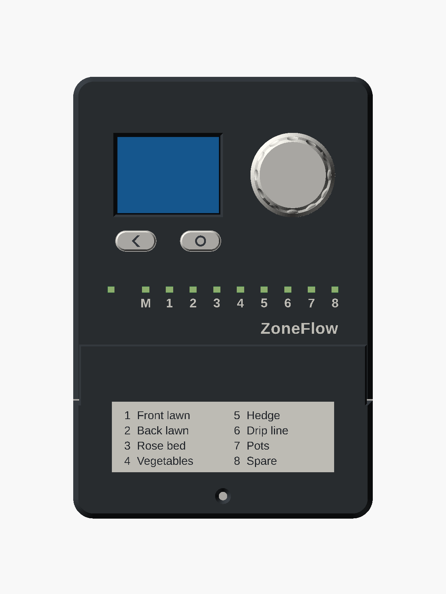

# ZoneFlow

Open-source controller for 24 VAC sprinkler valves: 8 zones plus a master
valve or pump-start relay, a colour display with a knob, WiFi and Bluetooth
LE, and no cloud service.

> **Status: designed on paper. Not built. Not tested.**
> No ZoneFlow board has been made, no part has been printed and no firmware
> has run on a board. Every figure in this repository is a design value, a
> calculation or a simulation result. **Do not order boards yet**: the PCB
> layout is finished and has had an independent review, but nobody has gone
> through the review's pre-order checklist, no sample display panel has
> confirmed the flat cable, and the owner has not decided to order. ZoneFlow
> has no safety, EMC or radio certification.

Documentation and manual: <https://syntroniks.github.io/zoneflow/>

## What exists

| Part | State |
|---|---|
| Circuit design | Written with calculations and simulations; two independent reviews (A1, A2) and the answers to the firmware's questions, findings resolved ([hardware design](docs/design/hardware-design.md)) |
| Schematic | KiCad 10, 20 pages, generated from `hardware/netlist.yaml`, ERC clean ([PDF](hardware/zoneflow-a/output/zoneflow-a-schematic.pdf)) |
| Bill of materials | LCSC number, stock and price on every line but the coin cell, checked 2026-11-10 and 2026-11-11 ([cost estimate](docs/hardware/cost.md)) |
| PCB layout | Revision A, 114 x 110 mm, four layers, routed, DRC clean; [independently reviewed](docs/design/hardware-layout-review.md); fabrication files in `hardware/zoneflow-a/output/`. Not ordered: the [pre-order review](docs/hardware/review/index.md) by a person is open ([#11](https://github.com/syntroniks/zoneflow/issues/11)) |
| Enclosure | Parametric OpenSCAD model, 8 printed parts, STL and 3MF exports, and a printable test-fit kit generated from the board file; not printed |
| Standalone firmware | ESP-IDF; web interface, REST API, MQTT, OTA, display menus; host-tested and run in a soak simulation, never run on a board |
| ESPHome package | Compiles for the board; host-tested, never run on a board |
| Browser demo | The standalone firmware compiled to WebAssembly on simulated hardware: <https://syntroniks.github.io/zoneflow/try-it/>. A simulation, not a test of hardware |
| Release tooling | Web installer, release workflow, `zfflash`; no release yet |

## Features, as designed

- 8 zone outputs and 1 master-valve or pump-start output, 24 VAC, 0.5 A each continuous; a 4-zone build of the same board
- Powered from one Class 2 sprinkler transformer; input designed to survive 32 VAC
- Valve current measured: open valve, shorted valve, current with every valve off and loss of 24 VAC reported in plain words
- Hardware fail-safe: two keep-alive detectors and a relay in the valve common turn the valves off within about a second if the firmware stops
- Rain sensor, flow meter (with leak alarm) and spare inputs; current-limited 5 V supply for powered meters
- 2.0 inch colour display, rotary encoder and two buttons, one light per output
- Real-time clock with a CR2032 cell: schedules run without a network
- Two firmware options: standalone (ESP-IDF) or ESPHome
- 3D-printable indoor wall-mount enclosure with a separate wiring compartment

## Repository layout

| Path | Contents |
|---|---|
| `docs/` | Documentation site source (MkDocs): the user manual, and design documents in `docs/design/` |
| `docs/design/system-spec.md` | System specification, the source of truth |
| `hardware/` | KiCad project, netlist, pin map, BOM, simulations |
| `firmware/zoneflow-fw/` | Standalone firmware (ESP-IDF) and its web interface |
| `firmware/esphome/` | ESPHome package and its external components |
| `enclosure/` | Parametric enclosure source and print files |
| `tools/` | Build, release and documentation scripts |
| `mkdocs.yml`, `pyproject.toml`, `uv.lock` | Site configuration and pinned docs dependencies |

## Follow and contribute

- Progress log: [issue #1](https://github.com/syntroniks/zoneflow/issues/1)
- Status and roadmap: <https://syntroniks.github.io/zoneflow/status/>
- How to contribute: [docs/contributing.md](docs/contributing.md). Reviews of the circuit, the layout and the firmware help most now.

## Licences

Hardware and enclosure: CERN-OHL-P-2.0 (`hardware/LICENSE`,
`enclosure/LICENSE`). Documentation: CC-BY-4.0 (`docs/LICENSE`). Firmware,
tools and everything else: Apache-2.0 (`LICENSE` at the root). Material from
other projects keeps its own licence:
[third-party material](docs/third-party.md).
