# Display interface

Status: **first implementation, never run on a panel.** No hardware exists.
Every picture on this page is output of the desktop simulator, which runs the
firmware's display code on the real controller core with fake hardware. What
has been checked is listed in [section 12](#12-what-is-verified). Colours,
brightness, drawing speed and the feel of the encoder need a board.

The display has its own pins on the rev A board (`hardware/pinmap.yaml`):
SPI2 clock, data and chip select, data/command, reset and backlight. Every
build starts it.

This document covers the local interface of the standalone firmware
(system spec sections 3.1 and 4.1): what each screen shows, how the controls
work, how it looks and why. The code is in
`firmware/zoneflow-fw/components/zf_display/` and the simulator in
`firmware/zoneflow-fw/sim/`.

## 1. What it has to do

The project owner looked at existing open controllers and found the screens
too small and the interfaces weak. The local interface is a reason to choose
this controller, so it gets a 320x240 colour panel and has to use it well.

| Given | Consequence |
|---|---|
| 320x240 IPS TFT, 2.0 to 2.4 inch, no touch | Everything goes through three controls. Text has to be large. |
| Rotary encoder with push switch, Back button, Manual/Home button | One-dimensional navigation: turn moves, press selects. |
| Wall of a garage, viewer about half a metre away | State readable without bending down; the state of the valves readable from further. |
| It switches water | The screen shows what the core reports, never its own guess. Stop is always close. |

### How large is large

The panel has 400 pixels on the diagonal (the square root of 320² + 240²), so
the pixel pitch is the diagonal divided by 400: 0.152 mm at 2.4 inch and
0.127 mm at 2.0 inch. Letter heights below were measured in the simulator's
output (capital letters and digits, in pixels) and converted with those
pitches. The angle is the height seen from 500 mm, in minutes of arc
(height / 500 × 3438).

| Font | Used for | Height | 2.4 inch | 2.0 inch |
|---|---|---|---|---|
| Montserrat 48 | time left, next start, picker values | about 32 px | 4.9 mm, 34' | 4.1 mm, 28' |
| Montserrat 28 | zone name, headline | 20 px | 3.0 mm, 21' | 2.5 mm, 17' |
| Montserrat 20 | lists, buttons, clock | 14 px | 2.1 mm, 14' | 1.8 mm, 12' |
| Montserrat 16 | second-rank lines, hints, section labels | 12 px | 1.8 mm, 12' | 1.5 mm, 10' |

Nothing is smaller than the 16 px font. From 3 m the large numerals subtend
about 5' on the 2.4 inch panel, which is the size of a letter on the 20/20
line of an eye chart: the countdown and the colour of the state chip can be
made out from across a garage, the rest cannot. A 2.4 inch screen does not
do better than that, and this design does not pretend it does.

## 2. Controls

| Control | Action | Does |
|---|---|---|
| Encoder | turn | Moves the focus. In a picker, changes the value. |
| Encoder | press | Selects the focused item. In a picker, confirms. |
| Back | press | One level up. In a picker, cancels. |
| Back | hold | Repeats every 0.4 s: climbs out of the menus. |
| Manual/Home | press | On Home: opens Manual run. Elsewhere: goes Home. |
| Manual/Home | hold 0.8 s | Stops all valves, from any screen. |

Rules that hold everywhere:

- **Focus is a white bar.** The focused row or button is drawn dark on
  white. Nothing else on the screen is white-filled except the value a
  picker is changing.
- **Lists do not wrap.** Turning past the end stops, so the user can spin to
  the top or bottom without looking.
- **The first input only wakes.** With the backlight dimmed or off, the
  first turn or press lights the screen and does nothing else.
- **The safe answer is focused.** Questions that erase something open with
  Cancel focused.
- **Idle screens go Home.** After 90 s without input the display returns to
  Home, unless a program has unsaved edits or the setup wizard is running.

The encoder press acts when the switch closes, not when it opens, so the
most used control has no delay. Only Manual/Home waits for the release,
because it has to tell a press from a hold.

Acceleration applies in value pickers only. Slow turning gives one step per
detent. Above 14, 28 and 50 detents per second a step counts 2, 5 and 10
times, so a run time of 45 minutes is a flick and one minute more is one
click. A pause of 0.3 s or a change of direction drops back to single steps.
These thresholds are a first guess to tune on real hardware.

## 3. Screen map

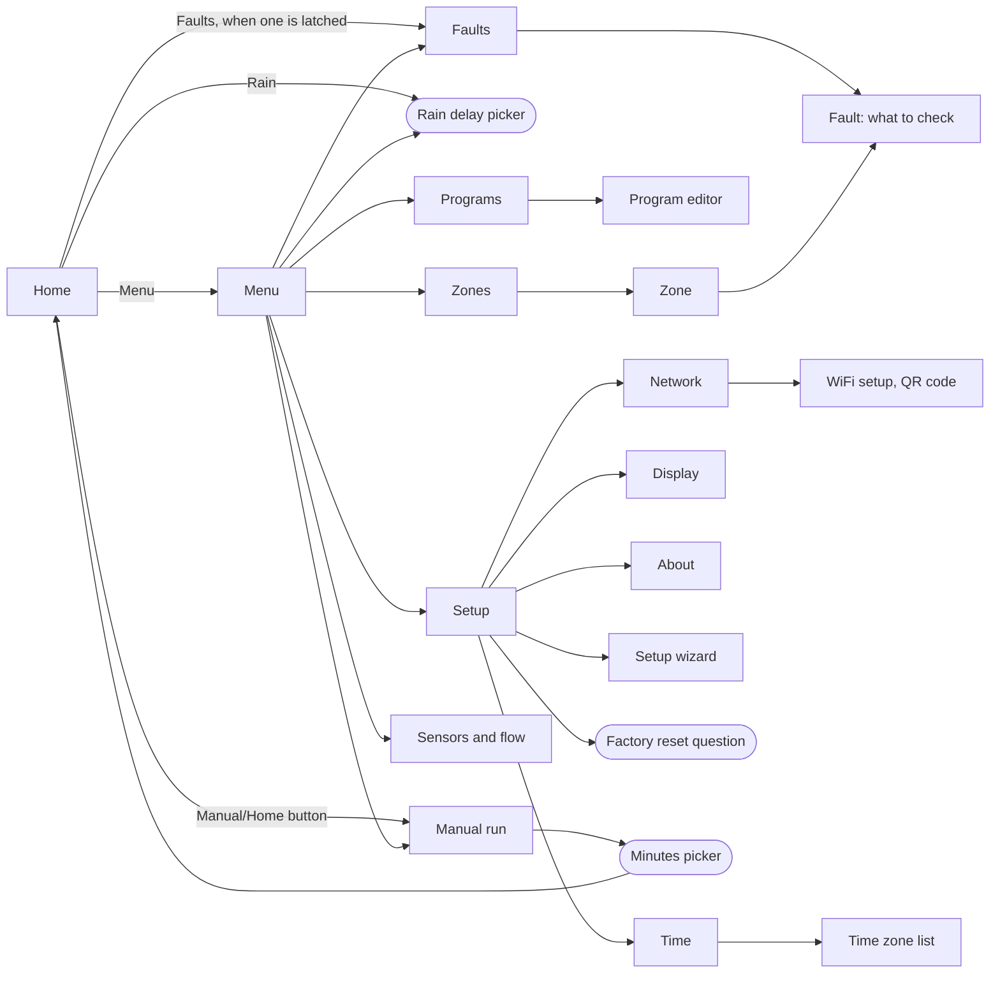

The deepest value is three screens from Home (Menu, Programs, a program).
All settings of a program are on that one screen.

There are three kinds of screen and one overlay, and every screen is one of
them:

| Kind | Used for |
|---|---|
| Home | The dashboard. |
| List | Rows that take focus, section labels, read-only lines. Five rows are visible; a bar on the right shows the position in longer lists. |
| Detail | An icon, a headline, a paragraph, up to three buttons. Questions, fault explanations, wizard pages, the QR code. |
| Picker | Covers the content area while a value is edited. Large numerals, one line that says what turning and pressing do. |

## 4. Home

Home answers, top to bottom: is water running, where and for how long, what
comes next, is anything holding the schedule back, and is anything wrong.

| Idle | Watering, program | Watering, one zone |
|---|---|---|
| 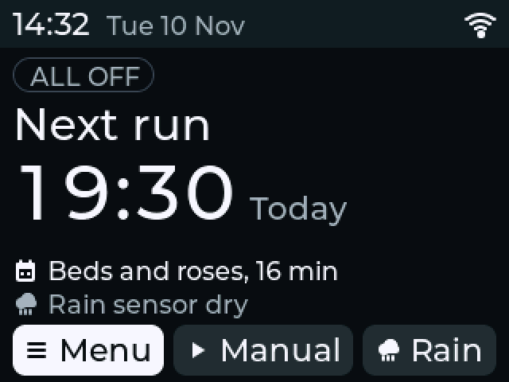{ width="300" } | 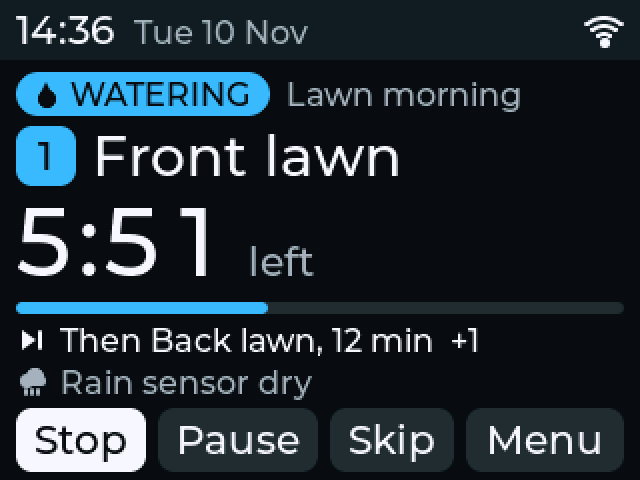{ width="300" } | 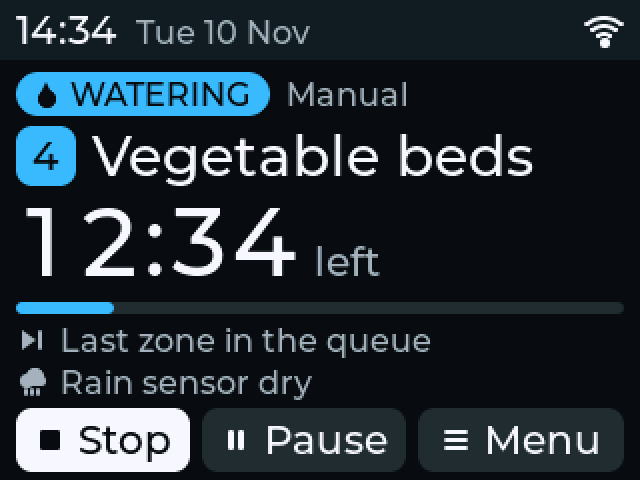{ width="300" } |

| Part | Idle | Running |
|---|---|---|
| Status bar | Clock, date, WiFi, rain hold, fault mark | the same |
| State chip | `ALL OFF`, outlined and grey | `WATERING`, filled blue, with the program name or "Manual" |
| Headline | "Next run" | Zone number and name |
| Numerals | Next start time, with "Today", "Tomorrow" or the weekday | Time left |
| Bar | none | Share of this zone's run that is done |
| Line 1 | Program that runs next and its total time | What is queued next, and how many more |
| Line 2 | Rain delay, rain sensor, missing supply | the same, or a fault |
| Buttons | Menu, Manual, Rain | Stop, Pause, Skip (if something is queued), Menu |

The chip always states the valve state the core reports, in words. It is
filled only when something is open or held, so a filled chip at the top of
the screen means "look".

Other states:

| Paused | Rain delay | Rain sensor wet |
|---|---|---|
| 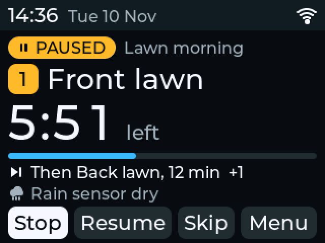{ width="300" } | 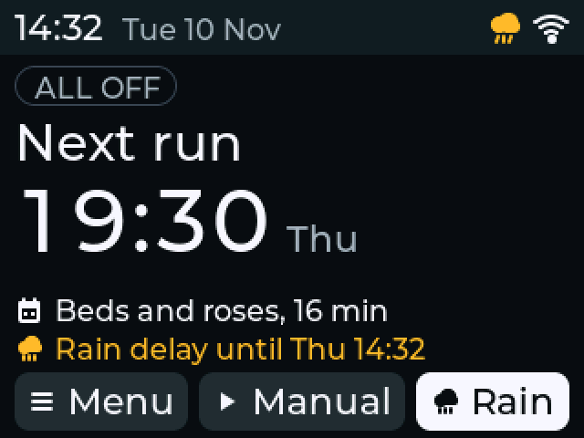{ width="300" } | 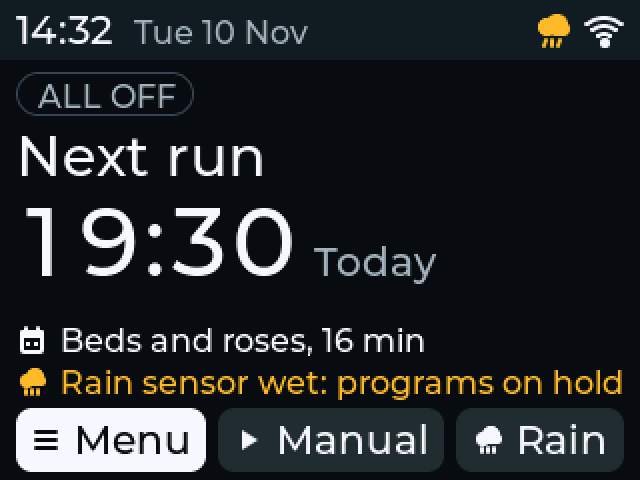{ width="300" } |

| Fault, nothing running | No 24 V AC | Clock not set |
|---|---|---|
| 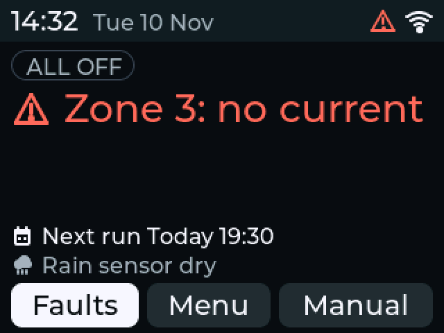{ width="300" } | 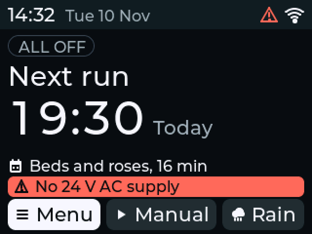{ width="300" } | 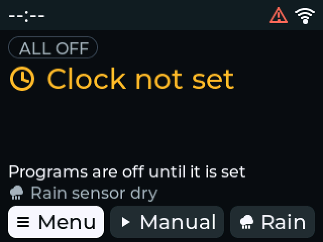{ width="300" } |

- **Fault with nothing running.** The fault becomes the headline, in red
  with a warning triangle, the next run moves to line 1, and the first
  button is Faults. One press shows what to check.
- **Fault while a program runs.** The running zone stays the headline and
  the fault is a red band on line 2. Stop stays the first button.
- **Dimmed.** The same picture at a fifth of the set brightness.

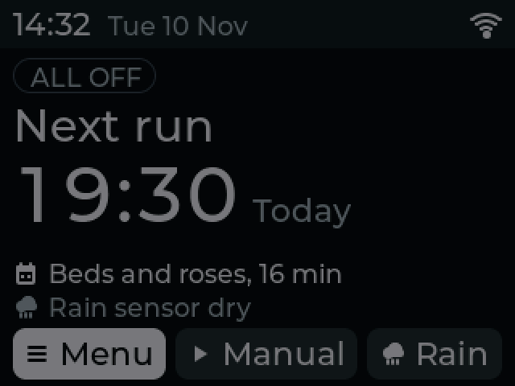{ width="300" }

The dimmed picture is an illustration: the simulator darkens the image, it
does not model a backlight.

### Next run

The scheduler decides what runs but does not publish what it will do next.
The display works it out from the same configuration with the core's own
time zone code (`zf_ui/next_run.hpp`). It skips starts inside a rain delay,
because the scheduler will. It cannot know whether the rain sensor will be
wet at that time. If the scheduler published its next start in
`SystemState`, the display would show that instead.

## 5. Manual run and Stop

**Three inputs from Home start a zone.**

| 1. Manual/Home button | 2. Press on a zone | 3. Press on the minutes |
|---|---|---|
| 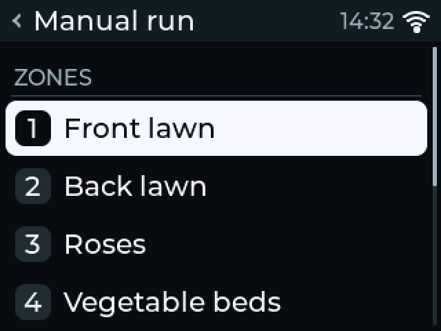{ width="300" } | 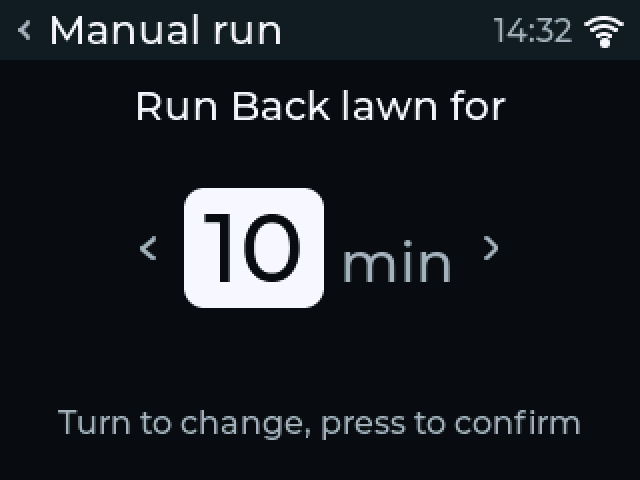{ width="300" } | { width="300" } |

The list opens on the zone that was run by hand last and the picker on the
minutes used last, so repeating the usual run is button, press, press.
Turning before a press picks another zone or another time. The third press
starts the run and returns Home. Programs are in the same list under the
zones; a program asks "Run now?" once, which is also three inputs.

If the 24 V supply is missing, the master valve is locked out or an update
is running, the core refuses to open valves. The list then says so and no
row can be chosen. A zone that reached its longest run rests for a while;
its row shows "Resting" and the time left, and cannot be chosen either. If
the core still refuses a run, the display shows the core's reason ("Not
started: zone is resting") in place of the "started" message.

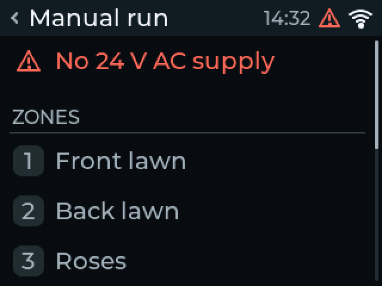{ width="300" }

**Stop.**

- **On Home, one press.** Whenever a valve is open or a run is queued, Stop
  is the first button and has the focus. Focus returns to it when a run
  starts and when the screen dims.
- **Anywhere, one hold.** Holding Manual/Home for 0.8 s stops everything
  and leaves the user where they were.
- **Asleep, one more.** With the backlight off the first input only wakes,
  so Stop is the second input. This follows from the wake rule in the
  brief; I would rather have a hold of Manual/Home stop even from a dark
  screen, and it is one line to change.

On every other screen the status bar shows a blue chip with the zone number
and the time left while a valve is open, so no screen hides that water is
running.

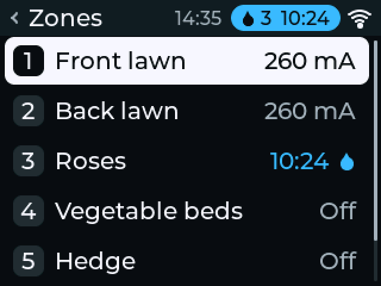{ width="300" }

## 6. Zones

| Zones | A zone | A zone with a fault |
|---|---|---|
| { width="300" } | 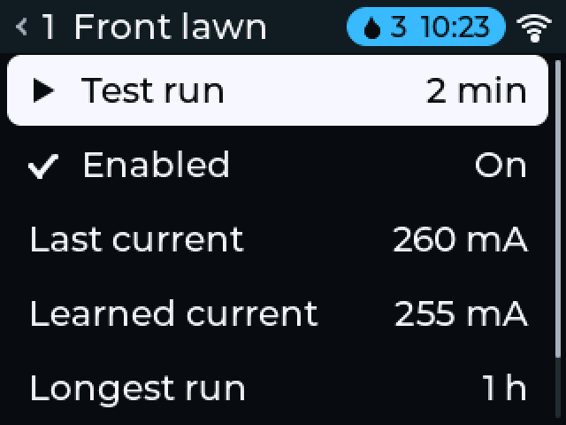{ width="300" } | 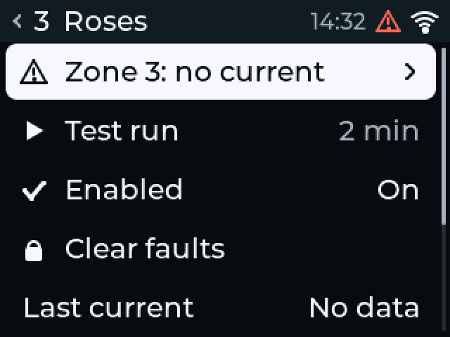{ width="300" } |

The list shows each zone's state: the time left if it runs, `Fault` or
`Locked` if it has a problem, `Disabled`, or else the current it drew the
last time it ran. A zone's screen has a test run (1 to 10 minutes), the
enable switch, its last and learned current, its longest allowed run, and
`Clear faults` when there is something to clear. Names are set in the web
interface; typing a name with an encoder is not worth building.

Two things here are less than they look:

- **Last current** is the total valve current while that zone ran alone, as
  the board measures one current for all outputs. With a master valve it
  includes the master's share. The display keeps it in RAM only.
- **Learned current** needs a value the core has but does not publish
  (section 11). Until then it reads "No data".
- **Clear faults** clears every latched fault. The core has no per-zone
  clear.

## 7. Programs

| Programs | A program | Lower down |
|---|---|---|
| 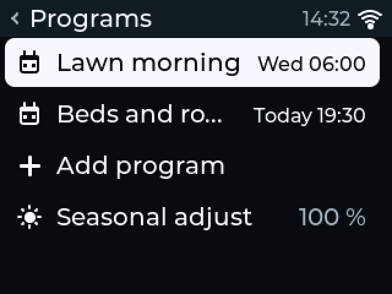{ width="300" } | 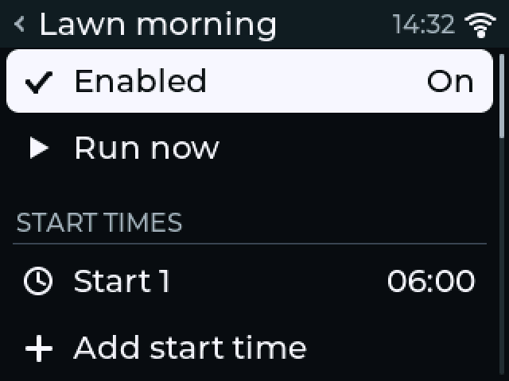{ width="300" } | 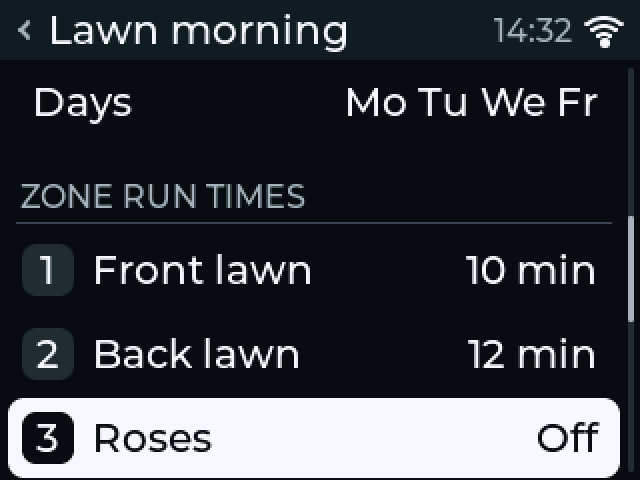{ width="300" } |

The list shows when each program starts next. A program's screen holds
everything about it in one scrolling list: enabled, run now, up to four
start times, the day rule, a run time for every zone, seasonal adjust, the
rain sensor, delete. Every value is edited the same way: press the row, turn,
press.

| Start time, hours | Start time, minutes | Run time |
|---|---|---|
| 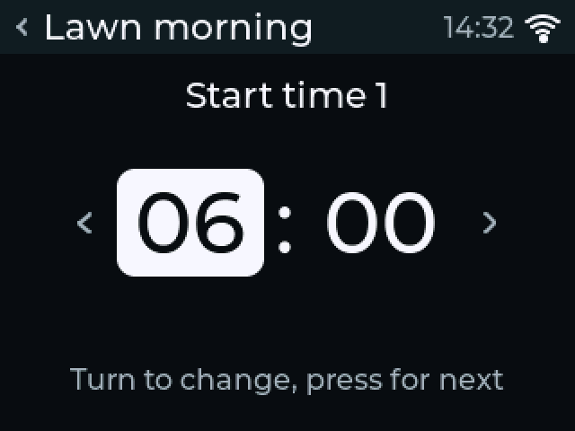{ width="300" } | 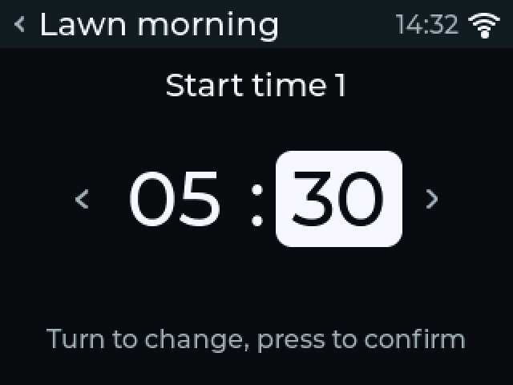{ width="300" } | 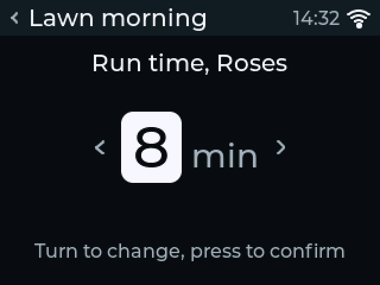{ width="300" } |

| Day rule | Weekdays | Seasonal adjust |
|---|---|---|
| 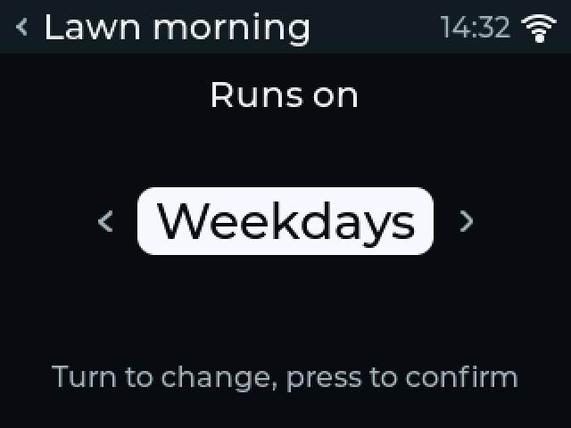{ width="300" } | 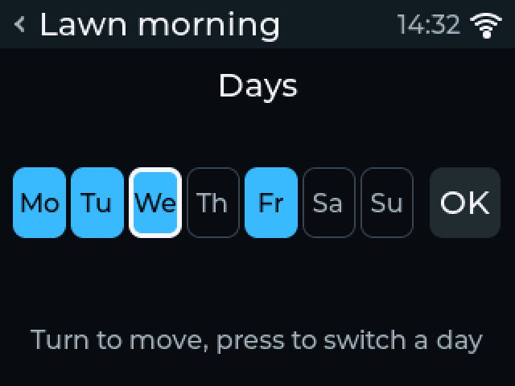{ width="300" } | 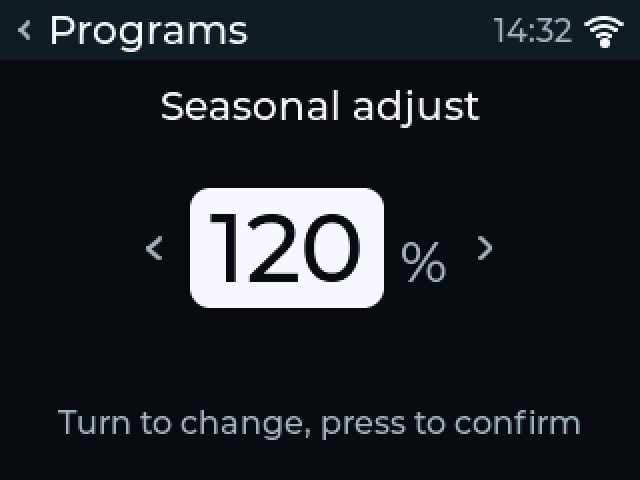{ width="300" } |

- **Start time.** Hours, press, minutes in steps of five, press. Turning
  the hours below 00 gives "Off", which removes that start. Start times stay
  sorted and a time entered twice counts once.
- **Day rule.** Weekdays, Interval, Odd dates, Even dates. Weekdays opens
  seven cells: turn to move, press to switch a day, press OK. Interval
  counts from the day it is set, so "every 3 days" set today runs today's
  later starts and then in three days.
- **Run time.** Whole minutes, accelerated, "Off" at zero, limited to the
  zone's longest run.
- **Seasonal adjust.** One percentage for all programs, in steps of 5, set
  from the program list. A program can opt out.

Nothing is written while editing. Leaving a changed program asks once:

| Save question | Delete question | New program |
|---|---|---|
| 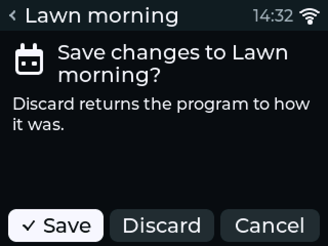{ width="300" } | 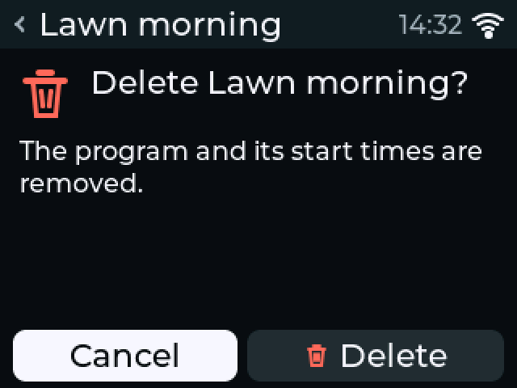{ width="300" } | 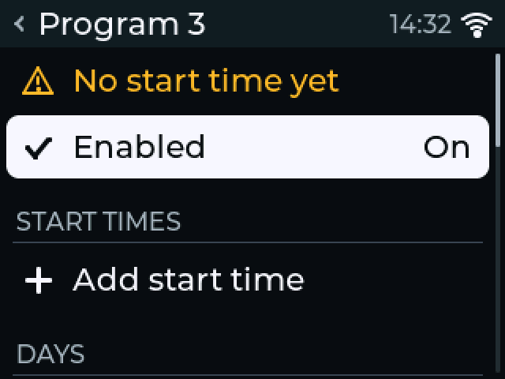{ width="300" } |

Save is focused, because the user just made those changes on purpose. Delete
opens on Cancel. I chose a question on leaving over saving each value at
once: a schedule should not change because someone brushed the knob, and the
cost is one press per editing session. A program that cannot run by itself
(no start time, no zone, no day) says so at the top of its screen and can
still be saved.

The core validates every save. If it rejects one, the display shows the
core's reason and stays in the editor.

## 8. Rain delay, sensors, faults

| Rain delay | Sensors and flow | Faults |
|---|---|---|
| 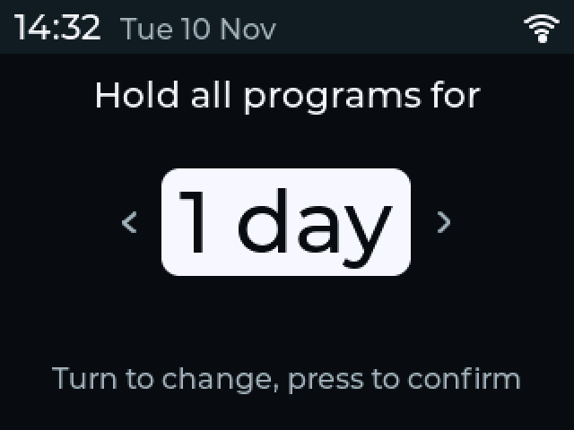{ width="300" } | 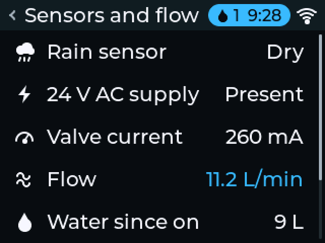{ width="300" } | 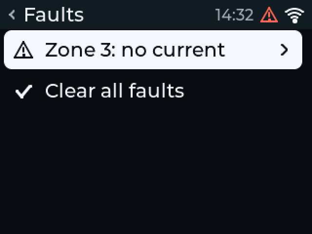{ width="300" } |

**Rain delay** is two inputs from Home: the Rain button, then a press on
Off, 6 h, 12 h, 1, 2, 3, 5, 7, 10 or 14 days. It opens on one day, or on the
delay that is running. Home then shows until when, and the next run moves
past the delay.

**Sensors and flow** is read-only: rain sensor, 24 V AC supply, valve
current, flow rate, water counted since power-on, the valve board's state,
master valve, spare input.

**Faults** lists what is wrong, one row per fault. A row opens the
explanation:

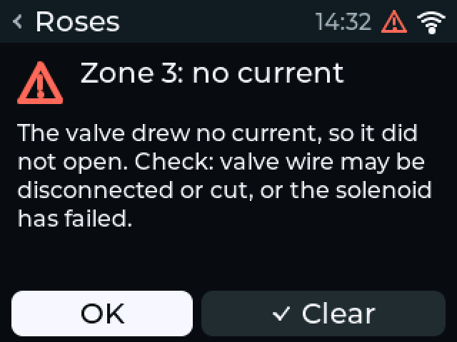{ width="300" }

Each text says what happened, then what to check, in words a homeowner
uses. No codes.

| Fault | Headline | Text |
|---|---|---|
| Open circuit | Zone 3: no current | The valve drew no current, so it did not open. Check: valve wire may be disconnected or cut, or the solenoid has failed. |
| Over-current | Zone 3: current too high | The zone was switched off and locked. Check: damaged solenoid, or two valves on one terminal. |
| Short circuit | Zone 3: short circuit | All valves were switched off and this zone is locked. Check: the zone wire may touch the common wire. |
| Current while idle | Current with all valves off | A valve output may be stuck on. If water is flowing, unplug the 24 V supply. The board needs service. |
| Supply lost | No 24 V AC supply | Valves cannot open. Watering resumes when power returns. Check: transformer plugged in, fuse, supply wires. |
| Leak | Water flows with all valves off | The flow meter counts water although nothing is running. Check: a leak, or a valve that does not close. |
| Config invalid | Settings could not be read | The stored settings were rejected and defaults are in use. Set up zones and programs again, or restore a backup. |
| Clock invalid | Clock not set | Programs do not start until the time is known. Connect WiFi, or set the time under Setup, Time. |
| Storage error | Settings could not be saved | Writing to memory failed. Try again. If it keeps failing, the board needs service. |
| Master lockout | Master valve locked | The master valve failed several times in a row, so no zone can run. Check: master valve wiring and solenoid. Then clear the fault. |
| No current reading | Valve current not measured | The board gets no current reading. Zones still run, but a broken or shorted valve is not noticed. If it stays, the board needs service. |
| Hardware trip | Protection tripped | A short made the board switch all valves off for a moment. The other zones carry on. A zone with three trips in a day stays off. Check: valve wires touching each other or the common wire. Then clear the fault. |
| Keep-alive detector | Safety circuit failed its test | The circuit that turns the valves off if the controller stops failed its self-test. Nothing runs. Repair the board, then confirm it here. |
| Expander | Valve driver not responding | The chip that drives the valves did not answer or did not read back what was written. All valves were switched off. Clear the fault to try again. If it comes back, the board needs service. |
| Welded relay | Valve relay stuck closed | Current flowed although the valve relay should have been open: a welded relay contact or a bridged jumper. Nothing runs. The board needs service. |
| Shorted output | Valve output stuck on | Current flowed with every valve off: a valve output on the board is shorted. The relay was opened and nothing runs. The board needs service. |
| Latch stuck | Protection did not reset | The short-circuit protection stayed tripped after the valves were switched off. Nothing runs. Clear the fault to try again. If it comes back, the board needs service. |
| Sensor supply | Sensor supply overloaded | The 5 V terminal for sensors is overloaded or too hot. Check: sensor wiring and how much current the sensors draw (100 mA at most). |
| DC current | Zone 3: valve current lopsided | The valve current flowed in one direction only, so the output that drives it is failing. The zone was switched off. The board needs service. |
| Mains signal | Mains signal wrong | The 24 V AC timing signal is not at mains frequency. Zero-cross switching and current readings may be off. The board needs service. |

A failed self-test of the valve board (hardware design section 19.7) adds a
line with its step and check, for whoever repairs the board. When a
keep-alive detector failed (steps 1, 2 and 9), one press does not clear it:
the button is **Repaired**, and it asks again, with Cancel first, before it
confirms the repair. The full self-test then runs before any valve opens.
**Sensors and flow** shows the valve board's state on its own row.

| | | |
|---|---|---|
| 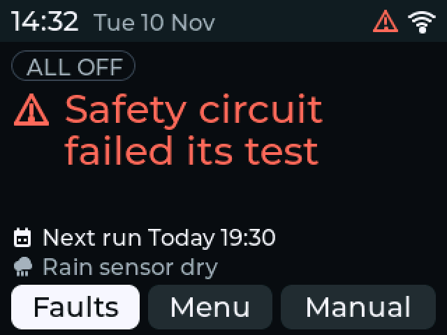{ width="300" } | 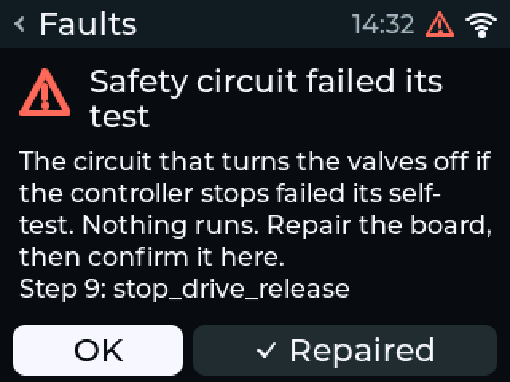{ width="300" } | 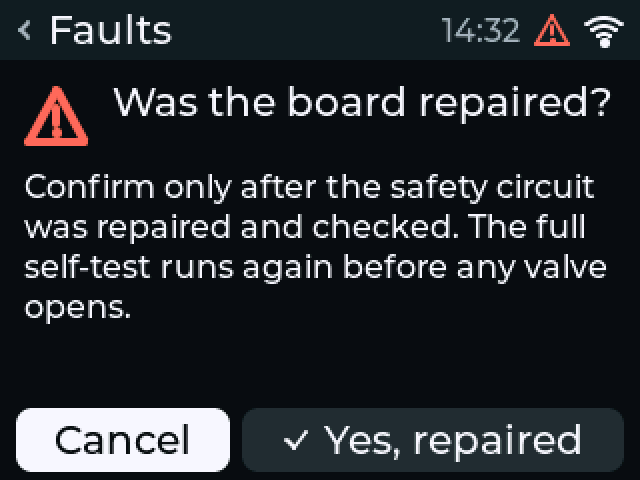{ width="300" } |
| 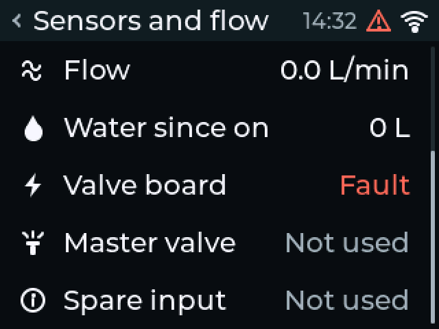{ width="300" } | | |

A zone-type fault that no zone carries belongs to the master valve and reads
"Master valve: ...". "No 24 V AC supply", "Clock not set" and "Valve current
not measured" clear by themselves and have no Clear button. A new latched
fault lights the screen.

## 9. Setup and the first-boot wizard

| Setup | Time | Display |
|---|---|---|
| 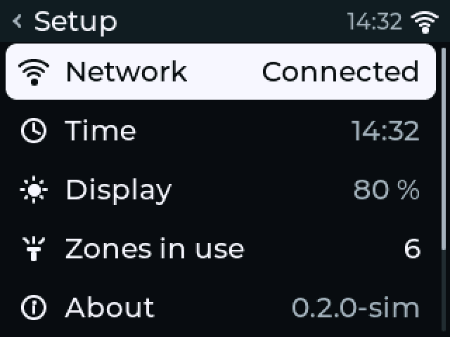{ width="300" } | 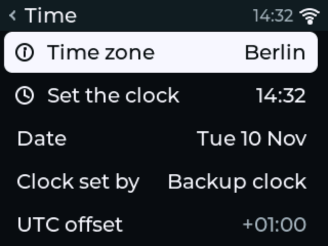{ width="300" } | 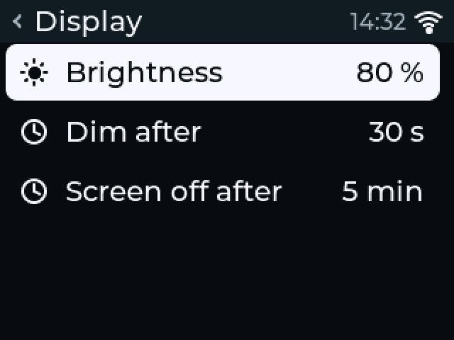{ width="300" } |

- **Network.** Link state, network name, address, signal, and "Set up
  WiFi", which shows the QR code for the Espressif BLE provisioning app
  while provisioning runs. On a device that is already on a network it
  cannot start provisioning yet (section 14).
- **Time.** Time zone from a list of 34 zones (cities and UTC offset), the
  clock by hand (date, then time), and where the clock came from.
- **Display.** Brightness, which follows the knob while it is being set, the
  time until the screen dims and the time until it goes dark.
- **Zones in use.** How many of the eight outputs are wired.
- **About.** Firmware, board, device name, ESP-IDF and LVGL versions.
- **Factory reset.** One question, Cancel focused.

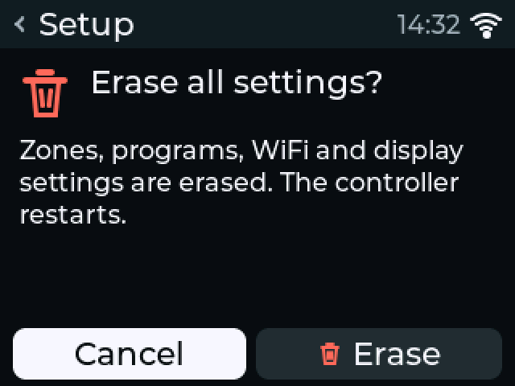{ width="300" }

The wizard runs on first boot and after a factory reset:

| Welcome | 1. Time zone | 2. WiFi |
|---|---|---|
| 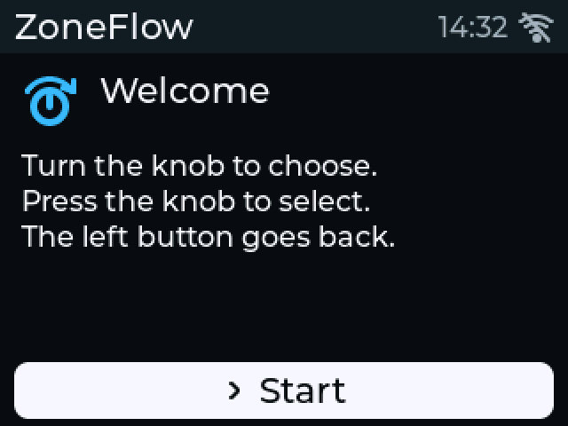{ width="300" } | 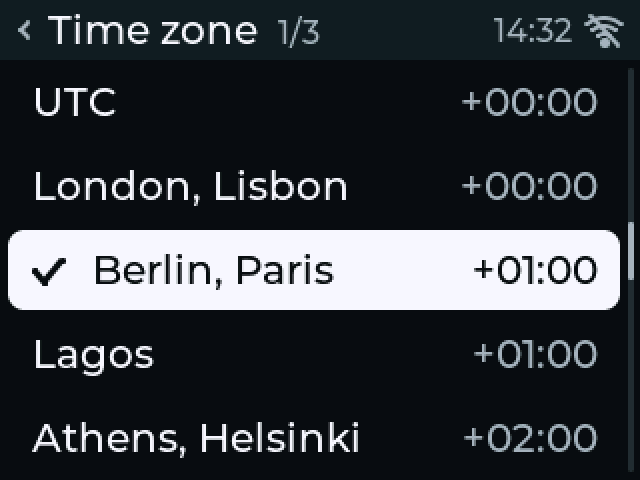{ width="300" } | 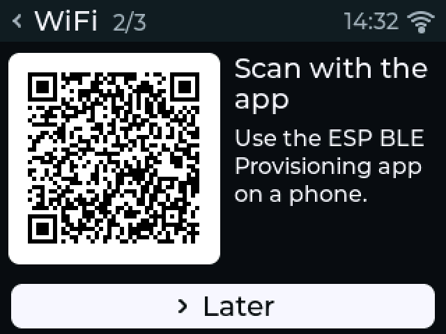{ width="300" } |

| 3. Zones in use | Done |
|---|---|
| 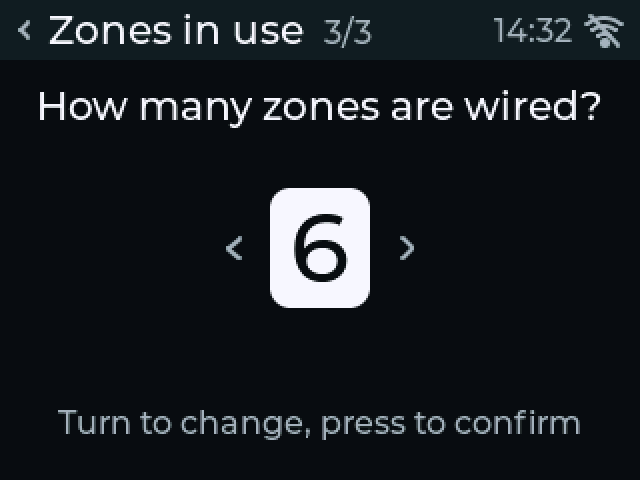{ width="300" } | 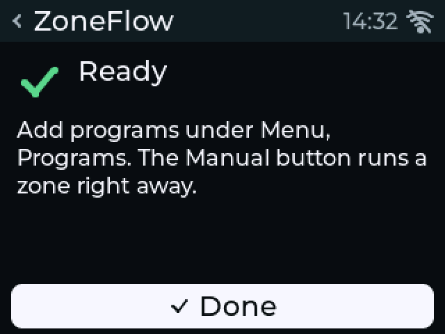{ width="300" } |

Back goes one step back. Manual/Home does nothing until the wizard is done.
WiFi can be skipped ("Later"), and the step is left out in a firmware build
with no network module. The valves work throughout; a manual run does not
need the wizard.

The wizard leans on things that need no reading: a knob pictogram, a step
counter, a list of city names, a QR code, a number. The three sentences on
the first page and the last are the exception. They are in the string table
like all other text.

The QR code is drawn with 3 px modules on a white card that is also its
quiet zone. On the 2.4 inch panel that is 0.46 mm per module (3 × 0.152).
Nobody has scanned it from a real panel yet.

## 10. Visual language

**Dark, flat, few colours.** A dark screen suits a garage and hides the glow
of an IPS panel at night. There are no gradients, shadows or animations. A
screen changes when the state changes.

| Role | sRGB | Contrast on the background | Meaning |
|---|---|---|---|
| Background | `#0A0E13` | | |
| Text | `#F2F5F8` | 17.7 | |
| Secondary text | `#A7B1BD` | 8.9 | labels, hints, values that are "off" |
| Focus | `#F2F5F8` fill, `#0A0E13` text | 17.7 | the one item the knob acts on |
| Running | `#3DB8FF` | 8.8 | a valve is open |
| Held | `#FFB829` | 11.2 | paused, rain delay, sensor, needs attention |
| Fault | `#FF6A5E` | 6.9 | a latched fault |
| OK | `#5BD68A` | 10.5 | saved, connected, no faults |

Contrast is the WCAG 2 ratio computed from these values. It says nothing
about how a given panel renders them.

**Colour is never the only signal.** Every coloured state also has a word or
an icon: the chip reads `WATERING` and carries a drop, a fault has a
triangle and a sentence, a selected weekday is a filled cell and an
unselected one is hollow. On the focused row all text turns dark, since the
red on white would only reach a contrast of 2.6. The row keeps its words and
icons, which is why they have to be enough.

**Type.** Montserrat in four sizes (section 1), shipped with LVGL under the
SIL Open Font License. Digits of the large numerals sit in cells of equal
width so a countdown does not shift sideways. That leaves the digit 1 with
more space around it than a typographer would like.

**Icons.** 26 icons, all original, drawn in code from lines, arcs,
rectangles and triangles on a 24-unit grid (`src/view/icons.cpp`). No icon
font and no bitmap is used. LVGL's Montserrat files also contain a few
FontAwesome symbols (LVGL's `LV_SYMBOL_*`); the display does not draw them.

**Wording.**

- Say what happened, then what to check.
- Use the user's words: "valve wire", not "load". No fault codes.
- No exclamation marks. A fault is stated, not shouted.
- 24-hour clock, metric units. Neither can be changed yet.
- Every string is in one table (`zf_ui/strings.hpp`, about 270 entries).
  A translation is a second table with the same ids. City names in the
  time zone list are proper nouns and stay as they are.

## 11. Safety

| Rule | How |
|---|---|
| The screen never says off while a valve is on. | Home is rebuilt from the core's `SystemState` on every change. The display keeps no copy of valve state and does not assume a command worked: after Stop the chip changes when the core reports the valve closed. |
| No data is not "off". | If no snapshot arrives for 5 s (the control task publishes at least once a second), Home shows `NO DATA`, "Controller not responding", and offers Stop. |
| Stop is close. | One press on Home, one hold anywhere (section 5). Stop needs no confirmation. |
| Destructive actions ask. | Delete program and factory reset ask, with Cancel focused. Leaving unsaved edits asks. |
| The display cannot exceed the core's limits. | Run times go to the core as commands and the core clamps them. The pickers also stop at the zone's limit so the user sees the real value. |
| A stuck display cannot hold a valve open. | The display has no access to the zone driver. It posts to `CommandQueue` like any other module. |

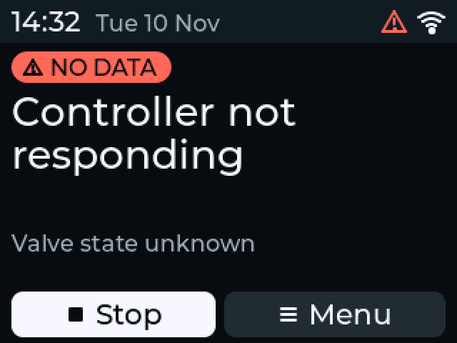{ width="300" }

The first rule has a test that feeds 3000 random inputs to the display and
checks after each one that an open valve is shown as open
(`UiNav.RandomInputsNeverShowOffWhileAValveIsOpen`).

## 12. What is verified

| Check | Covers |
|---|---|
| `test/host/run.sh` (GoogleTest, ASan, UBSan): 67 display tests | Button debounce, long press, repeat. Encoder detents, lost counts, counter wrap, acceleration. Every picker. Program editor and its mapping into the core configuration, through the stored JSON and back. Next-run forecast including rain delay and a start inside a DST gap. Every time zone entry parses. Navigation: three-input manual run, one-press stop, hold to stop, wake on first input, queue, pause, faults, rain delay, program edit with save, discard and delete, setup, clock, factory reset, wizard, a refused command, a resting zone, a pause that times out. |
| Simulator, `sim/run.sh --screenshots` | All 69 scenes draw and write a PNG. Each scene is reached with user inputs against the real controller core; the four valve-board scenes run it on the simulated rev A output stage of the host tests. |
| `idf.py build`, ESP-IDF v5.5.6, esp32s3 | Builds with no warnings, display included. |
| Looked at, by the author | All 65 pictures, three rounds. Found and fixed: buttons clipped with four in a row, list rows truncated, weekday labels cut by their frame, the fault too small on Home, no time shown while paused. |

Not checked, because it needs a board: the panel init sequence, orientation
and colour inversion, SPI at 15 MHz on the board's pins, PCNT counting with a
real encoder, backlight levels, drawing speed, PSRAM, the QR code under a
phone camera.

CI builds the simulator headless and regenerates the screenshots on every
pull request that touches the firmware. It fails if the build or a scene
fails. It does not compare pixels: a design change should not need a
baseline update to pass, and a reviewer should look at the pictures.

## 13. What is still weak

- **Home with a fault and nothing running** leaves a third of the screen
  empty under the headline.
- **Section labels cost a full row.** With six zones a program's screen is
  19 rows on a five-row window. It scrolls fast and stops at the ends, but
  it is long.
- **Long names are cut.** "Beds and roses" loses its last letters in the
  program list next to "Today 19:30". The start time drops to the small
  font first; the name is cut after that.
- **The time zone list is 34 rows** with no shortcut. It is used once.
- **Toasts cover the status bar** for three seconds, and with it the run
  chip on screens other than Home.
- **Some icons are weak at 22 px**: the sprinkler reads as a plug, the rain
  cloud is heavy. They were judged at 2x on a monitor, not on a panel.
- **No animation.** A picker replaces the list with no transition. I think
  that is right for a controller, but it has not been tried by a user.
- **Acceleration thresholds, long-press and repeat times** are guesses.
- **Weekday cells use the 16 px font**, the smallest text that takes input.
- **English, 24-hour and metric only.** The string table makes a translation
  possible. Right-to-left scripts and non-Latin fonts would need work in the
  view as well.
- **Colour choices have not been checked** against colour-blind vision
  beyond the rule that colour is never the only signal.

## 14. Interfaces the display needs from other modules

`zf::AppServices` covers zones, queue, sensors, faults, configuration and
the clock. What the display needs beyond that is behind narrow interfaces in
`zf_display/ports.hpp`, each with a stand-in in `zf_display/stubs.hpp`, so
the display builds, runs in the simulator and is tested without the owning
module. `zf::display::start()` takes the real implementations.

| Need | Owner | Interface | State |
|---|---|---|---|
| WiFi link state, network name, address, signal | `zf_net` | `INetworkPort::status()` | Wired to `net::status()` in `main/display_ports.hpp`. |
| The QR payload for the provisioning app | `zf_net` | `INetworkPort::startProvisioning()` | Wired to `net::setupInfo()`. Works while `zf_net` is provisioning, which is the case on a device with no credentials, when the wizard asks. |
| Start provisioning on a device that already has credentials | `zf_net` | the same | **Open.** `net::requestProvisioning()` restarts the device. The display does not do that on its own; "Set up WiFi" then says setup is not running and points to the web interface. Needed: either a way to start BLE provisioning without a restart, or a decision that the display asks "Restart to set up WiFi?" and calls it. |
| Factory reset | `zf_net` | `INetworkPort::factoryReset()` | Wired to `net::factoryReset()`, which stops watering, erases NVS and restarts. The display then does nothing more. |
| Per-zone learned current | `zf_core` | `IZoneDiagPort::learnedCurrentMa()`, from `CurrentMonitor::observedMa()` | **Open.** Stand-in; the zone screen reads "No data". |

The adapter in `main/display_ports.hpp` compiles and links. Like the rest of
the device side it has never run.

Wishes for `SystemState`, each of which would let the display drop a
workaround. None blocks anything.

| Wish | Workaround now |
|---|---|
| Next scheduled start | The display forecasts it from the configuration (section 4). |
| Time left of the queue head while paused | The display keeps the last value the core reported for that queue entry. |
| Per-zone last and learned current | Last current is tracked in the display's RAM; learned current needs the port above. |
| A per-zone `ClearFaults` | "Clear faults" clears all. |

Refused commands need no workaround any more: the core publishes
`CommandRejected`, `RunDropped` and `PauseExpired`, and the display shows
each as a message.

One note for the core's owner: GCC 16 at `-O2` reports `-Warray-bounds` in
`scheduler.cpp` (`zoneEnabled[z]` with `z < zoneCount`), which `-Werror`
turns into a build failure outside the unoptimised host tests. The simulator
build silences it for `zf_core`.

## 15. Open questions for the hardware team

1. **Pins.** Answered by `hardware/pinmap.yaml` (hardware design 19.3,
   questions 8 and 14): SPI2 on GPIO12, 11 and 10, data/command GPIO13,
   reset GPIO14, backlight GPIO21 (1 to 20 kHz; the firmware uses 5 kHz),
   Back GPIO18, Manual/Home GPIO39. The firmware drives chip select and
   reset. The SPI clock is 15 MHz, the ST7789V's guaranteed figure
   (hardware design 15.3), down from the 40 MHz placeholder. The encoder
   gives two counts per detent. The shared-pin build option is gone.
2. **Panel.** Which module, which controller revision, which orientation in
   the enclosure. Clock rate, SPI mode, mirror flags and colour inversion
   are placeholders in the board header.
3. **Encoder.** Detents per revolution and counts per detent. The firmware
   assumes four counts per detent.
4. **Backlight.** PWM frequency and polarity of the driver. The firmware
   uses 5 kHz, active high.
