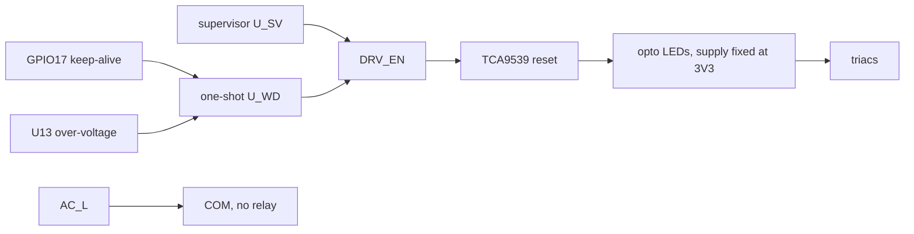
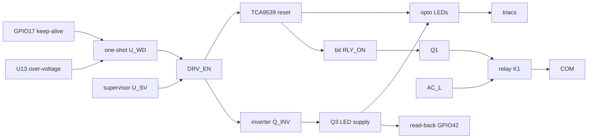
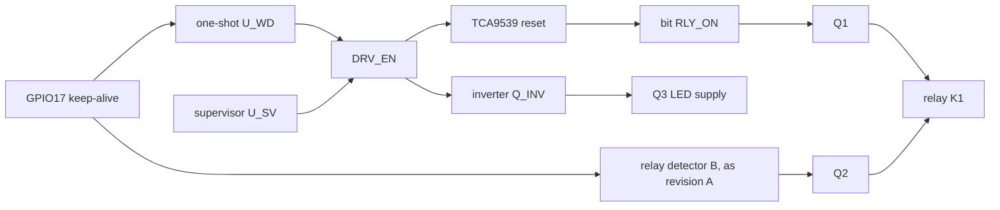
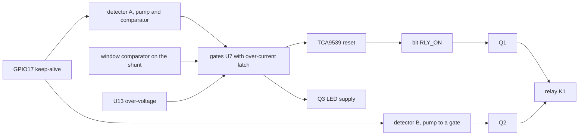

# Fail-safe reduction study

Status: **paper study, 2026-11-12. It changes nothing.** The specification,
the netlist, the board, the firmware and the enclosure are as they were.
Nothing here has been built or measured. Every figure is read from a
document, calculated from figures read from documents, or taken from a
simulation with behavioural models, and the text says which. Section 12
lists what the documents do not settle.

The owner asked for a review of this proposal, and added that the board will
need a watchdog:

> Tie the expander's reset to the ESP32's reset and rely on the chip's own
> watchdogs. Outputs drop on any crash or reflash.

## Summary

**The proposal as quoted does not do what it says.** The reset pin of the
module, `EN`, is an input. No reset that the chip makes for itself pulls it
low: not a crash, not a watchdog, not a brownout seen by the chip, not a
reflash over USB. An expander whose reset is tied to `EN` keeps its valve
bits through all of them. With the firmware as it is built, a crash is a
reset of the two processor cores only, and every pin keeps driving what it
drove. A valve that was open stays open until new firmware runs far enough
to close it, and stays open for good if the chip sits in download mode or
restarts in a loop. Section 2 has the evidence.

**The chip's own watchdogs do not fill the gap.** They restart the
processor in some hangs. They do not act on a task that hangs while the
others run, on a stopped clock, in download mode or under a debugger, and
they reset nothing outside the chip. Section 3.

**What does give "outputs drop on any crash or reflash"** is what revision A
already has in principle: firmware makes an edge on a pin every few
milliseconds, and a circuit that needs no firmware removes drive when the
edges stop. The expander's reset has to hang on that circuit, not on the
processor's reset. That circuit can be one chip. It does not have to be the
two discrete detectors of revision A.

**The variants.** Parts, cost and area are differences from revision A for
the 8-zone build, from `hardware/sim/study-failsafe-reduction/results/variants.md`.
Revision A has 313 soldered parts, 307 placed by machine and six through
the board, and costs 121.22, 70.57 and 53.71 USD per controller at 5, 25 and
100 by the cost model.

| Variant | What it is | Parts | USD per controller at 5 / 25 / 100 | Board area | What is no longer covered |
|---|---|---|---|---|---|
| As quoted | Expander reset on `EN`, internal watchdogs | not costed | not costed | not costed | A valve stays on through a crash, a restart loop, a reflash and a hung I2C bus. It is not a fail-safe. |
| V1 | One-chip detector resets the expander. No LED supply switch, no relay, no over-current latch | -32 | -1.01 / -0.86 / -0.76 | -436 mm² | A shorted triac, TVS or opto-triac leaves its valve on with nothing to stop it. A stuck expander does the same. One fault in the detector, then a crash, leaves a valve on. A dead short may cost a fuse. |
| **V2** | One-chip detector: expander reset, LED supply switch, relay on the expander bit | **-20** | **+0.33 / +0.21 / +0.12** | **-157 mm²** | One fault in the detector, then a crash in the same run, leaves a valve on. A dead short may cost a fuse. |
| V3 | V2 with the relay detector of revision A kept | -10 | +0.57 / +0.47 / +0.32 | -89 mm² | A dead short may cost a fuse. |
| V4 | Revision A | 0 | 0 | 0 | Nothing more than today. |

**What the numbers say first.** The whole fail-safe is a small part of this
board. Taking all of it down to V1 removes 32 of 313 parts, 3.5 % of the
board area and about one dollar. The one-chip variants that keep the relay
cost a little more than revision A, because one chip and a second supply
supervisor cost more than the twelve resistors, capacitors and diodes they
replace. If the aim is part count or cost, this is the wrong block to cut.
Issue #31 has the blocks where the parts are.

**Recommendation: V2, if the owner wants a smaller fail-safe at all.** It
keeps one answer to each kind of fault: the detector for dead firmware, the
LED supply switch for a stuck expander, the relay for a shorted output
device. It is off 0.14 to 0.29 s after the last edge in simulation, where
revision A takes 0.21 to 0.83 s, and at once when the supply sags. It removes
the second detector with its wide timing window, its read-back on an ADC pin
and most of the self-test procedure that goes with it. What it gives up, in
plain words:

- **The second layer.** In revision A no single component fault leaves a valve on after the firmware stops. In V2 two of the eleven faults I ran do: the timing capacitor shorted, and the chip's output stuck high. Firmware finds each at the end of the run or before the next one. A valve stays on only if the fault and a firmware crash fall in the same run.
- **The fast trip on a short.** Without the comparator and latch a dead short lasts until the PTC opens, 0.07 to 0.6 s by the design document's estimate, not 20 ms. By that same estimate it can open a fuse on a 40 or 75 VA transformer.
- **The relay detector that needs no supply rail.** Revision A opens the relay whatever the 3.3 V rail does. V2 needs a second supply supervisor to cover a rail that sags, and the one-shot's behaviour under 1.65 V is not in its data sheet.

If the owner will not give up the sentence "no single component fault" of
safety rule 3, the choice is V3 or revision A, and V3 saves ten parts. That
is not worth a new part type and a new analysis. Stay with revision A then.

Before any of this is trusted, a bench has to measure what section 11
lists, and somebody has to repeat the fault injection of review A2 on the
new circuit. Section 10 says where this study is weakest.

## 1. Scope, method and sources

I read the specification, the hardware design with its two reviews and the
answers to the firmware's questions, the prior-art survey and the safety
sections of the firmware architecture. For the chip I read Espressif's
documents and the source of ESP-IDF v5.5.6, the version the firmware builds
with. For the watchdog parts I read the makers' data sheets and took stock
and prices from the JLCPCB parts search on 2026-11-12. Section 14 lists
every document with its revision.

What I did not do is measure anything. No board exists.

Three reading rules for this document:

- **Reset names.** Espressif's manual names four reset levels: CPU Reset, Core Reset, System Reset, Chip Reset. ESP-IDF calls the manual's Core Reset a "system reset" and the manual's System Reset an "RTC reset". This document uses the manual's names.
- **Inference.** Where I join two documented facts to reach a third that no document states, the text says "inferred".
- **Not established.** Where the documents do not settle a point, the text says so and section 12 names the bench test.

Revision A today, for reference (hardware design sections 7 to 9):

- **Detector A**, a diode pump and a comparator on the keep-alive pin GPIO17. It makes `DRV_EN`, which switches the opto LED supply through Q3 and is the reset input of the TCA9539 expander. 13 parts.
- **Detector B**, a second diode pump on the same pin that ends at the gate of Q2, in series with the relay K1. It uses no supply rail. With K1, its drive and read-back: 19 parts in the block.
- **The over-current latch**, a window comparator and two NAND gates that remove `DRV_EN` 66 us after a short begins.
- **U13**, a detector that removes `DRV_EN` while `3V3` is above 4.04 V.
- **A self-test** in firmware that proves both detectors before and after every run.

## 2. What "expander reset tied to the ESP32 reset" does

### 2.1 The reset levels

The ESP32-S3 has four reset levels. The manual says what each resets
(Technical Reference Manual v1.8, section 7.1.3 and figure 7.1-1):

| Level | Resets | Manual's words |
|---|---|---|
| CPU Reset | One processor core | "CPU Reset: only resets CPUx core." |
| Core Reset | Both cores, the peripherals, the digital GPIOs. Not the RTC domain | "Core Reset: resets the whole digital system except RTC, including CPU0, CPU1, peripherals, Wi-Fi, Bluetooth® LE (BLE), and digital GPIOs." |
| System Reset | The above and the RTC domain | "System Reset: resets the whole digital system, including RTC." |
| Chip Reset | Everything | "Chip Reset: resets the whole chip." |

`EN` is the module's name for the chip pin CHIP_PU. Both data sheets type it
as an input: "I", "High: on, enables the chip. Low: off, the chip powers
off" (module data sheet v1.8, table 3-1; chip data sheet v2.2, table 2-10).
Table 7.1-1 of the manual lists every reset source the chip has, and every
one is an internal reset of one of the four levels. No document says that
any of them drives CHIP_PU. I take it that none does. That is inferred, and
it is item N1 of section 12.

### 2.2 What each event does on this board

The firmware builds with ESP-IDF v5.5.6. What that version does on an
ESP32-S3, read from its source:

| Event | Reset level | `EN` moves | Pins released | Source |
|---|---|---|---|---|
| `esp_restart()`, also the restart after an update | CPU Reset, both cores | no | **no** | `esp_system/port/soc/esp32s3/system_internal.c`, lines 146 to 162: ends in `esp_rom_software_reset_cpu()`. `esp_system.h` line 76: "Peripherals (except for Wi-Fi, BT, UART0, SPI1, and legacy timers) are not reset." |
| Panic, `abort()`, the default option | CPU Reset | no | **no** | `esp_system/port/panic_handler.c`, lines 321 to 330: `panic_restart()` calls `esp_restart_noos()`. The digital-core restart there is compiled for the ESP32 only. |
| Panic with the option "print and halt", or the GDB stub | none. The processor stops and every watchdog is disabled | no | **no** | `esp_system/panic.c`, lines 441 to 444 and 477 to 482 |
| Task watchdog, as this firmware configures it (`CONFIG_ESP_TASK_WDT_PANIC=y`, 5 s) | panic, so CPU Reset | no | **no** | `esp_system/task_wdt/task_wdt.c`, lines 374 to 383. `firmware/zoneflow-fw/sdkconfig.defaults` |
| Task watchdog, ESP-IDF default | none. It prints a warning and carries on | no | no | `esp_system/Kconfig`, `ESP_TASK_WDT_PANIC`, "default n" |
| Interrupt watchdog, first stage | panic, so CPU Reset | no | **no** | `esp_system/int_wdt.c` line 120, `highint_hdl.S` |
| Interrupt watchdog, second stage, if the panic handler could not run | Core Reset | no | yes | `int_wdt.c` line 122 |
| RTC watchdog, in the bootloader or a stuck panic handler | System Reset | no | yes | `bootloader_support/src/bootloader_init.c`, lines 70 to 100 |
| Brownout seen by the chip, as this firmware configures it | Core Reset, made by an interrupt handler | no | yes | `esp_hw_support/power_supply/brownout.c`, lines 44 to 83 |
| Bootloader finds no valid application | Core Reset, again and again | no | yes | `bootloader_support/src/bootloader_utility.c`, lines 592 to 626 and 1157 to 1163 |
| Reflash over USB: esptool enters download mode | Core Reset. `EN` and GPIO0 are not involved | no | yes | Manual table 7.1-1, code 0x15, and tables 33.3-2 and 33.4-3. esptool 4.13.0, `reset.py`, lines 124 to 142 |
| Download mode, while the host writes the flash | none. The ROM loader runs, no application | no | already released | Manual section 8.2 |
| `3V3` under the threshold of U12, the reset button, the pads of J8 | Chip Reset | **yes** | yes | Hardware design 12.4 |
| Power-up | Chip Reset | **yes** | yes | Chip data sheet 2.5.3 |

"Pins released" means that a pin the firmware was driving goes back to its
default, an input. For a Core Reset that rests on the manual's sentence
above. For a CPU Reset the opposite is inferred from two facts: the manual
says a CPU Reset resets the core only, and the restart code of ESP-IDF
writes no GPIO output or output-enable register. It is item N5 of section
12. The manual gives indirect support: it offers a "hold" function "to
retain the pin state through a core reset triggered by watchdog time-out"
(section 6.9), which would not be needed if a core reset kept the pins.

Two more facts about the pins:

- **Glitches.** At power-up GPIO17 and GPIO7 are each driven low for about 60 us (chip data sheet, table 2-2). That is the idle level of the keep-alive. The table is for power-up. Whether the same happens on other resets is not established, item N3.
- **Hold.** A pin with the hold function enabled keeps its level through a Core Reset. The firmware does not use the function today. A design that relies on a pin being released must never use it.

### 2.3 What follows for the wiring

| Wiring of the expander's reset | On a crash | On a reflash over USB | On a hang with no reset | Verdict |
|---|---|---|---|---|
| To `EN`, as quoted | A crash is a CPU Reset. `EN` stays high. The expander keeps every bit. | A Core Reset. `EN` stays high. The valve is on while the host flashes, and for as long as the chip sits in download mode. | Nothing happens. | Covers power-up, a low supply and the reset button. Nothing else. |
| To a GPIO held high by firmware, with a pull-down | The pin keeps driving high through a CPU Reset. The expander keeps every bit until new firmware pulls the pin low. A restart loop that never gets that far holds the valve on. | The Core Reset releases the pin. Off. | The pin stays high. Nothing happens. | A steady level cannot show that firmware is alive. Covers resets of Core level and above only. |
| To an external watchdog that also pulls `EN` | Off when the watchdog fires, 0.9 to 2.5 s after the last kick for the common parts. | The ROM loader does not kick. The watchdog pulls `EN` in the middle of the flash. A Chip Reset reads GPIO0 again, finds it high and starts the old application. The flash fails. | Off when the watchdog fires. | Does what the quote says, and breaks flashing unless the watchdog can be switched off. Section 4.3. |
| To a circuit that needs edges on a pin and acts on the expander only | The edges stop. Off after the circuit's time-out. | The pin is released, the edges stop. Off. The flash is not disturbed. | The edges stop. Off. | **This is what gives "outputs drop on any crash or reflash".** Revision A is this. So are V1 to V3. |

The last row has one condition, and revision A states it already (hardware
design 19.4): code that has just checked the control loop must decide each
edge. A peripheral that makes the edges by itself, such as LEDC, keeps
making them through a hang, and it survives a CPU Reset too. Neither the
restart code nor the start-up code of ESP-IDF resets LEDC
(`system_internal.c` lines 34 to 66, `clk.c` lines 300 to 334).

## 3. The chip's own watchdogs

### 3.1 What each one is

| Watchdog | Clock | What ESP-IDF and this firmware do with it | What it resets | Silent when |
|---|---|---|---|---|
| Main watchdog of timer group 1, used as the **interrupt watchdog** | The APB clock, from the PLL or the 40 MHz crystal (manual 13.2.2.1) | Fed from the tick interrupt of both cores. 800 ms with PSRAM. First stage a panic, second stage 1.6 s later a Core Reset (`int_wdt.c`, `Kconfig` lines 458 to 463) | Panic: the cores only. Second stage: the digital core | Interrupts still run. That is every hang of a task. Also when the APB clock stops, and under a debugger |
| Main watchdog of timer group 0, used as the **task watchdog** | The same | This firmware: 5 s, panic, watches the control task and the idle task of core 1 (`sdkconfig.defaults`). Its own interrupt feeds the hardware timer, so the second stage runs only if that interrupt cannot | Panic: the cores only | The watched tasks still run. A watched task that is stuck is found after 5 s |
| **RTC watchdog** | The RTC slow clock, by default the internal 136 kHz RC oscillator (manual 13.2.2.1 and 7.2.3) | On in the ROM and the bootloader, 9 s, System Reset. **Switched off just before the application starts** (`startup_funcs.c` lines 180 to 189). On again for 10 s inside the panic handler | Up to the RTC domain | The application runs, which is nearly always |
| **Super watchdog** | Its own analog circuit, a little under 1 s (manual 13.3) | The bootloader sets it to feed itself on every boot (`bootloader_esp32s3.c` lines 126 to 131) | The digital circuits | Always, for software. With automatic feeding no code has to run. What it still detects is not established, item N11 |
| **Brownout detector** | None. A comparator on the supply pins | This firmware: interrupt mode. The threshold option is labelled 2.44 V, and the source calls the labels estimates (`Kconfig.power` lines 14 to 39). The reset comes from an interrupt handler | Core Reset | The supply is between that level and the 3.0 V the chip needs. U12 covers that range from outside. Also while interrupts are masked |
| Crystal watchdog, clock glitch detector | | The first watches a 32 kHz crystal this board does not have. The second detects pulses shorter than 3 ns (manual 24.2.1) | | A 40 MHz crystal that stops. No document says anything detects that, item N9 |

Any code can switch off every one of them. The write keys guard against an
accidental write only. The manual calls them a mechanism that "prevent the
watchdogs from being disabled or tampered with due to an accidental write"
(13.2.2.3). And a USB
host is enough to switch two of them off: "OpenOCD will disable the hardware
timers of both the interrupt and task watchdogs at every breakpoint.
Moreover, OpenOCD will not re-enable them upon leaving the breakpoint"
(ESP-IDF, `wdts.rst`). On this board the debug adapter is the chip's own USB
port.

### 3.2 Failures that leave all of them silent

Each line names the facts it rests on. The outcome column is for a valve
that was open, with the expander's reset on `EN`.

| Failure | Why no internal watchdog acts | Valve |
|---|---|---|
| A task other than the watched ones hangs, or the control task spins but still calls the watchdog | The interrupt watchdog sees ticks. The task watchdog sees its tasks | Stays on. The maximum run time is firmware too |
| The 40 MHz crystal or the PLL stops | Both main watchdogs count the APB clock. The RTC watchdog is off in the application. Inferred. Not established what the chip does, item N9 | Stays on |
| Latch-up | No document mentions it, item N13 | Stays on until the power is cycled |
| A panic with "print and halt" configured, or a debugger attached | All watchdogs are disabled by the panic code or by OpenOCD | Stays on |
| The flash is corrupt and the bootloader is valid | The bootloader loops through Core Resets. Each one releases the pins. None pulls `EN` | Stays on |
| The application crashes at every start | Each crash is a CPU Reset. Rollback covers only the first start of a new image (ESP-IDF `ota.rst`) | Stays on unless each start gets as far as the expander |
| A hang inside a critical section | This one is covered. A critical section masks interrupts, the tick stops, and the interrupt watchdog panics after 0.8 s (ESP-IDF `wdts.rst`). The uncovered case is the opposite: a hang with interrupts running, where a timer interrupt would go on feeding any watchdog that does not ask whether the control loop is alive | On until the restart reaches the expander |
| A supply that sags but stays above the brownout level | The detector's level is about 2.44 V. The flash needs 2.7 V and the chip 3.0 V (module data sheet, table 6-8; chip data sheet, table 5-2) | U12 pulls `EN` at 3.02 to 3.14 V, and this is the one case where the wiring to `EN` does act |
| The chip waits in ROM download mode | No application runs. Which watchdogs run there is not established, item N14. esptool switches the RTC and super watchdogs off when it connects: "the RTC WDT and SWD watchdog are not reset and can then reset the board during flashing. Disable them." (`targets/esp32s3.py`, lines 331 to 347) | Stays on |
| A restart loop that opens a valve at each start | A valve needs a running keep-alive and two I2C writes. Boot code makes neither. It would take application code that runs that far and then crashes | With the reset on `EN`: on for as long as each start lasts |

### 3.3 Internal watchdogs against the detectors of revision A

**What the hardware detectors catch and the internal watchdogs do not.**
Every row of the table above. The detectors do not ask why the edges
stopped. A hung task, a stopped clock, a chip in latch-up, a halted
processor, a loader waiting for a host and an erased flash all look the
same: no edges, so no drive after the hold-up time. They also act on the
expander and the relay, which no internal reset reaches.

**What the internal watchdogs do and the detectors do not.** They restart
the processor, so the controller waters again tomorrow. The detectors
restart nothing. A controller whose firmware hangs with no watchdog firing
is safe and dead until someone cycles the power. That is true of revision A
today, and none of the variants changes it.

**What neither catches.** Firmware that is wrong but keeps making edges
that pass. Section 5 has that row.

## 4. A watchdog is required: the options

### 4.1 What the part has to do

The reading of the parts changed the question. Four things decide whether a
watchdog part can do this job:

- **Edges, not levels.** It must need activity on its input. Every candidate does.
- **What its output does when the processor is dead.** Most supervisors with a watchdog pulse their output low for about 200 ms and then let it go high again for a full time-out, over and over. With a dead processor the output of a TPS3823 is high for 75 to 95 % of the time. That suits resetting a processor. It cannot hold a relay or an LED supply off. It can reset the expander, because the expander forgets its bits at the first pulse and nothing writes them again.
- **What it does with an input that floats.** An ESP32 pin is high-impedance in reset and in download mode. The cheap parts treat a floating input as "watchdog switched off": TPS382x, MAX823, STM6823, CAT823, SGM823, APX823 and every 706 type. TI names the cure for the TPS382x, a 1 kohm resistor from the input to ground. The other sheets give none.
- **What it resets.** If it pulls `EN`, it must be kicked at all times, by a signal other than the keep-alive, which rests between runs. And it must not fire while the ROM loader writes the flash.

### 4.2 The candidates

Stock and prices are from the JLCPCB parts search on 2026-11-12, between
12:47 and 13:08. Every part is in the extended library. None is basic or
preferred. Timings are minimum / typical / maximum.

| Option | Part, LCSC number | Stock | USD at 1 / 100 | Time-out | Output with a dead processor | Floating input | Cannot catch |
|---|---|---|---|---|---|---|---|
| a. Internal watchdogs only | none | | 0 | 0.8 s and 5 s, for some hangs | No output. Nothing reaches the expander | | Section 3.2, all of it |
| b. Simple time-out, resets the processor | TI TPS3828-33DBVR, C20032, open drain. TPS3823-33DBVR, C7719, push-pull | 39,159 and 58,280 | 0.37 / 0.26 at 150, and 0.45 / 0.27 | 0.9 / 1.6 / 2.5 s, stated at 25 °C only | Low for 120 / 200 / 300 ms, then high for a full time-out, repeating | Makes its own pulses: watchdog off. 1 kohm to ground prevents that | A runaway that keeps kicking. Its own output stuck high |
| b. Simple time-out, faster | TI TPS3820-33DBVR, C130064 | 9,019 | 0.61 / 0.35 | 112 / 200 / 300 ms at 25 °C | Low for 15 / 25 / 37 ms, repeating | As above | As above |
| b. Simple time-out with a level output | MaxLinear SP706TEN-L/TR, C69492 | 8,048 | 0.42 / 0.25 | 1.00 / 1.60 / 2.25 s | WDO goes low and stays low until the next edge. A true level | Timer stopped, WDO stays high. No cure in the sheet | As above. Also a processor that never starts, for the first time-out |
| b. Watchdog only, with enable | ST STWD100NYWY3F, C46043 | 19,352 | 0.40 / 0.22 | 1.12 / 1.6 / 2.24 s | Low for 140 / 210 / 280 ms, repeating | Not a defined state. Needs a pull resistor | As above |
| c. Window, with supply supervisor | TI TPS3852H33DRBR, C2066812, VSON-8 | 3,176 | 1.66 / 1.20 | With 10 kohm on CWD: edges no closer than 2.2 ms and no further apart than 8.8 ms | WDO low for 170 / 200 / 230 ms, repeating. High about 5 % of the time | Must be driven. Needs a pull resistor | A runaway at a rate inside the window. Its own output stuck high |
| c. Window, small package | TI TPS3813K33DBVR, C93238 | 3,320 | 1.93 / 1.14 | Edges between 2.43 ms and 200 ms apart | One combined reset, low for 20 / 25 / 30 ms, high 73 to 94 % of the time | "Must be driven at all times" | As above |
| d. The discrete detector of revision A, single | 12 parts already on the board | | 0 | 0.21 to 0.83 s, 1.25 s if the pin stops high | A level | R33 holds the net | A runaway that keeps toggling. Fifteen component faults stick it on (hardware design 8.5, the rows "gate drive stays" that are not nets or leaks) |
| e. A retriggerable one-shot | Nexperia 74LVC1G123DP,125, C513291, TSSOP-8. TI SN74LVC1G123DCTR, C123302 | 3,442 and 8,164 | 0.56 / 0.33, and 1.09 / 0.81 | Set by a resistor and a capacitor. `tW = K x R x C`, K = 1 | A level. Low one pulse width after the last edge, and it stays low | A Schmitt input. Any pull-down holds it | A runaway that keeps toggling. Two of the eleven faults I ran stick it on, section 6.4 |
| e. Supervisor and watchdog in one part, in place of U12 | SGMICRO SGM820B-3.0XTDB8G/TR, C5152526, TDFN-8. Or the TPS3852 above | 3,981 | 1.40 / 0.78 | 170 / 200 / 230 ms with 10 kohm, or 1.36 / 1.6 / 1.84 s | Separate open-drain reset and WDO. WDO low for about 200 ms, repeating | "Cannot be left floating" | As the simple time-out |

Parts I looked at and dropped: the TPS3435 with a latched output behaves
as wanted and JLCPCB has 137 of it. The MAX6369 has pin-set time-outs down
to 1 ms and costs 1.34 USD at 100; I read its sheet from a mirror, not from
the maker. The Microchip MCP1316 to MCP1322 start their timer only at the
first edge, so a processor that never starts is never caught. The
windowed TPS3850 and TPS3430 have under 100 pieces each.

**The one-shot is option e for a reason.** It is the classic missing-pulse
detector, and it is the only stocked part whose output is a plain level
that I can use for all three jobs: the expander's reset, the LED supply and
the relay. The Nexperia sheet (rev 8, 14 August 2023) gives:

- **Pulse width.** "tW = K x REXT x CEXT", "K = constant = 1" for capacitors above 10 nF. At 10 kohm and 0.1 uF, 1.0 ms typical and 1.05 ms at most. It gives no minimum.
- **Retrigger.** "Retriggerable for very long pulses up to 100 % duty factor."
- **Inputs.** Schmitt trigger. Rising threshold 1.20 / 1.58 / 1.90 V at a supply of 3.0 to 3.6 V. Leakage 2 uA at most to 85 °C.
- **Supply.** 1.65 to 5.5 V, 6.5 V absolute. "Power-on-reset on outputs."
- **A trap.** A rising edge on the clear input while the trigger input is high also starts a pulse (function table).

### 4.3 Time-outs against what the firmware does

This matters for a watchdog that resets the processor through `EN`, options
b and c wired that way. A watchdog that acts on the expander only can fire
at any time and costs nothing but a closed valve.

| Phase | How long nothing can kick | Source | A watchdog on `EN` |
|---|---|---|---|
| ROM and bootloader | About 30 ms to the bootloader's first line in two logs of the ESP-IDF documents. The bootloader then verifies the whole image | `docs/en/security/esp32s3_log.inc`. The time on this firmware is not established, item N8 | Must not need a kick before the application runs |
| Start-up with the PSRAM test | "approximately 1 second per 4 MB of memory tested", so about 2 s for 8 MB | ESP-IDF `speed.rst`. `CONFIG_SPIRAM_MEMTEST` is on by default | A 1.6 s part fires in the middle of every start. It needs a start-up delay, a longer time-out or the test switched off |
| One flash erase command | A 4 kB sector: 70 ms typical, 500 ms at most. A 64 kB block: 0.3 s typical, 3 s at most. Tasks and ordinary interrupts stop for that long | Module data sheet v1.8, table 6-8. ESP-IDF `spi_flash_concurrency.rst` | Kicks from a task stop. Kicks from an interrupt handler held in RAM continue, as the keep-alive does today |
| An update over the air | `esp_ota_begin()` erases the whole partition unless told otherwise: 16 blocks per megabyte, 4.8 s typical and 48 s at most per megabyte, with one tick between blocks | `app_update/esp_ota_ops.c` lines 189 to 197 | A part of 2.5 s or less, kicked from a task, resets the chip in the middle of the update |
| Provisioning | Minutes. No valve runs and the keep-alive rests | Firmware architecture, section 12 | Needs its own kick signal, running whenever the board has power |
| Flashing over USB | The whole flash. The ROM loader kicks nothing | Section 2.2 | Fires and aborts the flash. See below |

**Flashing over USB with each option.**

- **Internal watchdogs only.** Flashing is not disturbed. esptool switches the RTC and super watchdogs off when it connects.
- **A watchdog on `EN`.** A chip held in reset cannot be flashed, and a watchdog that fires during the flash aborts it. The usual answers each cost something. A floating input that switches the watchdog off, as the TPS382x has, also switches it off whenever the processor is in reset, which is when it is wanted. A jumper or a start-up delay of a minute needs a person or leaves a minute uncovered. The third answer is to let the watchdog reset the expander and not the processor.
- **A detector on the expander only**, which is revision A, V1, V2 and V3. The Core Reset that esptool makes releases the pin, the edges stop, the valves close, and the flash goes on.

## 5. Each fault, each option

Rows are faults. "As quoted" is the proposal: the expander's reset on `EN`,
internal watchdogs, no keep-alive circuit, no relay. V1 to V3 are the
variants of section 7. A cell gives the state of the valve, the time to off,
what is reported, and the evidence. Evidence marks:

- **S** is this study's simulation of V2, `hardware/sim/study-failsafe-reduction/results/`. The V1 and V3 cells apply the same detector by argument, not by a run.
- **D** is the hardware design by section. **A2** is the fault table of review A2.
- **§** is a section of this document.

Times for V1 to V3 count from the last edge. Where the firmware has to
notice first, add its 500 ms heartbeat time-out and one 5 ms period, as
revision A does (hardware design 19.4).

| Fault | As quoted | V1 | V2 | V3 | Revision A |
|---|---|---|---|---|---|
| **Firmware hangs with a valve open** (control loop dead) | **On.** If the hung task is the watched one: panic after 5 s, a CPU Reset, and off only when the new start reaches the expander, about 7 s. If another task hangs, or the clock stops: **on for good**. Reported only if it restarts. §2.2, §3.2 | Off 0.14 to 0.29 s after the last edge, 0.80 s after the loop died. Reported after a restart. S `release` | As V1. K1 opens with it, 3 to 6 ms later. S `release` | As V2 | Off within 0.84 s of the last edge, 1.25 s if the pin stopped high. 1.34 and 1.76 s after the loop died. D 19.4 |
| **Firmware runs away and keeps the keep-alive going** | **On.** Nothing in hardware. | **On.** Rising edges at 10 Hz or more hold drive at every corner, 5 Hz at some. S `rates` | **On.** As V1 | **On.** Both layers follow the same pin | **On.** "Neither detector catches a wrong rate." D 8.5 |
| **Crash and restart loop** | **On, for good,** if no start gets as far as the expander. Each crash is a CPU Reset. §2.2 | Off after the first crash, in the times above. A start that makes one edge gives `DRV_EN` one pulse of 0.15 to 0.29 s with the expander empty: no LED current, no coil current. S `static` | As V1 | As V1 | Off within 0.84 or 1.25 s. One edge enables nothing. D 8.4 |
| **Brownout: `3V3` sags with a valve open** | Off at once when U12 pulls `EN`, at 3.02 to 3.14 V. The one fault this wiring covers | Off within 1 ms of the rail passing the threshold of the second supervisor. Without that part: 0.09 to 0.30 s after U12 acts, and **on** if the rail stays near 1.5 V and the one-shot's output is high there. S `brownout` | As V1. K1 follows 3 ms later | As V2. The relay detector also opens K1, with no rail | The valve stays on until a detector times out, 0.84 s at most after U12 resets the processor. D 8.5 |
| **Reflash over USB while a zone runs** | **On** for the whole flash, and for as long as the chip stays in download mode. §2.2 | Off 0.14 to 0.28 s after esptool resets the chip. The flash is not disturbed. S `release`, pin high-impedance | As V1 | As V1 | Off within 0.84 s. D 8.5 |
| **Update over the air while a zone runs** | Firmware refuses, or stops every zone first. If the update task then crashes: the crash row | Firmware as today. If a block erase stalls the control loop past 500 ms the interrupt stops the edges: off. D 19.1 rule 8 | As V1 | As V1 | As V1 |
| **I2C bus hung, outputs latched** | **On, for good.** Firmware cannot write the expander, and no restart it can make pulls `EN`. | Firmware stops the keep-alive. The reset also clears the expander's bus logic (TCA9539 sheet, 8.1). Off in the times above | As V1 | As V1 | Off within 0.84 s of that decision. D 8.5 |
| **Expander ignores its reset, or a valve pin is stuck low** | **On, for good.** | **On, for good.** The reset is the only path | Off: Q3 removes the LED supply, 0.28 to 0.29 s. **K1 stays closed**, which matters only with a second fault. Found: the expander still answers with the keep-alive stopped. S `faults` | Off, and K1 opens through its own detector | Off, and K1 opens through detector B. A2 |
| **Opto-triac shorted** | **On, from the moment it fails,** with the controller idle or dead. Firmware can report the current and cannot stop it | **On**, as "as quoted" | Off whenever no run is in progress, because K1 is open then. At the next start the firmware sees current with every output off, opens K1 and refuses to run. During a run in which it fails, the zone ends when firmware opens K1, or 0.3 s after the firmware dies. D 7.5 | As V2 | As V2, with the relay detector as a second way to open K1. D 8.5 |
| **Triac failed short, or its TVS** | **On**, as above | **On**, as above | As the row above | As the row above | As the row above |
| **Shorted valve wire** | The PTC ends the fault after 0.07 to 0.6 s, or firmware after 0.2 s. The triac carries it by calculation, margin 1.8 to 3.1. A fuse can open on a 40 or 75 VA transformer, and then the controller is dark. §8 | As "as quoted" | As "as quoted". K1 is not asked to break the fault current | As V2 | Drive removed after 66 us, K1 opened at once, the fault over within two half-cycles. The fuses hold. Latched and reported. D 6.6, 9.2 |
| **The watchdog part fails so that it never enables** | Does not apply | No valve runs. Found at the first start. S `faults`: capacitor open, series resistor open, supervisor output low | As V1 | As V1 | No valve runs. Found at the start test. A2 |
| **The watchdog part fails so that it never lets go** | Does not apply | Everything runs as usual. **After a crash the valve stays on.** Found by the read-back on GPIO42 at the end of the run or before the next. S `faults`: capacitor shorted, both resistors open, output stuck high | **As V1.** K1 hangs on the same part and stays closed too | Gate drive stays. K1 opens through the relay detector within 1.45 s, 2.19 s if the pin stopped high | The other layer turns the valve off in each of 57 such faults, and a test finds each. A2 |
| **Keep-alive pin stuck high or low** | Does not apply. There is no keep-alive | Never enables, or off in the times above. S `static`, `release` | As V1 | As V1 | Never enables, or off within 0.84 or 1.25 s. D 8.5 |
| **A net that toggles by itself bridged onto the keep-alive net** | Does not apply | **On** while the pin is high-impedance, for a push-pull net behind up to 1 to 3.3 kohm, by threshold. Off for the zero-cross net at any resistance. S `bridges` | As V1 | As V1. The relay detector is fed by the same net | **On** for a push-pull net behind up to about 3.3 kohm. D 8.5 |
| **`3V3` regulator shorted, 4.7 to 5.1 V, processor erratic** | **On.** A processor above its ratings is not known to obey anything | Off 0.6 to 0.9 ms after the fault, by U13 on the one-shot's clear input, whatever the pin does. S `overvoltage` | As V1. K1 follows 3 ms later | As V2 | Off 0.5 ms after the fault, by U13 through the latch. D 9.5 |

The cells that say "on" for V1 and V2 are the price of those variants.
They are not softened anywhere else in this document.

## 6. The reduced circuit, simulated

### 6.1 The circuit

This is V2. The new parts have names and no designators. Nobody has
assigned any.

- **U_WD**, a 74LVC1G123. The keep-alive net `KA`, with R33 as today, goes to the rising-edge input B. Input A is at ground.
- **R_T1, R_T2 and C_T**, 100 kohm twice in parallel and 4.7 uF. The pulse is 50 kohm x 4.7 uF = 235 ms. Two resistors, so that one of them open doubles the time and no more, the same reasoning as R30 and R91 of revision A. All three values are on the BOM already.
- **R_S**, 1 kohm, from the output of U_WD to `DRV_EN`, and **R_PD**, 100 kohm, from `DRV_EN` to ground.
- **U_SV**, a second supply supervisor of the type of U12, open drain, on `DRV_EN`. It holds `DRV_EN` low while `3V3` is under its threshold. Its output is defined from a supply of 0.7 V (TI SLVSES2J, feature list).
- **`DRV_EN`** is the reset input of U5, as today.
- **Q_INV**, an AO3400A, inverts `DRV_EN` for the gate of Q3, with R25 as its pull-up. U7 did that before.
- **K1** hangs on Q1 alone. Q1 follows the expander bit `RLY_ON`, as today. The source of Q1 goes to ground where Q2 was.
- **U13** pulls the clear input of U_WD low while `3V3` is above 4.04 V. R53 is the pull-up. It pulled the set input of the latch before.

### 6.2 Release and enable

From `results/release.md`: 81 runs, three ways of stopping times 27
corners. The corners move the timing parts (49.5 to 50.5 kohm, 3.3 to
5.2 uF, K from 0.9 to 1.1), the rail (3.2, 3.3 and 3.6 V), the transistor
thresholds and the coil inductance. The pulse width by the formula is 147 to
289 ms.

| After the last edge | Pin stops low | Pin stops high | Pin goes high-impedance |
|---|---|---|---|
| `DRV_EN` low, and with it the expander in reset | 139 to 281 ms | 149 to 291 ms | 139 to 281 ms |
| Opto LED current under 0.5 mA | 139 to 281 ms | 149 to 291 ms | 139 to 281 ms |
| K1 coil current under 3.6 mA | 141 to 287 ms | 151 to 297 ms | 141 to 287 ms |

The triac conducts to the end of its half-cycle after the LED goes dark,
up to 10 ms at 50 Hz, and K1 parts its contacts within its 10 ms release
time. So valve current ends within about 0.30 s of the last edge. Revision A
needs 0.84 s, and 1.25 s if the pin stops high. Stopping high costs the
one-shot 10 ms, because the last rising edge is then the last edge.

`V_DRV` is on within 0.05 ms of the first rising edge. The LED current is
11.3 to 13.4 mA while a valve runs.

### 6.3 Rates, steady levels, ramps

From `results/rates.md` and `results/static.md`:

- **Held without a gap** at every corner: 10 Hz, 25 Hz, the firmware's 100 Hz, 1 kHz, 100 kHz, and both lopsided waveforms of 1 ms and 20 ms. The lopsided ones do not hold the relay of revision A at its cold corner (review A2, finding M6). The one-shot counts edges, not charge.
- **5 Hz** holds at the nominal and the long corner and not at the short one. Under that, `DRV_EN` pulses and resets the expander once a period, so no valve bit survives.
- **A steady level, low or high, enables nothing** on any supply ramp from 1 ms to 10 s, with the pin high-impedance, tied to `3V3` through 100 ohm or driven low. That is with the one-shot's output low below 1.0 V.
- **If the one-shot's output is taken as high below 1.65 V,** it behaves as if it had been triggered during the ramp. On a ramp of 100 ms or faster `DRV_EN` is then high for one pulse width, up to 0.33 s, after the second supervisor lets go. On ramps of 1 s and 10 s the pulse is over before the supervisor lets go, and `DRV_EN` stays under 0.7 V. Nothing follows in either case, because the expander has just come out of its own power-on reset with no bit set: the LED current and the coil current are 0 in all 52 runs. The real supervisor holds on for 200 ms after the rail is good, which the model leaves out.
- **One rising edge, or one pulse of 1 ms,** makes `DRV_EN` high for one pulse width, 149 to 291 ms. With no valve bit set, nothing follows. This is different from revision A, where one edge enables nothing at all.

### 6.4 Supply sags, over-voltage, bridges, faults

**A valve runs and `3V3` sags** (`results/brownout.md`, 96 runs). U12 pulls
`EN` low when the rail passes its threshold, 3.018 to 3.142 V, and the pin
is high-impedance from then on. Times count from the start of the sag.

| Rail | With the second supervisor: LED dark after | Without it: LED dark after |
|---|---|---|
| Dip to 2.5 V for 300 ms | 0.3 to 0.5 ms | 140 to 278 ms |
| Dip to 2.9 V for 50 ms | 0.5 to 0.8 ms | 157 to 299 ms |
| Dip to 1.2 V for 300 ms | 0.3 to 0.4 ms | 93 to 302 ms |
| Falls to 0 V in 1 s | 48 to 86 ms, when it passes the threshold | 169 to 296 ms |
| Falls to 0 V in 10 s | 479 to 752 ms, when it passes the threshold or the one-shot times out | 617 to 1132 ms |
| Falls to 1.5 V in 50 ms and stays there | 4.5 to 8.0 ms | 57 to 181 ms, or **stays on** with 2.4 mA in the LED and the relay held, if the one-shot's output is high below 1.65 V |

In no run did drive come back when the rail recovered. The last row is why
U_SV is in the circuit. Without it the design depends on what a logic part
does below the range its data sheet covers. Revision A has the same kind of
gap for detector A, whose gates need 2.0 V, and covers it with detector B,
which uses no rail at all. V2 has no such layer.

**The regulator shorts** (`results/overvoltage.md`). With `3V3` stepping to
4.66 or 5.07 V and the pin toggling on at 25 Hz, 100 Hz or 1 kHz, `DRV_EN` is
low 0.60 to 0.85 ms after the fault and stays low. The 74LVC1G123 is inside
its ratings at 5.07 V.

**A toggling net bridged onto `KA`** while the pin is high-impedance
(`results/bridges.md`). A push-pull 3.3 V output holds the valve on through
a bridge of up to 1 kohm with the highest input thresholds and up to
3.3 kohm with the lowest, at 1 kHz and at 20 Hz. At 4.7 kohm it does not.
The zero-cross net, behind its 10 kohm pull-up, lifts `KA` to 0.65 V at
most and holds nothing at any resistance. This is the same weakness as in
revision A, with nearly the same limit, and it needs the same answers: the
layout rules of hardware design 8.5 and the float test.

**Single faults of the new parts** (`results/faults.md`), with a valve
running and the keep-alive then stopping:

| Fault | Valve after the stop | Found by |
|---|---|---|
| One timing resistor open | Off, twice as late: 0.59 to 0.60 s | Nothing, unless firmware compares the release time with a stored one. As R30 or R91 open in revision A |
| Both timing resistors open, a double fault | **Stays on** | The read-back on GPIO42 stays high |
| **Timing capacitor shorted** | **Stays on** | The read-back stays high |
| **Output of U_WD stuck high** | **Stays on** | The read-back stays high |
| Timing capacitor open, R_S open, U_SV output stuck low | Never ran | The start test |
| Q_INV shorted, Q3 shorted, R25 open | Off, by the expander's reset. The LED supply stays on | The read-back stays high |
| Expander ignores its reset | Off, by Q3. K1 stays closed | The expander answers with the keep-alive stopped |

Two single faults of the eleven stick this detector on. The fault table of
hardware design 8.5 has fifteen component faults that stick the discrete
detector A with its comparator and gates: the rows "gate drive stays" that
are not nets or leaks. The two counts are not of the same kind. Mine is from
eleven faults I chose. The other is from an injection of every pin and net.

## 7. The variants

The parts lists are in `hardware/sim/study-failsafe-reduction/variants.py`
and the table below is `results/variants.md`, written by `cost.py` from the
cost model of `tools/cost`. Removed parts carry the designators of
revision A.

| | V1 | V2 | V3 | V4 |
|---|---|---|---|---|
| Parts removed | 40 | 29 | 19 | 0 |
| Parts added | 8 | 9 | 9 | 0 |
| Net | -32 | -20 | -10 | 0 |
| SMT joints, of 840 | -70 | -47 | -25 | 0 |
| Extended part types that pay the feeder fee, of 35 | 0 | 0 | 0 | 0 |
| Landed cost per controller at 5, USD | -1.01 | +0.33 | +0.57 | 121.22 |
| At 25 | -0.86 | +0.21 | +0.47 | 70.57 |
| At 100 | -0.76 | +0.12 | +0.32 | 53.71 |
| Courtyard area freed, mm² | 498 | 232 | 164 | 0 |
| Courtyard area of the new parts, mm² | 62 | 76 | 76 | 0 |
| Net, of 12,540 mm² | -436 | -157 | -89 | 0 |
| Processor pins freed | GPIO7, GPIO40 | GPIO7, GPIO40 | GPIO40 | none |

The cost is the landed cost of `docs/hardware/cost.md`: board, parts,
assembly, freight, duty, enclosure and the builder's time. It is an
estimate that has never been compared with an order. The 74HC132 that goes
and the one-shot that comes are both extended parts, so the count of fee
types does not move. The area is the sum of footprint courtyards from the
board file. It says nothing about the tracks. The courtyard of the TSSOP-8
is my estimate of 19 mm², because no part on the board has that footprint.

Two more rows, for comparison, both with no new part:

| | Parts | USD at 5 / 25 / 100 | Area |
|---|---|---|---|
| Revision A with the relay detector removed (option d) | -10 | -0.29 / -0.26 / -0.22 | -68 mm² |
| Revision A with the over-current latch removed | -5 | -0.10 / -0.05 / -0.08 | -23 mm² |

A window watchdog in place of the one-shot costs more: the TPS3852H33DRBR
is 1.20 USD at 100, against 0.33 USD for the one-shot and 0.24 USD for the
second supervisor that the TPS3852 would replace together with U12.

### 7.1 V1: the detector resets the expander, and nothing else

- **Removed.** Detector A without its pull-down: R29, C22, D7, C23, R30, R91, R31, R32, C24, R34, R35, R36. The gates U7 with C20. The LED supply switch Q3, R25, R26, C21. The whole relay circuit: K1, D5, Q1, R11, R12, Q2, R89, C51, D22, R14, R90, C50, R93, R94, R95, D23, and JP1 becomes a track. JP1 is a pad pattern, so 39 of the 40 are parts. The latch parts R52, C33, R54, D8, R87.
- **Added.** U_WD, a decoupling capacitor, R_T1, R_T2, C_T, R_S, R_PD, U_SV.
- **Nets.** `KA_N0`, `KA_N1`, `KA_N2`, `KA_INP`, `KA_REF`, `KA_OK`, `DRV_EN_N`, `FAULT`, `FAULT_N`, `OC_CMP`, `OC_TRIP_N` as a latch input, `RLY_*`, `KB_*` and `COM` as a net of its own all go. `V_DRV` becomes `3V3`. New: the timing node, the output of U_WD before R_S, the clear input with R53 and the output of U13. R92 reads `DRV_EN`.
- **Unused.** Three of the four comparators of U6. Only the zero-cross comparator is left. The same holds for V2 and V3.

### 7.2 V2: the detector, the LED supply switch and the relay

- **Removed.** Detector A as in V1. U7 and C20. The relay detector with its transistor and read-back: Q2, R89, C51, D22, R14, R90, C50, R93, R94, R95. The latch parts R52, C33, R54, D8, R87.
- **Added.** As V1, and Q_INV.
- **Nets.** As V1 for the detector and the latch. `DRV_EN_N` stays, now the drain of Q_INV. `RLY_B`, `RLY_G2`, `RLY_B_RB`, `KB_N0` and `KB_N1` go. The source of Q1 is `GND`.
- **Kept from revision A.** Q3 with R25, R26, C21 and the read-back R92. K1, D5, Q1, R11, R12, the clamp D23, JP1. U13 with its four passive parts.

### 7.3 V3: V2 with the relay detector kept

- **Removed.** Detector A, U7 and C20, and the latch parts, as V2.
- **Added.** As V2.
- **Kept.** The whole of block B. The two layers are then of different kinds, a chip with a supply and a pump without one, which is better against a common cause than two of the same.
- **What it is.** Revision A with a chip for detector A and no latch. With the latch kept as well, U7 stays and the saving is four parts.

### 7.4 V4: revision A

No change.

### 7.5 Specification sentences that would change

Nothing is changed by this study. If a variant is chosen, these sentences
of `system-spec.md` have to change in the same pull request.

**Safety rule 3**, today: "The same signal holds the output expander in
reset, so no output state survives a restart. A second detector on the same
keep-alive signal, sharing no part with the first, releases the relay of
rule 6 in about the same time. No single component fault in either detector,
or in the logic behind them, may leave a valve on after the keep-alive
stops. Firmware tests both detectors before and after every run."

- **V1 and V2**: "The same signal holds the output expander in reset, so no output state survives a restart. A fault in the detector itself can leave drive enabled. Firmware tests the detector before and after every run, so that such a fault is found before the next run starts." For V2 add: "The relay of rule 6 opens with the expander."
- **V3**: unchanged.

**Safety rule 6**, today: "It is closed only while the output-enable is
active, the relay's own keep-alive detector is active and firmware has asked
for it."

- **V1**: the rule goes. Rule 1 then needs the words "unless an output device has failed short" after "every valve output is off", because the sentence is no longer true without them.
- **V2**: "It is closed only while the output-enable is active and firmware has asked for it."
- **V3**: unchanged.

**Section 3.1, current sense**, today: "A hardware comparator on the same
signal latches and removes gate drive without firmware."

- **V1, V2 and V3**: the sentence goes. In its place: "Firmware turns a shorted output off. The per-output series element carries the fault until then."

**Section 3.1, valve common**, today: "Relay in the feed to the COM
terminals, held by its own keep-alive detector".

- **V1**: the row goes. **V2**: "held by the output-enable". **V3**: unchanged.

**Section 3.1, MCU module**, "the valve outputs are on an I2C expander that
the output-enable holds in reset", stays true in every variant.

### 7.6 Firmware

| Part of the firmware | V1 | V2 | V3 |
|---|---|---|---|
| Keep-alive: the 5 ms interrupt, the heartbeat check, the pin | No change. The limit on a short phase can go: the one-shot holds with a 1 ms phase | As V1 | No change. Detector B still needs its 2.5 ms |
| Self-test, hardware design 19.7 | The idle, start and stop tests of detector A stay, with new limits near 0.1 to 0.35 s. Everything for detector B and the relay goes: its timing, the read of GPIO7, the weld check, the gate bleed check, the stored release time for B | As V1, but the weld check stays, and the expander must be seen to stop answering | As revision A, with new limits for A |
| The pin-high test and the float test | Stay | Stay | Stay |
| Over-current latch, 19.8 | Goes. No read of GPIO40, no 1.5 s clear. A short is the firmware's rms limit alone. Worth adding: a limit on single samples, so that a short ends in 30 ms and not 200 ms. Section 8 | As V1 | As V1 |
| Over-voltage, rule 18 | The sign changes: drive lost with the keep-alive running and no trip flag | As V1 | As V1 |
| A low rail | New: drive can go while the processor still runs, if U_SV trips before U12. Treat it as a supply dip, not as a detector fault | As V1 | As V1 |
| Update over the air | No change | No change | No change |
| ESPHome package | The same changes, in the code it shares with the standalone firmware (firmware architecture, section 21) | As V1 | As V1 |
| Unexpected-current checks, rule 6 | Report only. There is no relay to open | No change | No change |

### 7.7 Bench risks of the register, hardware design section 20

| Risk | V1 | V2 | V3 |
|---|---|---|---|
| 5, latch trips on noise | Gone | Gone | Gone |
| 10, thresholds and hold-up of both detectors | Replaced by one measurement of the one-shot | As V1 | Half of it stays |
| 16, K1 breaking fault current | Gone with K1 | Smaller: K1 is no longer opened at once on a short | As V2 |
| 22, 28, 29, gate drive and window of detector B | Gone | Gone | Stay |
| 23, single-fault behaviour | A new, shorter list | As V1 | A new list for A, the old one for B |
| 30, stop-test limits and stored release times | Simpler: one time, with a spread of two to one | As V1 | Stays for B |
| 33, GPIO7 read as a level and by the ADC | Gone | Gone | Stays |
| 34, bleed resistors at assembly | Becomes the two timing resistors | As V1 | Both |
| 4, the output survives a dead short | **Larger.** The run with the comparator disabled becomes the normal case | As V1 | As V1 |
| 27, a bridge onto `KA` | Stays | Stays | Stays |
| 32, a shorted 3.3 V regulator | Stays, on a new path | As V1 | As V1 |
| New: K of the one-shot at 50 kohm and 4.7 uF, over temperature | New | New | New |
| New: the one-shot's output with a supply under 1.65 V | New | New | New |
| New: U_SV against U12, which trips first and what firmware sees | New | New | New |
| New: a fuse on a dead short | New | New | New |
| New: a shorted output device with no relay | New | | |

## 8. The relay, separately

The proposal as quoted removes K1. Without K1 nothing can stop a triac
that has failed short.

**What is known about that failure.**

- **It is the common field failure.** The prior-art survey lists it first, from the OpenSprinkler forum: "Blown triac, zone dead or always on", and "Shorted solenoid or wiring destroys the zone triac". After it comes lightning on long valve wires, where the survey reports that a strike "can destroy the TVS". Those boards use a MAC97 with an 8 A surge rating. I found no failure rate for any design.
- **This design is built not to fail that way from a short.** The T810 has an 80 A surge rating, and by calculation carries a dead short on a 20 to 75 VA transformer until the PTC opens, with a margin of 1.8 to 3.1 in current (hardware design 6.6). Two things weaken that, both bench items there: the surge curve is for a junction that starts at 25 °C, and the PTC trip times above 8 A are scaled from one point.
- **A surge is a different matter.** Each output has a 600 W TVS that clamps at 77.4 V. A strike beyond its rating kills it, and "a TVS normally fails short, and a shorted TVS energises its valve" (hardware design 6.6). No calculation covers lightning. Risk 6 has no assumption at all.
- **Three parts per output can each do it:** the triac, its TVS, the output of the opto-triac. A shorted snubber capacitor passes about 0.3 A through 47 ohm, which may hold a valve open too.

**What the user gets.**

| | With K1 | Without K1 |
|---|---|---|
| An output device shorts while the controller is idle | Nothing visible. K1 is open. At the next start the firmware measures current with every output off, opens K1, shows a fault and does not water until someone acknowledges it | That zone waters from that moment. It does not stop for a schedule, a rain delay, the maximum run time, a restart or a dead controller. The display can say so. Only pulling the transformer or closing the water stops it |
| It shorts during a run | The zone cannot be switched off by its triac. The run ends when firmware opens K1, and K1 opens by hardware if the firmware dies | As above |
| The repair | The same: replace the part or the board | The same, after the water bill |

**What a master valve covers.** Where one is fitted, a shorted zone output
passes water only while the master is open, so the zone waters whenever any
other zone runs. That is overwatering, not a flood. A master valve does not
cover its own output shorting together with a zone. It does not cover
installations without one, and the specification does not require one. It
is a second valve, bought and plumbed by the user, against a fault of the
board.

**What K1 costs with the simplest drive.** In V2 the relay keeps seven of
its 17 parts: K1, D5, Q1, R11, R12, the clamp D23 and the jumper JP1. Q1
hangs on the expander bit, so the relay opens when the detector resets the
expander, and no second detector is needed for it to follow the watchdog.
From the variants table, V2 against V1 with the LED supply switch counted
too: 12 parts, 279 mm² and 1.34, 1.07 and 0.88 USD per controller at 5, 25
and 100. The relay is a through-hole part that the builder solders.

**My reading.** K1 is the only part of the fail-safe that protects against
the failure the survey found most often, and it costs under a dollar. I
would keep it in any variant.

## 9. The over-current latch

**What it does today.** A window comparator on the shunt signal sets a
latch 66 us after a short begins and removes drive (I ran
`ngspice -b hardware/sim/isense.cir` again: "OC_TRIP_N low after 65.9 us").
The triac stops at the next current zero or the relay breaks the current,
so the fault lasts two half-cycles at most. The latch also holds a flag the
firmware reads, and lights D8.

**What the design already says without it.** "With the 8 A triac the
output survives without this path", and "What the path still buys is that a
short ends before a fuse opens, and that firmware gets a latched signal that
says why" (hardware design 9). So removing the latch does not change whether the
output survives. That rests on the PTC and the surge rating, with the margins
of section 8, and on a bench test that has not been run.

**What removing it changes.** The fault lasts longer, and the fuses F1 and
F4 see it. They are 3 A time-lag parts that melt at 20 A²s (hardware design
6.6). The figures below are current squared times duration, with the short
at the terminals:

| Transformer | Fault current, rms | With the latch, 20 ms | Firmware today, 0.2 s | PTC alone | Firmware with a limit on samples, 30 ms |
|---|---|---|---|---|---|
| 20 VA | 7.2 A | 1.0 A²s | 10.4 A²s | 31 A²s after 0.6 s | 1.6 A²s |
| 40 VA | 13.2 A | 3.5 A²s | The PTC opens first | 31 A²s after 0.18 s | 5.2 A²s |
| 75 VA | 21.9 A | 9.6 A²s | The PTC opens first | 34 A²s after 0.07 s | 14.4 A²s |

- **With the latch** the fuses hold in every row.
- **With the firmware as it is** the short-circuit limit needs two samples, which I take to be two of the 100 ms windows (firmware architecture, section 3). A short on a 40 or 75 VA transformer then ends at the PTC, with 31 to 34 A²s against 20. By the design document's own words, "what the PTC-only case costs is a fuse". An open fuse leaves the controller dark until someone replaces it. The valves are off.
- **With a firmware limit on single samples**, which does not exist today, the fuses hold on paper. The ADC delivers frames of 10 ms, the write to the expander takes under a millisecond, and the triac then needs up to one half-cycle. It needs the ADC and the firmware alive, where the latch needs neither. Firmware rule 19 lets valves run without current readings because the latch is there.
- **The PTC column** scales one data sheet point, 0.5 s at 8 A, with the inverse square of the current. That gives the same 32 A²s at every current, which shows it is a rule of thumb. A time-lag fuse also takes more than its rated melting figure when the fault lasts a tenth of a second. Whether a fuse opens is a bench question.

**The other losses.** The red LED and the latched flag that say "this was a
short". The path that U13 used moves to the one-shot. And one gain: revision
A opens K1 at once on a trip, against a contact rated to switch 5 A, with up
to 31 A peak flowing. Without the latch nothing asks the relay to do that.

**Did a simulation settle it?** No. The existing run confirms the 66 us.
The question is how long the PTC and the fuses take, and those are data
sheet curves and a bench test, not a circuit.

**My reading.** The latch is five parts and under ten cents. Removing it saves
almost nothing and makes risk 4 of the register the normal case. I include
its removal in V2 only because the gates of U7 go anyway, and I would decide
it after the bench test of risk 4, not before.

## 10. Recommendation, and how it could be wrong

### 10.1 What I recommend

1. **Do not build the proposal as quoted.** It is not a fail-safe. Section 2.
2. **If the fail-safe is to shrink, build V2.** One 74LVC1G123 with its timing parts on the keep-alive pin. Its output resets the expander and switches the LED supply. K1 follows the expander bit. A second supply supervisor holds everything off on a low rail. U13 stays.
3. **Keep K1.** Section 8.
4. **Decide the latch after the bench test of risk 4.** Section 9.
5. **Do not expect a smaller or cheaper board from it.** V2 is 20 parts and 157 mm² less, and 12 to 33 cents more.

The reasons for V2 over revision A are not parts or money. They are these:

- **One specified time in place of two wide windows.** 0.14 to 0.29 s by the data sheet formula, against 0.21 to 0.83 s for detector A and 0.10 to 1.45 s for detector B, whose spread is a transistor threshold nobody has measured over temperature (risk 28).
- **Less to get wrong in firmware.** The self-test of two detectors with stored release times, a temperature window for storing them and a read-back through the ADC is the longest procedure in the hardware design. V2 needs one time measurement with fixed limits.
- **Fewer ways for the single layer to stick,** as far as eleven faults show: two in section 6.4, against fifteen component faults for the discrete detector A used alone, which is option d.
- **Off at once on a low rail**, where revision A leaves the valve on until a detector times out.
- **Two processor pins back.** The board has none spare today, and review A1 wanted one for the sensor supply fault flag.

The reasons for revision A over V2 are the three losses in the summary. The
first of them is the heavy one.

### 10.2 The three weakest points

1. **The case for one layer is an argument about coincidence, not a number.** I say a valve stays on in V2 only if a detector fault and a firmware crash fall in the same run. I have no failure rate for the chip, the capacitor or the firmware, so I cannot say how rare that is. And one event can cause both: a surge that upsets the processor may also damage the chip beside it. Revision A answers a common cause with a second layer of a different kind, and V2 has none. Review A1 called a single detector blocking. This study does not refute that finding. It asks the owner to accept it.
2. **The circuit I recommend rests on a model I wrote today.** The one-shot's K has no minimum in its data sheet, and I assumed 0.9 to 1.1. Its behaviour under 1.65 V is not specified, and the second supervisor is there because of that. Its sheet draws curves only up to 200 kohm and I use 50 kohm with 4.7 uF, a capacitor fifty times larger than any tabulated point. I ran eleven faults. Review A2 ran 376 on revision A and found a blocking fault that the author had missed, on a pin next to the keep-alive. The same kind of work on V2 may find the same kind of thing.
3. **The saving is small, so the study may be answering the wrong question.** If the owner's aim was fewer parts, the answer is that the fail-safe is a tenth of the board and V2 saves 6 %. A recommendation to change a reviewed circuit for 20 parts and no money is weak unless the simpler firmware and the tighter timing are worth it to the owner. If they are not, the right answer is to leave revision A alone and take the parts from the output channels, where issue #31 counts 99.

Smaller doubts: the facts about ESP-IDF are read from source, not measured,
and the central one, that a pin keeps driving through a CPU Reset, is
inferred. The cost model has never met an order. Prices and stock are those
of one day.

## 11. What a bench must measure before V2 is trusted

1. **The one-shot's pulse.** Width at 50 kohm and 4.7 uF on ten parts, at -20, 25 and 70 °C, at 3.2 and 3.4 V. Expected 147 to 289 ms. Then with one timing resistor lifted.
2. **The one-shot on a low and a slow supply.** Ramp `3V3` up and down between 0 and 3.3 V in 1 ms, 1 s and 10 s, with the pin low, high and toggling, and with a valve bit set on the way down. Scope the output of U_WD before R_S. This settles what the model had to assume.
3. **Release with a valve running.** Halt the processor, hold reset, start a USB flash, pull `EN`. The valve closes within 0.3 s each time and does not reopen. Then with the keep-alive stopped high.
4. **The clear input.** Trip U13 with the resistor of bring-up step 7 while the pin toggles. Then release it with the pin high and look for the one pulse the function table predicts.
5. **A sagging rail.** Repeat the rows of section 6.4 on a bench supply, with U_SV fitted and lifted. Note which supervisor trips first and what the firmware reports.
6. **The stuck faults.** Short the timing capacitor, lift both resistors, tie the output of U_WD high. For each, halt the processor with a valve running: the valve stays on, and the firmware must report the fault at the next start. This shows the loss, and that the test finds it.
7. **A bridge onto `KA`.** As risk 27 of the register, with 1 kohm and 3.3 kohm from the backlight net.
8. **A dead short without the latch.** Risk 4 of the register as written, with the comparator disabled. Count the fuses that open on 20, 40 and 75 VA transformers.
9. **The pins through a CPU Reset.** Drive GPIO17 high, call `esp_restart()` and `abort()`, and scope the pin through the restart. This is item N5, and it matters for revision A too.

## 12. Not established

Each item names the test that would settle it.

| No. | Question | Test |
|---|---|---|
| N1 | That `EN` stays high during every internal reset. The pin is typed as an input and no document names a driver, but none says so outright | Scope `EN` with its 10 kohm pull-up through `esp_restart()`, a second-stage interrupt watchdog reset, an RTC watchdog reset and a brownout |
| N3 | Whether the 60 us glitches of table 2-2 also occur on resets other than power-up | Scope GPIO17 and GPIO7 through an `EN` pulse, a System Reset and a Core Reset |
| N5 | That a pin keeps driving through a CPU Reset, and that the mask ROM does not touch it. The ROM source is not published | Item 9 of section 11 |
| N8 | The time from `EN` high to the application on this firmware | Toggle a pin first thing in `app_main` and measure, with the memory test on and off |
| N9 | What the chip does when the 40 MHz crystal or the PLL stops | Stop the crystal with the application running |
| N11 | What the super watchdog still detects when it feeds itself | Ask Espressif, or count it as covering nothing |
| N13 | Latch-up | No simple test. Count it as covered by nothing inside the chip |
| N14 | Which watchdogs run in ROM download mode | Leave the chip in download mode for a minute with no host and watch for resets |
| N15 | Whether the interrupt watchdog stays quiet through a 3 s block erase | Erase an update partition in a loop and log |
| W1 | The lowest K of the 74LVC1G123, and K at 50 kohm and 4.7 uF | Item 1 of section 11 |
| W2 | The one-shot's output between 0 and 1.65 V of supply | Item 2 of section 11 |
| W3 | The resistor that makes a floating input read as driven on the 706 and 823 types. Only TI gives one, 1 kohm for the TPS382x | Not needed for V2 |
| W4 | Whether the TPS3852's WDO keeps pulsing with a dead processor. I read it so; the sheet does not draw it. Its two tables give 8.8 and 9.3 ms for the same limit | Not needed for V2 |
| W5 | Timing of the TPS382x over temperature. The sheet states 25 °C | Not needed for V2 |
| W6 | The MAX823, MAX6369 and MAX6746 figures. I read mirrors of the Maxim sheets. analog.com refused the download, and so did st.com for the current STWD100 revision | Read the maker's copies before designing any of them in |
| C1 | Whether a fuse opens on a dead short that the PTC ends | Item 8 of section 11 |
| C2 | The courtyard of the TSSOP-8 and the track area a layout would free | Lay it out |

Not read at all: the ESP32-S3 errata, the mask ROM, and the data sheets of
the second-source copies of the supervisor parts.

## 13. Found on the way

**The threshold of U12 is 3.08 V, not 3.0 V.** Hardware design 12.4 gives
the TLV803EA30DBZR a falling threshold of "3.0 V, 2.94 to 3.06 V over
temperature", a release at 3.11 V at most and 90 mV of margin under the
lowest rail of 3.20 V. The TI data sheet (SLVSES2J, revised May 2021) decodes
the threshold option "30" as 3.08 V in its device naming table, with an
accuracy of -2 to +2 % over temperature and a hysteresis of 0.9 / 1.2 / 1.5 %
(section 7.5). By my arithmetic that is a falling threshold of 3.018 to
3.142 V and a release at up to 3.142 x 1.015 = 3.19 V. The margin under a
3.20 V rail is then about 10 mV, not 90. Risk 24 of the register, a
supervisor that resets on supply dips, is larger than the design document
says. The 2.93 V part that 12.4 names as the fallback would restore the
margin. I did not change the design document. Its author should check the
table, and the bring-up step that expects `EN` to fall "when `3V3` passes
2.94 to 3.06 V".

**A restart is not a reset of the pins.** Section 2.2 applies to revision A
as well. The firmware's shutdown and panic handlers drive the keep-alive
pin low themselves, so revision A does not depend on the pin being
released, and both of its detectors let go of a pin that stays high. Any
other output the firmware drives keeps its level through `esp_restart()`.

## 14. Sources

Read on 2026-11-12 unless a date is given.

**Espressif.**

- ESP32-S3 Series Datasheet, v2.2. Tables 2-1, 2-2, 2-10, 2-13, 3-1 to 3-3, 5-2, 5-4. Sections 2.5.3, 3.
- ESP32-S3-WROOM-1 and WROOM-1U Datasheet, v1.8. Tables 3-1, 4-6, 6-7, 6-8. Note 3 on page 4.
- ESP32-S3 Technical Reference Manual, v1.8. Sections 6.9, 7.1, 7.2, 8.1 to 8.3, 10.3.4.4, 13.1 to 13.3, 14.1, 24.2, 33.3, 33.4. Tables 6.12-1, 7.1-1, 33.3-2, 33.4-2.
- ESP32-S3 Hardware Design Guidelines, the "master" release as downloaded. Section 1.3.3 on CHIP_PU, its RC and a power monitor chip. It has no guidance on an external watchdog.
- ESP-IDF, tag v5.5.6, commit 880a203ae603d08a94d06aa01e0d6761958e5e9e. The files named in sections 2 to 4, under `components/` and `docs/en/`.
- esptool 4.13.0, `reset.py` and `targets/esp32s3.py`.

**Watchdog and logic parts.**

- Nexperia 74LVC1G123, rev 8, 14 August 2023, LCSC's copy for C513291. Tables 4 to 9 and note 3 of table 9.
- TI SN74LVC1G123, SCES586E. Feature list and sections 5.8, 5.9.
- TI TPS382x, SLVS165O. Sections 5 to 7. TI TPS3813, SLVS331J. TI TPS3852, SBVS302. TI TPS3435, SNVSCF7A. TI TLV803E, SLVSES2J. TI TCA9539, SCPS202C, sections 6.3, 6.5, 6.7, 8.1, 8.3.2.
- MaxLinear SP706, rev 3.0.2. SGMICRO SGM820, November 2024. ST STWD100, rev 10, a distributor's copy. Diodes APX823, DS31323 rev 5-2. Microchip MCP131X/2X, DS21985D.
- Maxim MAX823, 19-0487 rev 5, MAX6369, 19-1676 rev 8, and MAX6746, 19-2530 rev 3, each from a mirror.

**Stock and prices.** The JLCPCB parts search, 2026-11-12, 12:47 to 13:08,
for the parts of section 4.2. The rows for the parts that the cost model
uses are in `hardware/sim/study-failsafe-reduction/new-parts.csv`. All other
prices are the snapshot of `tools/cost` of 2026-11-11.

**This repository.** `docs/design/system-spec.md` v0.7,
`hardware-design.md`, `hardware-review-a1.md`, `hardware-review-a2.md`,
`hardware-answers-a2.md`, `prior-art.md`, `firmware-architecture.md`,
`hardware/netlist.yaml`, `hardware/sim/`, `tools/cost`,
`firmware/zoneflow-fw/sdkconfig.defaults`.

**What I ran.**

- `make -C hardware/sim/study-failsafe-reduction`: 349 ngspice runs of V2 and the cost table. The results are committed beside it.
- `ngspice -b hardware/sim/isense.cir`, for the 66 us of section 9.
- `uv run mkdocs build --strict` and the link check, for this page.
