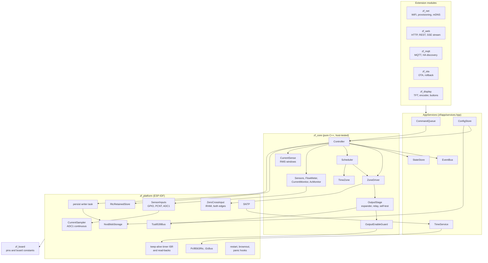
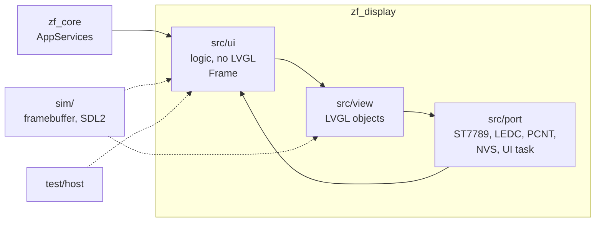

# ZoneFlow firmware architecture

Status: **phase 3, aligned with the rev A hardware design** (section 20).
Covers the standalone ESP-IDF firmware of system spec section 4.1
(`firmware/zoneflow-fw/`). No board exists and nothing described here has
run on one. Checks done so far: host unit tests (GoogleTest, ASan and
UBSan), the display simulator, and `idf.py build` with ESP-IDF v5.5.6.
Section 11 lists what the phase 2 core hardening changed, section 20 what
the rev A board changed.

Phase 1 delivered the structure, the safety-critical core and tests. Phase 2
hardens the core (section 11) and adds WiFi and provisioning (`zf_net`,
section 12), the REST API, event stream and static web serving (`zf_web`,
section 13), OTA with rollback (`zf_ota`, section 14) and the local display
interface (`zf_display`, section 17, and
[display interface](display-ui.md)). The network security design is in
[firmware security](firmware-security.md). MQTT with Home Assistant
discovery is `zf_mqtt` (section 18). The web UI itself is later work. Every module plugs into the interfaces in section 4 and does
not reach around them.

## 1. Modules



| Component | Role |
|---|---|
| `zf_core` | All decisions. No ESP-IDF headers. Built by the firmware and by `test/host`. |
| `zf_board` | The board header. Pin numbers, I2C addresses and expander bits are generated from `hardware/pinmap.yaml` at build time (`tools/gen_board_header.py`); the hand-written `zoneflow_rev_a.hpp` names them, adds scales and timings with their sources, and checks the pin rules with `static_assert`. Section 20. |
| `zf_platform` | Implements the core's interfaces on ESP-IDF. Holds no policy. |
| `main` | Creates the objects (all static), starts the tasks, calls the extension modules. |
| `zf_net` | WiFi station, BLE and SoftAP provisioning, hostname and mDNS, captive DNS, factory reset. Logic in `net_logic.cpp` (host-tested). |
| `zf_web` | HTTP(S) server, REST API, SSE stream, static files, admin authentication. Logic in `api.cpp`, `auth.cpp`, `crypto.cpp`, `routes.cpp`, `http_util.cpp`, `json_map.cpp` (host-tested). |
| `zf_ota` | Firmware upload and pull, web UI image upload, post-boot self-test and rollback. Logic in `ota_logic.cpp` (host-tested). |
| `zf_display` | The local interface: display logic (pure C++, host-tested), LVGL view, ESP-IDF drivers and the UI task. Section 17. |
| `zf_mqtt` | MQTT client, topic tree, commands, Home Assistant discovery. Logic in `mqtt_logic.cpp` (host-tested). Section 18. |

## 2. Threading model

| Task | Priority | Core | Period | Does |
|---|---|---|---|---|
| keep-alive (GPTimer alarm ISR, IRAM) | interrupt | allocating core | 5 ms (`CONFIG_ZF_OE_TOGGLE_PERIOD_MS`) | Calls `OutputEnableGuard::step()`, writes the keep-alive pin register (GPIO17), then reads GPIO42, GPIO7 and GPIO40 into `OutputEnableGuard::sample()` for the self-test timing. Runs while the flash cache is off. No heap, no locks, no calls (checked in the linked ELF). |
| zero-cross (GPIO ISR, IRAM) | interrupt | core of `app_main` | each AC_ZC edge, 100 per second | Timestamps the edge into `ZeroCrossTracker`. IRAM-safe, so a flash erase does not look like a loss of 24 VAC; its only call is `esp_timer_get_time()`, which is in IRAM. |
| `zf_isense` | 6 | 0 | 10 ms frames | Reads ADC1 continuous conversions (5 kS/s per channel, 6 dB), calibrates them to mV and accumulates 100 ms windows (`ChannelStats`). Publishes the latest window under a spinlock. Static stack (12 KB). |
| `zf_control` | 10 | 1 | 50 ms (`CONFIG_ZF_CONTROL_PERIOD_MS`) | Drains the command queue, then `Controller::tick()`. Subscribed to the task watchdog (5 s, panics). |
| `zf_persist` | 3 | 0 | 250 ms poll | Takes the latest runtime state from `PersistMailbox`, builds the JSON and writes NVS. Static stack (6 KB). |
| `zf_evlog` | 2 | 0 | on event | Logs events from its own queue. |
| `zf_history` | 2 | 0 | on event, at least every 500 ms, 6 KB static stack | Turns events from its own queue into history records and writes the open chunk to NVS in batches (section 19). |
| `main` | 1 | any | 100 ms | Status LED, state log once a minute. |
| lwIP / SNTP | IDF | 0 | on sync | `TimeService::onNetworkSync()` writes the RTC. The TCP/IP task (priority 18) is pinned to core 0 so network load never preempts the control task (security review F6). |
| `zf_net` | 5 | 0 | 1 s or on message, 6 KB | WiFi, provisioning and mDNS calls. IDF event handlers only queue a message. |
| `zf_dns` | 3 | 0 | on packet, 3 KB | Captive-portal DNS, only while the setup access point runs. |
| `httpd` (port 80, and 443 with HTTPS) | 5 | 0 | per request, 12 KB | Every REST request, config writes included; static files; uploads. |
| `zf_web_sse` | 3 | 0 | 250 ms or on event, 6 KB | Formats and sends event-stream messages from its own event queue. |
| `zf_ota_pull` | 4 | any | while pulling, 8 KB | HTTPS download into the passive slot. |
| `zf_ota_test` | 2 | any | 500 ms, at most 60 s after an update | Post-boot self-test, then confirm or roll back. |
| `zf_mqtt` | 3 | 0 | 250 ms or on message, 6 KB | MQTT state, commands, discovery, coalesced config edits (section 18). |
| `mqtt_task` (esp-mqtt) | 5 | any | on socket, 6 KB (IDF default) | MQTT protocol; its event handler only copies into the `zf_mqtt` inbox. |
| `zf_ui` | 4 | 0 | on input, on event, at most 20 ms | Owns LVGL. Reads input and event queues, builds the frame, draws. Section 17. |
| `esp_timer` (IDF) | IDF | IDF | 5 ms | Samples the encoder count and the buttons, decodes them, queues input events for `zf_ui`. |

Rules:

- **One owner.** The control task owns the `Controller`, and through it the
  `ZoneDriver` and `Scheduler`. No other task calls them. The one exception
  is `Controller::emergencyOff()` / `ZoneDriver::emergencyOff()`, which only
  writes GPIO and atomics and may run in any context.
- **Commands in.** Other tasks change behaviour only by posting a `Command`
  to `CommandQueue` (non-blocking, 16 entries, mutex held for one struct
  copy). A full queue returns `false`; the caller reports busy.
- **Events out.** `EventBus::publish()` runs on the control task and calls
  handlers synchronously, without holding the bus lock. A handler must
  return within microseconds: copy the event into the module's own queue
  with zero timeout (`platform::EventQueueSubscriber` does this) and drop
  it if full. Handlers must not block, sleep, take a lock a blocking task
  may hold, or call back into the controller.
- **State snapshot.** The control task publishes a `SystemState` copy to
  `StateStore` whenever something changed and at least once a second.
  `snapshot()` holds a mutex for one struct copy; `sequence()` is a lock-free
  change counter for pollers.
- **Config writes.** `ConfigStore::update()` validates, writes NVS, then swaps
  the in-memory copy. Writers serialise on a writer-only mutex that is held
  across the flash write. Neither the control task nor the keep-alive
  interrupt ever takes it. The NVS lock inside ESP-IDF is the other lock
  held across a flash write; only config writers and `zf_persist` take it.
  Readers (`get()`) use a separate mutex held for a copy.
- **No allocation in the safety path.** Zone driver, output-enable guard,
  keep-alive interrupt, command queue, event bus and `Controller::tick()`
  use fixed arrays. Config JSON handling (cJSON) allocates, and only runs on
  config load and update, on the caller's task. Runtime state is handed to
  the persist writer as a plain struct (below). A host test counts
  `operator new` calls inside 1200 control ticks that include a scheduled
  start and repeated state changes: zero.
- **Runtime state off the control task.** `Controller` posts a
  `SchedulerPersist` copy (plain data: 8 + 8 + 16 × 16 = 272 bytes) to its
  `PersistMailbox` at most every 2 s; the mutex is held for that copy only,
  and a newer copy replaces one not yet taken. `zf_persist` takes it, builds
  the JSON and writes NVS. A failed write comes back through the mailbox
  and raises `storage_error` on the next tick.

#### Why NVS garbage collection can no longer starve the heartbeat

Before, the control task built JSON and called `nvs_set_blob` itself, so a
write that triggered NVS garbage collection (page erase plus copying live
entries) held the control loop, and with it the heartbeat, for the whole
operation, and it waited on the NVS lock whenever a config write on
another task held it. Now:

1. The control task never calls NVS and never takes the NVS lock or the
   config writer lock. The only lock it shares with `zf_persist` is the
   mailbox mutex, which neither side holds across anything but a struct
   copy. A stalled writer cannot block `post()`.
2. `zf_persist` runs at priority 3 on core 0; the control task runs at
   priority 10 on core 1. Between flash operations the control task runs
   as usual.
3. What remains is the flash operation itself: while one sector is erased
   or written, the cache is off and both cores stall, the control task
   included. The heartbeat then ages by at most one flash operation plus
   one control period. The keep-alive no longer stalls with it (section 3),
   so OE keeps its edges as long as that stays under the 500 ms heartbeat
   timeout. NVS erases one 4 KB sector at a time; the worst-case sector
   erase time of the module flash must come from its datasheet (open
   question 2).

The host test `PersistHandOff.StalledFlashWriteDoesNotStallTheControlLoop`
runs the hand-off with a storage `write()` that blocks, as during garbage
collection, on a second thread. During 1200 ticks (60 s of control time,
including a scheduled start) with the writer stuck, the heartbeat is fresh
on every tick with a zone open, the control thread never calls storage, and
the last posted state is the one stored once the write is released.

## 3. Safety design

How the firmware implements spec section 2:

| Spec rule | Firmware |
|---|---|
| 1. Outputs off by default | Rev A has no valve GPIO: the valves are bits of an I/O expander that the keep-alive detectors hold in reset while the keep-alive is stopped, with resistors holding every pin off (hardware design 8.2). `initOutputStagePins()` is the first call in `app_main`: keep-alive latch low, then the pin an output (R33 holds it low before that). Read-back pins are configured as inputs with the pulls of rule 12. |
| 2. No strapping or glitching pins on outputs | The pin map has no valve or enable function on a GPIO; the generator refuses one. `zf_board` `static_assert`s: no pin on GPIO22 to 37, a strapping pin only for the function the pin map allows (BOOT, VIN_MON, sensor supply enable, status LED), the keep-alive an output, the two read-backs, the latch and the zero-cross inputs. |
| 3. Hardware output enable | Firmware keeps toggling a keep-alive signal, and two detectors on the board remove gate drive and open the valve-common relay within about 1 s after toggling stops. `OutputEnableGuard` toggles only while (a) the output stage asks for it (`KeepAliveRequest::Run`; `HoldHigh` for the pin-high self-test step), (b) the control loop heartbeat is younger than `CONFIG_ZF_OE_HEARTBEAT_TIMEOUT_MS` (500 ms), (c) it is not tripped. The edges come from a GPTimer alarm interrupt every 5 ms that keeps running through flash erases (see "Keep-alive from a timer" below). A stuck control loop, a stopped timer or a halted CPU all stop the toggling. The self-test of section 20 proves both detectors before and after every run. |
| 4. Maximum run time | Per zone, not per run (spec v0.3 rule 4 as amended). The driver adds up each zone's on-time across runs until the zone has been closed for `driver.min_rest_s` (default 1800 s). `ZoneDriver::start()` clamps every request to what is left of min(zone `max_run_s`, 4 h); the driver times the run and closes the valve, and `tick()` independently closes a zone whose accumulated on-time reaches the limit (`max_run_time`). The zone then refuses to start (`resting`) until it has been closed for the rest time. Stop and restart, pause and resume, back-to-back programs and config reloads do not reset the count. |

#### Keep-alive from a timer

The OE waveform is generated by a GPTimer alarm interrupt
(`CONFIG_GPTIMER_ISR_CACHE_SAFE=y`), not by a task. The interrupt handler is
in IRAM and the driver keeps it enabled while the flash cache is off, so OE
keeps its edges while NVS or OTA erase flash. Everything the handler
touches is in IRAM or DRAM: `OutputEnableGuard::step()` is forced inline
(the linked ELF shows `onKeepAlive` in IRAM with no call instructions), the
guard is a static object, and the pin write is a register write.

A peripheral generating the waveform must not keep a dead control loop's
outputs alive. It does not, because the timer does not decide the level;
`step()` does, on every alarm:

- The control task increments a heartbeat counter every tick.
- `step(period)` compares the counter with the value it saw last time. If
  the counter moved, the age restarts at 0; if not, the age grows by one
  period (5 ms). It needs no clock, so there is no time base to share or
  wrap.
- Once the age exceeds the timeout (500 ms), `step()` returns low on every
  alarm and OE gets no more edges; the hardware then removes gate drive
  within its hold time (about 1 s, spec rule 3). The age saturates just
  above the timeout, so it never wraps back to fresh; only a new heartbeat
  restarts the edges.

So when the control loop dies (hang, crash before the panic handler, a
priority problem), the edges stop at most 500 ms plus one period after its
last tick, although the timer keeps firing. A flash operation stalls the
control loop the same way; the edges continue through stalls shorter than
the timeout and stop for longer ones (`OutputEnableTimer.*` host tests).
The restart and brownout handlers trip the guard; they and the panic
handler also drive OE low directly.

Other limits enforced in the zone driver:

- **Concurrency.** At most `driver.max_concurrent` zones open or waiting
  (default 2, configurable 1 to 2, from spec section 1). Master is extra.
- **Master sequencing.** Master opens `pre_open_ms` before the first zone and
  closes `post_close_ms` after the last one. A zone starting during the
  post-close delay keeps the master on.
- **Inter-zone delay.** A zone opens no sooner than `inter_zone_delay_ms`
  after the previous zone closed.

Fault paths, each ending with outputs off:

| Event | Action |
|---|---|
| Short circuit (above `short_circuit_ma`, 2 samples, checked even during inrush) | All off, queue stopped, zone locked out, fault latched. On the master: counted towards the master lockout. |
| Over-current (above the summed window after settling, 3 samples; short-circuit samples count towards them) | Same as short circuit. |
| Hardware over-current trip (latch on GPIO40, sampled every 5 ms) | Hardware design 19.8. The latch has already removed drive and opened the relay. The output stage drives the keep-alive low, holds it for 1.5 s, which clears the latch and resets the expander, and checks the latch cleared (`trip_latch_stuck` after 3 s). The controller stops every output (`fault`), raises `over_current_trip` and blames the output switched on within 500 ms before the trip, else every output that was on (suspect). Each trip counts against the outputs it marks; an output with three trips within 24 h locks out until faults are cleared. The queue is not cleared: the next entry runs after the self-test, without the faulted output. |
| Master lockout (`master.fault_lockout_count` consecutive faults blamed on the master, default 3) | `master_locked_out` latched. With the master enabled, every start is refused: scheduled starts are skipped (`master_locked_out`), manual runs return `master_locked_out`, the driver refuses to open anything. A master session of at least `settle_ms` without a fault resets the count. |
| Open circuit (below the summed window) | That zone off, queue moves to the next entry, fault latched. Master or unattributable: all off. |
| Current with every output off | Keep-alive stopped, relay open: `current_while_idle`, fault only; on rev A this needs a welded relay and a shorted output device together, or a broken amplifier. Relay closed and no valve on: `output_shorted`, the output stage's fault state (rule 6, section 20). If the current rises past `short_circuit_ma`, `short_circuit` is reported as well. |
| Output-stage self-test or read-back fails (section 20) | Keep-alive low at once, every expander pin back to input while the expander still answers, `keepalive_detector`, `output_expander`, `relay_welded`, `output_shorted` or `trip_latch_stuck` with the check and step. Everything stops, the queue is cleared, every start is refused (`hardware_fault`) until a person acknowledges it. Kept over a software restart. |
| DC component in a zone's current (one triac polarity not conducting) | That zone off, `zone_dc_current` latched on the zone. |
| Current sense unavailable (ADC init or calibration failed, or no reading) | `current_sense_unavailable` raised; zones still run (policy below). |
| 24 VAC lost (no AC_ZC edge for 25 ms, then a 60 ms debounce) | All off, queue cleared, starts blocked until AC returns (500 ms debounce). The output stage stops the keep-alive at once and tests nothing without 24 VAC. |
| Maintenance command (OTA, factory reset) | All off, starts blocked. |
| `esp_restart()` (includes the reboot after OTA) | Shutdown handler trips the guard and drives the keep-alive pin low. |
| Panic, abort, task or interrupt watchdog | `-Wl,--wrap=esp_panic_handler`: an IRAM wrapper drives the keep-alive pin low by a direct register write, then runs the IDF handler. On rev A that is the only GPIO action that removes valve drive; the detectors do the rest within their hold-up. |
| Brownout | Brownout interrupt callback (IRAM) trips the guard and drives the keep-alive pin low before the reset. |

Latched faults clear with the `ClearFaults` command. Lockouts (zones and
master) clear with it. A current fault whose cause is still present is
raised again on the next sample. `ac_lost`, `time_invalid` and
`current_sense_unavailable` are conditions: they clear themselves when the
cause goes away, and `ClearFaults` does not hide them.

**Current sense unavailable: policy.** Zones keep running. Watering
matters more than diagnostics, and a controller that refuses to water
because a diagnostic failed is the failure users notice. The condition is
raised as a fault (status LED blinks, `activeFaults` bit, event), so the
board gets looked at. Without current readings, short-circuit protection
rests on the hardware over-current trip and the per-output series element
of spec 3.1, and the maximum run time still applies. With
`diagnostics.current_enabled = false` the condition is not raised.

## 4. Interfaces for later modules

Every module receives `zf::AppServices` (`zf/app/services.hpp`):

```cpp
struct AppServices {
    EventBus &events;       // subscribe(handler, ctx, mask)
    StateStore &state;      // snapshot(), sequence()
    ICommandSink &commands; // post(Command::runZone(z, s)), ...
    ConfigStore &config;    // get(), toJson(), update(), updateFromJson()
    TimeService &time;      // status(), setManual()
};
```

| Need | Use |
|---|---|
| Show status | `state.snapshot()`; poll `state.sequence()` or wake on an event. |
| Follow changes | `platform::EventQueueSubscriber` with an `EventMask`, read from the module's task. |
| Run, stop, pause, resume, skip, rain delay, clear faults, maintenance | `commands.post(Command::...)`. A command the controller refuses publishes `CommandRejected` with the command, its zone or program and the `RunError` (for example `locked_out`, `zone_resting`, `master_locked_out`, `inhibited`). Subscribe to it to answer an API call. |
| Read config | `config.get()` (typed) or `config.toJson()` (REST, backup). |
| Change config | `config.updateFromJson(json)` or `config.update(cfg)`; on success post `CommandType::ReloadConfig`. A failed validation returns the JSON path and a message for the API response. The controller also applies a new store revision on its next tick, so a configuration that was stored while the command queue was full still takes effect (section 22). |
| Set the clock | `time.setManual(utc)`. |

Event types: `ZoneChanged`, `MasterChanged`, `QueueChanged`, `ProgramStarted`,
`ProgramSkipped`, `ProgramMissed`, `SensorChanged`, `FaultRaised`,
`FaultCleared`, `RainDelayChanged`, `ConfigApplied`, `TimeStatusChanged`,
`MaintenanceChanged`, `CommandRejected`, `RunDropped` (a queued run whose
zone refused to start: locked out, resting, master locked out),
`PauseExpired` and `RunEnded` (one opening of one zone ended: source,
program, planned and actual seconds, stop reason, mean current of the zone
alone, flow-meter volume; for the history, section 19). `toString()` gives stable lowercase names for APIs.

New enum values are appended, never inserted. ESP-IDF builds with
`-Werror=switch`, so a `switch` over `EventType`, `FaultCode`, `RunError`,
`StartError` or `SkipReason` without a `default` must list every value.

`SystemState` also carries, per zone, `restRemainingSec` (resting after
reaching the maximum run time), and `masterLockedOut` and
`masterFaultCount`.

Adding state a module owns (for example network status) means adding a field
to `SystemState` and a command or setter that the control task applies.
Modules do not write `StateStore` themselves.

Phase 2 exception: network status lives in `zf_net`'s own `NetStatusStore`
(same pattern as `StateStore`: one writer, a mutex held for a copy, a
sequence counter) instead of `SystemState`, because `zf_core` was being
hardened on another branch at the same time. Readers use `net::status()` and
`net::statusSequence()`; the event stream merges it into its `state`
message.

Reviewed again after the core hardening merged: moving it into `SystemState`
is **not** a clean, additive change, so it stays in `zf_net`:

- Only the control task writes `SystemState`, and it builds each snapshot
  from its own members. The network status comes from the `zf_net` task. It
  would have to reach the controller either as a command (a `Command` is a
  small struct in a 16-entry queue; the status is about 200 bytes of SSID,
  addresses and counters) or as a new `ControllerDeps` source read under a
  lock on every publish. The second changes `ControllerDeps`, so every place
  that constructs a `Controller` (`app_main`, the host tests, other
  branches) changes too.
- Readers that want to wake on a network change would need a new
  `EventType`. Appending one breaks every exhaustive `switch` on another
  branch again (`-Werror=switch`), right after the hardening did the same.
- Every reader copies `SystemState`, the display at its frame rate. Most do
  not need the network block.

A reader that needs both takes `state.snapshot()` and `net::status()` and
compares `state.sequence()` and `net::statusSequence()`.

## 5. Scheduler

### Programs

A program has an id (stable, non-zero), name, enabled flag, up to 4 start
times (local "HH:MM"; a time listed twice counts once), a day rule, per-zone durations, a seasonal-adjust flag
and an obey-sensor flag. Day rules:

- **weekdays**: any set of days.
- **interval**: every N days (1 to 365) counted from an anchor date.
- **odd / even**: day of month. Odd runs on the 31st and the 1st back to back.

Zones of a program run one after another in zone order. Programs that start
at the same time queue behind each other; they do not overlap. The run queue
holds up to 64 entries.

### Run queue

`pause` closes the running zone and keeps its remaining time; `resume`
reopens it for the remainder. `skip` drops the head entry and starts the
next. `stop` closes everything and empties the queue.

A paused queue is stopped, not resumed, after `schedule.pause_timeout_min`
(default 120, range 1 to 1440), and `PauseExpired` is published. The
timeout runs from the first pause; pausing again does not extend it. Why
stop: someone paused on purpose (mowing, working in a bed, children
playing), and watering that restarts by itself hours later could soak
them or a lawn they left wet. A paused queue also blocks later scheduled
starts, so leaving it paused stops the schedule with no fault. Stopping
clears both problems: nothing starts unexpectedly, and the next scheduled
start runs as usual.

An entry whose zone refuses to start when it reaches the head of the
queue (locked out, resting, master locked out) is dropped with a
`RunDropped` event and the queue moves on. `RunZone` on a zone that is
locked out or resting is refused at once (`locked_out`, `zone_resting`).

### Adjustments and inhibits

| Condition | Scheduled starts | Running scheduled entries | Manual runs |
|---|---|---|---|
| Seasonal percent (0 to 250) | Durations scaled, rounded to the second | | Manual program runs scaled; manual zone runs not |
| Rain delay until a time | Skipped (`rain_delay`) | Removed when the delay is set | Allowed |
| Rain sensor (or spare in "inhibit" mode) active | Skipped if the program obeys the sensor | Removed when the sensor goes active | Allowed |
| No 24 VAC | Skipped (`no_ac`) | Cleared | Refused |
| Maintenance | Skipped | Cleared | Refused |
| Same program already queued | Skipped (`already_queued`) | | Refused |

### Time, DST and clock jumps

Start times are local wall-clock times converted with a POSIX TZ string
(`timezone` in config, for example `CET-1CEST,M3.5.0,M10.5.0/3`). The core has
its own TZ implementation so the host and the device compute the same
instants.

- **Spring forward.** A start inside the skipped hour runs at the end of the
  gap (02:30 on the Berlin change day runs at 03:00 CEST).
- **Fall back.** A start inside the repeated hour runs once, at the first
  occurrence.
- **Each start runs at most once.** For every program the scheduler stores
  the last start it consumed as a (local day, minute) key and persists it in
  NVS. Setting the clock back, rebooting right after a start, or a DST
  repeat never runs a start twice.
- **Clock set back by more than 24 h** (for example an RTC that was in the
  future, corrected by SNTP): the stored keys are clamped to the new time so
  the schedule resumes. The same check runs on the first valid time after
  boot, for keys stored while the clock was wrong. The keys from before the
  jump are kept in RAM until the clock passes the old time at its own pace,
  or jumps forward (more than 60 s) to within a day of it: then the earlier
  time was the right one, the clock was set back by mistake, and the starts
  consumed before the mistake are restored as consumed. Without this, a
  clock set back by days and put right by SNTP reported the day's starts as
  missed and ran the newest one again (system soak simulation, section 22).
  A restart in between loses the kept keys.
- **Clock put back by less than a day:** the keys stay, and every start the
  clock passes again that a key set while it was ahead covers is reported
  missed when the clock reaches it (missed-start policy 8 below).
- **No valid clock.** If the RTC is missing or reports lost time and SNTP has
  not synced, no scheduled start runs. Manual runs still work.
- **Time zone change.** The stored keys are local (day, minute) values. On
  a change of zone, `Scheduler::configure` moves each key to the same
  instant in the new zone (old zone to UTC, UTC to new zone). Without this,
  a move west made the last consumed key read as a later local time than
  now, and the next start counted as already run. Re-keying was chosen
  over storing UTC instants because it keeps the persisted format. An
  unchanged zone leaves the keys alone, so a key in a DST gap is not
  shifted.

### Missed-start policy

The scheduler evaluates the window between its last evaluation and now, once
a second. After a power cut, at boot, or after the clock jumps forward, that
window can contain starts that did not run on time.

1. Only starts within the last 24 hours are considered.
2. Of the starts in the window, only the newest per program can run.
3. It runs (late, `ProgramStarted` with `late = true`) if it is no older
   than `schedule.missed_start_grace_min` (default 60, range 0 to 720).
   With 0, nothing is caught up.
4. Every other start in the window is reported once as `ProgramMissed` and
   not run.
5. A program with no stored key (never ran on this device, or runtime state
   lost) gets no catch-up and no missed reports.
6. Editing the configuration never triggers a start whose time has passed.
7. The runtime record (the keys and the rain delay) is kept in two copies,
   `runtime` and `runtime_b`, written alternately, each with a sequence
   number and its own CRC-32 (`zf/app/persist.hpp`). A copy that fails its
   check is never used. When the newest copy may be the damaged one (one
   copy valid, the other present and damaged), the older copy is restored
   and the catch-up after boot runs nothing: every start in the window is
   reported missed. One of them may have run already, and a start reported
   missed that ran is the lesser harm than one that runs twice. Both copies
   damaged is policy 5. (System soak simulation, section 22 gap 9.)
8. After the clock is put back by less than a day, each start the clock
   passes again whose key is already consumed (it ran, was reported missed,
   or an edit passed it while the clock was ahead) is reported missed when
   the clock reaches it, once, and never run again. The record of which
   starts these are is in RAM; a restart in between skips them without a
   report. (Section 22 gap 4.)

This list is the policy for every case in which a start does not run at
its time; the clock bullets above and the scheduler's comments refer to
it.

Example: a program at 06:00 with the default grace. Power fails at 05:30 and
returns at 06:20: the 06:00 start runs at 06:20. Power returns at 07:30
instead: the start is reported missed and the next one runs as usual.

## 6. Configuration

Stored as JSON in NVS (namespace `zoneflow`, key `config`). The same JSON is
the REST and backup format. Abbreviated example:

```json
{
  "schema": 2,
  "device_name": "zoneflow",
  "timezone": "CET-1CEST,M3.5.0,M10.5.0/3",
  "zone_count": 8,
  "zones": [{"name": "Lawn", "enabled": true, "max_run_s": 3600,
             "current_min_ma": 80, "current_max_ma": 700, "default_run_s": 600}],
  "master": {"enabled": true, "pre_open_ms": 1000, "post_close_ms": 2000,
             "fault_lockout_count": 3,
             "current_min_ma": 80, "current_max_ma": 700},
  "driver": {"max_concurrent": 2, "inter_zone_delay_ms": 2000, "min_rest_s": 1800,
             "zero_cross_switching": false},
  "sensors": {
    "rain": {"enabled": true, "contact": "nc", "debounce_ms": 2000},
    "spare": {"enabled": false, "contact": "no", "debounce_ms": 200, "function": "none"},
    "flow": {"enabled": false, "pulses_per_litre": 450, "leak_threshold_lpm": 0.5, "leak_detect_s": 60}
  },
  "diagnostics": {"current_enabled": true, "settle_ms": 500, "idle_max_ma": 30,
                  "short_circuit_ma": 3000, "confirm_samples": 3},
  "schedule": {
    "seasonal_percent": 100,
    "missed_start_grace_min": 60,
    "pause_timeout_min": 120,
    "programs": [{"id": 1, "name": "Lawn", "enabled": true, "starts": ["06:00"],
                  "days": {"type": "weekdays", "weekdays": ["mon", "wed", "fri"]},
                  "durations_s": [600, 0, 300], "seasonal": true, "obey_sensor": true}]
  },
  "mqtt": {"enabled": false, "host": "", "port": 1883, "username": "", "tls": false,
           "ca": "bundle", "client_id": "", "base_topic": "", "discovery": true,
           "discovery_prefix": "homeassistant", "ha_zone_entity": "valve"}
}
```

- **Missing fields** take their defaults; unknown fields are ignored.
- **Validation** rejects the whole document on the first error and returns
  its JSON path (for example `schedule.programs[0].starts[1]`) and a message.
  Range limits are in `zf_core/src/config.cpp`. A document nested more than
  16 levels deep is rejected before parsing: cJSON recurses once per level.
- **Migration.** `schema` is required. An older schema runs the steps in
  `kMigrations` (`config_json.cpp`), one version at a time, and the result
  is written back. Schema 2 (phase 3) added the `mqtt` object and
  `zones[].default_run_s`; step 1 to 2 writes both with their defaults.
  Tested in `mqtt_config_test.cpp` (a stored schema 1 document loads as
  `Migrated` and is written back as schema 2; a schema 1 backup restores).
  A firmware older than phase 3 reads a schema 2 document best-effort
  (newer schema) and refuses to write it, so after a rollback past phase 3
  configuration edits fail until the newer firmware is back or the
  configuration is reset.
- **Newer schema** (firmware rolled back after an OTA): parsed best-effort,
  used, and not written back, so the newer firmware finds its data intact.
  The same document sent through `updateFromJson()` (REST, MQTT, restore)
  is rejected with path `schema` and "schema N is newer than this firmware
  supports (2)": writing it would drop every field this firmware does not
  know.
- **New fields in this phase** (schema stays 1; absent fields take their
  defaults, so older documents still load):

  | Field | Default | Range | Meaning |
  |---|---|---|---|
  | `driver.min_rest_s` | 1800 | 60 to 86400 | Closed time that ends a zone's run of back-to-back runs, and the rest after it reached its maximum run time. |
  | `driver.zero_cross_switching` | false | | Turn outputs on at a mains zero crossing when the board has the signal. |
  | `master.fault_lockout_count` | 3 | 1 to 10 | Consecutive current faults on the master that lock it out. |
  | `schedule.pause_timeout_min` | 120 | 1 to 1440 | A paused queue is stopped after this long. |

  Why 30 minutes of rest: the default maximum run time is 60 minutes, so a
  zone can be on for at most 60 of any 90 minutes, and typical programs
  (10 to 30 minutes per zone) never meet the limit. Two programs that share
  a zone within half an hour share one budget.
- **Invalid stored config:** defaults are used, `config_invalid` fault is
  raised, the stored copy is kept for diagnosis until the next update.
- **Runtime state** (rain delay, last consumed start per program) lives under
  key `runtime`, written at most every 2 s and only when changed.

## 7. Sensors and diagnostics

- **Rain and spare inputs.** Dry contacts, NO or NC, debounced (default
  2000 ms rain, 200 ms spare). The first reading after boot is taken as-is so
  a wet sensor inhibits from the start.
- **Flow.** PCNT counts pulses in hardware (falling edge, 1 us glitch
  filter). Litres = pulses / `pulses_per_litre`; rate over the last 5 s (one sample per second).
  Flow above `leak_threshold_lpm` for `leak_detect_s` with every valve shut
  raises `flow_without_zones`.
- **Valve current.** One total current from the low-side shunt (spec 3.1),
  measured as the RMS of 100 ms windows (section 20, current measurement).
  A new reading arrives every other control tick; confirmation counts are
  in windows. A shorted valve or wire shuts the zone off and is reported
  (spec 1). Expected window = sum of
  the min/max of every output that is on. Comparisons start `settle_ms` after
  any output change; the short-circuit limit applies at all times. A config
  reload does not restart a confirmation in progress. A fault
  is attributed to the output switched on most recently. Per-output current
  observed when the output runs alone (or with the master, minus the
  master's share) is recorded as the basis for learned limits later.
- **24 VAC present.** From the AC_ZC edge stream: present while an edge of
  either polarity came within 25 ms (hardware design 19.9). Loss declared
  after a further 60 ms, return after 500 ms. With no AC (USB-only power)
  the current checks are suspended and the output stage tests nothing.
- **Current sense unavailable** (`current_sense_unavailable`, hardware
  design rule 19). `SensorSample::currentSenseAvailable` is false when the
  ADC or its calibration could not be set up, or a tick gave no reading.
  The output stage also counts the measurement as lost when a self-test
  step waited 0.5 s for a window in vain, or a current channel rests
  outside its limits (section 20). Steps 5, 5b and 6 and rule 6 are then
  skipped, zones still run, and the condition is raised for as long as it
  lasts: skipping is never silent. Policy in section 3.
- **Zone fault policy** (`zf/diag/zone_fault_policy.hpp`, the same table in
  both firmwares since the soak found them differing, section 22 gap 7):

  | Fault | Stops | Locked out | Clears |
  |---|---|---|---|
  | Open circuit | the zone | no | itself, when the zone next runs inside its window; or by a person |
  | Over-current, short circuit | every output | yes | by a person |
  | DC component | the zone | yes | by a person |
  | Current rose with no output switched | every output | decided below | |

  Why: an open valve wire is a fault in the field, draws no current and
  harms nothing when retried; whoever fixes the wire should not have to
  visit the controller. A DC component means one polarity of the output's
  triac or gate drive conducts and the other does not: a half-dead output
  on the board, which needs a repair. Over-current and shorts put fault
  current through the output at every retry.
- **A failed-short output device during another zone's run** (section 22
  gap 2). Its valve's current adds to the run's. `CurrentMonitor` takes the
  run's level as the mean of the first two settled windows after the last
  output change, and a window more than a fifth (at least 40 mA) above it,
  for `confirm_samples` windows, is `current_rose`. Every output goes off at
  once; the output stage keeps the relay closed for its linger and checks
  rule 6 on the next window that starts 20 ms after the valves went off.
  Current there is `output_shorted`: the relay opens and nothing runs.
  Without it within 1.5 s (`ShortedOutputCheck`) the extra current went
  through the zone itself, which is reported and locked out as an
  over-current. Detection time from the failure to the relay opening: the
  first full window after it ends within 200 ms, three windows confirm it
  (300 ms), a control tick (50 ms), the rule 6 window (at most 220 ms) and
  a tick: about 0.8 s at most, 0.45 s on the simulated board. The relay
  opens within 10 ms of its control going (hardware design 9.2). Before,
  the device watered until that run ended. Not covered: a device that fails
  within the settle time and two windows of an output change (the rise is
  then part of the run's level) is found when the run ends, as before.
- **Hardware over-current trip.** GPIO40, low while the latch is set,
  sampled by the keep-alive interrupt every 5 ms and read every tick. There
  is no release pin: the output stage clears the latch by holding the
  keep-alive low for 1.5 s. Handling in section 3.
- **Zero-cross switching.** With `driver.zero_cross_switching` on and a
  zero-cross input attached (`IZeroCrossHal`), `ZoneDriver` turns each
  output on at the next mains zero crossing. On rev A the signal is a
  square wave, not a pulse per crossing (hardware design 19.9):
  `ZeroCrossTracker` takes both edges, takes the upward crossing as the
  rising edge less 0.30 ms, the mains period from rising edge to rising
  edge, and gives crossings half a period apart; the driver's offset is
  then 0. An output switches when its I2C write completes, about 0.1 ms
  after the wait. `zeroCrossWaitUs()` is a pure
  function (host-tested): it waits at most one crossing interval, and
  returns 0 (switch now) with no signal, an interval outside 7 to 11 ms, or
  no edge for three intervals. Turning off never waits: a triac stops at
  the next current zero by itself, and the off paths must stay immediate.
  The wait is a busy wait on the control task, at most 10 ms at 50 Hz per
  output switched on; an output that follows another at once is already
  on the crossing.

## 8. Timekeeping

- **Boot.** Read the RTC. If the chip answers, its voltage-low flag is clear
  and the time is after 2025-01-01, set the system clock from it (status
  `rtc`). Otherwise status `unset` and the `time_invalid` condition is
  raised.
- **SNTP.** Starts on the first `IP_EVENT_STA_GOT_IP` (`pool.ntp.org`). Each
  sync sets status `synced` and writes the RTC.
- **Representation.** The system clock and the RTC hold UTC. Local time
  exists only inside the scheduler and for display.
- **Provisional RTC: NXP PCF8563** (I2C address 0x51, register map from the
  NXP datasheet rev 11.1), chosen because it and the BM8563 clone are widely
  stocked. The driver is one file (`time_storage.cpp`, `Pcf8563Rtc`) behind
  `IRtc`. No part number or LCSC code is chosen here; that is the hardware
  lead's call.

## 9. Open questions for the hardware team

The hardware team answered questions 1 to 14 in
[hardware design](hardware-design.md) section 19.3, and
`hardware/pinmap.yaml` now exists. The independent
[hardware review A1](hardware-review-a1.md) then compared the answers with this document and
with the circuit. Question 2 is settled: the agreed contract follows it
below. Questions 12 and 13 have answers that change code and are noted in
place. The questions themselves are kept as they were asked.

**All fourteen answers are now implemented** (section 20): the board header
is generated from the pin map, the valves are expander bits, the latch has
no release pin, the zero-cross input is a square wave, the current is an
RMS of biased AC windows, and the shared-pin build option is gone. The new
questions that came up doing it are in section 20, "Questions for the
hardware author".

1. **Pin map.** Everything in `zoneflow_rev_a.hpp` is provisional. Please
   publish `hardware/pinmap.yaml`; the board header will follow it. The
   `static_assert`s will flag any pin that breaks the rules above.
2. **Keep-alive circuit.** Spec v0.2 fixes toggle mode and a removal time
   of about 1 s. Firmware produces an edge every 5 ms while an output is
   wanted and stops toggling when everything is off. The edges now come
   from an IRAM-safe timer interrupt and continue through flash erases,
   so the hold time no longer has to cover a sector erase. Still needed:
   the minimum edge rate the circuit accepts, and the module flash's
   worst-case 4 KB sector-erase time (from its datasheet). The control
   loop stalls for that long; if it can exceed about 450 ms (the 500 ms
   heartbeat timeout minus one control period), OE drops during the erase
   and `CONFIG_ZF_OE_HEARTBEAT_TIMEOUT_MS` has to be raised.

   **Agreed with hardware in review A1.** The same contract is in hardware
   design section 19.4. The decisions taken on that review added a second
   keep-alive detector for the valve-common relay and two read-back pins.
   The points below marked "changed" follow from that. None of them changes
   what the keep-alive interrupt itself has to do.

   - **The timer interrupt is accepted.** The hardware document said the
     keep-alive must never come from a timer. What that rule forbids is a
     peripheral that toggles the pin with no code deciding each edge: LEDC,
     RMT, MCPWM, a timer with a pin output. The interrupt of section 3
     decides every edge from the heartbeat, so it is consistent with the
     rule. The keep-alive pin stays a plain GPIO output with no peripheral
     signal routed to it. It is GPIO17 since hardware review A2, which
     moved it from GPIO38; `hardware/pinmap.yaml` has the reason.
   - **Edge interval.** 5 ms is right. The circuit needs an edge at least
     every 20 ms.
   - **The circuit does not check the rate.** It has no upper frequency
     limit, and anything from about 3 Hz to at least 1 MHz enables drive.
     Only a steady level is certain to disable it. A keep-alive that runs
     at the wrong rate is not caught in hardware.
   - **Enable delay, changed.** Gate drive is on 14 to 41 ms after the
     first edge and the relay transistor after 22 to 82 ms. Wait until
     GPIO42 reads high, GPIO7 reads low and the output expander
     acknowledges, 150 ms at most, before writing the expander.
   - **Hold-up, changed.** Gate drive is gone 0.45 to 0.9 s after the last
     edge when the pin stops low, and within 1.2 s if a fault leaves it
     high. The relay transistor lets go between 0.12 and 0.95 s after the
     last edge, 1.4 s if the pin is high. From a dead control loop to no
     gate drive is therefore at most 500 ms + 5 ms + 0.9 s = 1.4 s, and to
     an open relay 1.5 s.
   - **Hardware review A2 widened these figures** after this list was
     written: gate drive on after 13 to 22 ms and the relay transistor
     after 1 to 53 ms; gate drive gone 0.21 to 0.83 s after the last edge
     and within 1.25 s if the pin is high; the relay transistor 0.10 to
     1.45 s and 2.19 s. From a dead control loop to no gate drive is at
     most 1.34 s. The review also asks for no keep-alive phase shorter
     than 2.5 ms, which the 5 ms toggle meets. Section 19.4 of the
     hardware design has the current contract.
   - **Flash.** Espressif does not fix the module's flash part. A
     representative 16 MB part, the Winbond W25Q128JV, erases a 4 kB sector
     in 45 ms typically and 400 ms at most. 400 ms plus one 50 ms control
     period is 450 ms, inside the 500 ms heartbeat timeout by 50 ms. Keep
     `CONFIG_ZF_OE_HEARTBEAT_TIMEOUT_MS` at 500 and do not lower it. A
     64 kB block erase can take 2 s and will drop the outputs, so block
     erases stay out of watering, as OTA already does.
   - **What stopping does.** Holding the keep-alive low for 1.5 s resets
     the output expander, opens the valve-common relay and clears the
     over-current latch. Every start must set the expander up again.
   - **Self-test, changed.** Hardware design section 19.7 has the exact
     sequence and limits. In short: before every run, with the keep-alive
     low, GPIO42 must read low, GPIO7 must read high and the expander at
     0x74 must not answer. At start-up and at least once a day, holding
     the pin high for 1.0 s must not change either read-back. After
     starting, both read-backs must flip and the expander must answer
     within 150 ms. Before the relay is closed, the output about to run
     is switched on for one 100 ms window and must draw no current, which
     finds a welded relay contact. After every run, both read-backs must
     return within 1.0 s of the last edge. A failure means one of the two
     detectors is broken: write every expander pin back to input, raise a
     fault, refuse to run valves. Hardware design section 8.5 has the
     reason.
   - **New pins.** GPIO42 reads the drive-enable signal and GPIO7 the
     relay transistor. Both are inputs for the life of the firmware. The
     sensor supply enable moved from GPIO7 to GPIO45, a strapping pin
     that firmware must leave alone until the application runs.
   - **Still open.** None of this is in the firmware yet: hardware design
     section 19.5. The longest control-loop stall during a flash erase
     should be measured on real modules.
3. **Pull-downs.** Firmware assumes external pull-downs on every output and
   on OE so outputs stay off in reset and while unpowered. Confirm.
4. **Current-sense front end.** Spec v0.2: low-side shunt in the shared
   triac return, rectifying/averaging front end, biased away from the
   non-linear ADC region near 0 V. Firmware reads it on ADC1 with a
   placeholder scale of 1 mA per mV and a bias offset of 0 mV
   (`kValveCurrentMaPerMv`, `kValveCurrentOffsetMv`), 16 samples averaged
   per 50 ms tick. Needed: shunt value, gain, bias voltage, full scale and
   filter time constant, or the external ADC if one is used.
5. **24 VAC-present signal.** Assumed active low (optocoupler pulling down).
   Polarity and response time on loss?
6. **Field input polarity.** Assumed: contact closed pulls the pin low,
   external pull-ups present, protection network in series. The flow input
   must pass 200 Hz.
7. **RTC choice and backup.** PCF8563 assumed at 0x51. Battery or supercap,
   and expected hold-up time?
8. **Display.** Spec v0.3 replaced the OLED with a 320x240 ST7789-class
   TFT on SPI and added a second button. Needed: the panel module and its
   orientation in the enclosure, whether its CS and reset can stay undriven
   (the firmware assumes CS tied low and reset tied to EN), backlight
   driver polarity and PWM frequency, and the encoder's detents per
   revolution and counts per detent. Its pins are question 14.
9. **GPIO15/16 for I2C** assume no 32 kHz crystal on the module pins.
10. **Valve current windows.** Defaults are 80 to 700 mA per output and
    3000 mA short circuit. The prior-art survey cites 200 to 400 mA for
    typical solenoids and an OpenSprinkler default limit of 1200 mA. Please
    confirm against the triac stage and the spec ratings (0.5 A continuous,
    1.5 A inrush for 100 ms per output).
11. **Per-output LEDs.** The spec asks for one LED per output. Firmware
    assumes they follow the gate drive in hardware and only drives the
    power/status LED. If they need their own GPIOs, the pin map has to
    change.
12. **Hardware over-current trip.** Firmware now expects a latching
    comparator: trip status on GPIO18 (assumed active low, open drain) and
    a release pulse on GPIO47 (assumed active high, 10 us). Both pins,
    polarities and the pulse width are placeholders. Needed: the latch
    circuit, its trip threshold, whether it removes gate drive from every
    output or only the faulty one (firmware assumes all), and its minimum
    release pulse.

    **Answer.** Status is on GPIO40, low when tripped, driven by a logic
    gate through 10 kohm, so no pull-up and not open drain. There is no
    release pin and no release pulse: the latch clears when the keep-alive
    has been low for 1.5 s, so `clearOverCurrentTrip()` becomes "stop the
    keep-alive and wait". It trips at 4.6 A peak nominal, 4.0 to 5.4 A over
    tolerances, and removes drive from every output. Outputs must not be
    switched on within 100 ms of each other, or two inrush currents can
    trip it.
13. **Zero-cross detector.** Firmware expects one pulse per zero crossing
    (two per mains period) on GPIO48, rising edge at the crossing, offset
    0 us. Needed: the circuit, the edge that marks the crossing and the
    detector's lead or lag (`kZeroCrossOffsetUs`).

    **Answer.** GPIO41 carries a square wave at mains frequency, not a
    pulse per crossing. At 24 VAC the rising edge is 0.30 ms after the
    upward zero crossing and the falling edge 0.09 ms before the downward
    one. `zeroCrossWaitUs()` accepts intervals of 7 to 11 ms, so it needs
    both edges, and a separate offset for each.
14. **Pin budget.** The firmware wants 30 signals and the pin rules of the
    board header leave 27 GPIO (the count is in the header, "pin budget").
    The display needs five that the map did not have: SPI clock, SPI data,
    data/command, backlight PWM and the Manual/Home button, with the
    panel's CS and reset already left undriven. Data/command and the
    button take UART0 (43, 44). Nothing is left for clock, data and
    backlight. Until `hardware/pinmap.yaml` settles it, a build option
    decides: by default GPIO18, 47 and 48 carry the over-current trip and
    the zero-cross input and the display is not started;
    `CONFIG_ZF_DISPLAY_ON_SHARED_PINS` gives them to the display and treats
    those two inputs as not fitted. CI builds both. Ways out: an I2C
    expander for the switches and the LED; a module with quad PSRAM, if
    GPIO35..37 are then free (to check in the module datasheet); or doing
    without three signals. The spec's claim that the module has "enough
    GPIO without an expander" (section 3.1) no longer holds for this list.

## 10. Decisions made in phase 1

- **ESP-IDF v5.5.6**, the newest v5.x release at the time of writing.
  C++ is compiled as `gnu++2b` (IDF default); the core also builds as C++20
  on the host. No exceptions, no RTTI in core code.
- **cJSON** for configuration JSON: it ships with ESP-IDF; host tests fetch
  the same version (1.7.19).
- **Own POSIX TZ code** instead of newlib `localtime`, for host/device parity
  and testability.
- **Single sequential queue.** Programs never overlap. The concurrency limit
  of 2 is a safety ceiling in the driver; parallel programs can be added
  later without changing the driver.
- **Keep-alive as a task**, as the brief asked. Replaced in phase 2 by an
  IRAM-safe timer interrupt (section 3).

## 11. Phase 2 core hardening

The design concerns raised by the phase 1 review (pull request #17), as
decided by the orchestrator, and where each is handled:

| Concern | Change | Where |
|---|---|---|
| Max run time per run, not per zone | Per-zone on-time budget across runs, rest time `driver.min_rest_s`; spec rule 4 amended | Section 3, rule 4 |
| No master lockout | `master.fault_lockout_count`, `master_locked_out` | Section 3, fault paths |
| Pause has no timeout | `schedule.pause_timeout_min`, stop not resume | Section 5, run queue |
| Persistence on the control task | `PersistMailbox` and `zf_persist` | Section 2 |
| Current diagnostics switch off silently | `current_sense_unavailable`, zones still run | Section 3 |
| No hardware over-current input | Trip input, latch release, handling | Sections 3, 7, open question 12 |
| `RunZone` on a locked-out zone returns `Ok` | `RunError::LockedOut` and `CommandRejected` | Section 4 |
| Newer schema written back through the API | Rejected | Section 6 |
| Keep-alive pauses during flash erases | GPTimer interrupt, `step()` | Section 3 |
| (new) Switching at a random mains phase | Zero-cross hook, off by default | Section 7 |
| Idle current rising to a short is not reported | `short_circuit` after `current_while_idle` | Section 3 |
| Time zone change skips a start | Keys re-keyed on a zone change | Section 5 |
| Spec v0.3 drift (core only) | WROOM-1-N16R8: octal PSRAM, 16 MB flash, 4 MB OTA slots, 7.75 MB assets partition; board asserts for GPIO33..37 | `sdkconfig.defaults`, `partitions.csv`, board header |

Not done here: the display driver (owned by `zf_display`), and the stack
budgets for phase 2 modules (review concern 6) and request body caps
(concern 7), which belong to the modules that receive requests.

## 12. Network (`zf_net`)

Pure logic in `net_logic.hpp` (host-tested), ESP-IDF glue in `net.cpp`.

### Station

- Credentials are stored by the WiFi driver (`WIFI_STORAGE_FLASH`). At every
  start the station config is rewritten with `bssid_set = false`,
  `channel = 0`, all-channel scan and connect-by-signal, so each connect
  picks the strongest access point of the SSID. No BSSID or channel is ever
  stored (prior-art recommendation 8, OpenSprinkler #413). 802.11k/v are on
  so mesh systems can steer the station. Minimum security WPA2-PSK (WPA3-SAE
  accepted), PMF capable; an open network is used only when no password is
  stored.
- **Reconnect backoff** (`StationPolicy`, `Backoff`): 1 s, doubling to a
  5-minute cap, each delay scaled by a random 80 to 120 % so devices that
  lost the same AP do not retry in step. Reset on every IPv4 address.
  Retries never stop and never fall back to an access point: a router outage
  must not turn the controller into an open setup network.
- **Hostname** `zoneflow-xxxx` (last two MAC bytes, lower-case hex), used for
  DHCP and mDNS. **mDNS** (`espressif/mdns` 1.14.1): `zoneflow-xxxx.local`,
  `_http._tcp` and `_zoneflow._tcp` on port 80 with TXT `api=/api/v1`,
  `fw=<version>`, `id=<mac>`.
- **SNTP** is unchanged: `zf_platform` starts it on the first
  `IP_EVENT_STA_GOT_IP` and hands each sync to `TimeService`.

### Provisioning

| Item | Decision |
|---|---|
| Identity | At first boot: 10-character setup code (50 bits, hardware RNG with the radio on), SRP6a salt and verifier from `esp_srp_gen_salt_verifier` for user `wifiprov`. Stored in NVS namespace `zf_net`; kept by a factory reset. |
| Boot plan (`ProvisioningFsm::plan`) | Re-provision request stored → that transport. No credentials → BLE (SoftAP if BLE is not built in). Otherwise station, and the BT controller memory is released at once. |
| BLE | ESP-IDF unified provisioning (`wifi_provisioning`), Security 2, device name `ZoneFlow-XXXX`, scheme handler `FREE_BTDM` so BT memory is released when provisioning ends. |
| SoftAP | Same manager, SoftAP scheme, SSID `ZoneFlow-XXXX`, WPA2 with the setup code as passphrase. Shares `zf_web`'s HTTP server (`wifi_prov_scheme_softap_set_httpd_handle`), which serves the captive setup page at `/setup`; a DNS responder on 192.168.4.1:53 answers every A query with 192.168.4.1. |
| Windows | Unprovisioned: BLE for 10 min, then SoftAP until provisioned (one-way: BLE memory is gone). Re-provisioning a configured device: 15 min, then back to the stored network without a restart. A phone that has completed the Security 2 handshake (`PROTOCOMM_SECURITY_SESSION_SETUP_OK`; a bare BLE connection does not count) or a client on the WPA2 access point holds the window open, for at most 30 min from its start (`heldWindowMaxMs`). |
| Failures | Wrong password or AP not found: the manager's state machine is reset so the user can retry in the same session. |
| QR payload | `{"ver":"v1","name":"ZoneFlow-XXXX","username":"wifiprov","pop":"<code>","transport":"ble"}`, the format of the ESP-IDF `wifi_prov_mgr` example and Espressif's apps. `net::setupInfo()` returns it for the display; nothing sends it over the network. |
| Re-provision | `net::requestProvisioning(transport)` stores the request and restarts. The display offers it under Setup, Network, Set up WiFi, after the question "Restart into WiFi setup?" (Cancel focused); the API has `POST /network/reprovision`. The restart stops a running zone like any restart: the queue is not resumed, and the program it belonged to does not start again (its start was consumed). While provisioning waits, the controller runs as usual: scheduled starts run if the clock is valid, which after the restart means the backup clock (PCF8563), since SNTP needs the network. Pinned by `Reprovisioning.*` in `test/host/controller_test.cpp`. |
| Factory reset | `net::factoryReset()`: maintenance on, wait until the snapshot shows every output off (5 s max), keep the identity in RAM, `nvs_flash_erase()`, erase the stored core dump (`esp_core_dump_image_erase()`), write the identity back, restart. Power loss between erase and rewrite gives a new setup code. |

### Status

`NetStatus` (state, provisioning transport, SSID, BSSID, channel, RSSI, IPv4,
reconnect attempt and delay, last disconnect reason, mDNS) is published to
`NetStatusStore` when a field changes (RSSI by 5 dB or more) and at least
every 30 s. See section 4 for why it is not in `SystemState` yet.

## 13. Web server and API (`zf_web`)

- **Server.** `esp_http_server` on port 80, 12 KB task stack, up to 7
  sockets, LRU purge on. With HTTPS on, `esp_https_server` on 443 (4 sockets)
  serves everything and port 80 answers 301, except while the setup access
  point runs.
- **Routing.** One table (`routes.cpp`) gives each route its method, path,
  access level (Public, Read, Admin, Provisioning), body type and body cap.
  `Api::admit()` applies, in order: Host check, route match (404/405), Origin
  check for writes, session, CSRF header for cookie sessions, provisioning
  state and a connection that arrived on the setup access point (the glue
  compares the socket's local address with the SoftAP's), body size from
  `Content-Length`, content type. Only then is the body read. The HTTP glue registers five wildcard handlers for `/api/v1/*`, three
  exact handlers (events, firmware upload, UI upload) and `/*` for files.
- **OpenAPI.** `docs/firmware/openapi.json` (OpenAPI 3.1) documents every
  route. `web_openapi_test.cpp` checks both directions plus security, body
  type, `x-max-body-bytes` and response type per route.
- **Mapping to the core.** Reads use `state.snapshot()` and `config.get()`.
  Commands use `commands.post(Command::...)` and answer 202, or 503 when the
  queue is full. Configuration edits (zone settings, programs, time zone)
  patch the JSON document from `config.toJson()` and write it back with
  `config.updateFromJson()`, so all validation stays in `zf_core`; the error
  path is made relative to the edited object. A successful write posts
  `ReloadConfig`. Zone numbers are 1-based in the API.
- **Stop one zone.** The core has no "remove this queue entry" command, so
  `POST /zones/{n}/stop` skips the head entry when that zone is running and
  answers 409 otherwise.
- **Run commands and `CommandRejected`.** `RunZone` and `RunProgram` are the
  commands the controller can refuse. The API first answers what the snapshot
  already shows (locked-out zone, resting zone with `Retry-After`, locked-out
  master, maintenance, no 24 VAC). Otherwise it arms a `CommandWatch` (an
  `EventBus` subscriber that only stores atomics on the control task), posts
  the command and waits at most 250 ms: a matching `CommandRejected` becomes
  an error with the controller's `RunError` as `code`; a snapshot published
  after the post plus one more control period without a rejection becomes
  202 `"confirmed": true`; a timeout becomes 202 `"confirmed": false`. Commands
  carry no request id, so matching is by command type, zone and program, and
  the API runs one such wait at a time. Tested end to end with the real
  `Controller` (`ApiWithController.*`). Details and the error codes:
  [API reference, run commands](../firmware/api.md#run-commands).
- **Hardening state in the API.** Zones show `resting` and
  `rest_remaining_s`; the master shows `locked_out` and `fault_count`;
  `inhibit.master_lockout`; sensors show `current_sense_available` and
  `over_current_tripped`; the queue shows `pause_timeout_min`. New events
  `command_rejected`, `run_dropped` and `pause_expired` go to the stream with
  their data. A restore or `PUT /config` of a newer schema answers 400
  `unsupported_schema` with the core's path (`schema`) and message.
- **Event stream: SSE**, not WebSocket (reasons in the
  [API reference](../firmware/api.md#live-event-stream)). The bus handler is
  `platform::EventQueueSubscriber` (copy into a 32-entry queue, never waits).
  The `zf_web_sse` task turns events into `event` messages, sends a `state`
  message when the snapshot changes (at most every 500 ms, at least every
  30 s), `network` and `ota` messages on change and a keep-alive comment after
  15 s. Each stream is an `httpd_req_async_handler_begin()` request owned by
  that task; at most 3. A send that fails ends the stream. Sends happen
  outside the stream lock, so a slow client delays only the stream task.
  Once a second the task asks `Api::streamMayContinue()` with each stream's
  Cookie and Authorization headers: with `protect_reads` on, a stream ends
  with the session that opened it.
- **Static files** from the `www` LittleFS partition (`joltwallet/littlefs`
  1.22.3), with gzip variants, immutable caching under `/assets/` and a
  client-side-routing fallback; a built-in page when the partition is empty.
  Contract for the UI: [web UI contract](../firmware/web-ui-contract.md).
- **Settings** (`protect_reads`, `https`, `check_host`) and the password
  record live in NVS namespace `zf_web`, not in the configuration, so a
  backup never carries them.

## 14. OTA (`zf_ota`)

- **Upload** (`POST /firmware/upload`, streamed in 4 KB chunks) and **pull**
  (`POST /firmware/pull`, `esp_https_ota` with the certificate bundle,
  redirects followed, `https://` only).
- **Gate** (`mayStart`): refused while another update runs, or while a zone
  is open or waiting, the master is on or the queue is running, unless forced.
- **Before writing:** post `StopAll` and `SetMaintenance(true)`, then poll the
  snapshot until maintenance is on and every output is off (`outputsSafe`,
  5 s limit, else `outputs_not_off`). Maintenance stays on until the restart;
  on failure it is released. Flash writes stall both cores, so the outputs
  are off before the first erase (see open question 2).
- **Image checks:** the first 288 bytes (image header, first segment header,
  `esp_app_desc_t`) are held back until chip id (ESP32-S3) and project name
  (`zoneflow-fw`) match; nothing is written for a wrong image. `esp_ota_end`
  then checks the image hash before the boot slot changes.
- **Swap:** `esp_ota_set_boot_partition`, restart after 1 s so the HTTP
  answer goes out. The restart shutdown handler forces outputs off again.
- **Rollback.** `CONFIG_BOOTLOADER_APP_ROLLBACK_ENABLE` was already on.
  `ota::markRunningAppValid()` (unchanged call in `app_main`) now starts a
  self-test when the image is pending verification: confirm once the state
  sequence advanced 5 times (control loop alive) and the web server started;
  roll back at once if the stored configuration was rejected
  (`config_invalid`), or after 60 s. A crash before confirmation also rolls
  back (bootloader). Network connectivity is not a condition: a router outage
  during an update must not undo it.
- **Web UI image** (`POST /firmware/assets`): same gate and maintenance; the
  first chunk must carry the LittleFS magic at offset 8 (LittleFS SPEC.md);
  each 4 KB sector is erased just before it is written.
- **Status** in `GET /firmware` and the `ota` stream message: phase, error,
  bytes, new version, running and next slot, image state, version in the
  other slot.

## 15. Memory and flash budget

Measured by `idf.py size` (ESP-IDF v5.5.6, esp32s3, `-Os`, WROOM-1-N16R8
configuration from `sdkconfig.defaults`):

| | `main` after the core hardening (`d6685a3`) | This branch |
|---|---|---|
| Application image | 442 615 B | 1 501 983 B (35.8 % of a 4 MB OTA slot) |
| Flash code (`.text`) | 280 816 B | 1 046 276 B |
| Flash data (`.rodata`) | 84 136 B | 316 916 B |
| Internal RAM used statically (DIRAM `.text` + `.data` + `.bss`) | 93 663 B | 171 623 B |
| Internal RAM left for heap and stacks (DIRAM remaining) | 248 097 B | 170 137 B |

Most of the growth is the WiFi and BLE stacks, mbedTLS (TLS server and
client, X.509 writing), the provisioning manager, the HTTP servers, mDNS and
LittleFS. The image leaves about 2.6 MB of headroom in each OTA slot.

The module has 8 MB of octal PSRAM, and `main` enables it for `malloc`
(`CONFIG_SPIRAM_USE_MALLOC`). Blocks of 16 KB or more go to PSRAM
(`CONFIG_SPIRAM_MALLOC_ALWAYSINTERNAL=16384`), and 32 KB of internal RAM is
kept for DMA and drivers (`CONFIG_SPIRAM_MALLOC_RESERVE_INTERNAL=32768`).
WiFi and lwIP buffers stay internal (`CONFIG_SPIRAM_TRY_ALLOCATE_WIFI_LWIP`
is off).

Heap at run time has not been measured; no board exists. Estimates, with
their sources:

| Consumer | Estimate | Basis |
|---|---|---|
| Free internal heap after static allocation | about 166 KB | DIRAM remaining in the table above, before any task or driver allocates |
| WiFi driver (station) | 40 to 60 KB internal, rough | 10 static RX buffers of about 1.6 KB (`CONFIG_ESP_WIFI_STATIC_RX_BUFFER_NUM=10`) are allocated at start; up to 32 dynamic RX and 32 dynamic TX buffers come and go with traffic; plus driver state. The range is a guess to be replaced by a measurement |
| NimBLE + BLE controller, provisioning only | about 60 to 100 KB | Released after provisioning; the prior-art survey cites about 110 KB for BLE provisioning |
| Task stacks added in phase 2 | 35 KB internal | httpd 12 + SSE 6 + net 6 + DNS 3 (setup only) + OTA pull 8 (while pulling) |
| One TLS session (HTTPS on, or OTA pull) | 20 to 40 KB | mbedTLS with `CONFIG_MBEDTLS_DYNAMIC_BUFFER`; worst case is a 16 KB record each way, which lands in PSRAM |
| Config copies during a request | up to about 20 KB | JSON text (up to 16 KB body, in PSRAM at that size) plus a cJSON tree of small blocks and one `Config` struct (about 2 KB) |

The tightest case for internal RAM is a BLE provisioning session (BT stack
and WiFi together). With large blocks now in PSRAM it should fit, but it
must be measured on the first board: `GET /api/v1/info` reports `heap.free` and
`heap.min_free` (all 8-bit heap, PSRAM included), `heap.internal_free` and
`heap.internal_min_free` (internal RAM only) and `http_stack_free_min`. If internal RAM is short, turning on
`CONFIG_SPIRAM_TRY_ALLOCATE_WIFI_LWIP` is the next lever.

## 16. Decisions made in phase 2

- **SSE for the live stream**, not WebSocket: one direction is enough, it
  reuses HTTP authentication and the Host check, and browsers reconnect by
  themselves.
- **Own SHA-256/HMAC/PBKDF2** (`crypto.cpp`, 200 lines) instead of mbedTLS
  for the password hash, so host tests and the device run the same code;
  checked against RFC 4231 and RFC 7914 vectors. mbedTLS is used for TLS and
  the certificate.
- **One admin password, RAM sessions**, CSRF token plus SameSite=Strict
  cookie, Host-header check. See [firmware security](firmware-security.md).
- **Configuration edits as JSON patches** of the stored document, so the API
  adds no second validator.
- **Network status outside `SystemState`**, also after the core hardening
  (section 4 gives the reasons).
- **Run commands wait up to 250 ms for a verdict** rather than always
  answering 202, so a caller learns about a locked-out or resting zone from
  the answer; the stream still carries every rejection.
- **Requests run on the HTTP task with a 12 KB stack** rather than a separate
  worker task: one place to size, measured at run time.
- **Managed components** `espressif/mdns` 1.14.1 and `joltwallet/littlefs`
  1.22.3, pinned exactly in each component's `idf_component.yml`. mDNS left
  ESP-IDF core in v5.0; LittleFS was never in it.

## 17. Display

What the interface shows and why is in [display interface](display-ui.md).
This section is how it is built.

Since section 20 the display has its own pins and every build starts it.
(Before, the provisional pin map had none and `display::start()` returned
at once.) Everything below describes the firmware build and the simulator.

### Layers



| Layer | Depends on | Built by |
|---|---|---|
| `src/ui`, `include/zf_ui` | `zf_core` only. No LVGL, no ESP-IDF. | firmware, simulator, host tests |
| `src/view`, `include/zf_view` | `src/ui` and LVGL | firmware, simulator |
| `src/port` | ESP-IDF, `zf_board`, `zf_platform` | firmware |

The logic turns the core's snapshot and the user's inputs into a `Frame`
(`zf_ui/model.hpp`): a status bar, one of three screen kinds, and optionally
a picker or a toast, all as plain strings, icons and tones. The view draws a
`Frame` and holds no state beyond its LVGL objects. So the host tests assert
on the same data the screen shows, without LVGL, and the simulator shows
what the device will draw without hardware.

A screen (`zf_ui/screen.hpp`) is one level of the navigation stack. It
fills the frame from the snapshot every time something changes, and reacts
to the row or button the user pressed by posting a command, updating the
configuration, or pushing another screen. Screens keep no copy of zone or
queue state.

### Threading

- **One task owns LVGL.** `zf_ui` (priority 4, core 0, 12 KB stack) is the
  only task that calls LVGL, the view or the display logic. LVGL runs
  without its OS layer and without a lock.
- **Events in.** The display subscribes with `platform::EventQueueSubscriber`
  (16 entries). The handler copies the event on the control task and
  returns. `zf_ui` reads the queue, then takes a snapshot.
- **State.** `zf_ui` polls `StateStore::sequence()` each pass, at least
  every 20 ms, and copies the snapshot when it changed. No snapshot for 5 s
  is shown as "no data", never as "off".
- **Commands out.** `ICommandSink::post()`, non-blocking. A full queue shows
  "Busy. Try again."
- **Configuration.** Saving a program or a setting calls
  `ConfigStore::update()` on `zf_ui`, which writes flash, then posts
  `ReloadConfig`. The display freezes for the length of the NVS write. The
  control task is not involved.
- **Inputs.** The encoder's two phases feed one PCNT unit that counts every
  edge (4 per cycle), so no step is lost while `zf_ui` draws. A 5 ms
  `esp_timer` reads the count and the three switches, runs the decoders of
  `zf_ui/input.hpp`, and queues finished events (32 entries). A turn or
  press wakes `zf_ui` at once.
- **Drawing.** LVGL renders the changed area in stripes of 320 x 24 pixels
  into one of two buffers and hands each to `esp_lcd`, which sends it by
  DMA while LVGL renders the next. Nothing is drawn while the backlight is
  off.

### Memory and size

Measured with `idf.py size` (ESP-IDF v5.5.6, esp32s3, `-Os`). "Main" is
the firmware before this module (`5c1a131`). "Default" is the default build
with this module, in which the display has no pins and is not started, so
the linker drops it. "Display" was the build with
the display on shared pins; since section 20 that is the only build.

| | Main | Default | Display | Display minus main |
|---|---|---|---|---|
| `zoneflow-fw.bin`, bytes | 1,502,096 | 1,503,728 | 1,966,992 | +464,896 |
| Share of a 4 MB OTA slot | 35.8 % | 35.9 % | 46.9 % | |
| Static RAM, `.data` + `.bss`, bytes | 73,124 | 73,236 | 78,296 | +5,172 |
| Code that ESP-IDF places in RAM, `DIRAM .text`, bytes | 98,499 | 98,499 | 107,403 | +8,904 |
| Internal RAM left for heap and stacks, bytes | 170,137 | 170,025 | 156,061 | -14,076 |

The display build of that time left out the over-current trip and
zero-cross inputs, whose code the linker then dropped, so the true cost of
the display was a little above the last column. These figures are from
before the rev A board; section 20 has the size of the current single
build.

Where the flash goes (`idf.py size-components`, display build): LVGL
349,285 bytes, of which 173,843 are constant data, mostly the four fonts;
`zf_display` 69,487 bytes. The rest of the increase is ESP-IDF code that
the display pulls in: SPI master, `esp_lcd`, LEDC.

RAM the display takes at run time:

| What | Bytes | Where | How known |
|---|---|---|---|
| Draw buffers, 2 x 320 x 24 x 2 | 30,720 | internal, DMA-capable | computed |
| `zf_ui` task stack | 12,288 | internal | set in code; peak use not measured |
| Input queue, 32 x 6 bytes, and event queue, 16 events | under 2,000 | internal | computed from the item sizes |
| LVGL heap: the view's objects, their styles and texts | 53,520 peak | PSRAM, internal if PSRAM is full | measured in the simulator over all 65 scenes on a 64-bit host; pointers are half that size on the ESP32-S3, so this is an upper bound |
| `zf_display` and LVGL static data | 4,724 | internal | `idf.py size-components` |
| SPI, PCNT, LEDC and timer driver state | not measured | internal | |

About 50 KB of internal RAM at run time on top of the 14 KB the table
above shows, and about 54 KB of PSRAM, plus driver state. Section 15 puts
the free internal heap at about 166 KB before any task or driver
allocates and names BLE provisioning as the tightest case. The display's
64 KB come out of the same pool, so that case has to be measured with the
display running. If it does not fit, the first thing to give up is the
second draw buffer (15 KB): LVGL then waits for each stripe to be sent
before it renders the next.

The draw buffers are in internal RAM because the SPI driver sends them by
DMA; a buffer in PSRAM would be copied for every stripe. LVGL's heap goes
through `lv_malloc_core()` in `src/port/settings.cpp` to PSRAM first, and
falls back to internal RAM if PSRAM has no room. The UI task logs its LVGL
heap use at start; that number will replace the simulator's once a board
exists.

One stripe is 15,360 bytes, 3.1 ms on the wire at 40 MHz (15,360 x 8 / 40e6).
A full redraw is ten stripes, 31 ms of transfer plus rendering time, which
is not measured. A countdown tick redraws the digits and the progress bar,
not the screen.

### Configuration in two places

The firmware configures LVGL through Kconfig (`CONFIG_LV_*` in
`sdkconfig.defaults`), the simulator through `sim/lv_conf.h`. Colour format,
fonts, theme and QR code support must agree. `zf_view/theme.hpp` stops
either build if one of them is missing. The LVGL version is pinned to 9.6.0
in `components/zf_display/idf_component.yml` and in `sim/CMakeLists.txt`.

### Display settings

Brightness, dim and off times, the wizard-done flag and the last manual run
are the display's own and live in NVS namespace `zf_display`, apart from the
core's configuration. A factory reset erases both.

## 18. MQTT (`zf_mqtt`)

User guide, topic reference and examples: [MQTT and Home
Assistant](../firmware/mqtt.md). Pure logic in `mqtt_logic.hpp`
(host-tested), ESP-IDF glue in `mqtt.cpp`.

### Structure

- **Only `AppServices`.** State from `state.snapshot()`, events from an
  `EventQueueSubscriber` (32 entries), commands through `commands.post()`,
  settings from `config.get()`, configuration edits through
  `config.update()` followed by `ReloadConfig`. Network facts (IP, RSSI,
  MAC) come from `net::status()`, update progress from `ota::status()`.
- **Two tasks.** esp-mqtt runs the protocol on its own task. Its event
  handler copies each message (topic up to 160 bytes, payload up to 256)
  or connection event into an 8-entry inbox with zero timeout and returns;
  a full inbox drops the message and counts it. The `zf_mqtt` task does
  everything else.
- **Settings.** `Config::mqtt` (schema 2), validated by the core like every
  other field. The password and a custom CA certificate live in NVS
  namespace `zf_mqtt` and are set only through `PUT /api/v1/mqtt`, so the
  configuration document, `GET /config` and the backup never carry them.
  A change of connection settings or secrets stops and recreates the
  client; any other configuration change resends discovery and state.

### Connection

- The client is created once the station has an IPv4 address.
- esp-mqtt's fixed-delay reconnect is off; `ConnectionPolicy` (the
  `net::Backoff` of section 12) retries after 2 s, doubling to 5 min,
  scaled by 80 to 120 %, reset on every connection.
- Last will: `offline`, retained, QoS 1 on `<root>/status`; `online` is
  published retained on connect. Keep-alive 60 s, network timeout 5 s.
- TLS: `esp_crt_bundle_attach` or the stored PEM CA.

### Bounded memory

The broker can be slow or away for days. Nothing grows with that time:

- Retained state is not queued. `markChanges()` sets one bit per topic
  (`Dirty`); when a topic is sent, its payload is built from the newest
  snapshot. A failed publish leaves its bit set.
- Events and command results go out only while connected and are dropped
  otherwise.
- QoS 0 publishes are written straight to the socket (at most the 5 s
  network timeout, on the `zf_mqtt` task only). QoS 1 messages (availability,
  discovery) wait in the esp-mqtt outbox, capped at 64 KB (`outbox.limit`).
- The discovery document is built once per send: about 15 KB with the
  default configuration, 26.5 KB with 8 zones, 16 programs and every
  sensor (measured on the host). Blocks of 16 KB or more go to PSRAM
  (section 15).

### Commands and the control loop

- `parseCommand()` validates topic and payload against the configuration
  (zone number, enabled zone, program id, 1 to 14 400 s, 0 to 720 h) and
  maps them to `Command`s. The zone driver still clamps every run to the
  zone's maximum and remaining budget (section 3, rule 4).
- **Retained and empty messages are never commands.** A retained run
  would start watering at every reconnect. An empty message is what every
  subscriber receives when someone clears a retained message; the broker
  test found that it started the zone with its default run time before
  this rule.
- A token bucket (10 at once, 5 per second) answers the rest with
  `rate_limited`. The control task drains at most 8 commands per 50 ms tick
  from a 16-entry queue, so MQTT can never hold it up; a full queue is
  answered `busy`. Host test `MqttRateLimiter.FloodNeverFillsTheCommandQueue`.
- Every command gets a `<root>/result` message. Refusals by the controller
  come from the `CommandRejected` event, so they are reported whichever
  interface sent the command.
- Configuration edits from MQTT (zone run time, program enable) are
  collected and written at most every 2 s (`PendingEdits`): each write
  erases flash.

### Home Assistant discovery

One device discovery message (Home Assistant 2026.11.1 documentation,
`<prefix>/device/zoneflow_<id>/config`), not retained, sent on every
connect and 1 to 5 s after a Home Assistant birth message. Components that
are no longer wanted are sent once as `{"platform": ...}` and then
omitted (`DiscoveryPlanner`), the removal procedure the documentation
gives. `mqtt_discovery_test.cpp` checks the document against the options
and device classes documented for each platform
(`test/host/data/ha_mqtt_discovery.json`, with its source).

Why `valve` for zones: Home Assistant's valve entity has open, close and
stop and an `opening` state, which matches a zone that waits for the
master or the inter-zone delay. `ha_zone_entity: switch` is offered for
dashboards and automations built on switches.

The `update` entity has no `command_topic`: Home Assistant shows the
version and the progress of an update started elsewhere but cannot
install one. Firmware installs stay behind the admin login of the REST API
([firmware security](firmware-security.md), section 4.8).

### Verification

- Host tests: `mqtt_logic_test.cpp`, `mqtt_discovery_test.cpp`,
  `mqtt_config_test.cpp`, `web_mqtt_api_test.cpp`.
- Broker test (`test/broker/run.sh`, not in CI, 22 checks): the logic and the real
  `Controller` against Mosquitto 2.1.2, through libmosquitto. It replaces
  `mqtt.cpp` with a short loop of its own, so esp-mqtt and the glue are
  only compiled, never run.
- `idf.py build` (ESP-IDF v5.5.6, fresh `sdkconfig`, after merging the
  display and the security review): default configuration
  `zoneflow-fw.bin` 1,564,624 bytes (37.3 % of a 4 MB slot), 58,672 bytes
  more than `main` at f4514de (1,505,952, built the same way); internal RAM
  left for heap and stacks 167,109 bytes, 2,764 less than `main` (169,873).
  With `-D ZF_DISPLAY=1`: 2,027,648 bytes, 58,432 more than the 1,969,216
  reported for `main` in pull request #23. No warnings in ZoneFlow code in
  either build. (Historical: since section 20 there is one build, display
  included.)

## 19. History

A bounded, persistent log of what the controller did, for the web UI's
History screen and `GET /api/v1/history`
([API reference](../firmware/api.md#history)).

### What is recorded

| Record | From |
|---|---|
| Run: zone, source, program, planned and actual seconds, stop reason, mean current, volume | `RunEnded`, published by the controller when an open zone closes. The controller keeps, per zone, the open time, what was left to run, the queue entry's source and program, and the flow counter at opening; `CurrentMonitor` averages the samples it can attribute to that zone alone (`beginRun()`, `runMeanMa()`). With two zones open together, both get the volume measured meanwhile. |
| Program started, skipped (with reason), missed; run dropped | The scheduler's events |
| Fault raised and cleared | `FaultRaised`, `FaultCleared` |
| Boot with reset reason | `app_main`, from `esp_reset_reason()` |
| Clock source, configuration applied, rain delay, sensor change, maintenance, pause expired | The matching events |
| Firmware or web UI update started, failed, installed | `zf_ota`, through `historyLog()` |

Zone open/close, master, queue changes and refused commands are not
stored: the run record summarises a run, and refusals reach the API caller.

### Storage

`HistoryLog` (`zf_core/include/zf/history/history.hpp`) is pure C++ over
`IBlobStorage`, the same NVS namespace as the configuration:

- 24 blobs `hist00`..`hist23` of up to 1012 bytes: a 12-byte header (magic,
  version, record count, chunk sequence, CRC-32) and up to 50 records of 20
  bytes. 1200 records in all; at a typical 20 to 40 records a day that is
  one to two months.
- The open chunk is the one with the highest valid sequence; slot =
  sequence % 24, so a new chunk replaces the oldest. A record's id is
  sequence × 50 + index + 1 and keeps growing across restarts.
- **Wear.** Records are buffered in RAM. The open chunk is rewritten at most
  once a minute, after 16 new records, when it fills, or at once for a
  fault. At 30 records a day that is about 2 to 30 rewrites of 1 KB a day,
  spread by NVS over its pages.
- **Power loss.** An NVS blob write leaves the old or the new value. A chunk
  that fails its magic, size or CRC is ignored on load and in queries, so a
  damaged chunk costs only its own records. What was still buffered (at
  most a minute; faults are written at once) is lost.
- **Failures.** A failed write keeps the records buffered and is retried
  after another interval; if the open chunk fills meanwhile, it waits as a
  sealed chunk. The `storage_error` fault is not raised for history writes:
  watering does not depend on them.

### Threads

The control task only publishes events. The `zf_history` task (priority 2,
core 0) receives them through its own `EventQueueSubscriber` (32 entries;
a full queue drops events and logs the count), converts them
(`historyFromEvent()`), appends and flushes. `append()` and `query()` take a
mutex held for a record or chunk copy, never across flash I/O, so the HTTP
task reads older chunks from NVS while the recorder keeps appending; a chunk
reused meanwhile fails its sequence check and is skipped.

### Tests

`history_test.cpp`: codec round trip and damage detection (flipped bytes, a
torn blob), batching and urgent writes, ring wrap-around with paging over
every page, restart after a simulated power cut, a damaged chunk in the
middle and at the head, failing storage and retry, filters, event
conversion, and `RunEnded` from the real controller (durations, current,
volume, a paused program run). `web_api_test.cpp` covers the route, its
parameters and `protect_reads`; `web_openapi_schema_test.cpp` checks every
GET answer, history included, against `docs/firmware/openapi.json`.

## 20. Rev A board

The firmware follows [hardware design](hardware-design.md) section 19, which
was written for it, and `hardware/pinmap.yaml`. Tracking issue #6. No board
exists: everything below was checked against a simulated board in host
tests, not against hardware.

### Board header from the pin map

`tools/gen_board_header.py` reads `hardware/pinmap.yaml`, checks it (known
keys and values, no GPIO or signal twice, analogue inputs on ADC1 with the
right channel, only pins the N16R8 module brings out, no valve or relay
function on a GPIO, 16 expander bits, I2C addresses unique per bus) and
writes `zf_board/pinmap_generated.hpp`: one constant per signal, the I2C
buses and devices, the expander bits and the limits. Every build runs it at
configure time and again when the pin map or the script changes
(`components/zf_board/zf_board_generate.cmake`): the ESP-IDF build with
ESP-IDF's Python, the host tests and the simulator with `uv run --script`.
The output is not committed. The firmware workflow runs on every change to
`hardware/pinmap.yaml`, so a pin map change that breaks the firmware fails
CI. `zoneflow_rev_a.hpp` names no GPIO number: it maps the generated names
to the firmware's, adds the constants the map does not carry, each with its
source, and checks the rules (strapping pins, read-backs as inputs, valve
bits active-low outputs, relay active high, ADC1, backlight 1 to 20 kHz,
SPI clock at most 15 MHz). The `ZF_DISPLAY` build and its Kconfig option are
gone: one build, display included.

### The output stage

`hw::OutputStage` (`zf/hw/output_stage.hpp`, pure C++) implements
`IOutputHal` for the zone driver and runs the procedures of section 19 on
the control task, every 50 ms tick. It owns the keep-alive request of
`OutputEnableGuard`: `Off`, `Run` (toggle) or `HoldHigh` (the pin-high
test). The guard's interrupt still decides each edge from the heartbeat
(contract 19.4), and every period records the levels of GPIO42 (`A_RB`),
GPIO7 (`B_RB`) and GPIO40 (`OC`) and when each last changed. That record
times both detectors to one 5 ms period.

The expander is reached through `hw::IExpanderBus`; on the device
`Tca9539Bus`, ESP-IDF's I2C master driver at 400 kHz with a 5 ms timeout per
transaction and `i2c_master_bus_reset()` (nine clocks, a 50 ms limit) to
recover a stuck bus. No call waits without a limit. A missing acknowledge,
a timeout, a stuck bus or a wrong read-back stops the keep-alive at once; the
hardware then resets the expander and opens the relay within the detectors'
hold-up whatever the bus does. A missing acknowledge while the keep-alive
runs is decided on the next tick: an over-current trip (the latch reset the
expander) or an expander fault.

| Section 19.7 | What the firmware does |
|---|---|
| Step 0 | Waits for 24 VAC (an AC_ZC edge within 25 ms), the keep-alive low for 2.5 s, the latch clear and, since the hardware answers (issue #41, 19.10), the latest `VIN_MON` window mean between 0.60 and 1.50 V. Below: `supply_low`, above: `supply_high`, both conditions that clear themselves while step 0 waits; a cycle that is not a run gives way and is tried later. `VIN_MON` under 0.10 V for 2 s with AC_ZC edges throughout is `rectifier_fault` (D2, R1 or C1), which needs a confirmed repair. Without a `VIN_MON` reading (the ADC lost) the supply check is skipped, as the current checks are, and the lost measurement is reported. Without 24 VAC nothing is tested or run. On the first step 0 after start-up, an expander that still acknowledges gets every pin back to input at once: after a restart with a valve on it can still hold its outputs, for up to 0.83 s on a healthy board and indefinitely with the keep-alive net bridged to a net that toggles by itself (section 22). |
| Step 1 | `A_RB` low, `B_RB` high, the expander does not acknowledge. `A_RB` reads `V_DRV` since review A2: high with an acknowledge is `idle_drive_enabled` (detector A or the latch), high without one `idle_drive_supply_on` (Q3), an acknowledge with `A_RB` low `idle_expander_answers` (`DRV_EN`). The window mean of GPIO7 between 0.3 and 1.5 V, from the ADC, is `idle_relay_gate_drain` (review A2 4.6 question 7), whatever the digital read says. The rest levels of the current channels (every window taken with the keep-alive stopped, 19.10): both above 0.90 V is `supply_over_voltage` (rule 18, 3V3 above about 3.6 V), which needs a confirmed repair; one outside 0.70 to 0.88 V (`ISENSE_LO`) or 0.68 to 0.90 V (`ISENSE_HI`) is a lost current measurement (rule 19), reported, and the sequence goes on. |
| Step 2 | Pin held high for 2.0 s (was 1.0 s: the one rising edge keeps a low-threshold Q2 on for up to 1.33 s at 70 C, `hardware/sim/failsafe/sequence.py`), both read-backs unchanged, 100 ms low. At start-up, before every run (the default, 2.1 s; `pinHighTestEveryRun`, ESPHome `self_test_before_every_run`) and in a polling cycle when the last one is 24 h old. |
| Step 2b | At start-up and before every run, whatever step 2 does (19.7, note to step 2): after step 2's 100 ms low, or, when step 2 does not run, after 100 ms low with the load on (`FloatLead`). The guard's request `Float`: the interrupt turns the pin's output driver off (no pull) for 0.5 s and reads the pin every 1 ms; any high read fails at once (`float_pin_high`), then `A_RB` must be low (`float_drive_enabled`) and `B_RB` high (`float_relay_on`). Fewer than 400 reads also fails: the test did not run as written. Then 100 ms driven low. `OutputStageStatus::floatTest` is set from the 100 ms before to the 100 ms after, for rule 17. |
| Step 3, `OC` | `OC` low while no valve bit is low (in step 3 or 4 of any procedure) is not an over-current (19.8): not counted against an output (`tripSeq` unchanged, `idle_trips` counted), keep-alive low for 1.5 s, one more try. The second in a row is `latch_input_held`, which needs a confirmed repair: 3V3 above 4 V with U13 acting, U13 or its divider, U6B, U6C or R48 to R51. A start that passes step 4a resets the count. |
| Step 3 | Toggle; `A_RB` high and `B_RB` low within 150 ms of the first edge (timed by the interrupt), and the expander acknowledges. |
| Step 4a | Input ports: 0x1F on port 0; port 1 0x2F on an 8-zone board, 0x3F on a 4-zone board. The variant bit is read once (start-up) and must not change later; the sensor-fault bit is reported, not a stop. |
| Step 4b, 4c | Output ports 0xDF and 0xFF, then configuration 0xC0 and 0xF0 (0xFF on a 4-zone board), all read back; polarity 0x00. The values are computed from the pin map's bits; a host test checks them against the literals of 19.7. |
| Step 5 | The run's first output (the master if it opens first) on with the relay open for one 100 ms window: current above the idle threshold is `relay_welded`. The valve pin must also read low on the input port while driven low (`weld_no_readback`, review A2 appendix A). |
| Step 5b | `RLY_ON` set and read back, 20 ms, configuration 0 with the relay bit an input (0xE0 on rev A), 10 ms, the step 5 output on for one window, then output off, `RLY_ON` cleared, configuration 0 back to 0xC0, each read back. Current above the idle threshold is `gate_bleed` (R12 open). Skipped, like step 5, without current readings or a known first output. |
| Step 6 | Relay bit set and read back, 20 ms, one window with every valve off: current above the idle threshold is `output_shorted`. Then outputs may switch. |
| Step 7 | Every write read back (output and input port). Every tick all six registers are read and compared with the shadow copy and the valve inputs with the valve outputs; `A_RB` high, `B_RB` low, `OC` high. Never more than three valve bits low after any write. |
| Step 8 | Valve bits set, 40 ms, relay bit cleared, configuration 0xFF. |
| Step 9 | Keep-alive low; `A_RB` released 0.15 to 1.0 s and `B_RB` 0.05 to 1.6 s after the stop (3 s timeout; `stop_drive_release`, `stop_relay_release`); the expander does not acknowledge. Once commissioned, each time also within 0.40 to 1.70 times the board's stored value (`stop_drive_band`, `stop_relay_band`; was 0.5 to 1.5, which failed 8 healthy stop tests in `commission.py`). |
| Fault state | Keep-alive low. In the same tick, while the expander still answers, every output off in one pair write (output ports 0xDF and 0xFF, TI SCPS202C figure 31: zones 5 to 8 follow zones 1 to 4, the master and `RLY_ON` by nine SCL periods, 22.5 us at 400 kHz, plus at most 0.2 us of output valid time), then configuration 0xFF and 0xFF in a second pair write; repeated every tick. Section 22 gap 6: before, port 0 (with the relay) went a write ahead of port 1, and only on the next tick. Nothing starts until a person acknowledges. |
| 19.6 polling | Every 10 minutes while the sensor supply is on, and when flow starts with every valve shut or stops with one open (at most once a minute): steps 0, 1, 3, 4a, a read of port 1, step 9. No output or configuration register is written. |
| Commissioning | A board with no stored release times runs, after the start-up test and while nothing else is asked for, up to ten cycles like the polling cycle (steps 0, 1, 3, 4a, 9) back to back, and stores the medians once five agree. A sample counts only while the die temperature reads 25 to 50 C (19.7 item 2); outside that, or after ten cycles that stored nothing, it tries again every 10 minutes for as long as nothing is stored. A run request goes first. Details below. |
| Rule 15 | No separate check, as the hardware answers decided: `idle_relay_on` names both causes, and the troubleshooting guide gives the test a person can do (unplug USB: with a failed regulator the controller is dark on 24 VAC alone). |
| Rule 16 | `esp_console` on UART1 with its default pins fails the build; every tick the device reads the keep-alive pin's IO_MUX function and GPIO matrix output selection, and anything but a plain GPIO is `keepalive_pin_routed`. ESPHome refuses `logger: hardware_uart: UART1`. |
| Rule 17 | While `floatTest` is set: standalone, the display task runs the backlight PWM at 50 % duty (raw duty, not the square law of the user's level, which made "50 %" a quarter until this change) and at 4.7 kHz instead of 5 kHz (19.7 note to step 2b: 5 kHz and a read every 1 ms lock together), and redraws the whole screen continuously; a task on core 0 streams through 256 kB of PSRAM and sends 0x55 on UART0 at 115 200 baud without pause (the console is on USB serial/JTAG; a terminal on J8 shows a line of U). ESPHome: the same task, and `display.yaml` sets the backlight to 4.7 kHz and half level and updates the display every 20 ms from the component's `on_float_test` trigger. |
| Rule 19 | `OutputStageStatus::currentLost`: unavailable (the ADC), no window (a step waited 0.5 s in vain), rest level. While it is set, steps 5, 5b and 6 and rule 6 are skipped (`checks_skipped` counts the starts) and `current_sense_unavailable` is raised for as long as it lasts. |
| Phase rule (19.4) | `keepalive::periodMeetsContract()`: a period of 2.5 to 20 ms. Both firmwares assert it for their timer configuration at compile time. The pin changes level only at a keep-alive period, so the period is the shortest phase. A host test runs every procedure on the simulated board and finds no phase under 5 ms. |
| 19.8 latch | Read every tick (sampled every 5 ms). On a trip: keep-alive low, 1.5 s, the latch must be clear by 3 s or `trip_latch_stuck`. The next run starts from step 0. |

Decisions where section 19 leaves room:

- **Power linger.** After the last output goes off the relay stays closed
  for 2 s before step 8, so back-to-back zones and programs do not repeat
  the 2 s precondition and the self-test between them. Rule 4 says the
  relay opens 40 ms "after the last" output; the firmware reads that as "at
  least". Rule 6 (current with the relay closed and no valve on) is checked
  during the linger.
- **Toggling before a stop test.** The start-up test and the polling cycle
  would stop the keep-alive about 0.1 s after starting it. The firmware
  keeps toggling, with every pin an input, for at least 1 s before step 9,
  so that the detectors' reservoirs are charged as in the simulations the
  release limits come from. Review A2 answered question 1 below: 0.3 s is
  the least it allows, and 1 s is right. Every path into step 9 goes
  through one function that has waited for it; a static assertion ties the
  1 s to the 0.3 s, and a host test checks the start-up, polling, run and
  cancelled-run paths.
- **The stored release times (19.7, the limits of step 9).** Where:
  `IDetectorReferenceStore`. Standalone: NVS key `ka_ref` through
  `hw::BlobReferenceStore`, 14 bytes with magic, version and CRC-32; not a
  configuration key, so a factory reset keeps it. ESPHome: a flash
  preference with the same record. How it is learned: after the start-up
  test, while nothing else is asked for, up to ten commissioning cycles in
  one boot; the start-up test and each cycle give one sample; the medians of
  five agreeing samples are stored. What a sample must satisfy, so that a
  board with a fault cannot store the fault as its normal: tA 0.33 to
  0.85 s and tB 0.12 to 1.25 s (the hardware answers, from
  `failsafe/commission.py`; were 0.34 to 0.9 s and 0.16 to 1.1 s, derived
  by hand), the five within a factor of 1.25, and the die temperature at 25
  to 50 C. Every board with an open R30 or R91 is refused; an open R14 or
  R90 is refused on about a quarter of boards and needs an ohmmeter on the
  rest (risk 34). No ratio of tB to tA: it does not separate the two. A
  value loaded from storage outside the same range is ignored. Stop tests after runs and
  polling cycles never teach. Re-learning: confirming the repair of a fault
  of steps 1, 2, 2b, 5b or 9 clears the stored value, and the board learns
  it again at once. Until a value is stored, step 9 applies the absolute
  limits only and the condition `not_commissioned` is active (19.7 item 3).
- **Rule 15.** It cannot be told apart from step 1 with what firmware can
  read: `V_BUCK` missing and Q2 stuck on both put 0 V on GPIO7 at rest with
  24 VAC present. The hardware answers made that the rule: `idle_relay_on`
  with both causes named, and a person unplugs USB to tell them apart.
  `VIN_MON` is read since (step 0), which takes a brown-out out of step 1:
  on USB power it was reported as a relay fault that needs a repair.
- **The die temperature.** ESP-IDF's temperature sensor driver, range -10
  to 80 C, read every 10 s (standalone `SensorInputs`, ESPHome
  `die_temperature()`), into `StageTickInput::dieTempC`. Without the sensor
  the board does not commission and keeps reporting `not_commissioned`;
  the absolute limits of step 9 still apply.
- **GPIO7 as an analogue input.** The relay read-back is a third channel of
  the ADC1 continuous-mode pattern, at 5 kS/s and 6 dB like the current
  channels, and its window mean comes with every current window. 6 dB
  reads to about 1.6 V; a healthy 3.05 V reads as full scale, which is above
  the 0.3 to 1.5 V of the fault. ESP-IDF turns a pin's digital input off when
  it configures it for the ADC; the firmware turns it back on, because the
  keep-alive interrupt reads the same pin as a level. Whether both work
  together on the chip is a bench item; if the digital read were lost, the
  pin would read low and the idle test would fail on the safe side.
- **The keep-alive interrupt runs every 1 ms** on the standalone firmware too
  (it was every 5 ms), to read the floating pin every 1 ms as step 2b asks.
  The keep-alive itself still changes once every 5 ms.
- **Acknowledge polling in step 3.** The detectors are timed to 5 ms by the
  interrupt; the expander is addressed once per control tick, so its
  acknowledge is accepted up to one tick after the 150 ms.
- **Stagger.** The zone driver never switches two outputs on within
  100 ms (rule 10), master included: a zone waits at least 100 ms after the
  master even with `pre_open_ms` 0.
- **Without current readings** (ADC failed, a window that does not come, a
  rest level outside its limits) the weld, gate bleed and shorted-output
  checks are skipped and zones still run, the policy of section 3 and
  rule 19, and `current_sense_unavailable` says so for as long as it lasts.
- **`VIN_MON` in the ADC pattern.** A fourth channel of the continuous-mode
  pattern, GPIO3 at 6 dB and 5 kS/s like the others: 20 kS/s in all.
  `CurrentWindowStats::vinMon`; only the window mean is used.

### Faults and who may clear them

| Fault | Checks | Clear |
|---|---|---|
| `keepalive_detector` | Steps 1 and 2, steps 3 and 9 detector timing and band, `A_RB` or `B_RB` wrong while running | Steps 1, 2 and 9 (a detector can no longer be relied on): only `AcknowledgeRepair`, a second deliberate action. Others: `ClearFaults`. |
| `rectifier_fault` | Step 0, 19.10: no rectified supply with mains present for 2 s | Only `AcknowledgeRepair` |
| `supply_over_voltage` | Rule 18: both rest levels above 0.90 V | Only `AcknowledgeRepair` |
| `latch_input_held` | 19.8: the latch set twice with no valve bit low | Only `AcknowledgeRepair` |
| `supply_low`, `supply_high` | Step 0, 19.10: `VIN_MON` under 0.60 V or above 1.50 V | Clear themselves |
| `keepalive_bridged` | Step 2b; rule 16 (`keepalive_pin_routed`) | Step 2b: only `AcknowledgeRepair`. Rule 16: `ClearFaults`, found again at the next tick while it lasts. |
| `relay_gate_bleed` | Step 5b | Only `AcknowledgeRepair` |
| `not_commissioned` | No stored detector release times | Clears itself when they are stored |
| `output_expander` | No acknowledge, read-back or input mismatch, stuck bus, more than three valve bits | `ClearFaults` |
| `relay_welded` | Step 5 | `ClearFaults`; found again at the next run if still welded |
| `output_shorted` | Step 6, rule 6 | `ClearFaults` |
| `trip_latch_stuck` | 19.8 | `ClearFaults` |
| `sensor_supply` | `SENS_FLT_N` low | Clears itself when it reads high |
| `zone_dc_current` | DC component in three windows | `ClearFaults` |
| `mains_signal` | AC_ZC outside 45 to 66 Hz (100 Hz: bridged to the keep-alive) | Clears itself |

`AcknowledgeRepair` is a command with a confirmation flag. Since review A2
it acknowledges any fault of steps 1, 2, 2b, 5b and 9, and since the
hardware answers also `rectifier_fault`, `supply_over_voltage` and
`latch_input_held`, and it clears the
board's stored release times so that it learns them again. The display
offers it as **Repaired** on the fault's detail screen, then asks again with
Cancel first; the REST API as `POST /faults/acknowledge-repair` with
`{"repaired": true}`; MQTT not at all. `ClearFaults` acknowledges every other
output-stage fault. The latched check survives a software restart (below).

Every fault is visible everywhere: the fault code and, for an output-stage
fault, the check and step in `FaultRaised` (`FaultData::detail`), the
event stream (`check`, `step`), `GET /status` (`hardware`, `faults.hardware`,
`inhibit.hardware`), `GET /faults`, `GET /sensors` (`sensor_supply_fault`),
MQTT (`faults.hardware`, `sensors.sensor_supply_fault`) and two Home
Assistant binary sensors (valve board fault, sensor supply fault), the
display's fault list, detail texts and Sensors screen, and the web UI's
string table. A run refused because of it answers `hardware_fault`; a
skipped schedule reports `hardware_fault`.

### Current measurement

ADC1 continuous mode samples `ISENSE_HI` (GPIO2) and `ISENSE_LO` (GPIO1) at
5 kS/s each, 6 dB attenuation, calibrated to millivolts with the
curve-fitting scheme. `zf_isense` accumulates exactly 500 samples of each
channel per window: 100 ms of the ADC's clock, five cycles at 50 Hz and six
at 60 Hz. A window that took more than 120 ms of wall time lost samples and
is dropped. `CurrentSense` (pure C++) then takes the RMS with the window mean
removed, uses the high-gain channel (1.503 mA/mV) unless one of its samples
was below 60 mV or above 1500 mV, and the low-gain channel (7.50 mA/mV)
otherwise. Windows with the keep-alive stopped teach the noise floor and the
idle mean; the floor is removed in quadrature, and a window mean that moves
away from the idle mean by more than 30 % of the RMS (and 20 mA) while
current flows is a DC component. The idle threshold default is now 30 mA
(19.2). Host tests feed synthetic 50 and 60 Hz waveforms at several phases,
a clipped 1.5 A load, a bias drift, noise and a half-wave current through
the same code.

### Run budget over a restart and a power cut

Firmware security residual risk 10: a restart reset each zone's on-time and
rest. Every control tick the controller now writes a `RetainedRecord` to
RTC memory (`RTC_NOINIT`, 192 bytes): per zone the on-time since it last
rested and how long it has been closed, the latched output-stage check, and
the ages of the last three over-current trips per output. A magic number,
version, size, CRC-32 and the CRC's complement guard it; power-on garbage
and a half-written record are rejected and the budget starts empty. On
start-up the driver takes the budgets back; the restart itself counts as no
rest, so a restart can lengthen a zone's rest but not shorten it.

A power cycle or brownout loses RTC memory, and a reset during its write
tears it. Since the soak found that (section 22 gap 3) the budget has a
copy in flash too (`zf/app/budget.hpp`): two records, `budget_a` and
`budget_b`, written alternately, each with a sequence number and a CRC-32.
`BudgetPoster` posts one when a zone opens or closes, when a zone finishes
its rest, and every 30 s while a zone is open, never more than once a
second; the standalone firmware's persist task writes it, the ESPHome
component writes ESPHome preferences and syncs them. Nothing is written
while nothing runs. When the RTC copy is not intact, the controller takes
the newest valid flash copy and charges what the last write may have
missed: a zone open at the write 32 s more, every other zone 2 s; one copy
damaged (the newest may be lost) another 32 s and no rest credit; both
copies unreadable, every zone has used its whole budget and must rest the
minimum rest time (the worst case); no copy at all (a new board), an empty
budget. The time the controller was off never counts as rest. Wear: a
one-hour run writes about 120 records of 84 bytes.

### Other items of section 19.1

- **PSRAM ECC**: `CONFIG_SPIRAM_ECC_ENABLE=y` (name checked in ESP-IDF
  v5.5.6, `esp_psram/esp32s3/Kconfig.spiram`).
- **RTC clock output**: `Pcf8563Rtc::init()` writes 0x00 to register 0x0D.
- **Read-back pins**: GPIO42 input with the internal pull-down, GPIO7 input
  with no pull, never outputs.
- **Sensor supply**: GPIO45 is left alone until `app_main` has the output
  stage pins set up, then latched high and made an output, with no pull-up.
- **Backlight** 5 kHz (1 to 20 kHz); **display SPI** 15 MHz (ST7789V
  guaranteed figure, hardware design 15.3); chip select and reset driven;
  encoder two counts per detent.
- **Flash**: OTA already turns maintenance on, stops every output and waits
  before writing the passive slot; the heartbeat timeout stays 500 ms.
- **AC presence** from the zero-cross interrupt, which is IRAM-safe so that
  a flash erase does not look like a loss of 24 VAC.

### Verification

| Check | Result |
|---|---|
| `test/host/run.sh` (ASan, UBSan) | 587 tests pass, 79 of them new: `OutputStage` (28) and `SelfTestFailure` (20 injected faults: each detector stuck on, both pin-high faults, slow enable and release of each detector, an open bleed, wrong inputs, outputs, configuration and polarity, stuck bus, welded relay, shorted output, a detector stuck on after a run), `HardwareController` (8, the controller on the simulated board), `CurrentSense` (12), `Retained` (6), `ZeroCrossTracker` (5). |
| Simulated board (`test/host/fake_board.hpp`) | The two detectors with their enable and hold times, the latch, a register-level TCA9539 in reset while `DRV_EN` is low, the relay, the valve current; faults injected per part. It is a model of the design's tables, not of the circuit. |
| `idf.py build`, ESP-IDF v5.5.6 | No warnings. `zoneflow-fw.bin` 2,071,504 bytes (49 % of a 4 MB slot). The keep-alive and zero-cross interrupts are in IRAM; the keep-alive handler makes no call, the zero-cross handler only `esp_timer_get_time()` (in IRAM). |
| Release dry run (`tools/zfrelease`: `package`, `assemble`, `verify`, as `release.yml` runs them, on a build with the web UI packed) | Every `verify` check passes. The application is 2,071,504 of the 4,194,304 bytes of an OTA slot: 2,122,800 bytes (50.6 %) left. `zfflash fetch`, the installer page test and `stage-site` pass on the same files. |
| Display simulator | 69 scenes, four new ones on the simulated board. |
| Web UI | Type check and 156 unit tests pass; API types regenerated from `openapi.json`. |

Not checked, because it needs a board: anything about real timing, the I2C
bus at 400 kHz, the ADC sample rate and calibration, the noise floor, the
detector times, and the interrupt load.

### Verification after review A2

No board exists. These are the checks run on the firmware that follows
review A2 (tracking issue #6):

| Check | Result |
|---|---|
| `test/host/run.sh` (ASan, UBSan) | 806 tests pass, 199 of them new. `AppendixA/ReviewA2Fault` (166): every row of review A2 appendix A that names a step of the self-test, injected into the simulated board, 149 present from power-up and 17 appearing during a run; each is found by the step the review names, and leaves no valve driven. `SelfTestA2` (25): the limits, the lettered steps, the phase rule through every procedure, the float test and its load flag, `V_DRV` and the analogue read of GPIO7 in step 1, rule 15, the gate bleed register sequence and an open R12, commissioning, a faulty or hot board that does not commission, re-learning after a confirmed repair, the stored record, rule 16. `Corners/HealthyCorner` (4): the typical board and three tolerance corners of the review pass with their own stored times. Four more for the controller, the API schema and MQTT. |
| Simulated board (`test/host/fake_board.hpp`) | Models the revised circuit at the level firmware sees: `A_RB` reads `V_DRV`, the expander follows `DRV_EN`, Q1's gate keeps its charge with R12 open, the keep-alive net can be bridged to a toggling or a high net, GPIO7 has an analogue level, the detectors release at the corner times of review A2 4.3 and fill as in its `warmup.md`. It is a model of the review's results, not of the circuit. |
| `idf.py build`, ESP-IDF v5.5.6 | No warnings. `zoneflow-fw.bin` 2,079,808 bytes with the web UI packed (49.6 % of a 4 MB slot). `onKeepAlive` is in IRAM, 151 instructions, no call instruction. |
| Release dry run (`zfrelease package`, `package-prebuilt`, `assemble`, `verify`, the installer page test, `zfflash fetch`, `stage-site`) | Every check passes. |
| ESPHome | `esphome config` and `esphome compile` pass for both examples and `factory.yaml`; 41 host tests pass; `on_timer` is in IRAM, 338 instructions, no call. |
| Display simulator | 75 scenes, two new: a float-test fault and a board that is not commissioned. |
| Web UI | Type check, 183 unit tests and 54 end-to-end tests (phone, 320 px, desktop) pass; API types regenerated. |

Not checked, because it needs a board: whether the float test sees a real
bridge, whether the ADC and the digital read of GPIO7 work together, the
release times and the learning limits, the interrupt load at 1 kHz.

### Questions for the hardware author

Review A2 section 4.6 answered questions 1, 2, 3, 5 and 7. The answers and
what the firmware did are in brackets; the questions it raised follow the
list.

1. **Stop test after a short toggle.** The release limits of step 9 come
   from simulations. Do they hold after 1 s of toggling (the firmware's
   minimum before a stop test), and after the 0.1 s a start-up test or
   polling cycle would otherwise take? If the hold-up is shorter after a
   short toggle, healthy boards would fail step 9 at start-up. [Answered:
   after 0.3 s yes, after 0.1 s no; 1 s is right. Kept, and asserted.]
2. **Step 3 acknowledge.** The firmware addresses the expander once per
   50 ms tick, not every 5 ms; is an acknowledge up to 200 ms after the
   first edge acceptable when both read-backs were in time? [Answered: yes.
   Unchanged.]
3. **Pin-high test before every run** adds 1.1 s to every start. Is that the
   intended default, or is "start-up and every 24 h" enough? [Answered:
   before every run, with the float test. Kept as the default; the 2b float
   test runs with it.]
4. **Relay linger.** Is a relay closed for up to 2 s with every valve off
   (rule 6 checked meanwhile) acceptable under rule 4?
5. **`SENS_FLT_N` with the supply off.** Step 4a expects bit 5 high. What
   does the TPS2553 fault output do while its enable is low? The firmware
   masks the bit in the step 4a comparison and reports it only. [Answered:
   high-impedance, read high; masking is the safe choice until a bench
   confirms it. Unchanged.]
6. **Bias check.** 19.2 says the window mean should stay near 790 mV. What
   deviation of the idle mean is a front-end fault? The firmware learns the
   idle mean but does not judge it.
7. **Q2 gate-drain short on GPIO7.** 7.4 suggests reading GPIO7 as ADC1
   channel 6 to see 0.3 to 1.5 V. The firmware reads it as a digital input,
   where that fault reads low and fails step 1 as `idle_relay_on`. Is the
   analogue reading wanted as well? [Answered: yes, 0.3 to 1.5 V in step 1.
   Done: `idle_relay_gate_drain`.]
8. **Zero-cross offsets.** The firmware uses the 24 VAC offsets (0.30 ms,
   0.09 ms). They shrink at 32 VAC; should `VIN_MON` (GPIO3) correct them?
   `VIN_MON` is not read yet.
9. **DC component.** What size of mean shift should count? The firmware
   uses 30 % of the RMS current and at least 20 mA, and stops the zone.

### Questions after review A2

The revised section 19 left these open, or contradicts itself here. The
firmware's choice for each is above. All twelve are answered in
[hardware answers A2](hardware-answers-a2.md) (issue #38, pull request #42),
and the firmware follows the answers since issue #41: the table of the
output stage above, and the verification below.

1. **Rule 15 cannot be told from step 1.** With 24 VAC present, GPIO7 reads
   0 V at rest both when `V_BUCK` is missing and when Q2 is on. Step 0 puts
   rule 15 before step 1, which taken literally would report every Q2 fault
   of appendix A as a regulator fault; appendix A itself finds "`V_BUCK`
   falls to 0 V with USB attached" in step 1. Is a reading that separates
   them wanted (there is no free pin), or is `idle_relay_on` with both causes
   named enough?
2. **"`VIN_MON` in its normal range"** is not defined in section 19, and
   firmware does not read `VIN_MON`. What range? It would separate an open F1
   (`VIN_DC` gone) from U1, F5 or D25, not from Q2.
3. **Commissioning "at room temperature".** Firmware cannot measure the
   board's temperature. It relies on the learning limits and the agreement
   of five samples instead. Should commissioning be a deliberate action of a
   person (a button) rather than automatic on the first start?
4. **The learning limits** (tA 0.34 to 0.9 s, tB 0.16 to 1.1 s) are derived
   from section 4.5 of the review, not simulated. A board whose tB is under
   about 0.55 s at 27 °C still learns an open R14 or R90 as its normal:
   doubled, it stays inside both the absolute limits and the learning
   limits. Would a check of tB against tA help, and with what ratio?
5. **"Run steps 3 and 9 five times."** Each stop test needs 2.5 s low before
   the next start (step 0), so each cycle is about 4.5 s and runs steps 0, 1,
   3, 4a and 9. Is that what was meant?
6. **2 s or 2.5 s.** Section 19.6 still asks for 2 s between a polling cycle
   and a run, which is less than the 2.19 s the relay detector may take with
   the pin high and less than step 0's 2.5 s. The firmware waits 2.5 s.
7. **Step 2b: what is "in use".** No duty cycle, refresh rate or PSRAM
   traffic is given. The firmware runs the backlight at 50 %, redraws the
   display continuously and streams 256 kB of PSRAM. The ESPHome display
   updates every 20 ms. Whether that makes the strobe and the SPI lines
   toggle as the simulation assumed is a bench question.
8. **Step 2b with the pin-high test made daily.** "With step 2" and step 2
   may be daily (ESPHome `self_test_before_every_run: false`), but review
   A2 4.6 says 2b is the only step that finds the bridge and nothing covers it
   meanwhile. Should 2b run before every run regardless?
9. **Steps 5 and 5b without current readings** are skipped, so an open R12
   is then found by nothing. Acceptable?
10. **Stale text.** Section 7.4 says GPIO42 reads `DRV_EN`; 8.6 and 19.7 say
    `V_DRV`. Section 8.6 ends with "limits of 0.2 to 1.0 s"; 19.7 has 0.15 s.
    Section 19.3 item 3 gives `KA` a 10 kohm pull-down; R33 is 2.2 kohm.
11. **GPIO7 as an ADC input and a digital input at once**, behind R94 of
    100 kohm. Does the ADC's sampling disturb the digital read, and how far
    does the source resistance pull the reading? Bench item.
12. **The relay detector's slow corner** (m10): no firmware timeout assumes
    one second, and the firmware always stops the pin low. The specification's
    "about the same time" is still not met at that corner; that is the owner's
    decision.

## 21. Shared with the ESPHome package

The [ESPHome package](../firmware/esphome.md) (`firmware/esphome/`, issue #7) builds
`components/zf_core` from this tree as an ESP-IDF component, by path, and uses these
parts unchanged: `hw::OutputStage`, `OutputEnableGuard`, `ZoneDriver`, `CurrentSense`,
`CurrentMonitor`, `ZeroCrossTracker`, `AcMonitor`, `RetainedRecord` and `DayRule`.
Its own glue (`firmware/esphome/components/zoneflow/supervisor.*`) does the hardware part
of `Controller` for it, and its host tests run on `test/host/fake_board.hpp`.

What this means for changes here:

- A change to `zf_core` changes both firmwares. The `esphome` workflow runs on changes
  to `zf_core`, `zf_board`, the board header generator, `fake_board.hpp` and `fakes.hpp`.
- `zf_core`'s `CMakeLists.txt` must keep building as a plain ESP-IDF component with no
  other ZoneFlow component: ESPHome adds it with nothing else from this tree.
- The ESPHome build differs on the device in three places: AC_ZC is sampled every 1 ms in
  the keep-alive interrupt (ESPHome installs the GPIO interrupt service without the IRAM
  flag), there is no panic-handler wrap (ESPHome's crash handler already wraps it), and
  the expander is reached through ESPHome's I2C bus, which offers no bus clear after
  start-up. The guide lists the consequences.

## 22. System soak simulation

No board exists, so until now every module had only been tested by its
author, in unit tests, the display simulator and the browser demo. The
soak simulation (`test/soak/`, tracking issue #6) runs the whole controller
for simulated weeks and years against the simulated rev A board and a
model of the world around it, with invariants checked on every simulated
tick. It is deterministic from a seed. Its
[README](https://github.com/syntroniks/zoneflow/blob/main/firmware/zoneflow-fw/test/soak/README.md)
lists what the world model contains and how to run, trace and shrink a run.
It is a simulation: it counts as none of the bench checks of system spec
section 8.

### What runs

The framework-free layers as the browser demo links them: `Controller`
with the scheduler, zone driver, current monitor and sensors;
`hw::OutputStage` with its self-test, commissioning and stored reference;
the keep-alive guard and its interrupt every 5 ms; the config store,
persistence through `PersistMailbox`, the history log, the time service and
the retained record; the REST API (`web::Api`, authentication included) and
the MQTT command path (`parseCommand`, coalesced edits, rate limit). The glue
is wired as `app_main.cpp` and the platform tasks wire it. A second rig runs
the ESPHome package's `zfe::Supervisor` on the same board and world.

### Invariants

| Id | Invariant | From |
|---|---|---|
| S1 | No output energised without the firmware's command, beyond 2.5 s while a fault is found | Spec 2 rules 1, 3, 6 |
| S2 | After a halt, no output energised later than the last keep-alive edge + a working detector layer's hold-up at the net's level, with any one board fault; no keep-alive edge later than 505 ms after the last heartbeat while the interrupt runs | Spec 2 rule 3, hardware design 19.4 |
| S3 | At most `driver.max_concurrent` zones on; never more than three valve bits driven | Spec 1, hardware design 19.1 rule 3 |
| S4 | Per-zone commanded on-time between rests never above the maximum run time, across software restarts (one tick lost per restart allowed); tails after halts and fault stops counted | Spec 2 rule 4, section 20 |
| S5 | No zone open while locked out, master locked out, in maintenance, without 24 VAC or without the output stage ready | Section 3 |
| S6 | Relay 20 ms before the first valve and not onto one; outputs 100 ms apart; relay 40 ms after the last valve while the keep-alive runs | Hardware design 19.1 rules 4, 10 |
| S7 | A zone the driver has open is open in the snapshot and in `GET /status` | |
| S8 | Every scheduled start started, skipped or reported missed once, never twice, never lost (local time from glibc, not the firmware's code) | Section 5 |
| S9 | The configuration after every boot validates; a healthy board leaves its start-up test | |
| S10 | NVS keys and bytes, the live heap and the oracle's queues bounded; no leak at exit | |
| S11 | No heap allocation in `Controller::tick()`; no flash write from the control task with a valve on | Section 2 |
| L | With no faults, every start runs on time and every zone completes its time | Section 5 |

### Runs

All on one 16-core host, without the sanitizers unless noted. Simulated
time; the control loop ticks every 50 ms and the keep-alive interrupt runs
every 5 ms, except that idle stretches (nothing wanted, keep-alive off)
are stepped one second at a time.

| Run | Code | What | Result |
|---|---|---|---|
| Development: several hundred chaos seeds of 1 to 14 days, liveness, halt and ESPHome batches | each fix as it came | | Findings 1 to 5 and the model defects below |
| First long run, stopped after about 26 minutes | before finding 6 | about a third of the 2,000 chaos seeds | Finding 6 and two oracle refinements |
| Long run (`run_long.sh`), 2 h 32 min | before finding 7 | chaos: 2,000 seeds × 14 days (28,000 simulated days, 4.67 × 10⁹ control ticks, 37,034 boots); liveness: 32 seeds × 365 days (11,680 days); halt: 1,080 scenarios (38,880 halts, 30,199 with a valve on); ESPHome: 160 seeds × 5 days (800 days) | Finding 7 (every liveness seed). Chaos: three seeds ran a start twice from a runtime record the flash model had damaged (gap 9); seed 1842 and halt seed 834 led to the S2 and S4 refinements. ESPHome: no violation |
| Final verification | final (this pull request's head) | chaos: seeds 1 to 400 × 14 days (5,600 days); liveness: 32 seeds × 365 days (11,680 days); halt: 1,080 scenarios; ESPHome: 64 seeds × 5 days (320 days) | Chaos: one violation, seed 392 again (gap 9, a start run twice from a runtime record the flash model damaged beyond NVS's guarantee). Liveness: 31 seeds clean; seed 12 skipped a program the harness had generated with no zone, fixed in the generator and clean on its rerun. Halt and ESPHome: no violation |
| CI subset (`--ci`), on every firmware change | ASan, UBSan | chaos 24 × 2 days, liveness 2 × 45 days, 54 halt scenarios, ESPHome 4 × 1 day | No violation; 3 min 49 s on GitHub's runner |

What the chaos part of the long run did, from its counters: 538,039 REST
calls and 434,661 MQTT messages (7,012 floods), 11,771 power cuts, 11,717
software restarts, 3,490 brownouts, 4,593 hung control tasks and 3,480
frozen processors, 311,372 SNTP clock steps, 1,012 clock jumps back by more
than a day and 10,261 time zone changes; 2,820 bit flips and 4 torn records
in flash, 952 torn retained records; 1,033 comparator trips; 4,817 board
faults injected. 74,488 scheduled starts came due in valid time and 7,901
more were caught up after a restart or a clock jump. The control task never
allocated (S11) and never wrote flash with a valve on; it wrote `ka_ref`
2,237 times, always with every valve off. The longest an output stayed
energised without a command while the firmware ran was 2.05 s (S1, limit
2.5 s). The longest from a halt's last heartbeat to no energised output was
1.41 s in chaos and 2.23 s in the halt scenarios.

### Defects found in the firmware, and fixed

Each has a focused regression test in `test/host` that fails without the
fix (checked by reverting the fix) and passes with it. Numbered in the
order they were found; 7, the most severe, needed a simulated year without
a restart (the liveness mode).

| # | Severity | Defect | Fix | Test |
|---|---|---|---|---|
| 7 | High | After 49.7 days of uptime the keep-alive interrupt's 32-bit millisecond count wraps. The output stage read "later < earlier" as "not yet", so a keep-alive stopped shortly before the wrap read as low for 0 ms ever after: step 0 waited, and every scheduled and manual run with it, for another 49.7 days, with no fault raised. A stop test across the wrap would have reported a detector fault | Intervals taken as ages at the interrupt's latest time, modulo 2^32, exact up to 49.7 days (a signed difference would hang the same way after 24.8 days with the keep-alive left off). Shared with the ESPHome package | `OutputStage.RunsAcrossTheWrapOfTheInterruptsMillisecondCount` |
| 1 | Medium | A clock set back by more than a day, then put right (someone set it wrong by hand, SNTP corrected it): the clamp of the keys made the scheduler report the day's starts as missed and run the newest one again inside the grace period, so a zone watered twice | Keep the keys from before such a jump in RAM; restore them when the clock jumps forward to within a day of where it was (section 5) | `SchedulerTest.ClockSetBackDaysThenCorrectedDoesNotRepeatStarts`, `SchedulerTest.BogusFutureClockCorrectedThenSmallStepStillRuns` |
| 2 | Medium | A restart within about 2.3 s of a scheduled start lost the consumed key (runtime state is posted at most every 2 s, and not before 2 s of uptime): the start ran again after the restart, a zone watered twice | Post the runtime state on the tick that consumed a scheduled start | `PersistHandOff.ConsumedStartIsPostedOnTheSameTick` |
| 3 | Medium | A configuration write that found the command queue full (REST 503 "stored, reload not queued"; MQTT logged it) left the controller running the old configuration until the next restart, maximum run times and disabled zones included, while `GET /config` showed the new one | `Controller::tick()` applies a new config store revision | `ControllerTest.StoredConfigIsAppliedWithoutItsReloadCommand` |
| 4 | Low | After a restart with a valve on and the keep-alive net bridged to a net that toggles by itself, the valve stayed driven for the 2.5 s of step 0 into the new boot | On the first step 0 after start-up, an expander that still answers gets every pin back to input (section 20) | `OutputStage.RestartWithTheKeepAliveBridgedSwitchesAValveOffAtOnce` |
| 5 | Low | When the output stage failed the read-back of a switch-on write, the driver still reported the zone (or master) open for one tick: state, API and history showed a run that never watered. Nothing was energised | `ZoneDriver` checks that power is still ready after the write | `ZoneDriverStage.AZoneWhoseWriteFailsIsNotReportedOpen`, `...AMasterWhoseWriteFailsIsNotReportedOn` |
| 6 | Low | A configuration edit handled in the control step in which the clock reached a start, before the tick evaluated that second, advanced the keys to the current minute and consumed the start: it neither ran nor was reported missed | `Scheduler::configure` advances keys to the last instant it evaluated, not to now (section 5, policy 6 unchanged) | `SchedulerTest.EditInTheSecondOfAStartDoesNotLoseIt` |

Fixes 4 and 5 are in code the ESPHome package shares (`OutputStage`,
`ZoneDriver`). Fix 4 adds one I2C address probe to the start-up test;
`OutputStage.KeepAliveLowTwoSecondsBeforeAnyTest` now expects it.

A host test was flaky on a loaded machine, on `main` too:
`PersistHandOff.StalledFlashWriteDoesNotStallTheControlLoop` counted
ticks only after its writer thread had started, and its 1200 ticks take
about a millisecond (2 of 30 runs failed on `main` while the soak ran;
10 of 30 after fix 2, which posts earlier). It now waits, bounded, for
the writer; 0 of 40 failed under the same load.

Not measured: fix 3 runs the configuration reload from `tick()`, which
puts the tick's own frame under the reload path on the 6 KB control task
stack. The reload already ran on that task from `handle()`; the added
frame is a few hundred bytes. A stack high-water mark on a board settles it.

### Defects in the simulated board model

`test/host/fake_board.hpp`, changed here:

- It logged every bus transaction as a string, without bound: a long run
  ran out of memory. `logBus` turns it off.
- It held its keep-alive guard by reference for life, so no test could
  restart the firmware on a board whose detectors were still on.
  `attach()` hands the pin to a new guard.
- It had no frozen processor: the timer interrupt always ran. `cpuHalted`
  keeps the pin at its last level and stops the read-back sampling.
- Not changed: `window()` reports the peak of the 5 ms currents, not an
  RMS. The host tests use it as the current reading; the soak computes its
  own windows from the waveform.

### Requirement gaps

Found by the soak in pull request #43. The follow-up change (issue #41's
pull request) closed the ones that are firmware's, each with a regression
test in `test/host` (`soak_gaps_test.cpp`, `scheduler_test.cpp`,
`hardware_answers_test.cpp`, the ESPHome `supervisor_test.cpp`) and an
invariant in the soak that fails the CI subset; the status of each is in
brackets. Gaps 1 and 10 are the hardware author's, in
[issue #45](https://github.com/syntroniks/zoneflow/issues/45) with the soak
evidence.

1. **The keep-alive net bridged to a net that toggles by itself** (review
   A2 appendix A, a single fault) keeps both detectors on. If the processor
   then freezes with a valve on, nothing in hardware stops the valve until
   the processor is reset; spec section 2 rule 3 ("no single component
   fault ... may leave a valve on after the keep-alive stops") does not hold
   for this fault while the firmware is halted. Step 2b finds the bridge
   before the next run, and fix 4 switches the valve off at the restart.
   A hardware decision. [Hardware; issue #45.]
2. **A failed-short triac waters during every other zone's run.** Its
   current hides inside the run's window; rule 6 only promises that the
   relay opens after the run, when step 6 or the linger check finds it
   (`gap.shorted_output_watering_ms`). [Closed: a current that rises with
   no output switched stops every output, and rule 6 opens the relay within
   about 0.8 s (section 7). Invariant `S1-shorted-output`; left counted: a
   device that fails within 1.5 s of an output change, or with no usable
   current measurement.]
3. **The run budget is lost over a power cycle, a brownout or a torn
   retained record** (section 20 says so for the first two). The record is
   one copy, so a reset during its write (5 % of resets in the model)
   loses it too; a zone can then run past its maximum
   (`gap.budget_lost_over_power_cycle`). Two alternating copies would close
   the torn case. [Closed: two copies in flash with a sequence number and a
   CRC, what the last write missed charged, both unreadable the worst case
   (section 20). Invariant `S4-budget-power-cycle`.]
4. **After the clock is put back by less than a day,** starts covered by
   keys set while it was ahead (a start, or any configuration edit then)
   are skipped without a missed report
   (`gap.start_skipped_after_clock_put_back`). The scheduler keeps one key
   per program and cannot tell a start it ran from one it only passed.
   [Closed: reported missed when the clock passes them again, missed-start
   policy 8 (section 5). Invariants `S8-lost`, `S8-rerun-after-clock-put-back`.]
5. **A start cut by a restart before any valve opened runs again** after
   the restart, inside the writer's 250 ms poll and the flash write that
   remain after fix 2 (`gap.rerun_of_start_cut_before_watering`); it waters
   once, which is the better outcome. [Unchanged, counted.]
6. **The fault state releases the relay** in the same write as zones 1 to 4
   and before zones 5 to 8 (`doFault()` writes port 0 first). Rule 4's 40 ms
   applies to the run sequence; with the keep-alive already stopped the
   hardware's own release order is not controlled either. [Closed: every
   output off in one pair write in the tick of the fault, zones 5 to 8 at
   most 22.7 us after the relay and zones 1 to 4 (section 20), asserted in
   `HardwareAnswers.FaultPathSwitchesBothPortsOffInOnePairWrite`.
   Invariant `S6-fault-path-split`.]
7. **The two firmwares differ on a zone fault:** the ESPHome supervisor
   locks a zone out on an open circuit and on a DC component; the
   standalone controller stops it, and the next start runs it again. The
   specification does not say which is wanted. [Closed: one policy in
   `zf/diag/zone_fault_policy.hpp` for both (section 7): an open circuit is
   not locked out and clears at the next good run; a DC component is.]
8. **The keys kept after a large backward jump (fix 1) are in RAM only;** a
   restart between the wrong setting and its correction still repeats.
   [Unchanged.]
9. **The runtime record (`runtime`) has no integrity check of its own.**
   The configuration is validated, the history chunks and the detector
   reference carry a CRC; the runtime record relies on NVS's entry CRC.
   The soak's flash model can damage a value beyond what NVS promises:
   a bit flip in a key then gave missed reports for starts that had run
   (`gap.missed_report_from_damaged_runtime_record`), and in one seed of
   the long run (chaos 392, after flipped bits) ran a start a second time
   (`S8-duplicate-damaged-record`). A CRC in the record would close it;
   it changes the stored format, so it is left to a separate change.
   [Closed: its own CRC and a second copy; when the newest copy may be the
   damaged one, the catch-up reports missed instead of running, missed-start
   policy 7 (section 5). The old plain-JSON record is still read.
   `S8-duplicate-damaged-record` fails the run.]
10. **A reset after a freeze with the keep-alive pin high** pulls the pin
    low: one more edge after the last one the firmware made. In the
    simulated board an edge re-arms a detector's hold-up, so the time from
    the last heartbeat to no drive can exceed the 1.76 s of hardware design
    19.4 (0.505 s + the time to the reset + the low-pin hold-up). The
    longest seen in the halt runs was 2.23 s. Whether one falling
    edge recharges the real detectors is a question for the hardware
    author; the interrupt watchdog (300 ms by default) keeps the freeze
    short. [Hardware; issue #45.]
11. **Commissioning writes `ka_ref` from the control task** (documented in
   section 20). The soak checks that it never happens with a valve
   energised; it did not.

### Not covered

- The display: S7 checks the state snapshot the display reads and the
  REST API's `GET /status`, not the display logic's frames.
- The MQTT publishing side, Home Assistant discovery, the event stream,
  OTA, WiFi and provisioning (WiFi is a flag that gates SNTP and MQTT).
- Real concurrency. The simulation is single-threaded: the control,
  persist, history, HTTP and MQTT tasks run in a fixed order, so races
  between them are not explored. Flash stalls of the control task are
  modelled (up to 400 ms), and so are the interrupt's 5 ms periods.
- Real timing and electrical behaviour: the board is the table-level model
  of `fake_board.hpp`, the current windows are computed from a model
  waveform, the comparator is a threshold on the peak current.
- Covered since the follow-up: zero-cross switching (on in 30 % of the
  random configurations, on a modelled AC_ZC; invariant Z1), the ESPHome
  schedule component's logic (two random programs per run; invariant E8),
  and the MQTT inbox of 8 messages under floods (invariant M1).
- The ESPHome package outside its supervisor and its schedule logic: the
  sprinkler component and the YAML are played by a timer that starts and
  stops zones.
- Stack depth, interrupt load and tick time on the ESP32-S3. The slowest
  host tick was 120 ms on a loaded host in the final chaos run; host time
  says little about the device.
- The run budget and history over months with restarts: chaos runs last
  14 days; only the liveness runs, which have no restarts, last a year.

