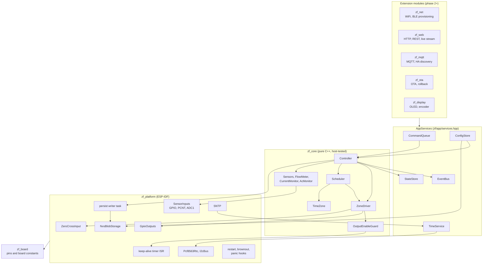

# ZoneFlow firmware architecture

Status: **phase 1 plus phase 2 core hardening**. Covers the standalone
ESP-IDF firmware of system spec section 4.1 (`firmware/zoneflow-fw/`).
Nothing described here has run on a board. Checks done so far: host unit
tests (GoogleTest, ASan and UBSan) and `idf.py build` with ESP-IDF v5.5.6.
Section 11 lists what the phase 2 hardening changed.

Phase 1 delivers the structure, the safety-critical core and tests. WiFi and
BLE provisioning, the web UI and REST API, MQTT, OTA and the OLED UI are
later phases. They plug into the interfaces in section 4 and must not reach
around them.

## 1. Modules



| Component | Role |
|---|---|
| `zf_core` | All decisions. No ESP-IDF headers. Built by the firmware and by `test/host`. |
| `zf_board` | The board header. Every GPIO number and board constant, plus `static_assert` checks of the pin rules. |
| `zf_platform` | Implements the core's interfaces on ESP-IDF. Holds no policy. |
| `main` | Creates the objects (all static), starts the tasks, calls the extension modules. |
| `zf_net`, `zf_web`, `zf_mqtt`, `zf_ota`, `zf_display` | Stubs. Each header lists what the module must do. |

## 2. Threading model

| Task | Priority | Core | Period | Does |
|---|---|---|---|---|
| keep-alive (GPTimer alarm ISR, IRAM) | interrupt | allocating core | 5 ms (`CONFIG_ZF_OE_TOGGLE_PERIOD_MS`) | Calls `OutputEnableGuard::step()` and writes the OE pin register. Runs while the flash cache is off. No heap, no locks, no calls into flash. |
| `zf_control` | 10 | 1 | 50 ms (`CONFIG_ZF_CONTROL_PERIOD_MS`) | Drains the command queue, then `Controller::tick()`. Subscribed to the task watchdog (5 s, panics). |
| `zf_persist` | 3 | 0 | 250 ms poll | Takes the latest runtime state from `PersistMailbox`, builds the JSON and writes NVS. Static stack (6 KB). |
| `zf_evlog` | 2 | 0 | on event | Logs events from its own queue. |
| `main` | 1 | any | 100 ms | Status LED, state log once a minute. |
| lwIP / SNTP | IDF | IDF | on sync | `TimeService::onNetworkSync()` writes the RTC. |
| Phase 2 modules | own tasks | | | Read state, subscribe, post commands. |

Rules:

- **One owner.** The control task owns the `Controller`, and through it the
  `ZoneDriver` and `Scheduler`. No other task calls them. The one exception
  is `Controller::emergencyOff()` / `ZoneDriver::emergencyOff()`, which only
  writes GPIO and atomics and may run in any context.
- **Commands in.** Other tasks change behaviour only by posting a `Command`
  to `CommandQueue` (non-blocking, 16 entries, mutex held for one struct
  copy). A full queue returns `false`; the caller reports busy.
- **Events out.** `EventBus::publish()` runs on the control task and calls
  handlers synchronously, without holding the bus lock. A handler must
  return within microseconds: copy the event into the module's own queue
  with zero timeout (`platform::EventQueueSubscriber` does this) and drop
  it if full. Handlers must not block, sleep, take a lock a blocking task
  may hold, or call back into the controller.
- **State snapshot.** The control task publishes a `SystemState` copy to
  `StateStore` whenever something changed and at least once a second.
  `snapshot()` holds a mutex for one struct copy; `sequence()` is a lock-free
  change counter for pollers.
- **Config writes.** `ConfigStore::update()` validates, writes NVS, then swaps
  the in-memory copy. Writers serialise on a writer-only mutex that is held
  across the flash write. Neither the control task nor the keep-alive
  interrupt ever takes it. The NVS lock inside ESP-IDF is the other lock
  held across a flash write; only config writers and `zf_persist` take it.
  Readers (`get()`) use a separate mutex held for a copy.
- **No allocation in the safety path.** Zone driver, output-enable guard,
  keep-alive interrupt, command queue, event bus and `Controller::tick()`
  use fixed arrays. Config JSON handling (cJSON) allocates, and only runs on
  config load and update, on the caller's task. Runtime state is handed to
  the persist writer as a plain struct (below). A host test counts
  `operator new` calls inside 1200 control ticks that include a scheduled
  start and repeated state changes: zero.
- **Runtime state off the control task.** `Controller` posts a
  `SchedulerPersist` copy (plain data: 8 + 8 + 16 × 16 = 272 bytes) to its
  `PersistMailbox` at most every 2 s; the mutex is held for that copy only,
  and a newer copy replaces one not yet taken. `zf_persist` takes it, builds
  the JSON and writes NVS. A failed write comes back through the mailbox
  and raises `storage_error` on the next tick.

#### Why NVS garbage collection can no longer starve the heartbeat

Before, the control task built JSON and called `nvs_set_blob` itself, so a
write that triggered NVS garbage collection (page erase plus copying live
entries) held the control loop, and with it the heartbeat, for the whole
operation, and it waited on the NVS lock whenever a config write on
another task held it. Now:

1. The control task never calls NVS and never takes the NVS lock or the
   config writer lock. The only lock it shares with `zf_persist` is the
   mailbox mutex, which neither side holds across anything but a struct
   copy. A stalled writer cannot block `post()`.
2. `zf_persist` runs at priority 3 on core 0; the control task runs at
   priority 10 on core 1. Between flash operations the control task runs
   as usual.
3. What remains is the flash operation itself: while one sector is erased
   or written, the cache is off and both cores stall, the control task
   included. The heartbeat then ages by at most one flash operation plus
   one control period. The keep-alive no longer stalls with it (section 3),
   so OE keeps its edges as long as that stays under the 500 ms heartbeat
   timeout. NVS erases one 4 KB sector at a time; the worst-case sector
   erase time of the module flash must come from its datasheet (open
   question 2).

The host test `PersistHandOff.StalledFlashWriteDoesNotStallTheControlLoop`
runs the hand-off with a storage `write()` that blocks, as during garbage
collection, on a second thread. During 1200 ticks (60 s of control time,
including a scheduled start) with the writer stuck, the heartbeat is fresh
on every tick with a zone open, the control thread never calls storage, and
the last posted state is the one stored once the write is released.

## 3. Safety design

How the firmware implements spec section 2:

| Spec rule | Firmware |
|---|---|
| 1. Outputs off by default | `GpioOutputs::init()` is the first call in `app_main`: it sets the output latch to off, then enables the drivers (pin goes from high impedance straight to driven off). `ZoneDriver::init()` forces all off again. Hardware pull-downs must hold outputs off before that (see open questions). |
| 2. No strapping or glitching pins on outputs | `zf_board` `static_assert`s: no strapping (0, 3, 45, 46), USB (19, 20) or flash/PSRAM (26 to 37) pins, no output or OE on a pin with a high-level power-up glitch (18, 19, 20; ESP32-S3 datasheet v2.2 table 2-2), no duplicates. |
| 3. Hardware output enable | Firmware keeps toggling a keep-alive signal, and hardware removes gate drive within about 1 s after toggling stops. `OutputEnableGuard` toggles only while (a) an output is on or about to be, (b) the control loop heartbeat is younger than `CONFIG_ZF_OE_HEARTBEAT_TIMEOUT_MS` (500 ms), (c) it is not tripped. The edges come from a GPTimer alarm interrupt every 5 ms that keeps running through flash erases (see "Keep-alive from a timer" below). A stuck control loop, a stopped timer or a halted CPU all stop the toggling. A static-level variant exists as a Kconfig option for other hardware; rev A uses toggle mode. |
| 4. Maximum run time | Per zone, not per run (spec v0.3 rule 4 as amended). The driver adds up each zone's on-time across runs until the zone has been closed for `driver.min_rest_s` (default 1800 s). `ZoneDriver::start()` clamps every request to what is left of min(zone `max_run_s`, 4 h); the driver times the run and closes the valve, and `tick()` independently closes a zone whose accumulated on-time reaches the limit (`max_run_time`). The zone then refuses to start (`resting`) until it has been closed for the rest time. Stop and restart, pause and resume, back-to-back programs and config reloads do not reset the count. |

#### Keep-alive from a timer

The OE waveform is generated by a GPTimer alarm interrupt
(`CONFIG_GPTIMER_ISR_CACHE_SAFE=y`), not by a task. The interrupt handler is
in IRAM and the driver keeps it enabled while the flash cache is off, so OE
keeps its edges while NVS or OTA erase flash. Everything the handler
touches is in IRAM or DRAM: `OutputEnableGuard::step()` is forced inline
(the linked ELF shows `onKeepAlive` in IRAM with no call instructions), the
guard is a static object, and the pin write is a register write.

A peripheral generating the waveform must not keep a dead control loop's
outputs alive. It does not, because the timer does not decide the level;
`step()` does, on every alarm:

- The control task increments a heartbeat counter every tick.
- `step(period)` compares the counter with the value it saw last time. If
  the counter moved, the age restarts at 0; if not, the age grows by one
  period (5 ms). It needs no clock, so there is no time base to share or
  wrap.
- Once the age exceeds the timeout (500 ms), `step()` returns low on every
  alarm and OE gets no more edges; the hardware then removes gate drive
  within its hold time (about 1 s, spec rule 3). The age saturates just
  above the timeout, so it never wraps back to fresh; only a new heartbeat
  restarts the edges.

So when the control loop dies (hang, crash before the panic handler, a
priority problem), the edges stop at most 500 ms plus one period after its
last tick, although the timer keeps firing. A flash operation stalls the
control loop the same way; the edges continue through stalls shorter than
the timeout and stop for longer ones (`OutputEnableTimer.*` host tests).
The restart and brownout handlers trip the guard; they and the panic
handler also drive OE low directly.

Other limits enforced in the zone driver:

- **Concurrency.** At most `driver.max_concurrent` zones open or waiting
  (default 2, configurable 1 to 2, from spec section 1). Master is extra.
- **Master sequencing.** Master opens `pre_open_ms` before the first zone and
  closes `post_close_ms` after the last one. A zone starting during the
  post-close delay keeps the master on.
- **Inter-zone delay.** A zone opens no sooner than `inter_zone_delay_ms`
  after the previous zone closed.

Fault paths, each ending with outputs off:

| Event | Action |
|---|---|
| Short circuit (above `short_circuit_ma`, 2 samples, checked even during inrush) | All off, queue stopped, zone locked out, fault latched. On the master: counted towards the master lockout. |
| Over-current (above the summed window after settling, 3 samples; short-circuit samples count towards them) | Same as short circuit. |
| Hardware over-current trip (comparator latch, read every tick) | All off in firmware state, queue stopped, `over_current_trip` latched. Blamed: every output switched on within `settle_ms` before the trip, else the output switched on most recently. Blamed zones lock out; a blamed master counts towards the master lockout. Starts are refused while the latch is set. The latch is released on a later tick, only when the driver has nothing open or waiting, right after all outputs are driven off again; a latch that comes back is released at most once a second and reported once. |
| Master lockout (`master.fault_lockout_count` consecutive faults blamed on the master, default 3) | `master_locked_out` latched. With the master enabled, every start is refused: scheduled starts are skipped (`master_locked_out`), manual runs return `master_locked_out`, the driver refuses to open anything. A master session of at least `settle_ms` without a fault resets the count. |
| Open circuit (below the summed window) | That zone off, queue moves to the next entry, fault latched. Master or unattributable: all off. |
| Current with every output off | Fault only. Firmware already has everything off; the output stage needs a human. If the current then rises past `short_circuit_ma`, `short_circuit` is reported as well. |
| Current sense unavailable (ADC init or calibration failed, or no reading) | `current_sense_unavailable` raised; zones still run (policy below). |
| 24 VAC lost (60 ms debounce) | All off, queue cleared, starts blocked until AC returns (500 ms debounce). |
| Maintenance command (OTA) | All off, starts blocked. |
| `esp_restart()` (includes the reboot after OTA) | Shutdown handler trips OE and forces outputs off. |
| Panic, abort, task or interrupt watchdog | `-Wl,--wrap=esp_panic_handler`: an IRAM wrapper forces OE and outputs off by direct register writes, then runs the IDF handler. Checked in the linked ELF: the IDF call site loads `__wrap_esp_panic_handler`. |
| Brownout | Brownout interrupt callback (IRAM) forces outputs off before the reset. |

Latched faults clear with the `ClearFaults` command. Lockouts (zones and
master) clear with it. A current fault whose cause is still present is
raised again on the next sample. `ac_lost`, `time_invalid` and
`current_sense_unavailable` are conditions: they clear themselves when the
cause goes away, and `ClearFaults` does not hide them.

**Current sense unavailable: policy.** Zones keep running. Watering
matters more than diagnostics, and a controller that refuses to water
because a diagnostic failed is the failure users notice. The condition is
raised as a fault (status LED blinks, `activeFaults` bit, event), so the
board gets looked at. Without current readings, short-circuit protection
rests on the hardware over-current trip and the per-output series element
of spec 3.1, and the maximum run time still applies. With
`diagnostics.current_enabled = false` the condition is not raised.

## 4. Interfaces for later modules

Every module receives `zf::AppServices` (`zf/app/services.hpp`):

```cpp
struct AppServices {
    EventBus &events;       // subscribe(handler, ctx, mask)
    StateStore &state;      // snapshot(), sequence()
    ICommandSink &commands; // post(Command::runZone(z, s)), ...
    ConfigStore &config;    // get(), toJson(), update(), updateFromJson()
    TimeService &time;      // status(), setManual()
};
```

| Need | Use |
|---|---|
| Show status | `state.snapshot()`; poll `state.sequence()` or wake on an event. |
| Follow changes | `platform::EventQueueSubscriber` with an `EventMask`, read from the module's task. |
| Run, stop, pause, resume, skip, rain delay, clear faults, maintenance | `commands.post(Command::...)`. A command the controller refuses publishes `CommandRejected` with the command, its zone or program and the `RunError` (for example `locked_out`, `zone_resting`, `master_locked_out`, `inhibited`). Subscribe to it to answer an API call. |
| Read config | `config.get()` (typed) or `config.toJson()` (REST, backup). |
| Change config | `config.updateFromJson(json)` or `config.update(cfg)`; on success post `CommandType::ReloadConfig`. A failed validation returns the JSON path and a message for the API response. |
| Set the clock | `time.setManual(utc)`. |

Event types: `ZoneChanged`, `MasterChanged`, `QueueChanged`, `ProgramStarted`,
`ProgramSkipped`, `ProgramMissed`, `SensorChanged`, `FaultRaised`,
`FaultCleared`, `RainDelayChanged`, `ConfigApplied`, `TimeStatusChanged`,
`MaintenanceChanged`, `CommandRejected`, `RunDropped` (a queued run whose
zone refused to start: locked out, resting, master locked out) and
`PauseExpired`. `toString()` gives stable lowercase names for APIs.

New enum values are appended, never inserted. ESP-IDF builds with
`-Werror=switch`, so a `switch` over `EventType`, `FaultCode`, `RunError`,
`StartError` or `SkipReason` without a `default` must list every value.

`SystemState` also carries, per zone, `restRemainingSec` (resting after
reaching the maximum run time), and `masterLockedOut` and
`masterFaultCount`.

Adding state a module owns (for example network status) means adding a field
to `SystemState` and a command or setter that the control task applies.
Modules do not write `StateStore` themselves.

## 5. Scheduler

### Programs

A program has an id (stable, non-zero), name, enabled flag, up to 4 start
times (local "HH:MM"; a time listed twice counts once), a day rule, per-zone durations, a seasonal-adjust flag
and an obey-sensor flag. Day rules:

- **weekdays**: any set of days.
- **interval**: every N days (1 to 365) counted from an anchor date.
- **odd / even**: day of month. Odd runs on the 31st and the 1st back to back.

Zones of a program run one after another in zone order. Programs that start
at the same time queue behind each other; they do not overlap. The run queue
holds up to 64 entries.

### Run queue

`pause` closes the running zone and keeps its remaining time; `resume`
reopens it for the remainder. `skip` drops the head entry and starts the
next. `stop` closes everything and empties the queue.

A paused queue is stopped, not resumed, after `schedule.pause_timeout_min`
(default 120, range 1 to 1440), and `PauseExpired` is published. The
timeout runs from the first pause; pausing again does not extend it. Why
stop: someone paused on purpose (mowing, working in a bed, children
playing), and watering that restarts by itself hours later could soak
them or a lawn they left wet. A paused queue also blocks later scheduled
starts, so leaving it paused stops the schedule with no fault. Stopping
clears both problems: nothing starts unexpectedly, and the next scheduled
start runs as usual.

An entry whose zone refuses to start when it reaches the head of the
queue (locked out, resting, master locked out) is dropped with a
`RunDropped` event and the queue moves on. `RunZone` on a zone that is
locked out or resting is refused at once (`locked_out`, `zone_resting`).

### Adjustments and inhibits

| Condition | Scheduled starts | Running scheduled entries | Manual runs |
|---|---|---|---|
| Seasonal percent (0 to 250) | Durations scaled, rounded to the second | | Manual program runs scaled; manual zone runs not |
| Rain delay until a time | Skipped (`rain_delay`) | Removed when the delay is set | Allowed |
| Rain sensor (or spare in "inhibit" mode) active | Skipped if the program obeys the sensor | Removed when the sensor goes active | Allowed |
| No 24 VAC | Skipped (`no_ac`) | Cleared | Refused |
| Maintenance | Skipped | Cleared | Refused |
| Same program already queued | Skipped (`already_queued`) | | Refused |

### Time, DST and clock jumps

Start times are local wall-clock times converted with a POSIX TZ string
(`timezone` in config, for example `CET-1CEST,M3.5.0,M10.5.0/3`). The core has
its own TZ implementation so the host and the device compute the same
instants.

- **Spring forward.** A start inside the skipped hour runs at the end of the
  gap (02:30 on the Berlin change day runs at 03:00 CEST).
- **Fall back.** A start inside the repeated hour runs once, at the first
  occurrence.
- **Each start runs at most once.** For every program the scheduler stores
  the last start it consumed as a (local day, minute) key and persists it in
  NVS. Setting the clock back, rebooting right after a start, or a DST
  repeat never runs a start twice.
- **Clock set back by more than 24 h** (for example an RTC that was in the
  future, corrected by SNTP): the stored keys are clamped to the new time so
  the schedule resumes. The same check runs on the first valid time after
  boot, for keys stored while the clock was wrong.
- **No valid clock.** If the RTC is missing or reports lost time and SNTP has
  not synced, no scheduled start runs. Manual runs still work.
- **Time zone change.** The stored keys are local (day, minute) values. On
  a change of zone, `Scheduler::configure` moves each key to the same
  instant in the new zone (old zone to UTC, UTC to new zone). Without this,
  a move west made the last consumed key read as a later local time than
  now, and the next start counted as already run. Re-keying was chosen
  over storing UTC instants because it keeps the persisted format. An
  unchanged zone leaves the keys alone, so a key in a DST gap is not
  shifted.

### Missed-start policy

The scheduler evaluates the window between its last evaluation and now, once
a second. After a power cut, at boot, or after the clock jumps forward, that
window can contain starts that did not run on time.

1. Only starts within the last 24 hours are considered.
2. Of the starts in the window, only the newest per program can run.
3. It runs (late, `ProgramStarted` with `late = true`) if it is no older
   than `schedule.missed_start_grace_min` (default 60, range 0 to 720).
   With 0, nothing is caught up.
4. Every other start in the window is reported once as `ProgramMissed` and
   not run.
5. A program with no stored key (never ran on this device, or runtime state
   lost) gets no catch-up and no missed reports.
6. Editing the configuration never triggers a start whose time has passed.

Example: a program at 06:00 with the default grace. Power fails at 05:30 and
returns at 06:20: the 06:00 start runs at 06:20. Power returns at 07:30
instead: the start is reported missed and the next one runs as usual.

## 6. Configuration

Stored as JSON in NVS (namespace `zoneflow`, key `config`). The same JSON is
the REST and backup format. Abbreviated example:

```json
{
  "schema": 1,
  "device_name": "zoneflow",
  "timezone": "CET-1CEST,M3.5.0,M10.5.0/3",
  "zone_count": 8,
  "zones": [{"name": "Lawn", "enabled": true, "max_run_s": 3600,
             "current_min_ma": 80, "current_max_ma": 700}],
  "master": {"enabled": true, "pre_open_ms": 1000, "post_close_ms": 2000,
             "fault_lockout_count": 3,
             "current_min_ma": 80, "current_max_ma": 700},
  "driver": {"max_concurrent": 2, "inter_zone_delay_ms": 2000, "min_rest_s": 1800,
             "zero_cross_switching": false},
  "sensors": {
    "rain": {"enabled": true, "contact": "nc", "debounce_ms": 2000},
    "spare": {"enabled": false, "contact": "no", "debounce_ms": 200, "function": "none"},
    "flow": {"enabled": false, "pulses_per_litre": 450, "leak_threshold_lpm": 0.5, "leak_detect_s": 60}
  },
  "diagnostics": {"current_enabled": true, "settle_ms": 500, "idle_max_ma": 60,
                  "short_circuit_ma": 3000, "confirm_samples": 3},
  "schedule": {
    "seasonal_percent": 100,
    "missed_start_grace_min": 60,
    "pause_timeout_min": 120,
    "programs": [{"id": 1, "name": "Lawn", "enabled": true, "starts": ["06:00"],
                  "days": {"type": "weekdays", "weekdays": ["mon", "wed", "fri"]},
                  "durations_s": [600, 0, 300], "seasonal": true, "obey_sensor": true}]
  }
}
```

- **Missing fields** take their defaults; unknown fields are ignored.
- **Validation** rejects the whole document on the first error and returns
  its JSON path (for example `schedule.programs[0].starts[1]`) and a message.
  Range limits are in `zf_core/src/config.cpp`. A document nested more than
  16 levels deep is rejected before parsing: cJSON recurses once per level.
- **Migration.** `schema` is required. An older schema runs the steps in
  `kMigrations` (`config_json.cpp`), one version at a time, and the result
  is written back. Schema 1 is the first, so the table is empty; the
  mechanism is tested with injected steps.
- **Newer schema** (firmware rolled back after an OTA): parsed best-effort,
  used, and not written back, so the newer firmware finds its data intact.
  The same document sent through `updateFromJson()` (REST, MQTT, restore)
  is rejected with path `schema` and "schema N is newer than this firmware
  supports (1)": writing it would drop every field this firmware does not
  know.
- **New fields in this phase** (schema stays 1; absent fields take their
  defaults, so older documents still load):

  | Field | Default | Range | Meaning |
  |---|---|---|---|
  | `driver.min_rest_s` | 1800 | 60 to 86400 | Closed time that ends a zone's run of back-to-back runs, and the rest after it reached its maximum run time. |
  | `driver.zero_cross_switching` | false | | Turn outputs on at a mains zero crossing when the board has the signal. |
  | `master.fault_lockout_count` | 3 | 1 to 10 | Consecutive current faults on the master that lock it out. |
  | `schedule.pause_timeout_min` | 120 | 1 to 1440 | A paused queue is stopped after this long. |

  Why 30 minutes of rest: the default maximum run time is 60 minutes, so a
  zone can be on for at most 60 of any 90 minutes, and typical programs
  (10 to 30 minutes per zone) never meet the limit. Two programs that share
  a zone within half an hour share one budget.
- **Invalid stored config:** defaults are used, `config_invalid` fault is
  raised, the stored copy is kept for diagnosis until the next update.
- **Runtime state** (rain delay, last consumed start per program) lives under
  key `runtime`, written at most every 2 s and only when changed.

## 7. Sensors and diagnostics

- **Rain and spare inputs.** Dry contacts, NO or NC, debounced (default
  2000 ms rain, 200 ms spare). The first reading after boot is taken as-is so
  a wet sensor inhibits from the start.
- **Flow.** PCNT counts pulses in hardware (falling edge, 1 us glitch
  filter). Litres = pulses / `pulses_per_litre`; rate over the last 5 s (one sample per second).
  Flow above `leak_threshold_lpm` for `leak_detect_s` with every valve shut
  raises `flow_without_zones`.
- **Valve current.** One total current from the low-side shunt (spec 3.1).
  A shorted valve or wire shuts the zone off and is reported (spec 1).
  Expected window = sum of
  the min/max of every output that is on. Comparisons start `settle_ms` after
  any output change; the short-circuit limit applies at all times. A config
  reload does not restart a confirmation in progress. A fault
  is attributed to the output switched on most recently. Per-output current
  observed when the output runs alone (or with the master, minus the
  master's share) is recorded as the basis for learned limits later.
- **24 VAC present.** Loss declared after 60 ms, return after 500 ms. With
  no AC (USB-only power) the current checks are suspended.
- **Current sense unavailable.** `SensorSample::currentSenseAvailable` is
  false when the ADC or its calibration could not be set up, or a tick gave
  no reading. Policy in section 3.
- **Hardware over-current trip.** `SensorSample::overCurrentTripped` reads
  the comparator latch; `IOutputHal::clearOverCurrentTrip()` pulses its
  release. Handling in section 3.
- **Zero-cross switching.** With `driver.zero_cross_switching` on and a
  zero-cross input attached (`IZeroCrossHal`, GPIO interrupt timestamps on
  the device), `ZoneDriver` turns each output on at the next mains zero
  crossing plus the board's detector offset. `zeroCrossWaitUs()` is a pure
  function (host-tested): it waits at most one crossing interval, and
  returns 0 (switch now) with no signal, an interval outside 7 to 11 ms, or
  no edge for three intervals. Turning off never waits: a triac stops at
  the next current zero by itself, and the off paths must stay immediate.
  The wait is a busy wait on the control task, at most 10 ms at 50 Hz per
  output switched on; an output that follows another at once is already
  on the crossing.

## 8. Timekeeping

- **Boot.** Read the RTC. If the chip answers, its voltage-low flag is clear
  and the time is after 2025-01-01, set the system clock from it (status
  `rtc`). Otherwise status `unset` and the `time_invalid` condition is
  raised.
- **SNTP.** Starts on the first `IP_EVENT_STA_GOT_IP` (`pool.ntp.org`). Each
  sync sets status `synced` and writes the RTC.
- **Representation.** The system clock and the RTC hold UTC. Local time
  exists only inside the scheduler and for display.
- **Provisional RTC: NXP PCF8563** (I2C address 0x51, register map from the
  NXP datasheet rev 11.1), chosen because it and the BM8563 clone are widely
  stocked. The driver is one file (`time_storage.cpp`, `Pcf8563Rtc`) behind
  `IRtc`. No part number or LCSC code is chosen here; that is the hardware
  lead's call.

## 9. Open questions for the hardware team

1. **Pin map.** Everything in `zoneflow_rev_a.hpp` is provisional. Please
   publish `hardware/pinmap.yaml`; the board header will follow it. The
   `static_assert`s will flag any pin that breaks the rules above.
2. **Keep-alive circuit.** Spec v0.2 fixes toggle mode and a removal time
   of about 1 s. Firmware produces an edge every 5 ms while an output is
   wanted and stops toggling when everything is off. The edges now come
   from an IRAM-safe timer interrupt and continue through flash erases,
   so the hold time no longer has to cover a sector erase. Still needed:
   the minimum edge rate the circuit accepts, and the module flash's
   worst-case 4 KB sector-erase time (from its datasheet). The control
   loop stalls for that long; if it can exceed about 450 ms (the 500 ms
   heartbeat timeout minus one control period), OE drops during the erase
   and `CONFIG_ZF_OE_HEARTBEAT_TIMEOUT_MS` has to be raised.
3. **Pull-downs.** Firmware assumes external pull-downs on every output and
   on OE so outputs stay off in reset and while unpowered. Confirm.
4. **Current-sense front end.** Spec v0.2: low-side shunt in the shared
   triac return, rectifying/averaging front end, biased away from the
   non-linear ADC region near 0 V. Firmware reads it on ADC1 with a
   placeholder scale of 1 mA per mV and a bias offset of 0 mV
   (`kValveCurrentMaPerMv`, `kValveCurrentOffsetMv`), 16 samples averaged
   per 50 ms tick. Needed: shunt value, gain, bias voltage, full scale and
   filter time constant, or the external ADC if one is used.
5. **24 VAC-present signal.** Assumed active low (optocoupler pulling down).
   Polarity and response time on loss?
6. **Field input polarity.** Assumed: contact closed pulls the pin low,
   external pull-ups present, protection network in series. The flow input
   must pass 200 Hz.
7. **RTC choice and backup.** PCF8563 assumed at 0x51. Battery or supercap,
   and expected hold-up time?
8. **OLED address.** 0x3C assumed. SSD1306 or SH1106?
9. **GPIO15/16 for I2C** assume no 32 kHz crystal on the module pins.
10. **Valve current windows.** Defaults are 80 to 700 mA per output and
    3000 mA short circuit. The prior-art survey cites 200 to 400 mA for
    typical solenoids and an OpenSprinkler default limit of 1200 mA. Please
    confirm against the triac stage and the spec ratings (0.5 A continuous,
    1.5 A inrush for 100 ms per output).
11. **Per-output LEDs.** The spec asks for one LED per output. Firmware
    assumes they follow the gate drive in hardware and only drives the
    power/status LED. If they need their own GPIOs, the pin map has to
    change.
12. **Hardware over-current trip.** Firmware now expects a latching
    comparator: trip status on GPIO18 (assumed active low, open drain) and
    a release pulse on GPIO47 (assumed active high, 10 us). Both pins,
    polarities and the pulse width are placeholders. Needed: the latch
    circuit, its trip threshold, whether it removes gate drive from every
    output or only the faulty one (firmware assumes all), and its minimum
    release pulse.
13. **Zero-cross detector.** Firmware expects one pulse per zero crossing
    (two per mains period) on GPIO48, rising edge at the crossing, offset
    0 us. Needed: the circuit, the edge that marks the crossing and the
    detector's lead or lag (`kZeroCrossOffsetUs`).
14. **Pin budget.** The provisional map now uses every free GPIO of the
    WROOM-1-N16R8 except UART0 (43, 44). The TFT (SPI: clock, data,
    chip select, data/command, backlight PWM; spec v0.3) and a second
    button need about six more. Options: an I2C GPIO expander for the
    buttons and encoder, sharing the I2C pins, or moving the status LED
    or AC-present input. The display owner and the hardware lead need to
    settle this in `hardware/pinmap.yaml`.

## 10. Decisions made in phase 1

- **ESP-IDF v5.5.6**, the newest v5.x release at the time of writing.
  C++ is compiled as `gnu++2b` (IDF default); the core also builds as C++20
  on the host. No exceptions, no RTTI in core code.
- **cJSON** for configuration JSON: it ships with ESP-IDF; host tests fetch
  the same version (1.7.19).
- **Own POSIX TZ code** instead of newlib `localtime`, for host/device parity
  and testability.
- **Single sequential queue.** Programs never overlap. The concurrency limit
  of 2 is a safety ceiling in the driver; parallel programs can be added
  later without changing the driver.
- **Keep-alive as a task**, as the brief asked. Replaced in phase 2 by an
  IRAM-safe timer interrupt (section 3).

## 11. Phase 2 core hardening

The design concerns raised by the phase 1 review (pull request #17), as
decided by the orchestrator, and where each is handled:

| Concern | Change | Where |
|---|---|---|
| Max run time per run, not per zone | Per-zone on-time budget across runs, rest time `driver.min_rest_s`; spec rule 4 amended | Section 3, rule 4 |
| No master lockout | `master.fault_lockout_count`, `master_locked_out` | Section 3, fault paths |
| Pause has no timeout | `schedule.pause_timeout_min`, stop not resume | Section 5, run queue |
| Persistence on the control task | `PersistMailbox` and `zf_persist` | Section 2 |
| Current diagnostics switch off silently | `current_sense_unavailable`, zones still run | Section 3 |
| No hardware over-current input | Trip input, latch release, handling | Sections 3, 7, open question 12 |
| `RunZone` on a locked-out zone returns `Ok` | `RunError::LockedOut` and `CommandRejected` | Section 4 |
| Newer schema written back through the API | Rejected | Section 6 |
| Keep-alive pauses during flash erases | GPTimer interrupt, `step()` | Section 3 |
| (new) Switching at a random mains phase | Zero-cross hook, off by default | Section 7 |
| Idle current rising to a short is not reported | `short_circuit` after `current_while_idle` | Section 3 |
| Time zone change skips a start | Keys re-keyed on a zone change | Section 5 |
| Spec v0.3 drift (core only) | WROOM-1-N16R8: octal PSRAM, 16 MB flash, 4 MB OTA slots, 7.75 MB assets partition; board asserts for GPIO33..37 | `sdkconfig.defaults`, `partitions.csv`, board header |

Not done here: the display driver (owned by `zf_display`), and the stack
budgets for phase 2 modules (review concern 6) and request body caps
(concern 7), which belong to the modules that receive requests.
