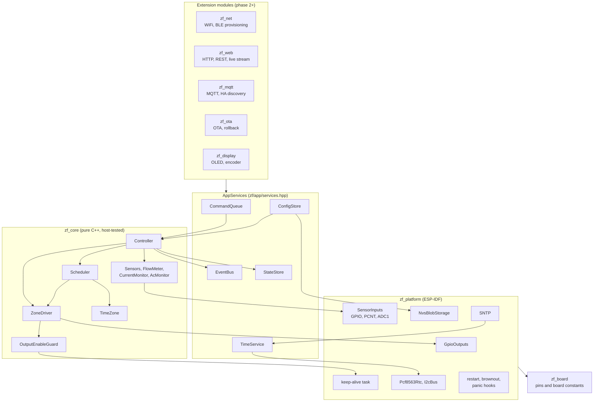

# ZoneFlow firmware architecture

Status: **phase 1**. Covers the standalone ESP-IDF firmware of system spec
section 4.1 (`firmware/zoneflow-fw/`). Nothing described here has run on a
board. Checks done so far: host unit tests (GoogleTest, ASan and UBSan) and
`idf.py build` with ESP-IDF v5.5.6.

Phase 1 delivers the structure, the safety-critical core and tests. WiFi and
BLE provisioning, the web UI and REST API, MQTT, OTA and the OLED UI are
later phases. They plug into the interfaces in section 4 and must not reach
around them.

## 1. Modules



| Component | Role |
|---|---|
| `zf_core` | All decisions. No ESP-IDF headers. Built by the firmware and by `test/host`. |
| `zf_board` | The board header. Every GPIO number and board constant, plus `static_assert` checks of the pin rules. |
| `zf_platform` | Implements the core's interfaces on ESP-IDF. Holds no policy. |
| `main` | Creates the objects (all static), starts the tasks, calls the extension modules. |
| `zf_net`, `zf_web`, `zf_mqtt`, `zf_ota`, `zf_display` | Stubs. Each header lists what the module must do. |

## 2. Threading model

| Task | Priority | Core | Period | Does |
|---|---|---|---|---|
| `zf_keepalive` | `configMAX_PRIORITIES - 2` (23) | 1 | 5 ms (`CONFIG_ZF_OE_TOGGLE_PERIOD_MS`) | Calls `OutputEnableGuard::nextLevel()` and writes the OE pin. Static stack, no heap, no locks. |
| `zf_control` | 10 | 1 | 50 ms (`CONFIG_ZF_CONTROL_PERIOD_MS`) | Drains the command queue, then `Controller::tick()`. Subscribed to the task watchdog (5 s, panics). |
| `zf_evlog` | 2 | 0 | on event | Logs events from its own queue. |
| `main` | 1 | any | 100 ms | Status LED, state log once a minute. |
| lwIP / SNTP | IDF | IDF | on sync | `TimeService::onNetworkSync()` writes the RTC. |
| Phase 2 modules | own tasks | | | Read state, subscribe, post commands. |

Rules:

- **One owner.** The control task owns the `Controller`, and through it the
  `ZoneDriver` and `Scheduler`. No other task calls them. The one exception
  is `Controller::emergencyOff()` / `ZoneDriver::emergencyOff()`, which only
  writes GPIO and atomics and may run in any context.
- **Commands in.** Other tasks change behaviour only by posting a `Command`
  to `CommandQueue` (non-blocking, 16 entries, mutex held for one struct
  copy). A full queue returns `false`; the caller reports busy.
- **Events out.** `EventBus::publish()` runs on the control task and calls
  handlers synchronously, without holding the bus lock. A handler must
  return within microseconds: copy the event into the module's own queue
  with zero timeout (`platform::EventQueueSubscriber` does this) and drop
  it if full. Handlers must not block, sleep, take a lock a blocking task
  may hold, or call back into the controller.
- **State snapshot.** The control task publishes a `SystemState` copy to
  `StateStore` whenever something changed and at least once a second.
  `snapshot()` holds a mutex for one struct copy; `sequence()` is a lock-free
  change counter for pollers.
- **Config writes.** `ConfigStore::update()` validates, writes NVS, then swaps
  the in-memory copy. Writers serialise on a writer-only mutex that is held
  across the flash write. This is the one lock held during a blocking call,
  and neither the control task nor the keep-alive task ever takes it.
  Readers (`get()`) use a separate mutex held for a copy.
- **No allocation in the safety path.** Zone driver, output-enable guard,
  keep-alive task, command queue and event bus use fixed arrays. Config JSON
  handling (cJSON) allocates, and only runs on config load and update.

## 3. Safety design

How the firmware implements spec section 2:

| Spec rule | Firmware |
|---|---|
| 1. Outputs off by default | `GpioOutputs::init()` is the first call in `app_main`: it sets the output latch to off, then enables the drivers (pin goes from high impedance straight to driven off). `ZoneDriver::init()` forces all off again. Hardware pull-downs must hold outputs off before that (see open questions). |
| 2. No strapping or glitching pins on outputs | `zf_board` `static_assert`s: no strapping (0, 3, 45, 46), USB (19, 20) or flash/PSRAM (26 to 37) pins, no output or OE on a pin with a high-level power-up glitch (18, 19, 20; ESP32-S3 datasheet v2.2 table 2-2), no duplicates. |
| 3. Hardware output enable | Spec v0.2: firmware keeps toggling a keep-alive signal, and hardware removes gate drive within about 1 s after toggling stops. `OutputEnableGuard` toggles only while (a) an output is on or about to be, (b) the control loop heartbeat is younger than `CONFIG_ZF_OE_HEARTBEAT_TIMEOUT_MS` (500 ms), (c) it is not tripped. The keep-alive task produces an edge every 5 ms. A stuck control loop, a stuck keep-alive task or a halted CPU all stop the toggling. A static-level variant exists as a Kconfig option for other hardware; rev A uses toggle mode. |
| 4. Maximum run time | `ZoneDriver::start()` clamps every request to min(zone `max_run_s`, 4 h). The driver times the run itself and closes the valve; a second independent check in `tick()` closes any zone open longer than its limit. Callers cannot pass a longer time through any path. |

Other limits enforced in the zone driver:

- **Concurrency.** At most `driver.max_concurrent` zones open or waiting
  (default 2, configurable 1 to 2, from spec section 1). Master is extra.
- **Master sequencing.** Master opens `pre_open_ms` before the first zone and
  closes `post_close_ms` after the last one. A zone starting during the
  post-close delay keeps the master on.
- **Inter-zone delay.** A zone opens no sooner than `inter_zone_delay_ms`
  after the previous zone closed.

Fault paths, each ending with outputs off:

| Event | Action |
|---|---|
| Short circuit (above `short_circuit_ma`, 2 samples, checked even during inrush) | All off, queue stopped, zone locked out, fault latched. |
| Over-current (above the summed window after settling, 3 samples) | Same as short circuit. |
| Open circuit (below the summed window) | That zone off, queue moves to the next entry, fault latched. Master or unattributable: all off. |
| Current with every output off | Fault only. Firmware already has everything off; the output stage needs a human. |
| 24 VAC lost (60 ms debounce) | All off, queue cleared, starts blocked until AC returns (500 ms debounce). |
| Maintenance command (OTA) | All off, starts blocked. |
| `esp_restart()` (includes the reboot after OTA) | Shutdown handler trips OE and forces outputs off. |
| Panic, abort, task or interrupt watchdog | `-Wl,--wrap=esp_panic_handler`: an IRAM wrapper forces OE and outputs off by direct register writes, then runs the IDF handler. Checked in the linked ELF: the IDF call site loads `__wrap_esp_panic_handler`. |
| Brownout | Brownout interrupt callback (IRAM) forces outputs off before the reset. |

Latched faults clear with the `ClearFaults` command. Lockouts clear with it.

## 4. Interfaces for later modules

Every module receives `zf::AppServices` (`zf/app/services.hpp`):

```cpp
struct AppServices {
    EventBus &events;       // subscribe(handler, ctx, mask)
    StateStore &state;      // snapshot(), sequence()
    ICommandSink &commands; // post(Command::runZone(z, s)), ...
    ConfigStore &config;    // get(), toJson(), update(), updateFromJson()
    TimeService &time;      // status(), setManual()
};
```

| Need | Use |
|---|---|
| Show status | `state.snapshot()`; poll `state.sequence()` or wake on an event. |
| Follow changes | `platform::EventQueueSubscriber` with an `EventMask`, read from the module's task. |
| Run, stop, pause, resume, skip, rain delay, clear faults, maintenance | `commands.post(Command::...)`. |
| Read config | `config.get()` (typed) or `config.toJson()` (REST, backup). |
| Change config | `config.updateFromJson(json)` or `config.update(cfg)`; on success post `CommandType::ReloadConfig`. A failed validation returns the JSON path and a message for the API response. |
| Set the clock | `time.setManual(utc)`. |

Event types: `ZoneChanged`, `MasterChanged`, `QueueChanged`, `ProgramStarted`,
`ProgramSkipped`, `ProgramMissed`, `SensorChanged`, `FaultRaised`,
`FaultCleared`, `RainDelayChanged`, `ConfigApplied`, `TimeStatusChanged`,
`MaintenanceChanged`. `toString()` gives stable lowercase names for APIs.

Adding state a module owns (for example network status) means adding a field
to `SystemState` and a command or setter that the control task applies.
Modules do not write `StateStore` themselves.

## 5. Scheduler

### Programs

A program has an id (stable, non-zero), name, enabled flag, up to 4 start
times (local "HH:MM"), a day rule, per-zone durations, a seasonal-adjust flag
and an obey-sensor flag. Day rules:

- **weekdays**: any set of days.
- **interval**: every N days (1 to 365) counted from an anchor date.
- **odd / even**: day of month. Odd runs on the 31st and the 1st back to back.

Zones of a program run one after another in zone order. Programs that start
at the same time queue behind each other; they do not overlap. The run queue
holds up to 64 entries.

### Run queue

`pause` closes the running zone and keeps its remaining time; `resume`
reopens it for the remainder. `skip` drops the head entry and starts the
next. `stop` closes everything and empties the queue. A paused queue stays
paused until resumed.

### Adjustments and inhibits

| Condition | Scheduled starts | Running scheduled entries | Manual runs |
|---|---|---|---|
| Seasonal percent (0 to 250) | Durations scaled, rounded to the second | | Manual program runs scaled; manual zone runs not |
| Rain delay until a time | Skipped (`rain_delay`) | Removed when the delay is set | Allowed |
| Rain sensor (or spare in "inhibit" mode) active | Skipped if the program obeys the sensor | Removed when the sensor goes active | Allowed |
| No 24 VAC | Skipped (`no_ac`) | Cleared | Refused |
| Maintenance | Skipped | Cleared | Refused |
| Same program already queued | Skipped (`already_queued`) | | Refused |

### Time, DST and clock jumps

Start times are local wall-clock times converted with a POSIX TZ string
(`timezone` in config, for example `CET-1CEST,M3.5.0,M10.5.0/3`). The core has
its own TZ implementation so the host and the device compute the same
instants.

- **Spring forward.** A start inside the skipped hour runs at the end of the
  gap (02:30 on the Berlin change day runs at 03:00 CEST).
- **Fall back.** A start inside the repeated hour runs once, at the first
  occurrence.
- **Each start runs at most once.** For every program the scheduler stores
  the last start it consumed as a (local day, minute) key and persists it in
  NVS. Setting the clock back, rebooting right after a start, or a DST
  repeat never runs a start twice.
- **Clock set back by more than 24 h** (for example an RTC that was in the
  future, corrected by SNTP): the stored keys are clamped to the new time so
  the schedule resumes.
- **No valid clock.** If the RTC is missing or reports lost time and SNTP has
  not synced, no scheduled start runs. Manual runs still work.

### Missed-start policy

The scheduler evaluates the window between its last evaluation and now, once
a second. After a power cut, at boot, or after the clock jumps forward, that
window can contain starts that did not run on time.

1. Only starts within the last 24 hours are considered.
2. Of the starts in the window, only the newest per program can run.
3. It runs (late, `ProgramStarted` with `late = true`) if it is no older
   than `schedule.missed_start_grace_min` (default 60, range 0 to 720).
   With 0, nothing is caught up.
4. Every other start in the window is reported once as `ProgramMissed` and
   not run.
5. A program with no stored key (never ran on this device, or runtime state
   lost) gets no catch-up and no missed reports.
6. Editing the configuration never triggers a start whose time has passed.

Example: a program at 06:00 with the default grace. Power fails at 05:30 and
returns at 06:20: the 06:00 start runs at 06:20. Power returns at 07:30
instead: the start is reported missed and the next one runs as usual.

## 6. Configuration

Stored as JSON in NVS (namespace `zoneflow`, key `config`). The same JSON is
the REST and backup format. Abbreviated example:

```json
{
  "schema": 1,
  "device_name": "zoneflow",
  "timezone": "CET-1CEST,M3.5.0,M10.5.0/3",
  "zone_count": 8,
  "zones": [{"name": "Lawn", "enabled": true, "max_run_s": 3600,
             "current_min_ma": 80, "current_max_ma": 700}],
  "master": {"enabled": true, "pre_open_ms": 1000, "post_close_ms": 2000,
             "current_min_ma": 80, "current_max_ma": 700},
  "driver": {"max_concurrent": 2, "inter_zone_delay_ms": 2000},
  "sensors": {
    "rain": {"enabled": true, "contact": "nc", "debounce_ms": 2000},
    "spare": {"enabled": false, "contact": "no", "debounce_ms": 200, "function": "none"},
    "flow": {"enabled": false, "pulses_per_litre": 450, "leak_threshold_lpm": 0.5, "leak_detect_s": 60}
  },
  "diagnostics": {"current_enabled": true, "settle_ms": 500, "idle_max_ma": 60,
                  "short_circuit_ma": 3000, "confirm_samples": 3},
  "schedule": {
    "seasonal_percent": 100,
    "missed_start_grace_min": 60,
    "programs": [{"id": 1, "name": "Lawn", "enabled": true, "starts": ["06:00"],
                  "days": {"type": "weekdays", "weekdays": ["mon", "wed", "fri"]},
                  "durations_s": [600, 0, 300], "seasonal": true, "obey_sensor": true}]
  }
}
```

- **Missing fields** take their defaults; unknown fields are ignored.
- **Validation** rejects the whole document on the first error and returns
  its JSON path (for example `schedule.programs[0].starts[1]`) and a message.
  Range limits are in `zf_core/src/config.cpp`.
- **Migration.** `schema` is required. An older schema runs the steps in
  `kMigrations` (`config_json.cpp`), one version at a time, and the result
  is written back. Schema 1 is the first, so the table is empty; the
  mechanism is tested with injected steps.
- **Newer schema** (firmware rolled back after an OTA): parsed best-effort,
  used, and not written back, so the newer firmware finds its data intact.
- **Invalid stored config:** defaults are used, `config_invalid` fault is
  raised, the stored copy is kept for diagnosis until the next update.
- **Runtime state** (rain delay, last consumed start per program) lives under
  key `runtime`, written at most every 2 s and only when changed.

## 7. Sensors and diagnostics

- **Rain and spare inputs.** Dry contacts, NO or NC, debounced (default
  2000 ms rain, 200 ms spare). The first reading after boot is taken as-is so
  a wet sensor inhibits from the start.
- **Flow.** PCNT counts pulses in hardware (falling edge, 1 us glitch
  filter). Litres = pulses / `pulses_per_litre`; rate over the last 5 s (one sample per second).
  Flow above `leak_threshold_lpm` for `leak_detect_s` with every valve shut
  raises `flow_without_zones`.
- **Valve current.** One total current from the low-side shunt (spec 3.1).
  A shorted valve or wire shuts the zone off and is reported (spec 1).
  Expected window = sum of
  the min/max of every output that is on. Comparisons start `settle_ms` after
  any output change; the short-circuit limit applies at all times. A fault
  is attributed to the output switched on most recently. Per-output current
  observed when the output runs alone (or with the master, minus the
  master's share) is recorded as the basis for learned limits later.
- **24 VAC present.** Loss declared after 60 ms, return after 500 ms. With
  no AC (USB-only power) the current checks are suspended.

## 8. Timekeeping

- **Boot.** Read the RTC. If the chip answers, its voltage-low flag is clear
  and the time is after 2025-01-01, set the system clock from it (status
  `rtc`). Otherwise status `unset` and the `time_invalid` condition is
  raised.
- **SNTP.** Starts on the first `IP_EVENT_STA_GOT_IP` (`pool.ntp.org`). Each
  sync sets status `synced` and writes the RTC.
- **Representation.** The system clock and the RTC hold UTC. Local time
  exists only inside the scheduler and for display.
- **Provisional RTC: NXP PCF8563** (I2C address 0x51, register map from the
  NXP datasheet rev 11.1), chosen because it and the BM8563 clone are widely
  stocked. The driver is one file (`time_storage.cpp`, `Pcf8563Rtc`) behind
  `IRtc`. No part number or LCSC code is chosen here; that is the hardware
  lead's call.

## 9. Open questions for the hardware team

1. **Pin map.** Everything in `zoneflow_rev_a.hpp` is provisional. Please
   publish `hardware/pinmap.yaml`; the board header will follow it. The
   `static_assert`s will flag any pin that breaks the rules above.
2. **Keep-alive circuit.** Spec v0.2 fixes toggle mode and a removal time
   of about 1 s. Firmware produces an edge every 5 ms while an output is
   wanted and stops toggling when everything is off. Needed: the minimum
   edge rate the circuit accepts, and confirmation that the hold time is
   longer than the module flash's sector-erase time. During NVS writes the
   flash cache is disabled, both cores stall and the keep-alive task pauses
   for that long (value from the flash datasheet, not measured here).
3. **Pull-downs.** Firmware assumes external pull-downs on every output and
   on OE so outputs stay off in reset and while unpowered. Confirm.
4. **Current-sense front end.** Spec v0.2: low-side shunt in the shared
   triac return, rectifying/averaging front end, biased away from the
   non-linear ADC region near 0 V. Firmware reads it on ADC1 with a
   placeholder scale of 1 mA per mV and a bias offset of 0 mV
   (`kValveCurrentMaPerMv`, `kValveCurrentOffsetMv`), 16 samples averaged
   per 50 ms tick. Needed: shunt value, gain, bias voltage, full scale and
   filter time constant, or the external ADC if one is used. If a hardware
   over-current path is added (spec: preferred), firmware should read its
   trip flag on a GPIO; there is no pin for it in the provisional map.
5. **24 VAC-present signal.** Assumed active low (optocoupler pulling down).
   Polarity and response time on loss?
6. **Field input polarity.** Assumed: contact closed pulls the pin low,
   external pull-ups present, protection network in series. The flow input
   must pass 200 Hz.
7. **RTC choice and backup.** PCF8563 assumed at 0x51. Battery or supercap,
   and expected hold-up time?
8. **OLED address.** 0x3C assumed. SSD1306 or SH1106?
9. **GPIO15/16 for I2C** assume no 32 kHz crystal on the module pins.
10. **Valve current windows.** Defaults are 80 to 700 mA per output and
    3000 mA short circuit. The prior-art survey cites 200 to 400 mA for
    typical solenoids and an OpenSprinkler default limit of 1200 mA. Please
    confirm against the triac stage and the spec ratings (0.5 A continuous,
    1.5 A inrush for 100 ms per output).
11. **Per-output LEDs.** The spec asks for one LED per output. Firmware
    assumes they follow the gate drive in hardware and only drives the
    power/status LED. If they need their own GPIOs, the pin map has to
    change.

## 10. Decisions made in phase 1

- **ESP-IDF v5.5.6**, the newest v5.x release at the time of writing.
  C++ is compiled as `gnu++2b` (IDF default); the core also builds as C++20
  on the host. No exceptions, no RTTI in core code.
- **cJSON** for configuration JSON: it ships with ESP-IDF; host tests fetch
  the same version (1.7.19).
- **Own POSIX TZ code** instead of newlib `localtime`, for host/device parity
  and testability.
- **Single sequential queue.** Programs never overlap. The concurrency limit
  of 2 is a safety ceiling in the driver; parallel programs can be added
  later without changing the driver.
- **Keep-alive as a task**, as the brief asked. An IRAM timer ISR could
  keep OE alive through flash operations (the heartbeat check would still
  drop OE if the control loop stopped). Worth doing only if open question 2
  shows the hold time cannot cover a flash erase.
