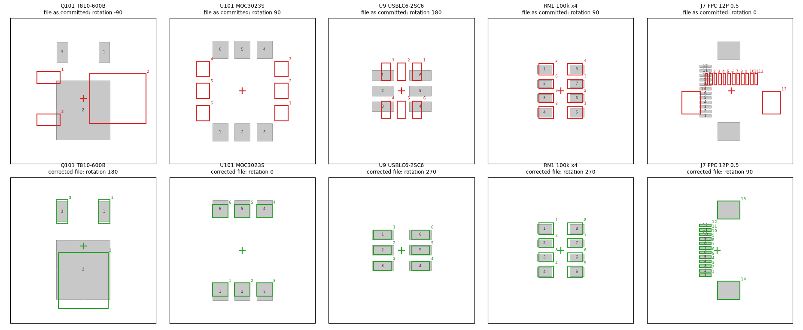
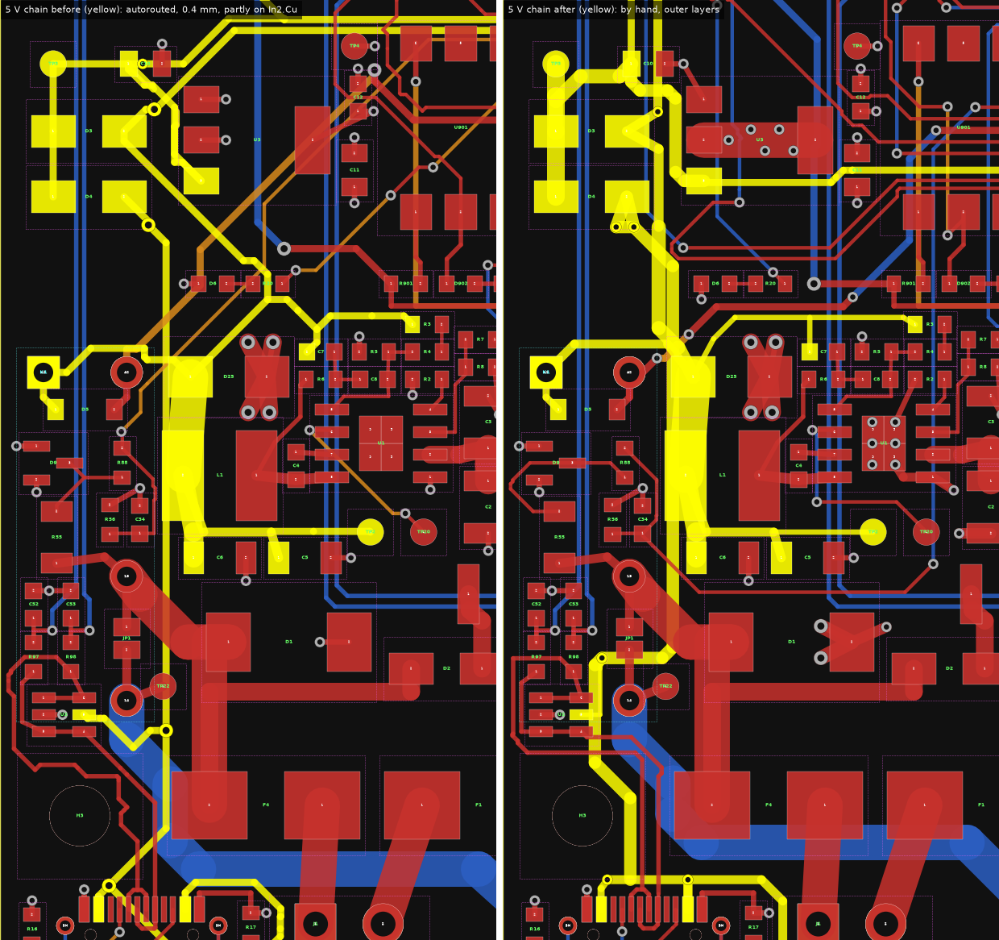
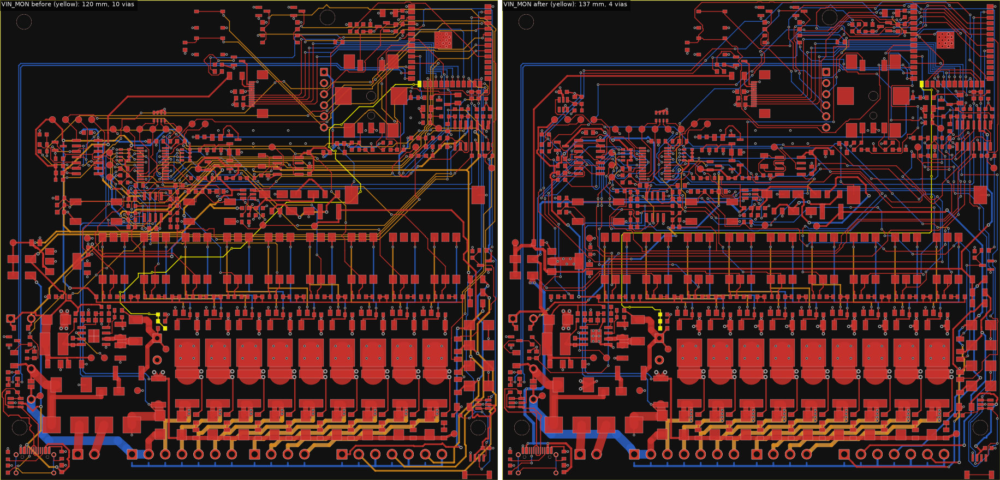
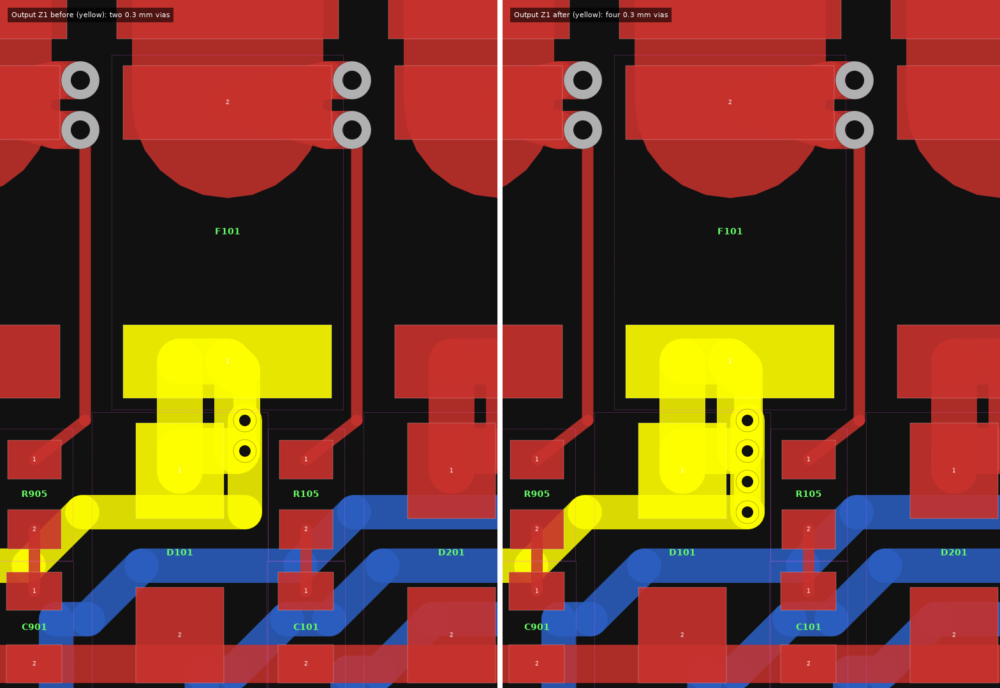
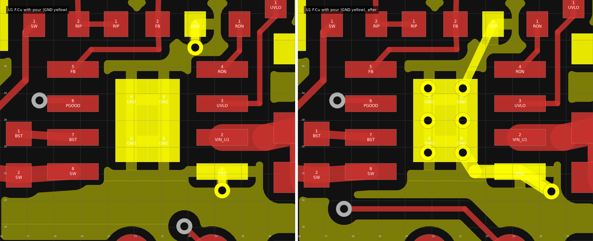
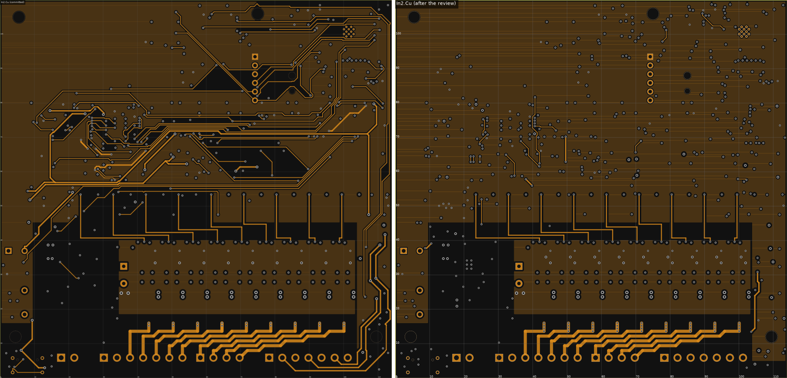
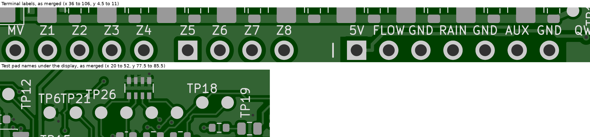
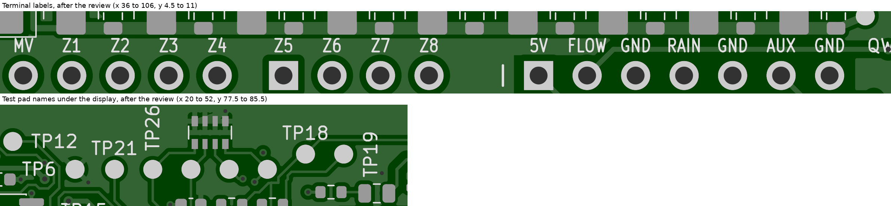
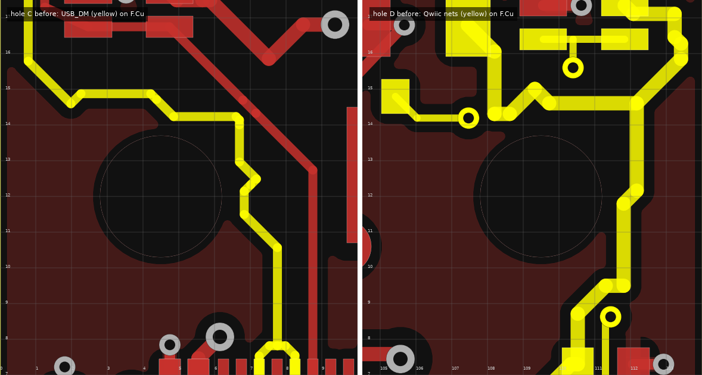
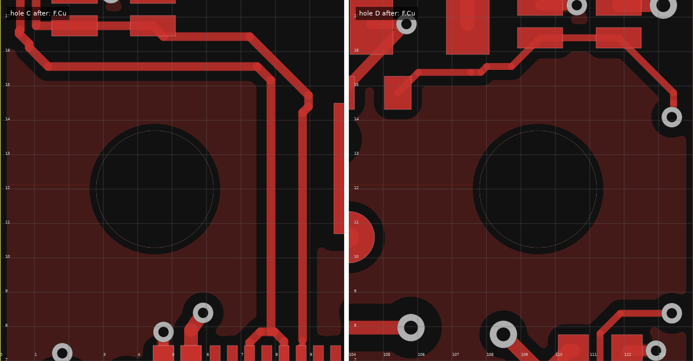

# ZoneFlow revision A: independent review of the PCB layout

!!! warning "No board has been made"
    This is a review of files. I opened the board file, the Gerber and drill
    files, the placement files and the makers' documents, measured them with
    my own scripts and looked at pictures of them. I did not hold a board or a
    part. Where this page says "verified", section 15 says against what.

I am the second reader of this layout. The first was its author, whose
account is the [layout document](hardware-layout.md). I started from the head
of the layout pull request (#39) and changed what I could prove wrong. The
board in the repository is the board after those changes. It was routed
again, so the autorouted tracks are new, and the layout document was brought
up to date with it.

Coordinates are those of the [mechanical contract](mechanical.md): origin at
the bottom-left corner seen from the component side, x right, y up,
millimetres. Findings are numbered L1 to L30.

## 1. Verdict

**Ready for a prototype order after the human checklist of section 17, and not
before.** The files as I found them were not ready. The placement file would
have put 26 parts down wrong, the nine triacs and the nine opto-triacs among
them, and the heat pad of the buck converter had no via. Those and the other
findings marked "fixed" below are fixed in the sources, and every check of
the build passes on the result.

What the verdict rests on, and what it does not.

- **It rests on files.** Section 15 lists each check and the document or
  program behind it.
- **It does not cover the circuit.** Reviews A1 and A2 did that. I checked
  that the copper is the netlist (DRC with schematic parity) and that the
  footprints are the parts.
- **It leaves seven things to a person**, because they need eyes on JLCPCB's
  order pages, a sample part or a printed sheet. Section 17.
- **A first board can still fail** for reasons no file shows: section 16.
- **The routing is good enough for a prototype and no better.** With the
  3.3 V layer kept as a plane, the autorouter could not finish on two
  layers. A maze router and I closed 17 connections, several of them with
  ten or more vias (L27). They are slow lines and I expect them to work. Lay
  the logic area by hand before a second revision.

## 2. Findings

Severity is for the files as I found them. "Blocking" would have wasted the
order. "Major" would have cost a re-spin, a wrong measurement or a field
failure, or hid such a fault from the checks. "Minor" is worth fixing. "Note"
is a check with no defect, or a risk I leave open with a reason.

| ID | Severity | Where | What I found | Evidence | Action |
|---|---|---|---|---|---|
| L1 | Blocking | Placement files | 26 of 307 placements wrong against JLCPCB's own footprints: nine triacs and nine opto-triacs a quarter turn off, both USB ESD arrays a quarter turn off, the display connector a quarter turn off and 1.6 mm from its lands, the module 3.6 mm from its lands, the USB-C receptacle 1.5 mm, the three resistor arrays half a turn round | Section 5, picture | **Fixed.** Correction table rewritten per part number. New check `make cpl-check`: 312 of 312 and 267 of 267 fit |
| L2 | Major | U1, (21.5, 33.0) | The exposed pad of the buck converter had no via and no track. Four thermal spokes 0.4 mm wide joined it to a sliver of the top pour. The GND pin was not tied to it | Section 8, picture. LM5164 data sheet 7.4.1, items 4 and 10 | **Fixed.** Six vias under the pad, the pin tied to it, a second via at the pin and at C2 |
| L3 | Major | 3.3 V, whole logic area | The 3.3 V pour on In2.Cu was in 21 pieces and the one on B.Cu in 15, cut by 2.4 m of autorouted track. C25 was 7.5 mm from the supply pin it serves, on 23 mm of 0.2 mm track | Section 9, pictures | **Fixed.** In2.Cu is a plane the autorouter may not use: one piece of 71 cm². The regulator U3 reaches it through five vias where it had one. C25 is 2.4 mm from its pin. What is left on that layer is L28 |
| L4 | Major | 5 V chain, (2 to 24, 26 to 55) | Buck output to OR-ing diode to regulator, and the USB feed, autorouted at 0.4 mm, part of it on 17 um inner copper. The feedback divider sensed 6 mm down the load track | Layout document as merged, sections 6 and 7.6 | **Fixed.** By hand on the outer layers, 0.55 to 1.0 mm. The divider senses at the pad of D25 on its own track. Section 7 |
| L5 | Major | `VIN_MON`, `RLY_B_RB` | The supply monitor line was 120 mm through ten vias, laid by a maze router. The relay read-back, 50 kohm behind it, was autorouted | Picture | **Fixed.** `VIN_MON` by hand: 137 mm, four vias, on B.Cu under the 3.3 V plane. `RLY_B_RB` by hand: 71 mm, two vias |
| L6 | Major | Nine output columns | Two 0.3 mm vias carried a shorted output. With JLCPCB's published plating, 18 um on average, they heat by 131 K in the case where only the PTC ends the fault | Section 7 | **Fixed.** Four vias per output (33 K), three at each A1 lead (40 K) |
| L7 | Major | Holes C (4.5, 12) and D (109.5, 12) | Autorouted copper under the heads of the two pan-head board screws: `USB_DM` 0.44 mm from hole C; the Qwiic supply and a via of the Qwiic clock under one head at hole D. A head that bites through the mask joins the two | Pictures | **Fixed.** The autorouter and the patch router are kept out of a 6 mm square at each hole on F.Cu. Nearest top-side copper now: 3.25 mm from the centre of hole C, 3.55 mm from hole D. The head is 2.8 mm in radius |
| L8 | Major | DRC itself | Two clearances were not what the layout document said. KiCad's footprint for U1 carries its own 0.2 mm, which outranks the net class: the ground pour stood 0.2 mm from the 45 V input pin and the switch node, where the class asks 0.4 mm. And a shared rule gave every pair of surface-mount pads 0.15 mm, whatever their nets | Section 10 | **Fixed.** The builder removes footprint overrides. The rule is gone; the one pair it hid, solder jumper JP1, has a rule of its own |
| L9 | Major | U4 ground pad | Twelve holes of 0.2 mm, from KiCad's stock module footprint. `jlcpcb.toml` recorded 0.2 mm as free of surcharge. JLCPCB's help article of 2026-11-10 says the standard hole is 0.3 mm | Section 11 | **Fixed.** 0.3 mm holes in 0.7 mm lands. DRC fails on any hole under 0.3 mm |
| L10 | Minor | Silkscreen, both sides | Terminal labels 0.1 mm apart ("FLOWGND", "24V~24V~"); designators flush against each other ("TP6TP21TP26", "SW2BOOT"); the designators of J1 to J4, J6 and TP16 placed beyond the board edge, where nothing is printed; U6 and SW1 cut by the edge | Section 12, pictures | **Fixed.** Narrower label letters. The cleaner now compares text with text and with the outline |
| L11 | Minor | D1, (16.3, 21.8) | The ground pad of the input surge clamp had one 0.3 mm via and thermal spokes | Script | **Fixed.** Three more vias |
| L12 | Minor | Gerber job file | The stack-up in the board file is KiCad's default: 35 um on all four layers, three equal dielectrics. The build that is ordered has 17.5 um inner copper and thin outer dielectrics. JLCPCB does not read the job file | `zoneflow-a-job.gbrjob` | Not fixed. Checklist item 2 |
| L13 | Minor | JLCPCB BOM | It lists seven parts that are not in the placement file and that JLCPCB does not place: C1, K1, J1 to J4 and the display DS1. Nothing marks them | Section 5 | Not fixed: the BOM is checked against the netlist. Checklist item 4 |
| L14 | Note | Triac tabs | Four 0.3 mm vias in each tab land sit under the solder paste. They are open on the top and covered by mask on the bottom, so solder runs in and stops there | Gerber files | Left as it is. Look at the tab joints of the first boards |
| L15 | Minor | Test pads | Nine designators find no place and are hidden: TP9, TP11, TP13, TP14, TP22, TP27, TP28, TP29 and U1. Seven were hidden before; TP11 and TP13 lost theirs to the stricter text check and to the new parts beside TP11 | `build/silk.json` | Not fixed. Section 14 lists every test pad with its net and position |
| L16 | Note | R33 | Not at module pin 10 as fail-safe rule 1 asks: 12.3 mm of track away | Section 13 | Harmless, with numbers |
| L17 | Note | J7 | Display bus 61 to 72 mm long against "about 40 mm" | Section 13 | Harmless at 15 MHz, with numbers. Cannot be met where the contract puts J7 |
| L18 | Minor | C30, C31 | 19 mm from the ADC pins they filter | Section 13 | Not met and cannot be with this pin map. Function unaffected; RF pick-up is a bench item |
| L19 | Note | Kelvin sense pair | Runs under U1 and beside L1 on B.Cu, the ground plane between | Section 8 | Left. Estimate: 0.2 mV at the switching frequency before two filters |
| L20 | Note | Assembly | No fiducial marks. The module overhangs the top edge by 6.0 mm. Parts stand 0.9 mm from the right edge | Section 11 | Checklist item 3 |
| L21 | Note | Antenna | The encoder's metal frame ends 12.5 mm from the antenna area, where Espressif asks 15 mm | Section 9 | Left: both positions are the contract's |
| L22 | Note | Fail-safe rules | Measured again with my own script on the new routing | Section 6 | No defect |
| L23 | Note | Footprints | Pin order and polarity of the part types of section 4 against the makers' documents and JLCPCB's library | Section 4 | No defect. One not verified: the cathode of D25 in the library |
| L24 | Note | Mechanical | Board against the contract with my own check; enclosure against the real board model | Section 13 | No defect |
| L25 | Minor | Nine PTC fuses, y = 20.9 | Each PTC shares its upper land with the triac tab through a 5 mm wide link, so it is heated by the triac. The hardware design derates it for 70 °C air: 0.64 A hold. The maker's chart gives 0.50 A at 85 °C, which is the full load | Section 9, heat | Not changed. Bench item with a number to look for |
| L26 | Note | Test and bring-up | Every step of the bring-up plan against the pads on the board | Section 14 | No defect. `VBUS` and `VIN_MON` have no pad of their own, and there is no ground post |
| L27 | Minor | Patched nets, logic area | On two layers the autorouter left 17 connections open. A maze router closed twelve and I closed five with it. Some are long and change layer often: `N_RAIN` 156 mm and 13 vias, `SENS_PWR_EN` 126 mm and 12, `STATUS_LED` 161 mm and 7, `RLY_A` 71 mm and 10, `ZD_Z8_N` 87 mm and 9, `I2C0_SDA` 58 mm and 8 | `routing.md`, section 9 | Not fixed. All are static or slow. Each is listed for the person who looks at the board. Lay them by hand at the next routing |
| L28 | Minor | 3.3 V plane, In2.Cu | Eleven of those connections pass under an obstacle on In2.Cu: 114 mm of track in all, each a slot in the plane, the longest 21 mm. Five of the nets cross under the display lines or the ADC lines | Section 9, table | Accepted. The plane stays one piece. The first routing had 2356 mm in 51 nets there |
| L29 | Major | Patch router | It did not know the rectangles that keep the autorouter out, nor a rule area inside a footprint. On this routing it laid the 5 V sensor supply 2.26 mm from the centre of hole D, under the screw head, and two nets across a stretch of the keep-alive net that the board closes. A first set of patches also ran the rain input for 17 mm within 2 mm of the keep-alive on the layer next to it | Section 10 | **Fixed** in the tool, and the patches made again. No track of another net on In2.Cu is now within 3 mm of the keep-alive |
| L30 | Note | Hole B, (75, 106) | Five autorouted nets pass under the plastic leg of the display carrier, the nearest 0.47 mm from the wall of the hole | Script | Left. The leg is plastic and the copper is under solder mask. The contract's keep-out there is for parts and bare copper |

## 3. What changed on the board

Every change is in a text source and has its own commit with the evidence
in the message. The generated board was rebuilt from them.

**Placement.** Four moves and five new parts. Nothing the mechanical contract
places has moved.

| Part | Change | Why |
|---|---|---|
| C25 | To (32.3, 67.5), above pin 8 of U8, with its own ground via | L3. It was 7.5 mm from the pin |
| R46 | To (27.15, 66.2) | Room for C25 |
| R9 | Turned half round | L5. The three `VIN_MON` pads now stand in one column |
| U2 | To (3.3, 17.7) | L7. Its USB lines no longer pass the screw head at hole C |
| U13, R13, R100, C55, C56 | New, at (14 to 18, 85 to 89) | The over-voltage detector that [answers A2](hardware-answers-a2.md) added to the circuit while this review ran |

**Copper by hand.** All of it is written in `design/layout.py` and locked.

- **Buck converter, L2.** Six vias under the exposed pad of U1, the GND pin
  tied to the pad, a second via at the pin and at C2.
- **5 V chain, L4.** `V_BUCK` from D25 to D3 and the relay coil, `V5` from
  the diodes to U3, `VBUS` from J5 to D4, `V_BUCK` to the sensor switch U11.
  A feedback track of its own from the pad of D25.
- **3.3 V regulator, L3.** A 2 mm bar from pin 2 to the tab of U3 and five
  vias into the plane. The tab had no via of its own.
- **Monitor lines, L5.** `VIN_MON` and `RLY_B_RB`.
- **Outputs, L6.** Four vias per output where there were two. A third via at
  each A1 lead.
- **Surge clamp, L11.** Three more ground vias at D1.
- **U13.** `OV_DIV` and the rest of the detector, with a rule that keeps the
  switch node, the keep-alive and the display lines 10 mm from `OV_DIV`.

**Planes, L3.** In2.Cu is the 3.3 V plane and the autorouter may not use it.
The second 3.3 V pour on B.Cu is gone. The autorouter routes on F.Cu and
B.Cu.

**Rules and footprints.**

- **Holes, L9.** The twelve vias in the module's ground pad are 0.3 mm. DRC
  fails on a smaller hole.
- **Clearances, L8.** The 0.2 mm that KiCad's footprint for U1 carried is
  removed. The rule that gave every pair of pads 0.15 mm is gone.
- **Screw heads, L7.** The autorouter is kept out of a 6 mm square on F.Cu
  at holes C and D.

**Silkscreen, L10.** Narrower letters for the terminal labels. The cleaner
compares texts with each other and with the board outline.

**Placement files, L1.** The correction table is rewritten per part number,
with offsets. `make cpl-check` is new.

**Routing.** Freerouting 2.5.0 had the 96 nets that are not laid by hand,
on F.Cu and B.Cu only, with its usage reporting off and no network. It ran 29
passes in 40 minutes and left 17 connections open.

- **Patch router, two layers.** Five connections.
- **Patch router, with In2.Cu as a last resort.** Seven connections. A
  millimetre on that layer costs six elsewhere, so it is used only to pass
  under an obstacle.
- **By hand.** Five connections, in `design/patches-hand.toml`: the test pad
  TP15, pin 2 of the amplifier U8, the pull-up R96 and pin 8 of the expander
  U5, which the autorouter had boxed in, and the I2C data line to the clock
  chip. Four pieces of autorouted copper were taken out for them and laid
  again.
- **A rail beside a guarded node.** The autorouter joined the four `V_DRV`
  pads of RN2 with a bar 0.86 mm from the gate node of Q2, as it did in the
  first routing. The build failed on layout rule 3. The bar is out and the
  pads are joined through their centres, 1.48 mm from the node.

Track on the board now, in millimetres:

| Layer | By hand | Patches | Autorouter |
|---|---|---|---|
| F.Cu | 1811 | 334 | 2733 |
| In1.Cu | 0 | 0 | 0 |
| In2.Cu | 444 | 113 | 0 |
| B.Cu | 1903 | 480 | 1650 |

641 vias: 386 by hand or beside a plane pad, 164 by the autorouter, 91 in
patches. The first routing had 518.

## 4. Footprints against the makers' documents

The author's table is [`design/footprints.md`](https://github.com/syntroniks/zoneflow/blob/main/hardware/zoneflow-a/design/footprints.md).
I did not repeat its land dimensions. I checked what kills a board: which pad
is which pin, which way round the part goes, and whether a part fitted from
the bottom has its pins mirrored. For each row I opened the document named
and compared it with the pad numbers, pad positions and nets of the board
file, printed by my script.

| Part | Document I opened | What I compared | Result |
|---|---|---|---|
| Q101 to Q901, T810-600B, DPAK | ST DocID7472 rev 12, front page drawing | Leads from the left with the tab away: A1, A2, gate. Board: pad 1 `ISNS`, tab `T2`, pad 3 gate | Agrees |
| U101 to U901, MOC3023SR2M | JLCEDA library symbol and footprint for C40701 (the onsemi sheet downloaded but I read the pin names from the library) | 1 anode, 2 cathode, 4 and 6 main terminals, counted anticlockwise | Agrees |
| U1, LM5164DDAR | TI SNVSAU4D, pin table | 1 GND, 2 VIN, 3 EN/UVLO, 4 RON, 5 FB, 6 PGOOD, 7 BST, 8 SW, pad "connect to the GND pin" | Agrees |
| U12, TLV803EA30DBZR | TI TLV803E sheet, figure 6-1 and the naming table | No pinout letter before the package code: 1 GND, 2 RESET, 3 VDD | Agrees |
| K1, G5NB-1A-E, fitted from the bottom | Omron G5NB sheet, "PCB mounting holes (bottom view)" | Bottom view: three pins in a row, the fourth beside the first. Seen from the top of this board, which is the relay's bottom view: A2, 13, 14 in a row at x = 7.15, A1 beside A2 | Agrees. Not mirrored. No coil polarity |
| C1, 63ZLJ470M, fitted from the bottom | Board file | Pad 1, the square one, is `VIN_DC` at (36.0, 32.5); two pins, so nothing to mirror | Agrees |
| BT1, CR2032-BS-6-1 | Q&J drawing BS-6, "PCB layout diagram, top view" | The right-hand land is marked +. Footprint pad 1 is at +x and is `VBAT`; the part is turned 180 degrees, so + is at (80.5, 65.3) | Agrees. Lands 32 over, 26 between, 4.2 wide: equal |
| J7, FPC-05F-12PH20, and the panel | Hansheng HS20HS072RX sheet, outline drawing; XUNPU drawing | Panel front view, tail down: fingers visible, pin 1 at the left, tail 15.28 mm from the left edge. Turned 90 degrees with the tail to +x and folded under: pin 1 at the lower y, fingers down. Board: pad 1 `GND` at y = 85.68 | Agrees with the contract and the netlist. Land pattern equal to XUNPU's |
| J5, TYPE-C-31-M-12 | JLCEDA library footprint for C165948 | 12 lands and 4 shell slots | All within 0.11 mm |
| SW3, EC11J1525402 | JLCEDA library footprint for C209762 | 5 terminals, 6 frame lands | All within 0.33 mm. The library has A, C, B on a 2.54 mm pitch, the footprint 2.5 mm as the ALPS sheet |
| U4, ESP32-S3-WROOM-1 | Espressif module data sheet, pin table; JLCEDA library footprint | 41 pads and the net on each against `hardware/pinmap.yaml` through DRC parity; pad positions | Pins within 0.02 mm |
| Diodes: M7, SS34, SS210, 1N4148W | JLCEDA library symbols | Cathode is library pad 1 and lands on KiCad pad 1, which the netlist calls K | Agrees |
| LEDs C125094 and C2286 | JLCEDA library symbols | Cathode lands on KiCad pad 1. The two types number their pads differently in the library and both come out right | Agrees |
| D25, SMBJ6.0A | JLCEDA library footprint | The library does not name its pins. Its footprint is of the same family as the three Schottky types, where pad 1 is the cathode | **Not verified.** Checklist item 5 |
| U13, TPS3701DDCR, added with [answers A2](hardware-answers-a2.md) | TI SBVS240C, pin table and drawing DDC0006A | 1 OUTA, 2 GND, 3 INA, 4 INB, 5 VDD, 6 OUTB. Board: 4 `OV_DIV`, 5 `3V3`, 6 `OC_TRIP_N`, 2 and 3 ground, 1 open. Drawing: 0.95 mm pitch, lands 1.1 x 0.6 mm on 2.7 mm centres, 1.1 mm high. KiCad `TSOT-23-6`: 0.95 mm pitch, lands 1.325 x 0.6 mm on 2.275 mm centres | Agrees. The lands are longer inwards than TI's and the lead still sits on them |
| TPS2553DBVR, TCA9539PWR, LM2901DR, 74HC132D, MCP6002, PCF8563T, LDL1117S33R, AO3400A, AO3401A | JLCEDA library symbol for each LCSC number: the pin name of every pad | Printed pad number, library pin name and board net side by side, 86 pins | Every pin's net is what the pin name needs. I did not open these nine makers' sheets |
| USBLC6-2SC6, BAT54S | From memory. The library numbers these pins and does not name them | 1 and 6 one line, 3 and 4 the other, 2 ground, 5 `VBUS`. BAT54S: 1 anode, 2 cathode, 3 the common point | Agrees with what I remember |
| J1 to J4, KF2EDGR | Kefa drawing (downloaded, not re-measured) | Pitch and pin 1 against the contract | Agrees with the contract |

The library is the JLCEDA/EasyEDA Official Library (<https://lceda.cn/>,
<https://easyeda.com>). It is JLCPCB's drawing of each part, not the maker's.
Where the two could differ and it matters, the row says which I read.

## 5. The placement file against JLCPCB's library

**Method.** JLCPCB places the footprint that its own library holds for an
LCSC number: the footprint's origin goes to the coordinate of the placement
file, turned by the file's rotation. So I took that footprint for each of the
89 part numbers, put it on the board as the file says, and compared where its
pads land with the pads of the board. All pads must land on pads. Pad 1 must
land on pad 1 for a part with numbered pins, and the cathode on pad 1 for a
diode or an LED. This is what JLCPCB's placement preview draws, done for every
part and compared by a program.

**What the committed file did.** Top row: the library footprint in red, placed
as the committed file said, over the board's pads in grey. Bottom row: the
corrected file.



| Parts | Committed file | Needed | Cause |
|---|---|---|---|
| Q101 to Q901, triacs | Rotation as KiCad's | 270 more, and 1.29 mm towards the leads | No row for TO-252 in the table |
| U101 to U901, opto-triacs | As KiCad's | 270 more | No row for SMDIP-6 |
| U2, U9, USB ESD arrays | 180 more | 270 more | The table's row for SOT-23 was right for the TPS2553 in the same package and wrong for this part: the library draws the two differently |
| U4, module | As KiCad's | 3.63 mm lower | The library's origin is on the row of pads 8 and 33 |
| J7, display connector | As KiCad's | 90 more, 1.58 mm | No row |
| J5, USB-C | As KiCad's | 1.53 mm further in | The library's origin is not KiCad's anchor |
| RN1 to RN3 | 90 more | 270 more | Row copied from another project. The four resistors of an array are alike, so the circuit was the same |

A placement that is a quarter turn off does not fit its lands, and JLCPCB's
engineers usually catch that and ask. I would not order on "usually".

**What I changed.**

- **The table.** `hardware/rules/jlcpcb-cpl-rotations.csv` now has a row for
  each of these, tied to the LCSC number where two parts in one package
  differ, with an offset where the origins differ.
- **The generator.** `hwflow.fab` applies a row to one part number, and turns
  the offset with the part.
- **The check.** `hwflow.cplcheck` and `make cpl-check` repeat all of this.
  It needs the network once, for the library footprints, and is not part of
  `make`. Its report is
  [`output/reports/placement-check.md`](https://github.com/syntroniks/zoneflow/blob/main/hardware/zoneflow-a/output/reports/placement-check.md).

**Result on the new files.** `make cpl-check`: 312 placements of the 8-zone
build compared, none misfits; 267 of the 4-zone build, none misfits.

- **What was compared.** For 46 parts of 20 numbers, pad 1 on pad 1. For 20
  diodes and LEDs of 6 numbers, the cathode on pad 1. For the other 246
  parts, two-pin passives and parts that fit both ways round, the pads as a
  set.
- **How close.** The largest distance from a library pad to the board pad it
  lands on is 0.42 mm, at the inductor L1, whose library lands are longer
  than the footprint's. The limit of the check is 0.6 mm.
- **Corrections in use.** 71 part numbers are placed with KiCad's rotation,
  11 with 270 degrees more, 6 with 180 and 1 with 90. Five have an offset.

**What this does not prove.** That the library's footprint is how the part
lies in its tape, and that pad 1 of the library is the pin the maker calls 1.
For the 26 part numbers where the direction matters, the library names its
pins or numbers them as the maker does, with one exception: D25, see
section 4. The preview is still
worth the five minutes: checklist item 5.

**BOM against placements.** The 8-zone BOM has 95 lines and 319 designators,
the placement file 312. The seven without a placement are C1, K1, J1 to J4
and DS1, on six lines. The 4-zone BOM has 94 lines and 273 designators, its
placement file 267: it leaves out the same 46 parts as the netlist's variant,
channels 5 to 8, J3 and R28. No part is placed that is not in the BOM, and no
BOM line mixes placed and unplaced parts.

## 6. Fail-safe layout rules

The author's check is `hwflow.layoutrules`. Mine is a separate script that
shares no code with it: it takes tracks as widened lines, vias as circles on
every layer, pads as their real shapes, and measures the keep-alive net and
each detector node against every other net, per layer and in plan view.

| What | Rule | The author's check | Mine |
|---|---|---|---|
| Other nets beside `KA` on its own layer | 1 mm | 1.04 mm, `BTN_BACK` and `ENC_B` | 1.03 mm, an `I2C0_SCL` track at R89. Nearer than that are only the two module pads beside pin 10, 0.37 mm, and the far pads of R29 and R89, 0.85 mm |
| Listed nets near `KA`, any layer, plan view | 1 mm | 1.07 mm, the pads of the USB pins 13 and 14. Then `TFT_MOSI` 1.37 mm, `TFT_SCLK` 1.77 mm | The same pairs |
| Listed nets near `KA_N0` | 1 mm | 1.20 mm, `TFT_BL` | The same |
| Rails near the five high-impedance nodes, same layer | 1 mm | `RLY_G2` 1.48 mm from `V_DRV`, `KA_N1` 1.22 mm from 3.3 V, `KA_INP` 2.22 mm, `KB_N1` 4.33 mm, `KA_N2` 4.34 mm | The same |
| The two pumps apart | 10 mm | 42.4 mm, and C22 at 90 degrees to C51 | 42.4 mm |
| Test pads on the pump nodes | none | None found | None. TP8 is on `KA_N2` as the rule allows |
| `OV_DIV` away from the switch node, `KA` and the display lines | 10 mm, plan view | 25.9 mm, `KA` | Not repeated |

The author's column is `output/reports/layout-rules.md` of this build: 278
distances, one spacing, one angle and one pad ban hold.

What my script shows that the rules do not ask about:

- **The layer next to the keep-alive.** `KA` runs on B.Cu, and In2.Cu is
  0.2 mm from it with no plane between. The nearest track of another net on
  In2.Cu is `N_RAIN`, 3.13 mm away in plan view, then `STATUS_LED` at
  4.06 mm. A first set of patches had `N_RAIN` at 1.09 mm for 17 mm of its
  length (L29). The fence is 3 mm now.
- **Crossings on the far side.** Ten nets cross over `KA` on F.Cu, with both
  planes between: the two nodes of detector B, which belong there,
  `BTN_BACK`, `ENC_A`, `ENC_B` and their two filtered copies, `N_AUX`,
  `VIN_MON` and `RLY_B_RB`. The first routing had nine: `BOOT` where
  `N_AUX` and `RLY_B_RB` are now. None is on the list of the hardware
  design, section 8.5. `RLY_B_RB` is mine and is a level that does not move
  by itself. `N_AUX` is a sensor input, which something outside the board
  drives: it is 1.4 mm of board and two planes away, not on the next layer.
- **`KA_N0`, the node behind R29.** A `QW_SDA` track passes 0.22 mm from the
  pad of C22 on F.Cu, and an `I2C0_SCL` via stands 0.23 mm from the node's
  track. The rule checks this node against the listed nets only, and I2C
  lines are not on the list: they move only while the firmware runs. I leave
  it and put it on the checklist, item 7.
- **Nothing found wrong.** The guard strips are in the board as rule areas on
  B.Cu, each side of the long segments, and DRC enforces them.

## 7. Power and AC paths

**Copper.** JLCPCB's capabilities page, read 2026-11-11: outer layers 1 oz
(35 um) finished, inner layers "0.5oz by default" (17.5 um), "Average Hole
Plating Thickness 18um". That last figure is an average and not a promise of
a minimum. I use it as the thickness and say so.

**Steady current.** The formula is the IPC-2221 chart fit the layout document
uses, I = k x dT^0.44 x A^0.725, k = 0.048 outside and 0.024 inside, A in
square mils. I checked the document's four rows and get the same numbers. It
is the older, more cautious chart. IPC-2152 gives lower rises for a board with
planes; I did not use it.

| Path | Copper I measured | Current | Rise |
|---|---|---|---|
| 24 VAC entry, J1 to the fuses, `AC_L` to D1 and K1, return to F1 | 2.0 mm on F.Cu, no neck | 3 A, the fuse rating | 5.3 K |
| `COM`, K1 to J2 | 2.0 mm on B.Cu | 1.5 A | 1.1 K |
| One output, terminal to vias | 0.9 mm on B.Cu and the same on In2.Cu | 0.5 A | 0.3 K on B.Cu alone |
| Output vias to PTC, PTC to tab | 1.2 mm and 5.0 mm on F.Cu | 0.5 A | 0.2 K |
| Shunt return | A plane on In2.Cu, 68.7 x 21.5 mm, three vias per triac, two 0.5 mm vias at R37 | 1.5 A | Not a track |
| `V_BUCK`, D25 to D3 | 9.1 mm at 0.8 and 6.5 mm at 0.55, F.Cu | 0.73 A peak | 1.8 K in the narrow part. 11 milliohm, 8 mV |
| `V5`, D3 to U3 | 6.8 mm at 0.8 and 9.9 mm at 0.7, F.Cu | 0.50 A peak | 0.5 K. 11 milliohm, 6 mV |
| `VBUS`, J5 to D4 | 42 mm at 0.7 on B.Cu, two vias at each end | 0.58 A peak | 0.7 K. 30 milliohm, 17 mV |
| `V_BUCK` to U11 | 61 mm at 0.5 on B.Cu | 0.16 A | 0.2 K. 68 milliohm, 11 mV |

Working for the narrowest piece of the chain, 0.55 mm on an outer layer:
21.65 mil x 1.378 mil = 29.8 mil²; 29.8^0.725 = 11.7; 0.048 x 2.754 x 11.7 =
1.55 A for 10 K; at 0.733 A, 10 x (0.733 / 1.55)^(1 / 0.44) = 1.8 K.

The 0.55 mm is where `V_BUCK` and `V5` pass side by side through the 2.1 mm
gap between the anode pad of D4 and the pins of U3. Everywhere else the chain
is 0.7 mm or wider.

**The 5 V chain, L4.** `V_BUCK`, `V5` and `VBUS` in yellow, the left edge of
the board from y = 5 to 58. Left as merged: 0.4 mm from the autorouter, part
of it on In2.Cu. Right: by hand, on the outer layers.



**The monitor line, L5.** `VIN_MON` in yellow on the whole board. Left as
merged: 120 mm through ten vias. Right: 137 mm and four vias, along y = 56.6
and up x = 98.3 on B.Cu.



**A short circuit.** The layout document's method: the conductor has no time
to lose heat, dT = I²t x rho / (A² x c), with 9.6 A²s when the triac or the
relay ends the fault and 34 A²s when only the PTC does. A via barrel is
pi x (hole + plating) x plating.

| Conductor | Cross-section | 9.6 A²s | 34 A²s |
|---|---|---|---|
| Two 0.3 mm vias, 18 um, as it was | 0.036 mm² | 37 K | 131 K |
| Four 0.3 mm vias, now | 0.072 mm² | 9 K | 33 K |
| A1 lead, 0.3 and 0.4 mm vias, as it was | 0.042 mm² | 28 K | 98 K |
| A1 lead, 0.3 and two 0.4 mm vias, now | 0.065 mm² | 11 K | 40 K |
| Fan-out lane, B.Cu with its copy on In2.Cu | 0.047 mm² | 21 K | 76 K |
| The same on B.Cu alone | 0.032 mm² | 48 K | 171 K |
| 2.0 mm track | 0.070 mm² | 10 K | 35 K |

Working for the four vias: pi x 0.318 x 0.018 = 0.0180 mm² each, 0.0719 mm²
together; 34 x 1.72e-8 / ((7.19e-8)² x 3.45e6) = 5.85e-7 / 1.78e-8 = 33 K.

**The output vias, L6.** Output Z1 in yellow, below its PTC. Left as merged,
right now.



- **The vias were the weak point and are not now.** The four sit 0.8 mm apart
  on the last 2.4 mm of the lane, where it ends under the column. They fit
  without moving the TVS: the layout document thought they did not.
- **The lane is the hottest piece again**, 76 K with its copy. That is the
  author's figure and I agree with it. From 70 °C it reaches 146 °C for a
  fraction of a second.
- **A via is not adiabatic over 70 ms to 0.6 s.** Heat reaches the pads at
  both ends of a 1.6 mm barrel in a few milliseconds. The table is the worst
  case and the real rise is lower. I did not model it.

**Other points of item 4.**

- **Thermal reliefs on current-carrying pads.** None. Every hand-routed
  current path is a track into the pad. The inner planes and the heat islands
  connect solid. Thermal spokes are on the ground pads of the top pour only.
- **Neck-downs.** The widths in the table hold from pad to pad. JP1's stubs
  are 0.5 mm, for a jumper that is open on this build.
- **The star point.** `GND` is one net. F1 and R37 join the AC return to it
  beside the terminals with 2.0 mm track. Valve current comes back through
  the `ISNS` plane and the shunt and does not use the ground plane.
- **The shunt's Kelvin connection.** Each sense track leaves from its own via
  at the end of a pad of R37. The ground sense passes through the ground
  plane in a 1.4 mm hole and meets ground only at the shunt pad. I followed
  both on the board file.
- **The surge clamp D1.** Its ground pad had one 0.3 mm via (L11). It has
  four now.

## 8. Buck converter and supplies

I read section 7.4 of the LM5164 data sheet, SNVSAU4D, and held the layout
against its ten guidelines.

| Guideline | Board |
|---|---|
| 1, 2. Input capacitor at VIN and GND, small loop | C2 and C3 have their VIN pads 2 mm from pin 2. Their ground pads are 3 mm further out and return through the plane 0.2 mm below. Acceptable. C2 has a second via now |
| 3. Inductor at SW, small SW copper | Pin 8, C4 and the pad of L1 within 4 mm. One 0.25 mm track to the ripple resistor |
| 4. GND pin tied to the pad and to a plane | **Was not.** L2 |
| 5. Ground plane in layer 2 | In1.Cu, solid under the whole converter |
| 6. Feedback, RON and enable returns to the plane | Each has its own via. R2 uses a via of the pad |
| 7. Wide VIN, VOUT and ground | VIN 1.5 mm, VOUT 2.0 mm to D25, then 0.8 mm |
| 8. Short FB, divider at the pin | Divider and ripple network within 4 mm of pin 5. **The sense point was on the load track.** L4 |
| 9. RON short | 2 mm |
| 10. Vias under the pad into the planes | **Were none.** L2 |

**Before and after, L2.** Top copper with the ground pour in yellow. Left as
merged: the pad hangs on four spokes. Right: six vias and the tie to pin 1.
The pour also stands further from pins 2 and 8 on the right, 0.4 mm where it
was 0.2 mm (L8).



- **Heat.** U1 loses about 0.2 W at the typical load and 0.5 W at the peak,
  by the 85 % the hardware design assumes. Six 0.3 mm vias are 5 K/W into
  the ground plane.
- **The fuse F5 and the clamp D25.** F5 is 6 mm from the pad of C1 on 1.5 mm
  track. D25 is 1.9 mm from the inductor pad on a 2 mm track, anode into the
  plane through four 0.4 mm vias. A 50 A pulse of 0.2 ms heats those vias by
  0.3 K.
- **The Kelvin pair under the converter, L19.** The pair runs on B.Cu under
  pins 5 to 8 and C4, 2 mm from the edge of L1, with the ground plane
  between. The plane stops the electric field. It is thinner than the skin
  depth at 281 kHz, so it does not stop the magnetic one. My estimate: the
  two tracks are 0.6 mm apart and about 10 mm of them lie beside the
  inductor, a loop of 6 mm². If the stray field there swings by 50 uT in half
  a period, a figure I assumed and did not look up, the loop picks up 0.2 mV
  at 281 kHz. The amplifier's 15 kHz filter and the 1.6 kHz filter at the ADC
  take that down by a factor of several thousand. I left the pair where it
  is. The other way round crosses the eighteen gate lines.
- **LDO U3.** As merged, pin 2 had one via into the 3.3 V copper and the tab
  had none: a 0.3 mm track, 3.8 mm long, joined the tab to the via of C12.
  The whole 3.3 V load went that way, and the tab had its own land, 2.0 by
  3.8 mm, to lose 0.27 W to. I found this late, while measuring the board
  for this page, and count it under L3. A 2 mm bar under the body now joins
  pin 2 and the tab, with five vias into the plane. A 0.3 mm via 1.2 mm long
  with 18 um of plating is 1.2 / (385 x 0.018) = 173 K/W, so five are about
  35 K/W into a plane of 75 cm². C10 is on the `V5` track
  10 mm before pin 3. C11 and C12 are 3 mm from the tab and reach it through
  the plane.
- **Decoupling.** Distance from each capacitor's supply pad to the pin it
  serves, centre to centre, measured on the board file:

    | Capacitor | Pin | mm |
    |---|---|---|
    | C2, C3 | U1 pin 2, `VIN_U1` | 3.6, 3.3 |
    | C4 | U1 pin 7, bootstrap | 2.0 |
    | C11, C12 | U3 pin 2, 3.3 V | 3.5, 3.0 |
    | C14, C15 | U4 pin 2, module supply | 3.7, 2.1 |
    | C18 | U5 pin 24 | 3.9 |
    | C19 | U6 pin 3 | 2.0 |
    | C20 | U7 pin 14 | 3.7 |
    | C25 | U8 pin 8 | 2.4, was 7.5 |
    | C35 | U10 pin 8 | 4.4 |
    | C47 | U11 pin 1 | 4.2 |
    | C54 | U12 pin 3 | 2.2 |
    | C56 | U13 pin 5 | 2.0 |
    | C37, C38 | J7 pin 8, display supply | 4.7, 2.2 |

    Every one has its own via into each plane or shares one with the pin
    beside it.

## 9. Planes, clearances, heat, signals, antenna

**3.3 V, L3.** In2.Cu, the whole board. Left as merged: the 3.3 V pour in
pieces between 2.4 m of autorouted track. Right: one plane, with the short
slots of the table below. The copper at the bottom of both is the shunt
plane and the copy of the valve fan-out.



- **Ground.** In1.Cu is one piece of 114 cm² with no track on it.
- **3.3 V.** In2.Cu is one piece of 71 cm². Every decoupling capacitor has
  its own via into it or shares one with the pin beside it (section 8).
- **What still cuts it, L28.** Eleven patched connections use the layer to
  pass under an obstacle. Each is a slot about 0.6 mm wide.

    | Net | On In2.Cu | Where | Passes under, on B.Cu |
    |---|---|---|---|
    | `N_RAIN` | 20.7 mm in 9 pieces | x 40 to 42, y 62 to 82 | `ADC_LO`, `V_BUCK`, `I2C0_SCL`, zone drive lines |
    | `SENS_5V` | 18.5 mm | x 104 to 106, y 13 to 31 | Runs over `T_AUX` and `T_RAIN` for 4 mm each |
    | `I2C0_SDA` | 13.5 mm in 2 runs | x 37 to 72, y 62 to 69 | `ADC_LO` and `ADC_HI`, twice; `V_BUCK` |
    | `ZD_MV_N` | 12.7 mm | x 22 to 27, y 45 to 71 | `V_BUCK`, `VB` |
    | `RLY_A` | 12.4 mm | x 9 to 50, y 38 to 70 | `ADC_LO`, `ADC_HI`, `VIN_MON`, `VBUS`, `V_BUCK` |
    | `ZD_Z8_N` | 9.3 mm | x 41 to 102, y 58 to 73 | `KA_OK`, zone drive lines |
    | `STATUS_LED` | 8.5 mm | x 89 to 96, y 102 to 106 | `TFT_BL` |
    | `SA_N` | 7.1 mm | x 32 to 35, y 59 to 65 | `V_BUCK` |
    | `VB` | 6.4 mm | x 25 to 26, y 63 to 75 | `V_BUCK`, zone drive lines |
    | `U0TXD` | 3.8 mm | x 78 to 79, y 98 to 101 | All six display lines |
    | `ZD_Z2_N` | 1.6 mm | x 22.8, y 63 to 64 | `V_BUCK` |

    114 mm in all. None is inside the fences round the keep-alive and the
    Kelvin sense pair.
- **What the slots cost.** A line on B.Cu that crosses a slot loses its
  return path for the width of the slot, 0.6 mm, and the current goes round
  the end. For the display bus at 15 MHz and one 3.8 mm slot that is a
  nanohenry or two. For the ADC lines, which are filtered at 1.6 kHz, it is
  nothing. The line in the slot couples to the line under it through the
  0.2 x 0.2 mm where they cross, about 0.01 pF. A 3.3 V edge puts 0.03 pC
  into the 100 nF at the ADC pin: a fraction of a microvolt.
- **`SA_N` is the one I like least.** It is the inverting input of the
  current-sense amplifier, and 7.1 mm of it run on In2.Cu under the
  amplifier with three vias. It crosses a Kelvin sense track laid by hand on
  F.Cu and the `V_BUCK` branch that I laid on B.Cu between the pin rows of
  U8. I moved that branch there for L4, and it is why `SA_N` has no way on
  the outer layers. If the low current range is noisy on the bench, look
  here.
- **Ground pours.** The pour on F.Cu is in 69 pieces and the one on B.Cu in
  43, each tied to the plane by the vias of the pads it touches. Twelve
  pieces are under 1 mm². KiCad removes a piece that touches no pad or via.

**Clearance and creepage.** The design's own rule is 0.5 mm around the 24 VAC
nets and 0.4 mm around the rectified input. I measured the smallest gap from
every copper item of those classes to every item of another domain, on each
layer, pours included.

| Layer | Smallest gap found | Where | Rule |
|---|---|---|---|
| F.Cu | 0.400 mm | Switch node pad of L1 to the ground pour, and the same to `V_BUCK`; `VIN_U1` and `VIN_DC` pads to the pour | 0.4 mm, rectified input |
| F.Cu | 0.500 mm | Every 24 VAC item to anything else | 0.5 mm |
| In1.Cu | 0.400 mm | C1's positive pin to the ground plane | 0.4 mm |
| In1.Cu | 0.500 mm | Terminal pins and tab vias to the ground plane | 0.5 mm |
| In2.Cu | 0.500 mm | Gate and opto-output vias, relay pins, to the 3.3 V plane | 0.5 mm |
| B.Cu | 0.500 mm | Heat islands, fan-out lanes and terminal pins to the ground pour | 0.5 mm |

- **One figure of my script was wrong.** It put the jumper JP1 0.30 mm from
  the ground pour. My script takes the jumper's shaped pads as boxes. With
  KiCad's own outline of the pad the distance is 0.500 mm.
- **Before the review** the pour was 0.200 mm from the switch node and the
  45 V input pin of U1 (L8).

- **What the rule is worth.** The supply is a Class 2 transformer, 45 V peak,
  clamped at 77 V. IPC-2221B table 6-1 asks 0.13 mm between coated conductors
  from 31 to 100 V and 0.5 mm between bare component leads from 51 to 100 V.
  I quote the table from memory and did not open the standard. The board's
  0.5 mm meets both.
- **This is functional insulation.** One transformer leg is circuit ground by
  design. Nothing here separates the user from 24 VAC, and nothing has to.
- **Under parts.** The opto-triacs have 24 VAC on one pad row and logic on the
  other, 9.5 mm apart. The gate and opto-output vias stand under the body,
  6.1 mm from the logic row.
- **Spark gaps.** Fifteen teeth on B.Cu end 0.6 mm from their terminal pads,
  each with its mask opening. I found all fifteen in the Gerber files.

**Heat.** Copper on each tab net, measured from the filled zones: 64 mm² on
F.Cu and 143 mm² on B.Cu, 2.07 cm² in all, against the 2 cm² the hardware
design asks. The six vias that join the two sides are 32 K/W by my sum, so
the bottom island does less than its area says. I expect a junction near
110 °C with three outputs on in 70 °C air, where the hardware design says
103 °C and the limit is 125 °C. That is an estimate on an estimate. The
bench decides it.

**The PTC beside each triac, L25.** The upper land of each PTC is part of the
tab copper: a 5 mm wide link joins it to the tab land, 0.7 mm above. The
layout document counts that land in the 2 cm². It also makes the PTC a part
that the triac heats. The hardware design, section 6.6, takes the PTC at the
air temperature: 0.64 A hold at 70 °C against a 0.5 A valve. The BHFUSE
sheet for the BSMD2920 series, "Thermal Derating Chart", gives the
BSMD2920-100 as 0.83 A at 50 °C, 0.73 A at 60 °C, 0.64 A at 70 °C and 0.50 A
at 85 °C. At 0.4 W the tab is within a kelvin or two of the junction, so it
is near 100 °C in 70 °C air by the design's estimate and by mine. A PTC with
one land on that copper and the other on a cooler track sits somewhere
between 70 and 100 °C. At 85 °C it holds exactly the load. So the margin the
design counts on is not there in the hottest case with the largest valve. Ordinary valves draw 0.2 to 0.3 A and leave room. A PTC that
trips closes the valve, which is the safe direction. I did not change the
copper: taking the PTC land off the tab costs tab area, and which matters
more needs a temperature measurement. On the bench, run 0.5 A through one
output for an hour in the warmest air the unit will see, and measure the PTC
body. Above 80 °C, narrow the link to the 1.2 mm the current needs.

**Neighbours and air.** The nine triacs stand in one row, 7.1 mm apart, each
on its own island. The design allows 5 K for neighbours and I have nothing
better. The shunt, 0.23 W, is 6.5 mm left of the first column. The
regulator U3 is 34 mm away, the cell holder 21 mm above the triac bodies,
the crystal 37 mm, the module at the top of the board. The enclosure takes air in through slits
in the partition below the terminal edge and low in the side walls, and lets
it out at the top. It rises past the islands on the back of the board first
and reaches the module last, warmed by everything below. The mechanical
design estimates 14 K at 3.5 W. I checked where the slits are in
`enclosure/zoneflow.scad` and did not calculate the flow.

**USB.** The pair is 0.25 mm tracks 0.2 mm apart on B.Cu. Over the plane on
In2.Cu, about 0.2 mm above, I get 60 ohm single-ended and 98 ohm
differential from the usual microstrip formulas. The plane is unbroken under
all 166 mm of it: no slot of the table above crosses the pair. Before, six
autorouted tracks cut the pour above it.
Between the connector and the series resistors the autorouter lays the two
lines apart on F.Cu, 24 and 30 mm, through the ESD array, with no via. That
is poor form and harmless at 12 Mbit/s.

**Display bus and ADC lines.** Both run on B.Cu under the same plane. One
slot crosses the display bus and one more its backlight line. Three nets
cross the ADC lines, at four places. Before, 6 and 20 autorouted tracks did.
The table above has them.

**Crystal.** Y1 is 3.5 mm from pins 1 and 2 of the clock chip U10. The two
tracks are 9.3 and 8.3 mm on F.Cu with no via, the ground plane 0.2 mm
below. There is no guard ring. The only track beside them on F.Cu is
`RTC_INT_N`, 0.44 mm away, which changes when an alarm fires. Two zone drive
lines cross under them on B.Cu behind both planes. About 0.4 pF of stray
capacitance on each side of a 12.5 pF crystal: I expect it to run, and the
frequency is a bench item the hardware design already lists.

**Zero-cross input.** `ZC_DIV` goes from the divider at the 24 VAC input to
the comparator under the module: 152 mm, autorouted, two vias, a 50 or 60 Hz
sine with a 10 nF capacitor at the divider end. It was 115 mm on In2.Cu
before. It is long because the two ends are in opposite corners. Timing
jitter of the zero cross is a bench item.

**Antenna.** The module's antenna area lies wholly beyond the top edge. I
found no copper of any layer in it, because there is no board there. The
ground plane under the rest of the module is whole: 757 of 792 mm² in the
36 x 22 mm around it, the holes being via clearances. The nearest metal in
the board plane is the encoder's frame land, 12.5 mm from the antenna area
(L21), then the screw at hole B, 19 mm.

## 10. The checks themselves

A check that passes for the wrong reason is worse than none. Two did (L8).

- **A footprint's own clearance.** I measured 0.200 mm from the pad of pin 8
  of U1, the switch node, to the ground pour, where the HVDC class asks
  0.4 mm. DRC was content. KiCad's `TI_SO-PowerPAD-8` has `(clearance 0.2)`
  written into it, and a footprint's clearance outranks the net class in the
  zone fill and in DRC. It was the only such footprint on the board. The
  builder now removes these and prints which.
- **A rule that lowered every pad clearance.** `jlcpcb.kicad_dru` gave any two
  surface-mount pads 0.15 mm. In KiCad a custom rule replaces the net-class
  clearance for the pairs it fits. I took the rule out and ran DRC: one
  finding, the two pads of JP1, 0.3 mm apart where their class asks 0.5 mm.
  That is how the jumper is made. It has its own rule now and the general one
  is gone.
- **Silkscreen.** DRC measures stroke against stroke with a clearance of
  zero, and it did not report a designator that lay wholly outside the
  outline. L10.
- **The placement file had no check at all.** L1.
- **The patch router obeyed DRC and nothing else, L29.** It read the rule
  areas of the board file. It did not read the rectangles in `board.toml`
  that keep the autorouter out of an area, and not a rule area that a
  footprint carries. On this routing it laid three patches where they should
  not be: `SENS_5V` under the screw head at hole D, and `N_RAIN` and
  `I2C0_SDA` on F.Cu across the keep-alive between x = 56.6 and 80.4, where
  the board closes the top side, and through two "no wiring" areas of the
  encoder footprint. DRC reported only the last. I found the first with the
  script that measures copper round the screw holes. The tool now takes
  every such rectangle as a fence, except those that only stand for copper
  the autorouter cannot see, and reads the rule areas of footprints.

What I did not find wrong: the netlist parity, the keep-alive distances, the
contract check. I repeated the last two with my own programs and got the same
answers.

## 11. Manufacturability at JLCPCB

Limits from <https://jlcpcb.com/capabilities/pcb-capabilities>, read
2026-11-11 through a text extraction tool, and from the help article "In what
cases will there be charged extra?", last updated 2026-11-10. Board values
from the board file and the Gerber and drill files.

| Limit | JLCPCB | This board | Where |
|---|---|---|---|
| Layers, thickness, copper | 4, 1.6 mm, 1 oz outside, 0.5 oz inside by default | The same | Checklist item 2 |
| Track width | 0.10 mm in the rules file | 0.10 mm for 0.4 mm of `ZD_Z5_N`, 0.12 mm for 0.2 mm of `I2C0_SDA`, 0.15 mm and 0.19 mm for 0.2 mm each. Every other track 0.2 mm or wider | Where the autorouter leaves a pin |
| Gap | 0.10 mm in the rules file | 0.2 mm, the smallest clearance of any net class. DRC finds no gap below a class | |
| Hole without a surcharge | 0.3 mm | 0.3 mm: 576 vias, and 12 holes in the module's ground pad | L9 |
| Via pad for a 0.3 mm hole | 0.45 mm or more | 0.6 mm, a ring of 0.15 mm. 45 vias are 0.8 mm with a 0.4 mm hole, 20 are 1.0 mm with 0.5 mm | |
| Ring of a through-hole pad | 0.18 mm in the rules file | 0.20 mm at the USB shell slots, 0.35 mm and more elsewhere | |
| Hole to hole, vias | 0.2 mm | DRC finds none closer | |
| Copper to board edge | 0.2 mm | Pours 0.20 mm. Nearest track 0.30 mm, `U0TXD_MCU` at (86.2, 108.8). Nearest via 0.32 mm, `QW_SCL` at (113.4, 8.4) | |
| Slots | Plated slots allowed | Four, for the USB shell, 0.6 mm wide, routed in the plated drill file | |
| Solder mask bridge | 0.10 mm | DRC finds no bridge below it | |
| Silkscreen | 1.0 mm high, 0.15 mm line | 1.0 mm and 0.15 mm at least. Footprint designators are 1.27 mm | Section 12 |

- **Vias.** All are covered by mask on both sides, except in a pad. 77
  vias have their centre in a surface-mount pad: the four in each triac tab
  (L14), those beside the PTC pads and at D25, D1 and U1, which are meant
  so, and one in the test pad TP15, which is not soldered. No autorouted
  via is in a pad.
- **Small passives.** Ground and 3.3 V pads of 0603 parts reach their plane
  through a 0.3 mm stub and a via, and the top pour meets pads through four
  0.4 mm spokes. I found no 0603 with one pad buried in a solid pour and the
  other on a thin track. I looked at the Gerber render for it and did not
  measure every part.
- **Copper slivers.** Twelve pieces of ground pour are under 1 mm². They are
  tied to ground. A fab may etch the smallest away, which does no harm.
- **Outline.** One closed rectangle of 114.0 x 110.0 mm in `Edge_Cuts`, four
  3.4 mm holes and four unplated component holes in the unplated drill file.
- **Drill files.** Excellon, metric, decimal format, one file for plated and
  one for unplated holes. The smallest tool in either is 0.3 mm.
- **Job file, L12.** `zoneflow-a-job.gbrjob` names the four copper layers in
  the right order, F.Cu, In1.Cu, In2.Cu, B.Cu. Its thicknesses are KiCad's
  defaults and not the build that is ordered. Checklist item 2.
- **Assembly, L20.** The board has no fiducial mark. The module overhangs
  the top edge by 6.0 mm, the terminal headers the bottom edge by 2.0 mm,
  and four TVS diodes stand 0.6 mm from the right edge. JLCPCB can add
  process edges with fiducials: checklist item 3.

**The 0.2 mm holes, L9.** The orchestrator's note said they were under U1.
They were in the ground pad of the module U4. U1 had no via at all, which is
L2. The capabilities page still calls 0.2 mm the "preferred" smallest via
hole and says only that 0.2 mm with a via under 0.45 mm costs more. The help
article says holes below "the standard size (diameter of 0.3mm or more)" cost
more and often need a four-wire test. The project's cost analysis found the
quote page charging for them on 2026-11-11. I did not open the quote page.
The module data sheet draws "via for thermal pad" with no size and says the
pad need not be soldered, so nothing asks for 0.2 mm. They are 0.3 mm now.

## 12. Silkscreen

Rendered from the Gerber files with a program that is not KiCad. Left as
merged, right now.




- **What was wrong, L10.** The terminal labels stood 0.08 to 0.37 mm apart,
  so `FLOW` and `GND` read as one word. Designators of neighbouring test
  pads touched (`TP6TP21`). The designators of J1 to J4, J6 and TP16 lay
  beyond the board edge, where nothing is printed, and those of U6 and SW1
  were cut by it. DRC had no finding: it measures stroke against stroke with
  a clearance of zero and does not look at the outline.
- **What changed.** The label letters are 0.8 mm wide in place of 1.0 mm,
  so the gaps are 0.5 mm and more. The cleaner now takes the box of every
  text and moves or hides a designator that is closer than 0.5 mm to another
  on the same line, overlaps one, or is within 0.3 mm of the edge.
- **Result of this build.** 23 rounds, 59 outline strokes removed, 36
  designators moved, 9 hidden, one optional label dropped, the rating of
  the soldered fuse F5. My own check on the result: 98 texts, no two boxes
  overlap, none under 1.0 mm high.
- **Hidden, L15.** TP9, TP11, TP13, TP14, TP22, TP27, TP28, TP29 and U1.
- **For the installer.** Twenty terminal labels, each behind its own
  terminal. The ground symbol right of the second `24V~`. `F4 3A T` and
  `F1 3A T` above the fuse holders. `CR2032` and `+` at the cell.
- **For bring-up.** `USB`, `QWIIC`, `RESET`, `BOOT`, `BACK`, `HOME`, the six
  names at the debug pads, and 22 of the 30 test pad designators.
- **The bottom side.** The orchestrator saw the title text on the back plot
  overlap itself. I rendered the bottom silkscreen from the Gerber file. It
  has three texts: the title in one line, the note at JP1 and `C1 +`. None
  overlaps another. In KiCad's plot the mirrored title lies over the copper
  of the display bus and looks crowded for that reason.


## 13. Mechanical, and the three rules not met as written

**The contract.** I wrote my own comparison of the board file with
`hardware/mechanical.yaml`. It shares no code with `hwflow mech`. It checks
the outline, the four holes, the position of the 26 parts the contract
places, pin 1 where the contract gives it, the side of every part, the height
of every other part against the zone it stands in, the keep-out round each
hole and foot, and the 1 mm at the edge. It agrees with the contract on
every point, as the author's check does, with the five parts of U13 on the
board. The smallest height margin is 0.45 mm: the 0603 parts under the light
pipes are 0.55 mm tall where 1.0 mm is allowed. Six lands, with no body over
them, are within the 1 mm edge strip: the test pad TP16 at 0.65 mm and five
parts on the right edge at 0.9 mm.

**The enclosure.** The enclosure's own check, `enclosure/tools/check.py`,
runs against a board model made of the boxes in the contract. I ran the same
test against the real board. KiCad exported the placed board as a mesh, with
every part model it has: 1339 bodies. OpenSCAD exported each printed part in
its assembled position. A program of mine intersected every body of the board
with every printed part and with the display panel, using the limit of the
enclosure's check, 0.5 mm³. Of the 1339 bodies, 337 are closed solids and
were used as they are, 41 were open and were replaced by their convex hull,
which can only be larger, and 961 are flat slivers under 0.9 mm with no
volume, which I left out. No body meets the base, the fascia, the cover, the
bridge, the knob, the buttons, the light pipes or the panel.

- **What it covers.** Every part with a KiCad model, C1 and K1 on the
  bottom side and the five new parts of U13 among them.
- **What it does not.** The parts KiCad has no model for: the two fuse
  holders with their fuses, F5, the ten PTCs, the USB-C receptacle, the four
  buttons, the encoder, the display connector and the cell holder. For those
  the contract's boxes and the author's check are all there is.
- **Screw heads.** Holes C and D take pan-head M3 screws from the top. A
  head is 5.6 mm across at most by ISO 7045, which I quote from memory. The
  contract keeps parts out of a 7 mm circle. Copper under the head is L7:
  the nearest is now 3.25 mm from the centre at hole C and 3.55 mm at hole
  D. Holes A and B take the legs of the display carrier, which are plastic.
  Hole A has no copper within 15 mm on the top side. Hole B has five nets
  under the leg (L30).

Top copper at holes C and D as merged, with `USB_DM` in yellow at hole C and
the Qwiic supply at hole D, and the same two places now:




- **Connector overhangs.** The terminal headers stand 2.0 mm beyond the
  bottom edge, as the contract's `header_face_y` says. The module stands
  6.0 mm beyond the top edge, inside the 10 mm the contract leaves free
  there. The USB-C receptacle stands 1.0 mm beyond the bottom edge.

**R33 is not at the pin (L16).** Rule 1 of the fail-safe analysis says "put
R33 at the module pin". It is at the corner of the module, where the net
branches to the two detectors, 12.3 mm of 0.25 mm track and two vias from pin
10. That track is 24 milliohm. R33 is 2200 ohm. A bridge from any net to the
keep-alive net meets the same pull-down wherever along those 12 mm it lands:
the difference is one part in 90 000. Open tracks: a break between the pin and
R33 leaves both detectors on the pull-down, off. With R33 at the pin the same
break would leave both detectors floating. So the place it has is the better
one, and I would change the rule's wording, not the board.

**J7 is further than 40 mm of track (L17).** The bus is 61 to 72 mm on the
board. The straight distance from the module pins to J7 is 42 mm and the
keep-alive net lies between, so 40 mm cannot be had where the contract puts
the two parts. With the 21 mm tail of the panel the line is about 100 mm, a
delay of 0.6 ns one way. A line is short for an edge slower than about twice
that. The clock and data tracks differ by 3 mm, 18 ps, against a data set-up
time of several nanoseconds. Any ringing is over in a few nanoseconds of a
33 ns half-period. If the edges prove fast, the firmware can lower the pin
drive strength. I take the deviation as harmless at 15 MHz.

**C30 and C31 are 19 mm from their pins (L18).** Pins 38 and 39 are on the
module's right side, 1.5 mm from the board edge, and the module covers
everything left of them. The capacitors are at the nearest place a part can
stand. For what they are there to do, a 1.6 kHz filter and a reservoir for
the sampling capacitor, 19 mm of track is 9 nH and 56 milliohm and changes
nothing. With In2.Cu a plane, three patched nets cross the two lines, at four
places, where twenty autorouted nets did. What the distance does cost is
radio-frequency pick-up at the pin itself, which a capacitor at the pin would
shunt and one a third of a wavelength away does not. I cannot put a number on that. Measure ADC noise with WiFi transmitting.
If it shows, the cure is in the pin map: GPIO4 to 7 on the left side have
room for a capacitor at the pin.

## 14. Test and bring-up

I went through the bring-up plan of the
[hardware design, section 21](hardware-design.md#21-bring-up-test-plan), and
looked for the pad each step needs. The board has 30 test pads, 1.5 mm round,
and six debug pads J8.

| Step | Needs | On the board |
|---|---|---|
| 1 | Rails to ground | TP1 `VIN_DC` (38.0, 30.0), TP3 `V5` (3.0, 54.4), TP4 `3V3` (20.0, 55.4), TP7 `V_DRV` (12.0, 82.6). Ground: TP5 (31.5, 20.5), TP6 (25.9, 80.4) |
| 1, 4 | The two bleed resistors, the reservoir of detector A | TP8 `KA_N2` (100.45, 80.6). The gate of Q2 has no pad, by layout rule 2, and is probed at C50 as the plan says |
| 2 | 5 V into `VBUS` from a limited supply, `EN`, the boot log | Through J5. `VBUS` has no pad: use a USB-C cable with open ends, or the anode land of D4 at (7.0, 46.9). `EN` and `BOOT` are on J8 at (74.2, 93.5) with `3V3`, `GND` and the two serial lines, and on the buttons SW1 and SW2 |
| 3, 4, 5 | `KA_OK`, `DRV_EN`, `V_DRV`, the I2C bus | TP9 (95.2, 76.3), TP12 (21.0, 82.6), TP7, TP18 and TP19 (44.0 and 47.0, 81.6) |
| 6 | Current into `ISNS`, the two amplifier outputs, the bias | TP17 `ISNS` (104.0, 10.6), TP13 and TP14 (25.1, 69.4 and 72.2), TP15 `VB` (25.1, 75.0) |
| 7 | `FAULT`, the latch input, a resistor across R13 | TP11 (18.0, 82.6), TP10 `OC_TRIP_N` (15.0, 82.6). R13 is at (17.4, 84.7), 0.9 mm above TP11 |
| 8 | `VIN_DC`, `V_BUCK`, `PGOOD`, `AC_ZC`, `VIN_MON` | TP1, TP2 (20.9, 28.0), TP20 (23.9, 28.0), TP16 (112.6, 71.5). `VIN_MON` has no pad: read it at C9, (36.2, 38.0) |
| 10 | `COM`, the relay driver | TP22 (9.2, 19.3), TP24 `RLY_B` (45.4, 71.3) |
| 11 to 13 | T2 of an output | The triac tab |
| 15 | Sensor supply | TP25 `SENS_PWR_EN` (60.2, 58.4), TP30 `SENS_5V` (72.0, 58.2) |

- **Reach.** No test pad has the pad of another net nearer than 0.77 mm.
  Seventeen of the thirty lie under the display carrier. The plan fits the
  display at step 17, after everything that needs them.
- **Flashing.** Through USB, with the reset and boot buttons at (48.0, 105.5)
  and (48.0, 99.4), or through the serial pads of J8. J8 is a row of holes
  for a 2.54 mm pin header and carries no part.
- **Power on the bench.** Step 2 runs the logic from USB alone through the
  OR-ing diode D4, with the 24 VAC side dead. I followed `VBUS` from J5 to D4
  on the board: 0.7 mm track, and nothing on it before the diode but the ESD
  array U2 and C13.
- **No ground post.** TP5 and TP6 are flat pads. For a scope, solder a pin
  into pad 2 of J8 or clip to terminal 2 of J1.
- **Names.** Eight of the thirty pads have no designator on the board (L15).
  The table above and the interactive BOM find them.

## 15. What I verified, and how

| Claim | How | Source |
|---|---|---|
| Pin order and polarity of the parts in section 4 | Read the document, printed the pads and nets of the board file | Makers' sheets downloaded on 2026-11-11 from ti.com, omron.com, espressif.com and LCSC's copies; JLCEDA library |
| Placement files | Section 5 | JLCEDA library, 89 part numbers |
| Fail-safe distances | My script on the board file, every layer, same layer and plan view | Board file |
| The slots in the 3.3 V plane | My script: every track of another net on In2.Cu, and what lies under it | Board file |
| Current and heating | Recomputed with JLCPCB's copper and plating | JLCPCB capabilities page |
| Buck layout | Read data sheet 7.4, compared guideline by guideline | TI SNVSAU4D |
| Clearances | My script, every pair of items, every layer, pours included | Board file |
| Fab limits | Read the page, compared with the files | JLCPCB pages named in section 11 |
| What the fab receives | Rendered the Gerber and drill files with gerbonara 1.6, not KiCad, and looked at both sides and each layer | `output/gerbers/` |
| Mechanical contract | My own comparison | `hardware/mechanical.yaml` |
| Enclosure | Section 13 | KiCad's STL export of the placed board with U13. Routing moves no part |
| The build | `make` in `hardware/zoneflow-a`: netlist parity, ERC, DRC with schematic parity, contract, layout rules. `make -C hardware design-check`. The `board` job of CI | Section 18 |

## 16. What I could not verify

- **Anything that needs a board or a part.** Solderability of the 0.3 mm
  lands, the triac temperatures, the short-circuit path, the antenna, the
  buck converter's ripple, noise on the current-sense channels.
- **That the tape orientation of each part is the library's.** Section 5.
- **D25's cathode in JLCPCB's library.** Section 4.
- **The panel and its tail.** I read the drawing. The hardware design already
  says to check a sample: the fold, the reach of 20.7 mm, the contact side.
- **JLCPCB's quote.** I did not upload files or open the quote page.
- **The plating in a hole.** 18 um is JLCPCB's average. I found no minimum.
- **Nine makers' sheets I did not open.** For those parts I compared the
  board with the pin names of JLCPCB's library symbol, and for two more with
  what I remember (section 4).
- **The KiCad GUI.** Like the author, I never opened the board in it.
  `kicad-cli` and the `pcbnew` module read and wrote every file.
- **The enclosure with real parts where KiCad has no model.** Section 13.
- **Routing quality net by net.** I looked at every layer and at crops of the
  dense areas, and I followed the 17 patched connections. I did not follow
  each of the autorouted nets from pin to pin.
- **The effect of the slots in the 3.3 V plane.** Section 9 has estimates. A
  field solver or a board would say.

## 17. Human pre-order checklist

!!! tip "There is a guided version of this list"
    The [pre-order review walkthrough](../hardware/review/index.md) takes
    these seven items, and the things section 16 says were not verified, one
    step at a time. Each step shows the place on the board, drawn from the
    board file, and takes a pass, a fail or a "not sure". It was written
    after this review, by another hand.

Seven things a person must do with eyes or hands before files go to a fab.
Each says where to look and what correct looks like.

1. **Print the top side 1:1 and lay parts on it.**
   `output/zoneflow-a-assembly-top.pdf` at 100 %. Check the scale: the board
   edge must measure 114.0 x 110.0 mm. Lay a KF2EDGR header on J1 to J4 (pins
   on the 1.4 mm holes, body flush behind y = 7.2), an FPC-05F-12PH20 on J7
   (twelve lands at the closed side, mouth towards the right), an EC11J15 on
   SW3, a CR2032-BS-6-1 on BT1 with its + mark at the left, a USB-C receptacle
   on J5. Correct: every lead on a land, no body over a neighbour's pad.
2. **Choose the board options to match the calculations.** At JLCPCB: 4
   layers, 1.6 mm, FR-4, 1 oz outer copper, 0.5 oz inner copper, smallest hole
   0.3 mm, vias tented, no gold fingers, no castellated holes. Pick ENIG: the
   display connector has 0.3 mm lands on a 0.5 mm pitch and the module has
   forty castellations, and a flat finish is worth its price on a first
   board. Correct: the quote shows no charge for small holes and no forced
   material upgrade. If it shows one, stop and find the hole:
   `grep '^T.*C0\\.[012]' output/gerbers/*.drl` must print nothing.
3. **Order assembly so that the machine can hold the board.** Top side only.
   Ask for process edges on the left and right sides, added by JLCPCB, with
   tooling holes and fiducial marks on them: the board has no fiducial of its
   own, the module overhangs the top edge by 6.0 mm and the terminal headers
   the bottom edge. Correct: JLCPCB's panel drawing shows a rail along each
   of the two 110 mm sides and none along the top or the bottom edge.
4. **Take six lines out of the assembly.** In JLCPCB's BOM step, deselect
   C1 (C2940725), K1 (C48746), J1 (C441182), J2 and J4 (C441187), J3
   (C441184) and the display DS1 (C5329582). They are fitted by hand: C1 and
   K1 from the bottom side and soldered from the top, J1 to J4 from the top.
   Correct: 89 lines remain for the 8-zone build and the placement count is
   312. For the 4-zone build, which has no J3, 89 lines remain and the count
   is 267.
5. **Look at JLCPCB's placement preview.** Run `make cpl-check` first; it
   must end with "0 do not fit". Then, in the preview, with
   `output/zoneflow-a-pin1.csv` beside it, look at these and nothing else if
   time is short. D25 at (12.9, 36.8): the cathode bar towards the left,
   towards the board edge. The eleven LEDs along y = 42 and D8: cathode at
   the left. The nine triacs: tab towards the terminals, leads towards the
   LEDs. The nine opto-triacs: the notch or dot at the lower left. U4: the
   antenna beyond the top edge. J7: the mouth towards the right. BT1: + at
   the left. Correct: every polarised part as described, and no part beside
   its lands.
6. **Look at the top silkscreen as the installer sees it.**
   `output/zoneflow-a-top.png` or the Gerber viewer of the fab. Correct: each
   of the twenty terminal labels stands behind its own terminal and reads as
   a word of its own; the ground symbol is right of the second `24V~`;
   `F4 3A T` and `F1 3A T` are above the fuse holders.
7. **Look at six places on the copper.** In KiCad or on
   `output/zoneflow-a-board.pdf`.
   Module pin 10 at (94.25, 97.08) and the track from it down to R33 and R29
   at (96.5, 87.6): nothing but ground beside it for 1 mm on F.Cu and B.Cu.
   R29 and C22 at (98, 87.6): the `QW_SDA` track and the `I2C0_SCL` via that
   stand 0.2 mm from the node behind R29, and whether you accept them there.
   Q2 at (53.6, 72.2) and D22: ground round the gate node, no rail within
   1 mm. U1 at (21.5, 33.0): six vias in the pad. Holes C and D at (4.5, 12)
   and (109.5, 12): no track within 3 mm of the centre on the top side. The
   17 patched connections, with `output/reports/routing.md` beside the
   board: each named there, and in the interactive BOM by its net.

Not on this list, because a program now does it on every build or on demand:
rotations (`make cpl-check`), keep-alive distances (`make rules`), the
contract (`make mech`), hole sizes and clearances (`make drc`).

Two things the list of the layout document asked for and this one leaves
open: whether JLCPCB will fit C1 and K1 from the bottom side, which nobody
has asked, and a look at the board in the KiCad window, which neither the
author nor I had.

## 18. How to repeat this

```
make -C hardware/zoneflow-a             # everything, and it fails if a check fails
make -C hardware/zoneflow-a cpl-check   # placement files against JLCPCB's library; needs the network once
make -C hardware design-check           # netlist, BOM and pin map against the design document
```

Results of the committed board:

| Check | Result |
|---|---|
| Schematic against the netlist | 353 components and 200 nets, pin for pin |
| ERC | No error, no warning |
| DRC with schematic parity, zones filled again | No error, no warning, nothing unconnected, no parity difference |
| Mechanical contract revision 3 | Agrees: outline, 4 holes, 26 placed parts, height zones for 294 parts |
| Layout rules | 278 keep-away distances, one spacing, one angle and one pad ban hold |
| `make cpl-check` | 312 and 267 placements, none misfits |
| `make -C hardware design-check` | No problem |
| `tools/hwflow`: pytest, ruff | 94 passed, clean |
| `make board-check ROUTE_FLAGS=--stored-only`, what CI runs | Passed |

The review scripts that are not part of the build measured the board file and
are described where their numbers appear. Two of them became tools of the
repository: `hwflow.cplcheck` and the text checks of `hwflow.silk`.
