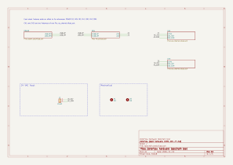
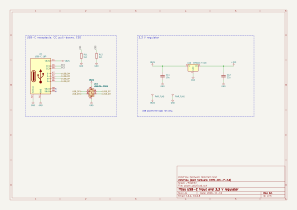
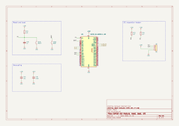
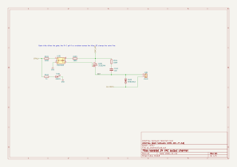
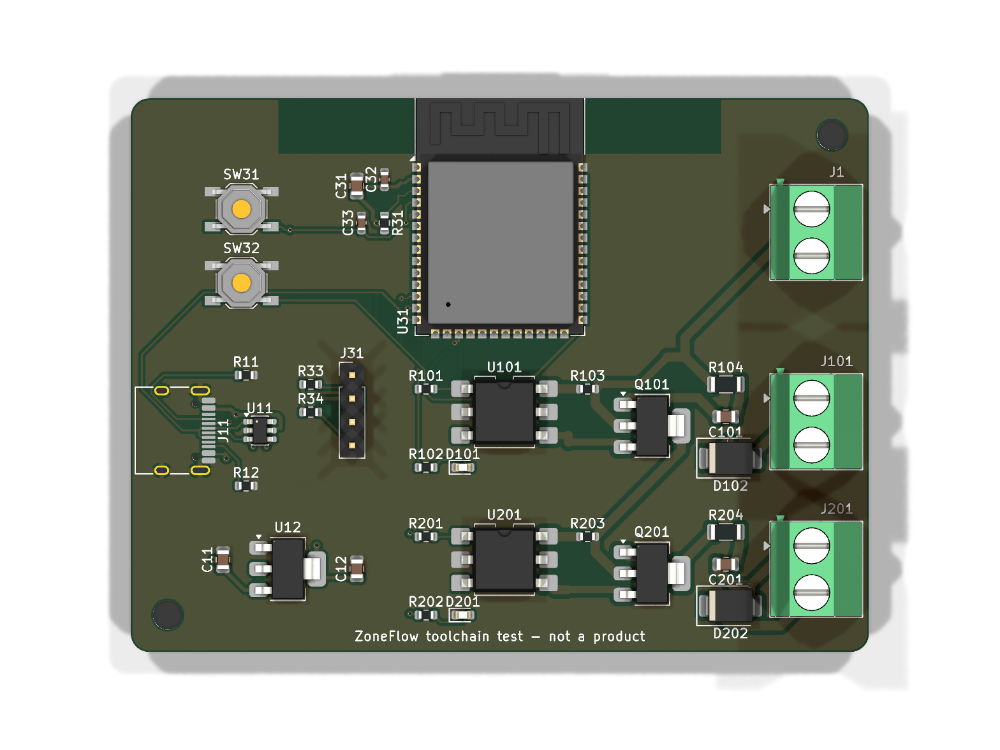
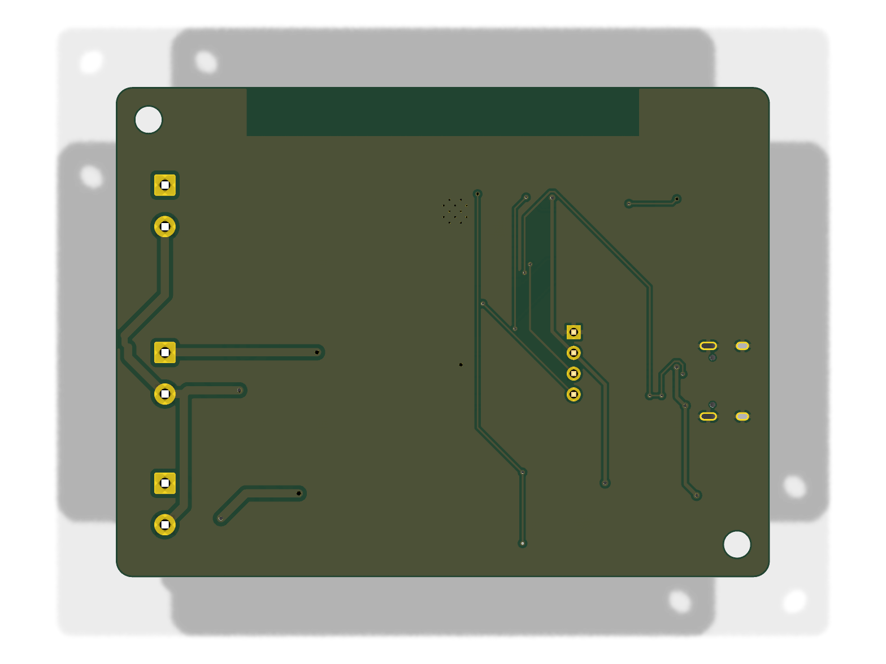

# Hardware toolchain

Status: **proven on a 40-part test board, 2026-11-10**, and used for the
schematic and the layout of the revision A board, 346 parts then and 348
since hardware review A2, on the same day (sections 12 and 13).
Nothing here has been built as hardware. Every result below names the command
that produced it.

This document describes how ZoneFlow hardware goes from text to a KiCad 10
project and fabrication files with no GUI, and how to design the real board
with it. The test board is in `hardware/toolchain-test/`. It is not the
ZoneFlow design and its part choices must not be reused.

## 1. Summary

- **Source of truth.** Two text files per board. `design/circuit.py` holds the
  circuit as Python. `design/board.toml` holds the outline, placement, net
  classes, pours and pre-routed tracks.
- **Generator.** `tools/hwflow`, a Python package in this repository. Its one
  third-party runtime dependency is PyYAML, to read the design netlist. It
  writes `.kicad_sch` files directly.
- **Everything after that is KiCad.** `kicad-cli` extracts the netlist, runs
  ERC and DRC, fills zones and exports the outputs. KiCad's `pcbnew` Python
  module builds the board. Freerouting 2.5.0 routes it.
- **One command.** `make` in the board directory. It stops with a non-zero
  exit code on any ERC or DRC error or warning.
- **Result on the test board.** ERC 0 violations. DRC 0 violations, 0
  unconnected items, 0 schematic parity issues. Freerouting routed 43 of 43
  connections in 11.5 s.

## 2. The flow

```text
design/circuit.py ──► hwflow sch ──► *.kicad_sch, .kicad_pro, lib tables, .kicad_dru
                                          │
                        kicad-cli sch export netlist ──► compared with the model
                                          │
                              kicad-cli sch erc  (gate)
                                          │
design/board.toml ──► hwflow.pcbbuild build ──► .kicad_pcb (placed, pre-routed) + .dsn
                                          │
                        Freerouting ──► route/<name>.ses  (cached by DSN hash)
                                          │
                        hwflow.pcbbuild finish ──► tracks imported, stubs removed
                                          │
                 kicad-cli pcb drc --refill-zones --save-board  (zone fill)
                 kicad-cli pcb drc --schematic-parity           (gate)
                                          │
                 kicad-cli exports ──► PDF, Gerbers, drill, BOM, CPL, STEP, renders
```

Three checks make the generated files trustworthy.

1. **Netlist check.** `hwflow` computes the netlist the circuit description
   means. It then asks KiCad for the netlist of the files it wrote and
   compares the two pin by pin. A wire that misses a pin, or touches the wrong
   one, fails the build before ERC runs.
2. **ERC.** `kicad-cli sch erc --severity-error --severity-warning
   --exit-code-violations`.
3. **DRC with schematic parity.** `kicad-cli pcb drc --schematic-parity
   --severity-error --severity-warning --exit-code-violations`. Parity proves
   the board has the same parts, footprints, fields and nets as the schematic.

### What is source and what is generated

| Path in a board directory | Kind | Edit by hand? |
|---|---|---|
| `design/circuit.py` | Source | Yes |
| `design/board.toml` | Source | Yes |
| `design/heights.toml` | Source, component heights for the mechanical check (section 13.2) | Yes |
| `design/rules.kicad_dru` | Source, board-specific DRC rules | Yes |
| `design/parts.toml`, `design/symbols.py`, `design/footprints.py`, `design/footprints.md` | Source, on a board drawn from a design netlist (section 12) | Yes |
| `lib/` | Generated project-local symbol and footprint libraries | No |
| `../rules/jlcpcb.toml`, `../rules/jlcpcb.kicad_dru` | Source, fab limits | Yes, with a citation |
| `../rules/jlcpcb-cpl-rotations.csv` | Source, rotation corrections | Yes |
| `route/<name>.ses`, `.dsn.sha256`, `.dsn.novalues.sha256`, `.freerouting.json` | Routing cache | No. `make reroute` replaces it |
| `*.kicad_sch`, `*.kicad_pcb`, `*.kicad_pro`, `*.kicad_dru`, `sym-lib-table`, `fp-lib-table` | Generated | No. The next `make` overwrites them |
| `output/` | Generated | No |
| `build/` | Scratch, not committed | No |

A human can open the generated project in KiCad to look, measure or try an
idea. A change made there is lost at the next build. Move it into `design/`.

## 3. Why this flow, and what was rejected

I gave each candidate a two-channel hierarchical example and loaded the result
with KiCad 10.0.8. Each got about ten minutes, so these are findings on small
cases, not full evaluations.

| Candidate | Version tested | What happened | Verdict |
|---|---|---|---|
| Own S-expression writer, `tools/hwflow` | this repository | Writes format `20260306`. KiCad's netlist matches the model in all 12 rotation and mirror states. One sheet file used twice gets two instance paths and distinct references. | **Chosen** |
| kicad-sch-api | 0.5.6, released 2025-11-19 | Writes the KiCad 9 format, which KiCad 10 loads. Flattens derived symbols correctly. `set_hierarchy_context` stores one instance path per sheet file, so one file cannot be used twice with different references. Writes no library tables. | Lost. Close, but reuse needs post-editing its output |
| circuit-synth | 0.12.1, released 2026-01-09 | Two instances of one sheet came out with one instance path. KiCad's netlist listed `R1` and `U1` twice. ERC reported 6 `hier_label_mismatch`. Both sheet symbols were drawn at the same position. `generate_pcb=True` logged "PCB generation features are not included in this version". | Failed |
| kiutils | 1.4.8, released 2024-02-02 | Reading and re-writing a KiCad 10 schematic dropped tokens without warning. `exclude_from_sim` went from 4 to 0, `do_not_autoplace` from 19 to 0, `dnp` from 3 to 1. | Failed. Lossy on KiCad 10 files |
| SKiDL with schematizer | 3.0.0 and 0.2.0, released 2026-10-16 | Has a KiCad 10 backend and does draw a wired schematic. A 22-part circuit raised `RoutingFailure` with default options and worked with `auto_stub=True, retries=5`. It wrote one file per channel instance, put no pins on the sheet symbols, named nets `N$9`, and overlapped text. Placement is automatic and cannot be steered. | Lost on readability and control. Worth another look in a year |
| atopile | 0.15.9, released 2026-09-12 | Its build targets include `update-pcb`, `bom`, `step` and `mfg-data`. None writes a `.kicad_sch`. | Fails the requirement for a readable schematic |
| tscircuit | CLI 0.0.3139, needs `bun` | `tsci export --format kicad_sch` wrote one flat sheet. Two instances of a group became 5 parts in KiCad's netlist where 9 were expected, with annotation errors. Symbols are its own, such as `Device:boxresistor_right`. Footprints are `tscircuit:...`. No `LCSC` field. | Failed |

Writing the files directly costs about 2,500 lines of Python that we now own.
In return the generator copies library symbols byte for byte, so KiCad reports
no library mismatch, and the page layout is under the designer's control.

## 4. Using it

### 4.1 What you need

- **KiCad 10.** `kicad-cli` on the path, and the system Python that carries the
  `pcbnew` module. Tested with 10.0.8 and Python 3.14.9.
- **uv.** It creates the locked environment in `tools/hwflow/.venv`.
- **Java.** Only when the routing cache is stale. Tested with OpenJDK 27.
- **Network.** Only for the first routing run. `hwflow.route` downloads
  `freerouting-2.5.0.jar`, 65 MB, into `hardware/.cache/`, checks its SHA-256
  and writes progress to `hardware/.cache/download.log`.

No system package was added to the build machine for this work.

### 4.2 Commands

Run these in a board directory such as `hardware/toolchain-test/`.

| Command | What it does |
|---|---|
| `make` | Everything, from source to outputs. Fails on any ERC or DRC finding |
| `make sch` | Schematic and project files only, with the netlist check |
| `make lint` | Plot every page and fail on colliding text or symbols |
| `make schematic` | Up to ERC, then the schematic PDF, SVGs and BOMs. No board is needed |
| `make committed` | Compare the committed netlist and BOMs with the design netlist. Needs no KiCad |
| `make erc` | Up to and including ERC |
| `make drc` | Up to and including DRC. Use this while iterating on placement |
| `make mech` | Up to DRC, then the board against the mechanical contract |
| `make reroute` | Discard the stored routing, route again, then everything |
| `make check` | Unit tests, KiCad round-trip tests, and deliberate ERC and DRC failures |

A full `make` on the test board takes about 25 s with the routing cache and
about 40 s when it has to route.

### 4.3 Writing the circuit

`design/circuit.py` defines `build()`, which returns a `Design`. Each sheet is
a function that receives a `Sheet`. Read
`hardware/toolchain-test/design/circuit.py` as the worked example.

```python
def ac_channel(s):
    gnd = s.power("GND", netclass="Power")        # power symbol, global net
    ctrl = s.port("CTRL", "input")                # hierarchical label, a sheet pin
    out = s.net("OUT", netclass="AC24")           # local label
    r1 = s.part("R1", "Device:R", at=(58.42, 73.66), rot=90, value="220R",
                footprint="Resistor_SMD:R_0603_1608Metric", lcsc="C22962")
    u1 = s.part("U1", "Relay_SolidState:MOC3023M", at=(76.2, 76.2), lcsc="C115469")
    s.wire(r1[2], u1[1])                          # a real wire between two pins
    s.connect(ctrl, r1[1])                        # short stub plus the net's label
    s.nc(u1[3], u1[5])                            # no-connect flags
```

- **Positions.** Millimetres on the page, on the 1.27 mm grid. An off-grid
  value is an error.
- **Rotation and mirror.** `rot` is 0, 90, 180 or 270, counter-clockwise.
  `mirror` is `"x"` or `"y"` as in the KiCad file format.
- **Pins.** `part["EN"]` or `part[3]`. Use `part.pins("GND")` when a name
  covers several pins. Pins a symbol stacks on one point count as one.
- **Every pin must be accounted for.** A pin that is neither connected nor
  marked with `s.nc()` or `s.nc_rest(part)` fails the build.
- **Wires and labels.** `s.connect(net, pins)` draws a stub and a label, or a
  power symbol for a power net. `s.wire(a, b, route="hv")` draws a wire.
  `s.label(net, at, direction)` puts a label or power symbol on a wire end.
- **Text placement.** `ref_at=` and `value_at=` override where a part's
  reference and value appear. `s.frame()` draws a titled dashed box.
- **Net classes.** Give `netclass=` on any net. The class follows the net
  through the hierarchy and lands in the project file as an exact-name pattern.

### 4.4 Describing the board

`design/board.toml` is commented. Its tables are listed here.

| Table | Content |
|---|---|
| `[netclass.NAME]` | Track width, clearance, via diameter and drill. Order sets priority |
| `[board]` | Page origin, size, corner radius, copper layer count, thickness |
| `[[zone]]` | Net, layers, clearance, optional outline polygon, pad connection style |
| `[place]` | `REF = [x, y, rotation, side]` in board coordinates |
| `[group.SHEET.parts]`, `[group.SHEET.at]` | One placement for every instance of a sheet |
| `[[track]]`, `[[group.SHEET.track]]` | Pre-routed tracks through pads, points and vias |
| `[silk]`, `[silk.move]`, `[group.SHEET.silk_move]` | Hide or move reference text |
| `[[text]]` | Free text on any layer |
| `[drc_severity]`, `[erc_severity]` | Changed check severities, each with its reason |
| `[route]` | `outer_layers_only = true` keeps the autorouter off inner layers |

A part with no placement fails the build and the message lists it. A placement
for a part that is not in the schematic fails the build too.

## 5. What was checked

All on 2026-11-10, KiCad 10.0.8, on the test board unless stated.

| Claim | Check | Result |
|---|---|---|
| Pin positions match KiCad in every orientation | `test_pin_positions_match_kicad_in_every_orientation`: 12 rotation and mirror states, netlist exported by `kicad-cli` and compared | Pass |
| The netlist check catches a bad drawing | `test_netlist_check_catches_a_wire_that_misses_its_pin` | Pass. The mismatch names the part |
| ERC is clean | `kicad-cli sch erc --severity-error --severity-warning --exit-code-violations` | 0 violations, exit 0 |
| ERC catches an error | `test_erc_catches_an_undriven_power_input`: the same circuit without `PWR_FLAG` | `power_pin_not_driven`, non-zero exit |
| DRC is clean | `kicad-cli pcb drc --schematic-parity --severity-error --severity-warning --exit-code-violations` | 0 violations, 0 unconnected, 0 parity, exit 0 |
| DRC catches a short | `test_drc_catches_a_short`: a track added across R11's two pads | `tracks_crossing` and `solder_mask_bridge`, non-zero exit |
| DRC catches board and schematic out of step | `test_drc_catches_a_part_missing_from_the_board`: R12 deleted from the board file | `missing_footprint`, non-zero exit |
| Sheet reuse gives distinct parts | `test_reused_sheet_gets_distinct_references_and_nets`, and R101 and R201 in the BOM | Pass |
| Net classes reach the board | `output/reports/build-summary.json`, read back from the board with `pcbnew` | AC24 1.0 mm and 0.5 mm clearance, Power 0.4 mm, Default 0.2 mm |
| The project files are reproducible | Two `make` runs, SHA-256 of every file compared | `.kicad_sch`, `.kicad_pcb`, `.kicad_pro`, library tables, BOM and CPL are byte-identical |
| A 4-layer board works | Scratch copy of the test board with `layers = 4`, pours on `In1.Cu` and `In2.Cu`, `outer_layers_only = true`, same commands | DRC 0 violations, 0 unconnected, exit 0. No track on an inner layer |

`make check` runs the 16 automated tests. The 4-layer run is not automated and
its files are not in the repository.

**Not checked.** Nobody has opened the project in the KiCad GUI. I tried under
`xvfb-run` and got a blank screen with no error, and did not pursue it. Every
file was loaded and re-saved by `kicad-cli` and `pcbnew`, which use the same
loaders as the GUI. Open it once by hand before relying on it.

## 6. Results on the test board

The circuit has an ESP32-S3-WROOM-1 with decoupling, reset and boot buttons, a
USB-C receptacle with CC resistors and ESD protection, a 3.3 V regulator, an
I2C header, two mounting holes, a 24 VAC input terminal, and two instances of
one opto-triac output channel. It has 40 parts and 27 nets on an 80 x 60 mm
2-layer board.

The test circuit was drawn against v0.1 of the system specification. Version
0.2 chose a different output stage, with one 24 VAC leg as circuit ground and
no opto-triac. That does not change what the test proves about the flow, and
it is one more reason not to copy the test circuit.

### 6.1 Schematic

Five pages from four files. `ac_channel.kicad_sch` appears twice.






The pictures in this document are copies of the build outputs of 2026-11-10,
kept in `docs/design/hardware-toolchain/` because the documentation site can
only serve files under `docs/`. The current outputs are in
`hardware/toolchain-test/output/`.

I read every page of `output/toolchain_test-schematic.pdf`. My judgement
follows.

- **Good.** The channel sheet reads like a hand-drawn schematic. The signal
  flows left to right with real wires and junctions. The regulator and reset
  blocks are clear. Framed blocks with titles help.
- **Acceptable.** The MCU sheet uses a label on every used pin. It is easy to
  check against a pin table and gives no sense of signal flow.
- **Ugly.** Pin numbers of stacked pins print on top of each other on the
  USB-C and ESP32 symbols. No-connect crosses crowd the ESP32 pin numbers.
  Both come from the stock KiCad symbols. The root sheet is mostly empty.
- **Manual work.** Four parts needed `ref_at` and `value_at` because the
  default text position collided with a wire or with other text. Expect that
  for about one part in ten.

### 6.2 Board





The back views are drawn as seen through the board from the front, not
mirrored.

### 6.3 Routing numbers

From `output/reports/build-summary.json` and `route/toolchain_test.freerouting.json`.

| Quantity | Value |
|---|---|
| Connections given to Freerouting | 43 |
| Left unrouted by Freerouting | 0 |
| Unconnected items in KiCad DRC after import and zone fill | 0 |
| Freerouting passes, time | 7 passes, 11.5 s |
| Track segments, vias, total length | 318, 23, 949 mm |
| Pre-routed items kept through import | 7 of 7 |
| Dangling stubs left by the router and removed | 3 |

Completion was 100% on a board with a lot of free area. That says little about
a dense board.

| Net class | Class width | Narrowest routed | Length below class width |
|---|---|---|---|
| AC24 | 1.0 mm | 0.75 mm | 29.5 of 252.4 mm |
| Power | 0.4 mm | 0.3 mm | 11.6 of 326.9 mm |
| Default | 0.2 mm | 0.15 mm | 21.6 of 369.8 mm |

Freerouting narrows a track to about 75% of its class width where it enters a
pad. The board's `rules.kicad_dru` accepts 0.75 mm on AC24 and DRC enforces
that floor.

### 6.4 Routing quality

- **Electrically complete and DRC-clean.**
- **Not what a person would draw.** The BOOT switch track runs 1 mm inside the
  left board edge for 30 mm. The 24 VAC feed crosses the board diagonally
  between the two channels. Tracks around the triacs make odd shapes.
- **No sense of return paths or current.** The router knows widths and
  clearances and nothing else. 24 VAC tracks run 0.5 mm from the logic ground
  pour because that is the class clearance, not because it is wise.
- **Freerouting reported 8 "unfixable violations"** between VBUS and GND pads
  inside the USB-C footprint. KiCad's DRC does not flag them. I did not find
  out which tool is right. Check that footprint before using it for real.

## 7. KiCad 10 Python findings

The SWIG `pcbnew` module still ships in KiCad 10.0.8 and runs without a
display. No step here needs `xvfb-run` or the IPC API. These are the problems
I hit and how the flow avoids each.

| Problem in 10.0.8 | Workaround in `hwflow` |
|---|---|
| `BOARD.Remove(item)` gives the object to Python. When the proxy is garbage-collected, `BOARD.Tracks()` starts returning a bare `SwigPyObject` and the interpreter segfaults on exit | Use `BOARD.Delete(item)` |
| `NETINFO_ITEM.GetNetClass()` returns a bare `SwigPyObject` | `board.GetDesignSettings().m_NetSettings.GetEffectiveNetClass(name)` |
| `FOOTPRINT.Points()` returns objects with no methods. Points are new in KiCad 10 | Their UUIDs are fixed in the saved file as text |
| `BOARD.GetLayerID("F.SilkS")` returns -1. Only GUI names such as `F.Silkscreen` resolve. An item saved on layer -1 makes the board unloadable | A lookup table that accepts both spellings and rejects unknown names |
| Every new item gets a random UUID and KiCad writes items sorted by UUID, so two builds differ in thousands of lines | `SetUuid` with a UUID derived from the item's content |
| `pcbnew.NewBoard()` and `SaveBoard()` rewrite `.kicad_pro` in full | Accepted. They keep the net classes and rules the generator wrote, and the result is stable |
| `kicad-cli` has no "update PCB from schematic" | The board is built from the exported netlist. Footprint paths use the schematic's UUIDs, so `--schematic-parity` passes |
| No headless zone fill command | `kicad-cli pcb drc --refill-zones --save-board` |
| KiCad reads the user's library tables, and a fresh account has none | The generator writes project-local `sym-lib-table` and `fp-lib-table`. `make` sets `KICAD_CONFIG_HOME` to a directory under `build/` |

The SWIG module is deprecated. If a later KiCad removes it, `pcbbuild.py` is
the one file to port, about 530 lines.

## 8. JLCPCB rules

I read <https://jlcpcb.com/capabilities/Capabilities> on 2026-11-10. The page
has no revision date. The values are for 1 oz outer copper on standard FR-4.
Where the 2-layer and multilayer figures differ, the rules use the stricter
one so that one set covers both.

| Limit | Value used | Page text |
|---|---|---|
| Track width and spacing | 0.10 mm | "0.10 / 0.10 mm (4 / 4 mil)" for 1 and 2 layers, 0.09 mm multilayer |
| Any hole | 0.30 mm | The smallest hole with no extra charge. The help article "In what cases will there be charged extra?", last updated 2026-11-10 and read 2026-11-11, says holes below "the standard size (diameter of 0.3mm or more)" cost more. The capabilities page still says "Preferred Min. Via hole size: 0.2mm". The two disagree; `jlcpcb.toml` has both and follows the article |
| Via diameter | 0.45 mm | "Via diameter should be 0.1mm(0.15mm preferred) larger than Via hole size" |
| PTH pad annular ring | 0.18 mm | 2-layer "absolute minimum 0.18 mm", multilayer 0.15 mm |
| PTH hole to track | 0.28 mm | "0.35mm is recommended, minimum 0.28mm" |
| Via hole to track, NPTH to track | 0.20 mm | "Via hole to Track 0.2mm", "NPTH to Track 0.2mm" |
| Via hole to via hole | 0.20 mm | "Via Hole-to-Hole Spacing 0.2mm" |
| Pad hole to pad hole | 0.45 mm | "Pad Hole-to-Hole Spacing 0.45mm" |
| SMD pad to pad, different nets | no rule | "SMD pad to pad clearance (different nets) 0.15mm". Every net class asks for 0.2 mm or more, so the classes keep this limit. It was a rule of its own until the layout review of revision A and did harm: see below |
| Copper to routed board edge | 0.20 mm | "Copper clearance from routed board edges: ≧0.2 mm". V-cut edges need 0.4 mm |
| Silkscreen text | 1.0 mm high, 0.15 mm line | "Minimum text height 40 mil (1.0mm)", "Minimum Line Width ≥0.15mm" |
| Pad to silkscreen | 0.15 mm | "Pad To Silkscreen 0.15mm" |
| Solder mask bridge | 0.10 mm | 0.10 mm for green, red, yellow, blue, purple. 0.13 mm for black or white |

The numbers are in `hardware/rules/jlcpcb.toml`, which becomes the board-wide
constraints in `.kicad_pro`. Limits that depend on the item type are rules in
`hardware/rules/jlcpcb.kicad_dru`. Both are copied into every project.

I read the page through a text extraction tool, not in a browser. Read it
again before an order.

**Two things the layout review of revision A changed here.**

- **A hole under 0.3 mm fails DRC.** The board-wide minimum is 0.30 mm and a
  rule in `jlcpcb.kicad_dru` names the reason in the report. Before, 0.20 mm
  was allowed, and the module footprint brought twelve such holes with it.
  On 2026-11-11 JLCPCB's quote priced them with a surcharge, a material
  upgrade and a four-wire test (the project's cost analysis found it). The
  toolchain test board keeps KiCad's stock module footprint and switches the
  finding off in its own `board.toml`, with the reason.
- **A clearance in a custom rule is not a floor.** `jlcpcb.kicad_dru` had a
  rule that gave every pair of surface-mount pads a clearance of 0.15 mm.
  KiCad takes a custom rule in place of the net-class clearance for every
  pair it fits, so two pads 0.15 mm apart passed DRC whatever their nets. On
  revision A it hid one pair, the solder jumper JP1, which now has a rule of
  its own in the board's `design/rules.kicad_dru`. A rule that lowers a
  clearance belongs to one named pair, never to a pad type.

## 9. Known limits

- **You place every schematic symbol by coordinate.** There is no automatic
  schematic layout. `make lint` finds text and symbols that collide
  (section 12.4). It does not judge whether a page reads well; you still
  read the PDF.
- **No buses, no graphical net-class flags, no per-instance values.** Every
  instance of a reused sheet has the same values.
- **KiCad names unlabelled nets.** A wire-only net shows up on the board as
  `Net-(C101-Pad1)`. Add `s.label()` if the name matters for review.
- **The autorouter narrows tracks at pads** to about 75% of class width. Set
  the floor you accept as a DRC rule per class.
- **The autorouter does not understand return paths or which areas of the
  board should stay apart.** Pre-route what matters. `[[rule_area]]`,
  `[[guard]]` and `[[route.keepout]]` say where it must not go (section 13.1).
- **On a 4-layer board Freerouting routes signals on the inner layers** unless
  it is told not to. `[route] layers` names the layers it may use, through its
  settings file (section 13.3); `[[plane]]` and `[route] exclude` keep the
  plane nets from it. The older `[route] outer_layers_only = true` shows it a
  2-layer board instead; plane nets are then routed as outer-layer tracks.
  Marking the inner layers `(type power)` in the DSN, or exporting the planes,
  did not keep Freerouting 2.5.0 off them.
- **Routing changes completely when placement changes.** The cache keeps a
  rebuild stable only while the DSN is byte-identical, or differs only in the
  value text of parts (section 13.8). A KiCad patch release
  changes the DSN header and forces a new route.
- **Freerouting may not be deterministic.** Its optimiser ran with 15 threads.
  I did not test whether two runs on the same DSN agree.
- **Reference text on the silkscreen needs attention.** DRC reported 6
  silkscreen warnings from 3 parts on a 40-part board. Each fix is one line in
  `board.toml`.
- **`silk_edge_clearance` is ignored on the test board** because the antenna,
  USB-C and terminal outlines cross the edge on purpose. That also hides
  reference text that hangs over the edge. Look at the render.
- **JLCPCB placement corrections are checked against JLCPCB's library, not
  against its preview.** `make cpl-check` (section 13.12) compares every
  placement with the footprint that the JLCEDA library holds for the part's
  LCSC number. The table of corrections was rewritten from that comparison in
  the layout review of revision A: with the seven rows it had before, 26
  placements of that board were wrong. The check does not prove that the
  library footprint is how the part lies in its tape. Still compare JLCPCB's
  preview with `output/<name>-pin1.csv` when ordering.
- **The CPL lists through-hole parts** such as terminal blocks, unless the
  board Makefile sets `POS_FLAGS := --smd-only`.
- **Board exports are not byte-stable.** Gerbers, drill files, reports, the
  PDF and the SVGs carry a timestamp or a generated id. A rebuild of the test
  board from a clean checkout changed 29 files under `output/` and nothing
  else. The STEP file renumbers its entities. The PNG renders differ by a
  few hundred pixels. The BOM and CPL are stable. For the schematic outputs
  `STABLE := 1` in a board Makefile removes the timestamps and keeps a plot
  that draws the same as before (section 12.5).
- **No 3D model for the USB-C receptacle** in the stock library, so the render
  shows only its outline.
- **An LCSC number is only as good as the lookup.** Of the 23 numbers I first
  typed from memory, 7 were wrong. All 23 were then checked against a listing
  and are recorded in `hardware/toolchain-test/design/parts-sources.md`.

## 10. Procedure for the real board

The real board is about five times the size of the test: roughly 200 parts,
nine output channels, a buck supply and more connectors.

### 10.1 Set up

1. Copy `hardware/toolchain-test/Makefile` to the new board directory and
   change `NAME`.
2. Write `design/circuit.py` with one function per functional block. Aim for
   15 to 30 parts per sheet on A4, or use `paper="A3"` for the MCU sheet.
3. Decide the reference scheme first. Give each sheet instance a
   `ref_offset`. Use 100 to 900 for the nine channels so R305 is zone 3.
4. Keep every part number in one table file beside the circuit, with the
   listing or datasheet it came from. The honesty rules in `CLAUDE.md`
   require the source.

### 10.2 Repeated channels

Write the channel once as a function and instantiate it nine times from the
root sheet.

```python
chan = d.sheet("ac_channel", "24 VAC output", build=ac_channel)
for n in range(1, 10):
    r.instantiate(chan, f"Z{n}", at=(col(n), row(n)), ref_offset=100 * n,
                  connect={"CTRL": r.net(f"Z{n}_CTRL"), "AC_HOT": hot, "AC_COM": com})
```

On the board, `[group.ac_channel.parts]` places the channel once, relative to
an origin. `[group.ac_channel.at]` gives the origin and rotation of each of
the nine instances. Pre-routes and silkscreen moves inside the group repeat
with it. Changing the channel layout is one edit.

A build that leaves instances out, such as the 4-zone board, is a KiCad 10
assembly variant: `Design.variant(name, dnp={refs})` (section 12.3).

### 10.3 Order of work

1. **Schematic first, sheet by sheet.** Run `make erc` after each sheet. Read
   the PDF page. Fix text collisions with `ref_at` and `value_at`.
2. **Board outline, connectors and mounting holes.** These are fixed by the
   enclosure. Place them and nothing else. `make drc` will list every part
   still unplaced, which is your to-do list.
3. **Place by block.** Read each footprint's pad and courtyard extents with
   `pcbnew` before choosing coordinates. Do not guess.
4. **Pre-route what must be right.** The 24 VAC feed and returns, the buck
   converter's switch node and input loop, USB D+ and D-, the current-sense
   path. Use `[[track]]` with explicit widths.
5. **Pours.** Ground on both outer layers, or inner planes on 4 layers with
   `outer_layers_only = true`.
6. **Autoroute the rest and read the result.** Expect several rounds of
   moving parts to help the router.
7. **Silkscreen last.** Hide references of small passives with `[silk] hide`
   if the board is dense, and move the rest.

### 10.4 Review from PDFs and renders

Reviewers do not need KiCad.

- **Schematic.** `output/<name>-schematic.pdf`, one page per sheet instance,
  with clickable hierarchy links. `output/schematic-svg/` has the same pages
  for embedding in a pull request.
- **Netlist.** The build prints the part and net count. `build/<name>.net` is
  KiCad's own netlist if a reviewer wants to grep for a pin. A board drawn
  from a design netlist commits it as `output/<name>.net`.
- **Board.** `output/<name>-top.png` and `-bottom.png` for placement and
  silkscreen. `output/<name>-front.svg` and `-back.svg` for copper.
- **Numbers.** `output/reports/build-summary.json` has routed widths per net
  class, via count and the ERC and DRC counts. `drc.rpt` and `erc.rpt` are the
  full reports.
- **Diffs.** A change to `design/` is a small text diff. The generated files
  change with it. Review the diff of `design/` and the pictures.

An agent reviewing a board should read the PNG and PDF pages, as I did here.
That found problems ERC and DRC did not: reference and value text printed on
top of each other, a note running off the page, and reference text clipped at
the board edge.

## 11. Risk for the full board

- **Schematic generation: low.** The mechanism is checked against KiCad's own
  netlist on every build. The cost is labour. Expect a few hours of coordinate
  work per sheet and several render-and-fix rounds.
- **Board build, DRC, outputs: low to medium.** They work today. The risk is
  the deprecated SWIG module and its wrapper faults. Four turned up in one
  day on a 40-part board. A 200-part board will find more.
- **Autorouting: medium to high.** 100% on a sparse 2-layer test predicts
  little. I expect the real board to need 4 layers, heavy pre-routing of the
  AC and power paths, and to finish with a handful of connections that need a
  placement change or a hand-written track.
- **Layout quality: high.** Nothing in this flow judges surge current paths,
  heat in the triacs, EMC or antenna keep-out beyond the library footprint.
  DRC passing means manufacturable, not good. Plan a human layout review in
  KiCad before any order, and budget for that reviewer to move tracks. A
  change made in the GUI has to be carried back into `board.toml` by hand.

My overall view is that the flow can produce the revision A board, and that
routing will take more effort than every other step combined.

## 12. Capture from a design netlist

The revision A board, `hardware/zoneflow-a/`, was designed on paper first.
`hardware/netlist.yaml` lists its 353 components, the part number of each and
the net on every pin, and it was reviewed before any schematic existed. The
schematic must therefore be that netlist, drawn. `hwflow.capture` makes it so.
This section describes what was added to the flow for it and what was checked.

### 12.1 Three inputs, one drawing

| File | Says | Does not say |
|---|---|---|
| `hardware/netlist.yaml` | Reference, value, package, LCSC number, build variant, the net on every pin | Anything about KiCad |
| `design/parts.toml` | For each part number: KiCad symbol, footprint, the short value shown on the page, and the pad for each netlist pin name where the name does not start with the number | Which components exist |
| `design/circuit.py` | Which sheet a component is on, where it sits, how the wires run, the notes on the page | Values, part numbers, nets |

`circuit.py` places a component by reference and draws wires between pins:

```python
def rtc(s):
    u10 = s.place("U10", P(130, 72))          # symbol, value, footprint, LCSC: from the two tables
    y1 = s.attach("Y1", 1, P(108, 69), DOWN)  # a two-terminal part: pin 1 on the point, body downwards
    s.wire(u10["OSCI"], y1[1], route="hv")    # a wire between two pins of one net
    s.label(P(100, 68), RIGHT)                # a label on that wire: its text is the wire's net
```

`P(x, y)` is a point in units of 1.27 mm. Pins that the function does not wire
get a short stub and the net's label, port or power symbol when the sheet is
finished, so no pin can be forgotten.

A net name appears in the drawing code only where a wire touches no pin and
no other wire.
`s.wire()` takes the net from the pins at its ends and **refuses to join pins
that the netlist puts on different nets**. A label always shows the net the
netlist gives. So a drawing mistake is a build error, not a wrong circuit.

A reused sheet is declared once: `cap.template("channel", {"Z1": 100, ...,
"MV": 900}, first_refs)`. The build checks that every instance has the same
parts and the same connections as the first before it draws one sheet for all
nine.

### 12.2 The parity check

After KiCad has extracted the netlist of the generated files, `hwflow sch`
compares it with `netlist.yaml` through `parts.toml`
(`tools/hwflow/hwflow/parity.py`). The build fails unless all of this holds:

- The same references on both sides, apart from the parts listed under
  `[mechanical]` in `parts.toml` (the mounting holes, which have no pins).
- For every component: the value and footprint of the part table, the LCSC
  number of the netlist, and the netlist's own value text in the hidden field
  `Spec`, word for word.
- For every KiCad net: all its pads belong to one design net, and it carries
  that net's name. A net local to a channel is compared with the channel
  suffix: `/Z3/T2` stands for `T2_Z3`.
- No design net is in two pieces. No pin that the netlist leaves open is
  connected. No pad of a symbol is unaccounted for.
- For each build, KiCad's BOM export lists exactly the parts that the
  netlist's `variant` field fits, with the right part numbers.

The test suite changes a small design seven ways (a pin moved to another net,
a changed value, a changed part number, a part added, a part removed, a pin
map the wrong way round, a renamed net) and checks that each one is
reported: `tools/hwflow/tests/test_capture_parity.py`.

Result on revision A, `make schematic`, 2026-11-11, after the two parts and
one net that hardware review A2 added and the five parts and one net of
[hardware answers A2](hardware-answers-a2.md): "353 components and 200
nets of the design netlist match KiCad's netlist pin for pin; fitted parts
match in 2 build(s)".

### 12.3 What else the generator learned

- **Multi-unit parts.** `s.place("U6", at, unit=2)`. The units of one package
  may be on different sheets. The power unit is a unit like any other.
- **Assembly variants.** `Design.variant("4-zone", dnp={...})` writes KiCad 10
  variants into every symbol instance. `kicad-cli sch export bom --variant`
  then gives the BOM of that build. `VARIANTS := 4-zone` in the board Makefile
  exports one BOM per variant.
- **Project-local libraries.** `design/symbols.py` writes
  `lib/<Name>.kicad_sym` with `hwflow.symgen`: new symbols as boxes with named
  pin groups, or stock symbols with a changed pin map. `design/footprints.py`
  writes `lib/<Name>.pretty` with `hwflow.fpgen`, through KiCad's `pcbnew`
  module, from the dimensions of the maker's drawing. `design/footprints.md`
  records what each footprint was compared with.
- **Notes.** `s.note()`, `s.text()`, `s.line()` and `s.frame()` put the design
  intent on the page. Title-block comment lines come from `Design.comments`.
- **Power flags.** `s.flag()` places a `PWR_FLAG` where a rail enters through
  a connector or a regulator output, each with a comment in `circuit.py`. No
  ERC check is switched off for revision A.

### 12.4 Page lint

ERC does not look at how a page reads. `hwflow lint` (`make lint`, and part of
`make erc` when `SCH_LINT := 1`) plots every page to SVG with `kicad-cli` and
fails on:

- two pieces of text whose boxes overlap,
- a wire or a graphic line that crosses a piece of text,
- text outside the page frame or inside the title block,
- two symbol bodies that overlap, and a wire that passes through a symbol body.

The text boxes are what KiCad plotted, so the check sees the page as a reader
does. It is a geometric test. It finds collisions; it does not find a page
that is merely ugly. Every sheet of revision A was also read as an image after
each change.

Result on revision A: "20 plotted pages, no text or symbol collides".

### 12.5 Committed outputs and CI

The generated files are committed, so a rebuild that changes nothing must
leave no diff. Two things stood in the way.

**The time of export.** KiCad stamps every PDF, SVG and report with the second
it was written. With `STABLE := 1`, `hwflow.stable` replaces that stamp by the
date of the title block. On one machine, two builds in a row then leave every
file of the board directory byte-identical. Checked on 2026-11-10 by comparing
SHA-256 sums before and after a second `make schematic`.

**Two builds of the same KiCad release.** The files were made with the Arch
package of KiCad 10.0.8. CI regenerates them in the KiCad project's own
`kicad/kicad:10.0.8` container image. The first CI run showed what differs
between the two builds, and I compared the files:

| Files | Arch package against container image |
|---|---|
| All 12 `.kicad_sch`, `.kicad_pro`, `.kicad_dru`, both library tables, `lib/` | Byte-identical |
| Both JLCPCB BOMs, both ERC reports | Byte-identical |
| `output/zoneflow-a.net` | One line. The three multi-unit parts (U6, U7, U8) list the id of each unit, and for U7 the two builds give two of its five ids in the other order |
| The 20 SVG plots | Different on nearly every line, and the same picture. Each page has exactly the same drawing elements, with the same coordinates, styles and text, written in a different order |
| The PDF | Different bytes and size, as it holds the same 20 pages in the other order |

So it is not a font, a library or a rounding difference. Where KiCad sorts the
items of a page for plotting, items of equal rank end up in an order that
depends on the build. Byte-identity of the plots across builds is therefore
not something the flow can promise, and the comparison is by content:

- `parity.normalise_netlist` sorts the unit ids of each part before the
  netlist is committed. The committed netlist is then the same from both
  builds.
- `hwflow.plotcmp` reduces an SVG to the multiset of what it draws: every
  drawing element with the style it inherits from its groups and its
  attributes, and every text string. The time of export and the order of
  drawing are left out and nothing else is. All 20 pages from the container
  compare equal to the 20 pages from the Arch package.
- With `STABLE := 1` the build sets the old plots aside, plots again, and
  **keeps the old file of every page whose new plot draws the same**. A plot
  changes in git only when the picture changes. The PDF holds all pages; it
  keeps its old file only when no page was redrawn, added or removed. Its
  content is not compared separately.

What this does not cover: a different KiCad **release** may change the sheet
files themselves. The CI image is pinned to the release the files were made
with, and both must move together.

Two CI jobs in `.github/workflows/hardware.yml` use this:

- **design consistency**, with Python only. `make -C hardware design-check`
  runs `tools/designsync` (netlist, design document, BOM, pin map) and then
  `hwflow committed`: the committed `output/zoneflow-a.net` against
  `netlist.yaml` pin for pin, and both committed JLCPCB BOMs against the
  netlist's build variants. An edit to `netlist.yaml` or `parts.toml` without
  a rebuild fails here.
- **regenerate the rev A schematic**, in the `kicad/kicad:10.0.8` image. It
  runs `make schematic` (parity, lint, ERC) and then `git diff --exit-code`
  on the whole board directory. Sheets, project file, libraries, netlist,
  BOMs and reports must be byte-identical to what is committed. A plot shows
  up as changed only if it draws something else. An edit to `circuit.py`
  without a rebuild, or a hand edit of a generated file, fails here. The job
  uploads everything it generated, so a failure can be compared file by file.

### 12.6 Limits found on revision A

- **Coordinates are still by hand.** The 11 sheet functions of revision A are
  about 1200 lines. Moving a block means changing its numbers.
- **KiCad connects a power symbol or a pin only at a wire end.** The writer
  splits wires at such points. A label may sit anywhere on a wire.
- **The channel sheet shows the first instance's values.** All nine channels
  have the same parts today; the template check fails the build if one ever
  differs.
- **3D models.** Four project footprints use a stand-in model and four have
  none (`design/footprints.md`, section 5).

## 13. Laying out the revision A board

The layout of `hardware/zoneflow-a/` needed more from `board.toml` than the
test board did. This section lists what was added and what was learnt. The
layout itself is described in [hardware layout](hardware-layout.md).

### 13.1 New in `board.toml`

| Table or key | What it does |
|---|---|
| `[board] y_up = true` | Board coordinates with the origin at the bottom-left corner and y up, the frame of a mechanical drawing. Rotations stay counter-clockwise as seen from the top |
| `[group.NAME] sheet = "..."` | Two groups may place parts of one schematic sheet, each with its own origin per instance. The channel has two: the power half on a 7.1 mm pitch and the logic half on 9.5 mm |
| `[[track]] via = [d, drill]`, `via_to = "In2.Cu"` | A via size for one track, and the layer a track continues on after its via |
| `[[plane]] net, skip, within` | A short stub and a via beside every surface-mount pad of a net that connects through a plane. `within` lists the rectangles the plane covers |
| `[[guard]] net, distance` | A rule area along each side of the hand-routed tracks of a net, where no other track or via may be |
| `[[rule_area]]` | A region of some layers with no pour, no tracks or no vias |
| `[route] layers` | The copper layers the autorouter may route on. Its vias still pass through the others |
| `[[via]] net, at, size` | A via on its own, to tie a pour to a plane |
| `[route] exclude` | Nets the autorouter must leave alone, by pattern (13.9). Their pads and their pre-routed copper stay as fixed copper with the clearance of their class |
| `[[route.plane]] layer, net` | A layer the autorouter must not route on, because it is a plane of that net (13.9) |
| `[route] clearance_margin` | Millimetres added to every clearance in the Specctra file. Freerouting works in its own units and came 2 um under a 0.2 mm clearance; 0.01 mm ends that |
| `[route] prune = true` | After the import, remove a hand-placed escape via or stub that nothing came to use (13.10) |
| `[route] widen = true` | After the import, give every autorouted track the width of its net class where DRC allows (13.11) |
| `[[unroute]]`, `[[patch]]`, `[patches]` | Changes to the routed board that do not disturb the stored routing (13.10) |
| `[[route.keepout]]` | Rectangles of some layers where the autorouter may put neither track nor via. The patch router keeps out of them too, unless the rectangle is marked `stands_for_copper = true`: that mark is for planes and islands that are added as zones after the Specctra file is written, which only the autorouter cannot see |
| `[route.patch_last_resort] layer, cost, keepout` | A plane layer that the patch router may use for a connection with no path on the routing layers (13.13) |
| `[route.layer_cost]` | A cost factor for a layer, to make the autorouter use it less |
| `[[text]] angle, justify, optional` | A turned or left- or right-aligned text, and a text the builder may drop if it collides (13.6) |
| `[[line]]` | Straight silkscreen strokes, for a mark that is not text |
| `[silk] clean = true` | Make the silkscreen pass DRC by removing and moving what DRC finds (13.6) |
| `[[keepaway]]`, `[[apart]]`, `[[perpendicular]]`, `[[no_pad]]` | Layout rules that DRC cannot express, checked on the finished board (13.7) |
| `[drc_severity]` | The severity of one DRC check, written into the project file |

`board.toml` of this board is itself written by a program, `design/layout.py`,
which `make` runs first. Most of the file repeats or is computed: nine output
columns, the fan-out lanes of the valve outputs, eighteen gate lines, a bus
with eighteen stubs, twenty terminal labels. `layout.py` is the source;
`board.toml` is committed so that a reviewer can read the numbers without
running anything. `layout.py` uses the standard library only and asserts what
it computes: that no two fan-out lanes come closer than their pitch, that
every gate line found a lane.

A footprint named `Lib:Name` is taken from the project's own `lib/Lib.pretty`
if that exists, and from KiCad's library otherwise.

### 13.2 The mechanical check

`make` runs it after DRC when the board Makefile sets `MECH_CONTRACT`.
`hwflow.pcbbuild dump` writes `build/placement.json` from the saved board: every
footprint with its side, position, body outline, courtyard and pads, in board
coordinates. `hwflow mech` compares that with the contract
(`tools/hwflow/hwflow/mech.py`):

- outline, layer count, thickness;
- every hole: an unplated hole of that diameter at that place;
- every part the contract places: pin 1, the pads, or the centre of the body,
  whichever the contract gives, within 0.05 mm, and its side;
- the keep-out circle of every hole, foot and post;
- the height zones, for every other part, with heights from
  `design/heights.toml`. A later zone overrides an earlier one. A footprint
  with no height in the table fails the build;
- the bottom side: only what the contract puts there;
- the edge keep-out;
- no part over 1.5 mm within 2.5 mm of a top-side pad of a bottom-side part.

It compares numbers in files. Nothing is measured. Seven tests in
`tests/test_mech.py` move, flip and raise parts on a made-up board and check
that each is reported.

### 13.3 The autorouter reports usage unless told not to

Freerouting 2.5.0 sends usage data to its maker's server,
`api.freerouting.app`, by default. The defaults in its settings file are
`disable_analytics: false` and `allow_telemetry: true`. Reading the class
files of the jar (`app/freerouting/analytics/`), an event carries:

- the command line, which names the design file: `zoneflow-a.dsn`,
  `toolchain-test.dsn`, with the path it was given;
- the host name of the machine;
- statistics of the board and of the routing run.

I read the names of the event fields in the class files. I did not capture a
request, so I cannot say more exactly what a run sent, and I saw no field for
the design file's contents.

**The runs before this was found went out with the defaults**: every
autorouter run of the test board, and the first probes of the revision A
board, on 2026-11-10 from the build machine. The project owner has been told.

Since then:

- `hwflow.route` writes a settings file with both switches off into
  `build/freerouting-home/` and points Freerouting at it through the `XDG_*`
  variables. It never uses the user's own Freerouting settings.
- It sets the Java proxy properties for HTTP and HTTPS to a closed port on the
  local machine, so that no request can leave even if a later version ignores
  the settings file. This is the only way the jar is run: do not start it by
  hand.
- CI does not run the autorouter. It reuses the stored session (13.8).

The same settings file carries what the Specctra file cannot:

- `router.fanout.enabled = false`. The fan-out stage puts a via at every
  surface-mount pin before routing. On this board that took the room the
  router needed. It is off for a board whose `board.toml` has a `[route]`
  table, unless that says `fanout = true`. The test board has no such table
  and keeps the autorouter's own settings, with which its stored routing was
  made.
- `router.layers[n]`: the cost of a layer. An `autoroute_settings` block in
  the Specctra file makes 2.5.0 load an empty board without an error message.
  A `.rules` file given with `-dr` was read but its `(fanout off)` was not
  honoured.
- `router.autorouter.ignore_net_classes`: the nets it must leave alone (13.9).

**`router.layers[n].routable = false` does not keep 2.5.0 off a layer.** An
earlier version of this section said it did. It is read without complaint
and not obeyed: with In1.Cu marked not routable, the router put more track on
In1.Cu than on any other layer, 2.2 m in one run. No check noticed, because
In1.Cu is a ground pour and a pour flows round whatever is on its layer.
Every routing of the revision A board stored before this was found had
signal tracks on the ground plane. What does keep the router off a layer is
in 13.9.

### 13.4 More KiCad 10.0.8 Python findings

- `FOOTPRINT.Flip` on a footprint that is not yet on a board crashes the
  interpreter. Add it to the board first.
- `LEFT_RIGHT` in `Flip` mirrors y, not x, as seen in board coordinates. A
  bottom-side part needs its rotation chosen by looking at where its pads
  land; `build/placement.json` shows that.
- `BOX2I.Merge` through the Python wrapper corrupts the heap. Take the four
  edges and compare them in Python.
- A custom DRC rule can lower a net-class clearance for one layer:
  `(layer "In2.Cu") (condition "A.NetClass == 'AC24' && B.NetClass == 'AC24'")`.
- Two builds of one KiCad release plot the same schematic page with its items
  in a different order (section 12.5).

### 13.5 What a dense board asks for

The test board routed itself. This one did not: with every net given to the
autorouter on two layers, a third of the connections were still open after
three passes. What made it tractable:

1. Planes and pours for ground and 3.3 V, with a via per pad, and those nets
   kept from the autorouter.
2. Every current-carrying net written out by hand, as a group where it
   repeats.
3. A third routing layer for the logic nets, In2.Cu, which they share with
   the 3.3 V pour.
4. No fan-out stage.
5. An escape, a short stub and a via, written out for every pin of the one
   fine-pitch part whose pins the router boxed in with its own vias.
6. A way to finish what the autorouter leaves open without routing again: a
   small maze router and the `[[unroute]]` and `[[patch]]` tables (13.10).


### 13.6 A silkscreen that passes DRC

On a dense board the stock silkscreen of the footprints cannot stay: outlines
cross the pads of the neighbours, designators land on other parts, the outline
of an edge connector hangs over the board edge. `hwflow/silk.py` does not model
any of that. It uses KiCad's DRC as the judge: it saves a copy of the board,
runs `kicad-cli pcb drc`, and for every silkscreen finding

- deletes the footprint stroke that is at fault;
- moves a reference designator to the next of fourteen places round its part,
  and hides it when none is free;
- deletes a `[[text]]` marked `optional`, and fails the build for one that is
  not.

It repeats until DRC has no silkscreen finding. One round takes about two
seconds on this board and it needs 23. `build/silk.json` says what was
removed, moved and hidden.

The price: a footprint with a stroke removed no longer equals its library
copy, and DRC says so (`lib_footprint_mismatch`). `board.toml` sets that one
check to "ignore". The check has little to say in this flow in any case: the
board is built from the libraries on every run and no board file is edited by
hand.

### 13.7 Layout rules that DRC cannot express

DRC measures copper against copper on one layer. A safety analysis also makes
statements such as "this net stays away from that one on every layer", "these
two circuits are 10 mm apart", "this net has no test pad".
`hwflow/layoutrules.py` reads them from `board.toml` and measures them on the
finished board file: `make rules`, part of `make`.

| Table | What it checks |
|---|---|
| `[[keepaway]] net, from, distance, scope` | The smallest distance from the copper of `net` to the copper of every net matching `from`. `scope = "plan"` measures in plan view whatever the layers, so that not even a crossing on another layer passes. `scope = "layer"` measures copper that shares a layer. `kinds` and `own_kinds` choose among tracks, vias and pads; `except` leaves nets out |
| `[[apart]] a, b, distance` | The smallest gap between a pad of one group of parts and a pad of the other |
| `[[perpendicular]] parts` | Two parts at right angles |
| `[[no_pad]] nets, refs` | No part matching `refs` has a pad on one of the nets |

Tracks are lines with a width, vias circles on every layer, pads their
bounding rectangles. Pours are not looked at. A rule that names no net of the
board fails, so that a renamed net cannot silently switch a rule off. The
result goes to `output/reports/layout-rules.md`. Ten tests in
`tests/test_layoutrules.py` run each rule on made-up copper, met and broken.

A `[[keepaway]]` with `scope = "layer"` also acts earlier: the builder keeps
the plane vias of the `from` nets that distance away when it places them.

### 13.8 What CI does with the board

The board build needs KiCad's Python module, which the `kicad/kicad` image has,
and the autorouter, which CI does not run. The job regenerates the placed and
pre-routed board from the sources, checks that the Specctra file it writes has
the hash stored beside the committed session in `route/`, imports that
session with its patches (13.10), and runs `make board-check`: DRC with
schematic parity, the mechanical contract, the layout rules. It makes no
renders and needs no display. `ROUTE_FLAGS=--stored-only` makes the route step
fail, instead of starting the autorouter, when the stored session does not
belong to the sources.

**A new value on a part is not a new board to route.** KiCad writes the
value text of every placed part into the Specctra file:
`(place C28 129800 -95600 front 0 (PN "220p C0G"))`. The autorouter does not
route by it, but the hash covered it, so changing a capacitor from 220 pF to
330 pF in the same footprint made the stored session "not from these
sources" and asked for a routing run of two hours that would not give the
same copper. Since the BOM consolidation, `hwflow.route` keeps a second
hash in `route/<name>.dsn.novalues.sha256`: the same file and router
settings with that value text left out of the placements, and nothing else
left out. The stored session is reused when the first hash matches, or when
the second one does; the route step then prints that the file differs only
in the value text of parts. A part that is added, removed, moved, turned,
put on the other side or given another footprint, a pad, a net, a rule or a
keep-out still changes both hashes. A test in `tests/test_dsn.py` holds
that. The first hash stays what names the session, because the patches of
13.10 carry it.

For the session of revision A the second hash was not written by a routing
run. It was calculated from the Specctra file of the commit before the
consolidation, whose first hash is the committed one,
`13cc4d6f...c4130`. The file after the consolidation differs from it in two
lines, the value text of C28 and C29, and putting the old text back gives
the committed hash again.

I could not run the container on the build machine, which has neither Docker
nor Podman. The job was run by GitHub for the first time on the pull request
that added it. On the build machine the same command, with the same KiCad
release, passes and writes the committed board file again byte for byte.

**What the schematic job needed.** It runs `make schematic` alone and fails
if a committed file under the board directory then differs. Two things broke
that once a board was built:

- KiCad rewrites `<name>.kicad_pro` with all its defaults whenever a board is
  saved. The committed file is the short one the schematic step writes.
  `hwflow project` writes it again, and the DRC, output and interactive BOM
  steps call it last.
- The step that keeps unchanged schematic plots moved every PDF of `output/`
  aside and brought back only the schematic's. It now leaves the board's PDFs
  alone.

`hwflow.stable` takes the export time out of the Gerber, drill, DRC and STEP
headers as well. Three outputs still differ in their bytes from one run to
the next and show as changed after every `make`: the STEP file, whose
entities are numbered in a different order, and the two renders. CI does not
compare them.

### 13.9 Telling the autorouter what is not its business

Two things had to be said to Freerouting 2.5.0 in the Specctra file, because
its settings file could not say them.

**Nets it must not route.** `[route] exclude` lists them by pattern: the nets
that connect through a plane or a pour, and the nets routed by hand. The first
version took the pins of those nets out of the Specctra file. That had two
faults, found on this board. The pads of such a net lost the clearance of
their net class, so the router laid tracks 0.2 mm from pads that need 0.5 mm.
And the router joined the separate pieces of a net that connects through a
plane it cannot see. Now `hwflow/dsn.py` leaves the pins in and moves each
such net from its class `X` to a class `X__fixed` with the same rules, and
the settings file names those classes in
`router.autorouter.ignore_net_classes`. Freerouting counts their connections
as unrouted in its log; `route/<name>.freerouting.json` therefore overstates
what is open, and DRC is the count that matters.

**Layers it must not route on.** `[[route.plane]] layer, net`. The layer gets
the type `power` and a plane polygon of that net over the board. With the type
alone Freerouting writes "declared as a power layer but no plane is defined
for it. It will be treated as a signal layer." With both it routes nothing on
the layer and still passes vias through it. `pcbbuild finish` fails if the
imported session has a track on such a layer.

### 13.10 Finishing after the autorouter

The autorouter does not give the same result twice, and a change to the
placement or to the hand-routed copper changes the Specctra file and so
discards the stored session. On the revision A board Freerouting also ends
with connections open: seventeen in the stored run, after 29 passes. To close
them without routing again, `board.toml` has tables that act after the
session is imported, in `pcbbuild finish`:

- `[[unroute]] nets = [...]` deletes the autorouted copper of the nets named.
  `net` with `box = [x0, y0, x1, y1]` deletes the autorouted copper of one net
  inside a rectangle. `vias = [[x, y], ...]` deletes a via by its place,
  whoever laid it. Use it for a via that is right in the Specctra file and
  wrong on the board.
- `[[patch]]` is a `[[track]]` laid after the import.
- `[patches] session` is the hash of the routing the patches were made for.
  `finish` refuses them for any other.
- `[route] prune = true` then removes what was laid as an offer and not taken:
  a locked via of a net without a pour that joins fewer than two layers, and a
  locked stub with a free end.

**The patch router.** `hwflow/patchroute.py` writes the `[[patch]]` tracks. It
reads from a DRC report which pairs of items are unconnected and searches a
path for each on a 0.05 mm grid, with A* over eight directions and the
routing layers and a via costing as much as 3 mm of track. Every other net's copper is an
obstacle grown by its clearance, half the new track's width and 0.03 mm; a net
with a `[[guard]]` or a `[[keepaway]]` rule gets the distance of that rule. A
hole keeps 0.3 mm from every other hole, and no via goes into a surface-mount
pad. It tries the width of the net class first, then 0.25 and 0.2 mm, in a
window 9 mm round the two ends and then 22.5 mm. A found path is then
straightened. From each corner it goes to the farthest cell of the path that
one 45 degree bend reaches over free cells. Thirteen tests in `tests/test_patchroute.py` run it
on made-up boards.

`make patches` runs it in passes. The first is on the board without patches.
A patch of one net can cut the pour of another in two, so the board is then
built with the patches and DRC is asked again; a pass with `--add` routes what
that opened and adds it to the file, up to three times. The result is
`design/patches.toml`, which `design/layout.py` copies into `board.toml`.

It does not rip up, it does not optimise, and it knows nothing of signal
quality. A long net it closes hops between layers wherever that is
shortest. `output/reports/routing.md` lists every net it touched, so that a
person looks at each.

After the board is routed again, run `make patches` and then `make`.

**Patches by hand.** `design/patches-hand.toml`, if it exists, is copied into
`board.toml` after `patches.toml`. It holds `[[unroute]]` and `[[patch]]`
entries for what the patch router cannot close by itself, with the reason for
each. They belong to the stored routing like the others. Before `make
patches` on a new routing, delete its entries.

### 13.11 The autorouter narrows tracks and does not say so

Freerouting 2.5.0 lays a connection narrower than its net class asks when it
cannot get through at that width: at three quarters of the class width, at
60 per cent, at half. The Specctra file gives one width per class and the
session comes back with others. The help text describes a neck-down "at
pins"; on this board whole connections came back narrow, the longest piece
43 mm. Of the stored routing of revision A, 312 segments in 61 nets, 356 mm,
were narrower than their class, among them pieces of `V_BUCK`, `V5` and
`VBUS`. DRC does not object, because a net class width is a default and not
a minimum and every one of those tracks is wider than the fab's limit.

I found it late, by listing the widths of the autorouted tracks, which the
routing report does on every build. I did not find it by looking at the
board.

`hwflow/widen.py`, switched on by `[route] widen = true`, undoes it where
there is room. In `pcbbuild finish`, after the session is imported and before
the patches are laid, it sets every autorouted track that is narrower than
its class to the class width, runs `kicad-cli pcb drc` on a copy, and puts
back every such track that a clearance finding names. It repeats until no
finding names one, which took three rounds on this board. The centre lines do
not move,
so the stored session stays valid. `output/reports/routing.md` lists what
stays narrow, with its length.

The settings file of 2.5.0 has `router.automatic_neckdown` and
`router.neck_width_um`. I did not try them. A new routing run does not give
the same board, and the width pass makes the result independent of them.

### 13.12 The placement file against the assembler's library

`hwflow/cplcheck.py`, `make cpl-check`. Added by the
[layout review](hardware-layout-review.md), which found the placement file
wrong for 26 parts.

JLCPCB places the footprint that its own library holds for an LCSC number,
with that footprint's origin on the coordinate of the placement file, turned
by the file's rotation. The library is the JLCEDA/EasyEDA Official Library
(<https://lceda.cn/>, <https://easyeda.com>). The check fetches the library
footprint of every part number of the BOM into `hardware/.cache/jlc-library/`,
which is not committed, puts it on the board as the placement file says, and
fails unless

- every library pad lands within 0.6 mm of a pad of the board. A heat tab or
  ground pad is left out of this, because two land patterns for one package
  draw it differently;
- pad 1 of the library lands on pad 1 of the board, for a part with numbered
  pins;
- the cathode of the library lands on pad 1, for a diode or an LED whose
  library pins are named. A footprint named `-BI` in the library is a
  bidirectional part and is compared as a set of pads.

`hardware/rules/jlcpcb-cpl-rotations.csv` holds the corrections. A row may
name one LCSC number, because two parts in one package can lie differently
in the library: the two SOT-23-6 parts of revision A do. A row may also move
the placement point, by an offset in the footprint's own frame, because the
library's origin is not always where KiCad's anchor is: for the module it is
3.6 mm away.

It needs the network the first time and is not part of `make`. Five tests in
`tests/test_cplcheck.py` run it on made-up footprints. Its report goes to
`output/reports/placement-check.md`.

### 13.13 More that the layout review added

- **Clearance overrides of library footprints are removed.** KiCad's
  `TI_SO-PowerPAD-8` has a clearance of 0.2 mm written into the footprint. A
  footprint's own clearance outranks the net class of its pads in the zone
  fill and in DRC. The ground pour stood 0.2 mm from the 45 V input pin and
  the switch node of the buck converter, where their class asks for 0.4 mm,
  and DRC had nothing to say. `pcbbuild` now removes such an override from
  every footprint and pad it places and prints which.
- **The silkscreen cleaner compares text with text.** DRC measures stroke
  against stroke, so two designators could stand flush against each other
  and read as one word. `silk.crowded_texts` finds two texts on one line that
  are less than 0.5 mm apart, and any two whose boxes overlap;
  `silk.off_board` finds a text within 0.3 mm of the outline or beyond it.
  Both feed the same loop as the DRC findings: the designator moves, or is
  hidden. A `[[text]]` may have `width`, for letters narrower than they are
  high.
- **A second plane.** `[[route.plane]]` may be given twice. Revision A has
  In1.Cu as the ground plane and In2.Cu as the 3.3 V plane, and the
  autorouter routes on the two outer layers only.
- **The autorouter's time limit.** `hwflow.route` stops the autorouter after
  `--timeout` seconds, 1800 by default, and nothing is kept of a run that is
  stopped. Routing revision A on two layers takes longer than that on the
  build machine. A board Makefile may set `ROUTE_LIMITS`; revision A has
  `--timeout 7200 --passes 30`.
- **The patch router's last resort.** With two planes, revision A is routed
  on F.Cu and B.Cu, and the hand-routed buses on B.Cu are walls that a
  signal can cross only on F.Cu. Seven connections had no path on the two
  layers. `[route.patch_last_resort]` names a plane layer that the patch
  router may then use. A cell of track there costs `cost` cells elsewhere,
  six on revision A, so it passes under the obstacle and comes up again.
  `keepout` lists rectangles of that layer where it may not go: on revision
  A the Kelvin sense pair and 3 mm either side of the keep-alive net, which
  run on B.Cu, the layer next to it. Each such track is a slot in the plane.
  The note of the patch says how much of it is on that layer, and the
  routing report lists it.
- **The patch router and keep-outs.** It used to read the rule areas of the
  board file and nothing else. It now keeps out of every `[[route.keepout]]`
  rectangle as well, and reads the rule areas that footprints carry. Before,
  it laid a track under a screw head and two across a closed stretch of the
  keep-alive net, and DRC had no objection to either.
- **A limit of the patch router, not changed.** It joins the two items that
  DRC names as unconnected. Another pin of the same net may be much easier
  to reach. Where that is so, write the patch by hand.
- **A limit of the plane-via placer, not changed.** `[[plane]]` gives a pad
  a via of its own only if no via of the same net is within `reach`, 2.5 mm
  by default. Otherwise it joins the pad to that via with a 0.3 mm stub. That
  is right for a decoupling capacitor beside its pin. It is wrong for a pad
  that carries current or heat: on revision A the tab of the 3.3 V regulator
  was joined to a capacitor's via 3.8 mm away and had no via of its own.
  Name such a pad in `skip` and write its vias in the `[[via]]` list.

### 13.14 Pictures of the board for the review walkthrough

`tools/reviewwalk`, `make review`, `make review-check`. Added with the
[pre-order review walkthrough](../hardware/review/index.md), a page that
leads the owner through the checks the layout review leaves to a person.

Each step of that page shows a crop of the board with the parts and nets in
question marked. The crops are drawn from the saved board file, not from a
plot: KiCad's `pcbnew` module turns every pad, track, via, zone fill, drawing
and text into outlines, and `reviewwalk/render.py` writes those as SVG with
the marking and the labels. So a picture cannot show a pad that the board
does not have. What it adds is its own: the crop, the colours and the labels
can be wrong, and each one was looked at when it was written.

- **`make`** on a board whose Makefile sets `REVIEW := 1` ends with
  `make review`, which draws the pictures into `output/review/` with a
  manifest. They are generated and committed, like the other outputs.
- **A part that is gone.** The steps name parts and nets, in their pictures
  and in their text. `make review` fails if one is not on the board, and
  says which step names it.
- **Stale pictures.** The manifest holds one hash over the board file, the
  picture descriptions, the drawing code and the place of the board in the
  top render. The render's bytes do not count: a build that only renders it
  again leaves the manifest as it was. The
  documentation build has no KiCad. It reads the board file as text, checks
  the names and the hash, and fails on a difference.
- **CI.** The board job runs `make review-check` on the committed board
  before it builds the board anew: it draws the pictures again and compares
  them with the committed ones, numbers within 0.02 of a picture unit.

Each shape in a picture carries the net, the part and the pad number that
the board file gives it, as attributes. The page shows them when a shape of
an enlarged picture is selected.

The page also writes the owner's decisions into a hand-off file for a coding
agent. `uv run --project tools/reviewwalk reviewwalk record FILE` checks such
a file against its schema and against the board, and writes a dated record
under `docs/design/reviews/`.

`tools/reviewwalk/README.md` says how a step and a picture are written, and
what the hand-off file holds.
