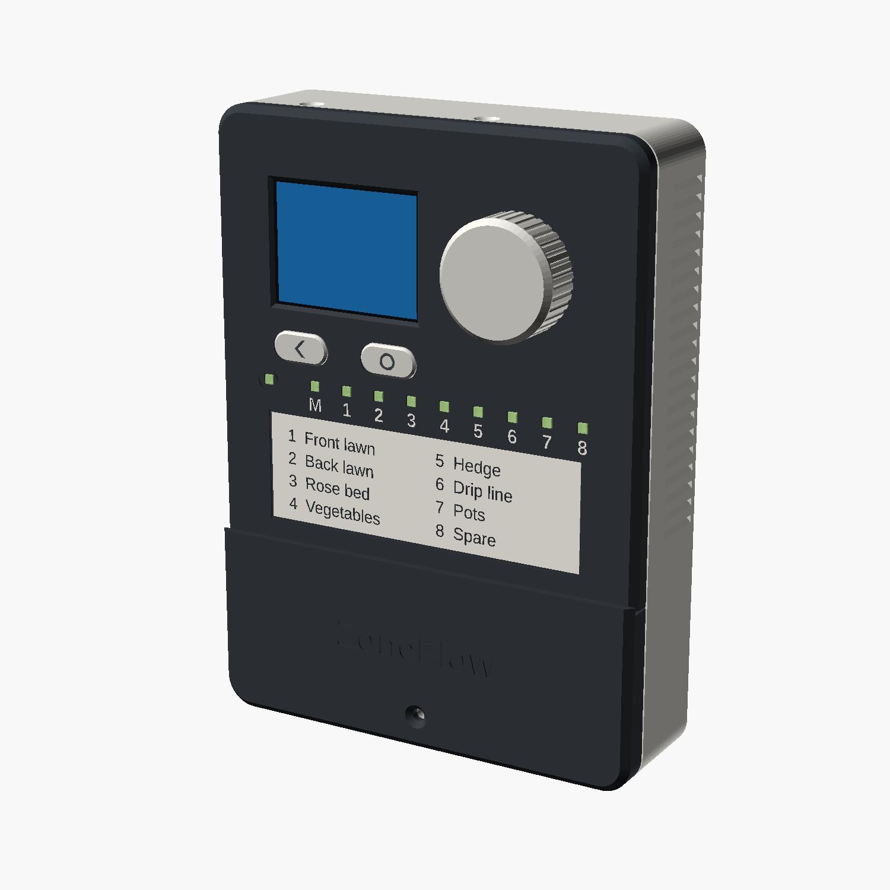
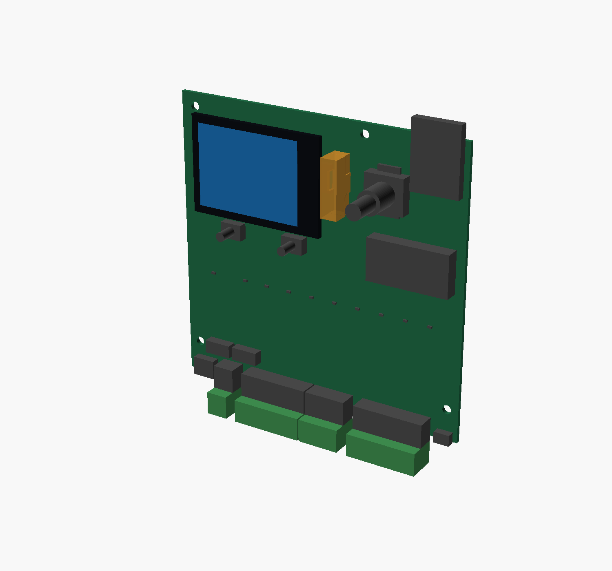
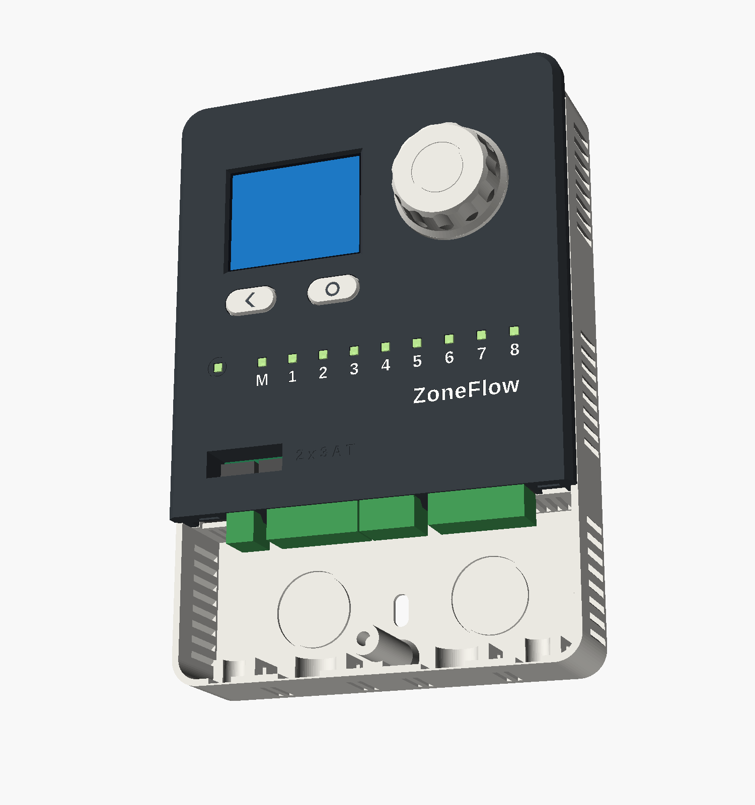
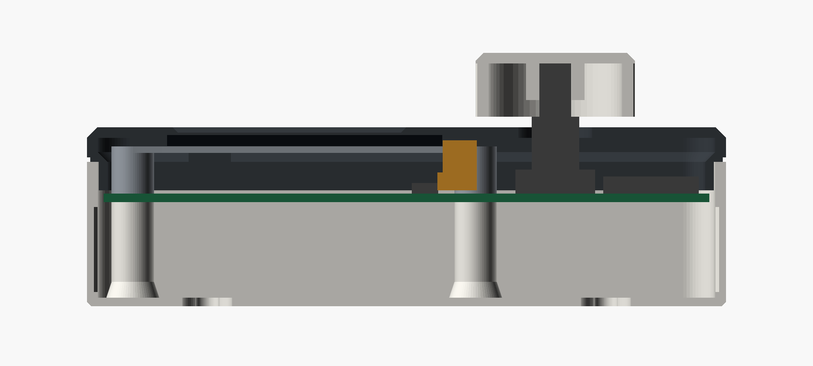
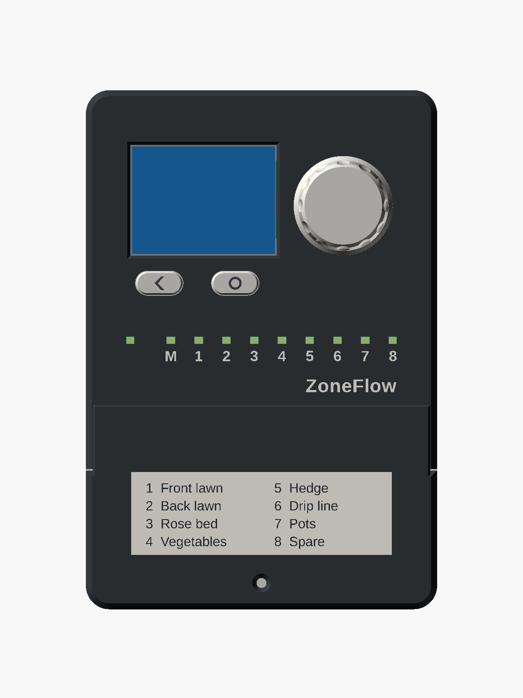
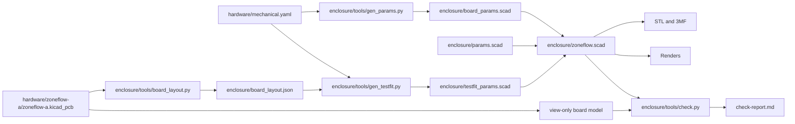

# ZoneFlow mechanical design, revision A

Status: **paper design, contract revision 3, 2026-11-10**. No board exists and
no part has been printed. Dimensions come from datasheets and drawings that I
opened, and the text says which. Section 10 lists what I could not confirm.
Section 12 lists what moved since revision 1, and section 12.1 what the board
layout changed in revision 3.

This document is for the PCB layout engineer. It explains the mechanical
contract in `hardware/mechanical.yaml`, which is the file to work from. If a
number here disagrees with that file, the file is right.

This contract was written before the board was laid out. That was
deliberate. The product's shape comes from how people use it, the enclosure
follows from that, and the board outline follows from the enclosure. The
board has since been laid out to it: [hardware layout](hardware-layout.md).
Section 12.1 lists what the layout changed, and the build now reads the
positions of the parts from the board file and stops if they differ from
this contract.

## 1. The product in brief

A wall-mounted unit 120.2 mm wide, 177.5 mm tall and 33.7 mm deep. The wiring
cover stands 2.0 mm further forward, and the knob 14 mm.

| Part of the product | What it is |
|---|---|
| Base | A tray with the back wall, the side walls, the wall fixings, the cable entries and the bosses that carry the board |
| Fascia | The front of the electronics compartment: display window, knob, two buttons, ten light pipes. It also carries a roof over the top of the base. |
| Wiring cover | The front of the wiring compartment. Its upper flap lies on the fascia and closes the fuse well. Two toes and one screw hold it. |
| Display carrier | A printed plate on four legs that stands on the board and holds the display panel |
| Knob, two button caps, light-pipe comb | The small parts |

The board is vertical, parallel to the wall, with its component side towards
the room. The terminal blocks are on its bottom edge and point down into the
wiring compartment. The ESP32 module is in the top right corner with its
antenna above the board.

## 2. Coordinates

All positions use one frame.

- **Origin**: the bottom-left corner of the board, seen from the component side with the terminal blocks at the bottom.
- **x**: to the right, along the terminal blocks.
- **y**: up, towards the antenna.
- **z**: out of the component side, towards the user. z = 0 is the top surface. The bottom surface is at z = -1.6.
- **Rotation**: degrees counter-clockwise seen from the top side. Each part in the YAML file states what its 0 degree orientation is.

## 3. Board outline: 114 x 110 mm

A plain rectangle, 1.6 mm thick, four layers, corners rounded up to 1.5 mm if
you like.

### 3.1 Why 114 mm wide

The bottom edge sets the width. Everything an installer or a service person
plugs in is on that edge, in this order from the left:

| Item | Width on the edge, mm | Note |
|---|---|---|
| Margin and USB-C | 15.5 | Centre at x = 8.0. The opening for the plug is 13 mm wide. |
| J1, 2-way | 8.42 | P x 3.81 + 0.8, from the Kefa drawing |
| Gap | 4.0 | Holds a fascia hook |
| J2, 7-way | 27.47 | |
| Gap | 0.6 | Zones 4 and 5 are neighbours |
| J3, 4-way | 16.04 | |
| Gap | 4.0 | Holds a fascia hook |
| J4, 7-way | 27.47 | Ends at x = 103.5 |
| Qwiic and margin | 10.5 | Centre at x = 109.25 |
| **Total** | **114.0** | |

The order of the blocks is the installer's order from section 16.1 of the
hardware design. A board 100 mm wide would cost less at JLCPCB. It does not
fit: the four terminal blocks alone take 79.4 mm.

### 3.2 Why 110 mm tall

Revision 1 was 100 mm tall for about 320 components. The reviewed circuit has
346, and every surface-mount part is now on the top side. I estimated the
area again from the packages in the bill of materials.

| Block | Area, mm² | Basis |
|---|---|---|
| Nine output channels | 3600 | 400 each: DPAK with a copper island, 2920 PTC, SMB TVS, SMD-6 opto, eight chip parts |
| Edge connectors | 1000 | 114 x 9 strip |
| Fuse well | 270 | 26 x 10.4, both holders and the wall around them |
| Module with its antenna rule | 700 | 18 x 19.5 on the board plus a strip beside it |
| Power entry, surge parts and buck | 1100 | SMC TVS, 2512 surge resistor, rectifier, buck, inductor. C1 is no longer here. |
| Fail-safe, relay detector, over-current, current sense, expander, supervisor | 1500 | Two SOIC-14, SOIC-8, TSSOP-24, three resistor networks, about 100 chip parts |
| Sensors and sensor supply | 650 | |
| USB, LDO, RTC, coin cell | 900 | The holder is 31.3 x 16 |
| Encoder, buttons, display connector, backlight | 700 | |
| Mounting holes, feet, test pads | 500 | |
| **Sum** | **10,920** | |

114 x 100 mm is 11,400 mm², which would leave 4 % between blocks. That is not
a margin. 114 x 110 mm is 12,540 mm² and leaves 15 %. I chose that.

The 10 mm went in above the LED row. Everything from the bottom edge up to
y = 45 kept its position. Everything above moved up by 10 mm. The new space
is a band from y = 45 to y = 55 across the full width, with no fixed part in
it and the full 9 mm of height.

If the layout still cannot be closed, tell me before growing the board, so
that the YAML file moves first. Each millimetre of board height is one
millimetre of enclosure height.

### 3.3 Where the blocks go

This is advice. Only the positions in section 4 are fixed.

- **y from 0 to 8**: the edge connectors.
- **y from 8 to 18, x from 8 to 34**: the fuse well. Nothing but F4 and F1.
- **y from 8 to 39**: the field circuits. Outputs behind J2 and J3 and spreading sideways, power entry on the left behind the fuses, sensors on the right behind J4. This is where the AC, the surge currents and the heat are, and it is the far end of the board from the antenna.
- **y = 42**: the row of ten LEDs. Each output LED belongs at the logic end of its channel, so a channel runs upward from its terminal to its LED. The channel pitch that this gives is 9.5 mm.
- **y from 45 to 55**: the free band.
- **y from 55 to 110**: logic, the module, the display connector and the controls.
- **Bottom side**: C1 and K1 and nothing else. See section 6.

## 4. Fixed positions

Every part below is positioned by the enclosure. The table gives the
reference point in millimetres. `hardware/mechanical.yaml` has the same
numbers with their sources, plus the body sizes.

| Ref | Part | x | y | Side | Orientation and notes |
|---|---|---|---|---|---|
| J5 | USB-C | 8.0 | edge | top | Mouth towards -y, about 1.0 mm beyond the edge |
| J1 | 24 VAC header, 2-way | pin 1 at 17.805 | pin row 5.9 | top | Mating face at y = -2.0. Pin 1 is the leftmost pin on all four headers. |
| J2 | Header, 7-way | pin 1 at 30.225 | 5.9 | top | COM, COM, MV, 1 to 4 |
| J3 | Header, 4-way | pin 1 at 58.295 | 5.9 | top | 5 to 8 |
| J4 | Header, 7-way | pin 1 at 78.335 | 5.9 | top | 5V, FLOW, GND, RAIN, GND, AUX, GND |
| J6 | Qwiic, JST SH side entry | 109.25 | edge | top | Mouth towards -y, 0.45 mm inside the edge (revision 3) |
| F4 | Fuse holder, `AC_L` leg | 15.0 | 12.6 | top | Long axis along x. In the fuse well. |
| F1 | Fuse holder, `AC_N` leg | 27.0 | 12.6 | top | Long axis along x. In the fuse well. |
| D6 | Status LED | 12.0 | 42.0 | top | |
| D902 | Master valve LED | 26.0 | 42.0 | top | |
| D102 to D802 | Zone LEDs 1 to 8 | 35.5 to 102.0, pitch 9.5 | 42.0 | top | |
| SW4 | Back button | 22.0 | 61.5 | top | Keep the 10 mm actuator, height code M |
| SW5 | Home / Manual button | 48.0 | 61.5 | top | |
| SW3 | Encoder | 85.0 | 88.0 | top | Shaft axis. Any multiple of 90 degrees. |
| J7 | Display FPC connector | 60.44 | 88.43 | top | Body centre. FPC enters from +x. Mouth at x = 63.0. Pad 1 at y = 85.68, pad 12 at y = 91.18. |
| U4 | ESP32-S3-WROOM-1 | 103.0 | 103.25 | top | Antenna towards +y and wholly beyond the top edge |
| BT1 | CR2032 holder | 95.0 | 65.3 | top | From the layout (revision 3). May move, see below. |
| C1 | Bulk capacitor, through-hole, lying down | 20.75 | 30.0 | **bottom** | Can axis along x. Pads at (36.0, 27.5) and (36.0, 32.5). Fixed. |
| K1 | Relay, through-hole | 4.8 | 27.85 | **bottom** | From the layout (revision 3): along the left edge, long axis along y. Free within the bottom zones. |

Notes on some of these.

- **Terminal headers overhang the edge by 2.0 mm.** The partition between the two compartments is 1.6 mm thick and stands 0.4 mm off the board edge. The header faces are flush with its wiring side. The pin row is 7.9 mm behind the face, from the Kefa drawing, so it is 5.9 mm inside the board.
- **J7's footprint numbering.** Pad 1 is the pad nearest the terminal-block edge. Looking into the connector's mouth with the board component side up, that is the left end. The hardware design, section 16.4, says the same and sets the footprint numbering that way. Its coordinates are the revision 1 ones, 10 mm lower than these.
- **The fault LED D8 has no light pipe.** It shows only with the fascia off. Firmware reports the same fault on the display.
- **The coin cell** lifts out of its holder upward. It must not be under the display carrier, a button cap or the light-pipe strip. With the fascia off it is in the open. Replacing it means two screws and no board removal.
- **SW1 and SW2**, reset and boot, are reachable with the fascia off. Put them anywhere.
- **Test pads** go on the top side or the bottom. The bottom is covered by the base once the board is in.
- **USB shell and J1.** The hardware design asks for 2 mm between the USB shell and the J1 pads. The shell ends at x = 12.47 and J1's first pin is at x = 17.8.

### 4.1 Mounting holes and supports

| Id | x | y | What | Keep-out |
|---|---|---|---|---|
| A | 5.5 | 105.0 | 3.4 mm hole. Carrier leg and M3x16 countersunk screw. | 9 mm on top, 10 mm below |
| B | 75.0 | 106.0 | Same | 9 mm on top, 10 mm below |
| C | 4.5 | 12.0 | 3.4 mm hole. M3x6 pan head. | 7 mm on top, 10 mm below |
| D | 109.5 | 12.0 | Same | 7 mm on top, 10 mm below |
| E | 5.0 | 71.0 | No hole. Carrier foot rests here. | 6 mm on top |
| F | 75.0 | 70.0 | No hole. Carrier foot rests here. | 6 mm on top |
| G | 86.0 | 74.0 | No hole. A post under the board takes the encoder push. | 7 mm below |

There is no screw in the top right corner. A steel screw there would be
inside the antenna's 15 mm clearance. That corner is 39 mm from screw B, and
only the module sits on it.

**A board that is 0.2 mm off.** The holes are 3.4 mm for a 3.0 mm screw, which
is 0.2 mm of play in every direction. Nothing else locates the board. Its
edges are 1.1 mm from the side walls and 0.4 mm from the partition. The
connector openings have 0.4 mm per side. The button caps sit loosely on the
switch actuators, and the encoder passes through a 14 mm hole.

### 4.2 The fuse well

The circuit has a fuse in each transformer leg. A user has to be able to
change either one, and must not reach anything else while doing it.

{ width="560" }

Both holders stand directly behind J1 inside a walled well. The well is a
rectangle of 1.2 mm walls that the fascia carries down to 0.3 mm above the
board. It opens to the front. The wiring cover's flap lies over the opening.
With the cover off, the two fuses are in view next to the 24 VAC plug, with
"2 x 3 A T" engraved beside them, and the walls stop a finger or a
screwdriver from going sideways.

| Item | Value | Source |
|---|---|---|
| Holder body | 9.73 x 5.03 x 3.81 mm | Littelfuse 154 series drawing |
| Pad pattern | 10.62 x 3.81 mm overall | Same drawing |
| F4 centre | 15.0, 12.6 | Behind J1 pin 1 |
| F1 centre | 27.0, 12.6 | Behind J1 pin 2. 1.38 mm between the two pad patterns. |
| Well, outside of the walls | x 8.0 to 34.0, y 7.5 to 17.9 | Zone T_FUSEWELL |
| Well, opening | 23.6 x 8.0 mm, 8.7 mm deep to the holders | Tweezers or small pliers |

For the layout: only F1 and F4 may be inside zone T_FUSEWELL. No test pad, no
via with exposed copper, no other part. Tracks under the walls are fine. Put
the "3 A T" rating on the silkscreen inside the well as well.

## 5. Height limits

Heights are above the surface the part is mounted on. A later row overrides
an earlier one where they overlap.

| Zone | Side | x0, y0 to x1, y1 | Maximum, mm | Reason |
|---|---|---|---|---|
| T_GENERAL | top | 0, 0 to 114, 110 | 9.0 | Fascia inside surface is at 10.5 |
| T_CARRIER | top | 0, 67.5 to 79.5, 110 | 5.0 | Under the display carrier. Underside at 7.65 now, 6.3 with a 2.4 inch panel. |
| T_FPC | top | 58, 76.5 to 72, 99.5 | 0 | The display FPC folds here. J7 only. |
| T_BTN_BACK | top | 11.5, 55 to 32.5, 67.5 | 7.0 | Under the button cap flange |
| T_BTN_HOME | top | 37.5, 55 to 58.5, 67.5 | 7.0 | Under the button cap flange |
| T_LIGHTPIPE | top | 9.3, 39.3 to 104.7, 44.7 | 1.0 | Light pipes end 1.5 above the board |
| T_FUSEWELL | top | 8.0, 7.5 to 34.0, 17.9 | 0 | F1 and F4 only |
| T_ANTENNA | top | 79, 95 to 114, 110 | 3.5 | Near the antenna. No metal bodies except U4. |
| T_EDGE_LEFT, T_EDGE_RIGHT | top | 1 mm strips | 0 | The fascia lip hangs over the board edge |
| B_GENERAL | bottom | 0, 0 to 114, 110 | 17.0 | 18.0 to the back wall. Through-hole parts only. |
| B_C1 | bottom | 9.5, 22.5 to 38.5, 37.5 | 0 | C1 only. Two ribs of the base stand here. |
| B_KEYHOLE_L | bottom | 10.5, 80 to 28.5, 104 | 10.0 | Pocket for a wall screw head |
| B_KEYHOLE_R | bottom | 85.5, 80 to 103.5, 104 | 10.0 | Pocket for a wall screw head |
| B_ANTENNA | bottom | 79, 95 to 114, 110 | 3.5 | Near the antenna |

The interference check builds these zones as solids and intersects them with
every printed part. The result is empty. So the heights in this table are
free space in the model, with the margins that the table already includes.

### 5.1 The tall parts

| Part | Height, mm | Source | Where it goes |
|---|---|---|---|
| K1, Omron G5NB | 15.3 maximum | Omron outline, 20.5 x 7.2 x 15.3 | Bottom |
| C1, Rubycon 12.5 x 20, lying down | 13.0 | Rubycon ZLJ drawing: diameter + 0.5, length + 2.0 (revision 3; revision 2 read the PX sheet, length + 1.5) | Bottom, fixed |
| Terminal headers | 7.0 | Kefa KF2EDGR drawing | Their fixed positions |
| CR2032 holder BS-6 | 5.5 | Q&J drawing | Top, T_GENERAL |
| L1, SRN6045TA | 4.5 | Bourns, 4.2 ± 0.3 | Top, anywhere |
| Fuse holders | 3.81 | Littelfuse drawing | The fuse well |
| USB-C | 3.26 | HRO drawing | Fixed |
| Module | 3.25 | Espressif, 3.1 ± 0.15 | Fixed |
| DPAK triacs | 2.4 | ST package data for the T4 series. I did not open the T810 sheet; the hardware design says the package is the same. | Top |
| Output PTC, BSMD2920 | 2.1 maximum | BHFUSE table: 7.98 x 5.44 x 2.10 | Top |

## 6. C1 and K1: who fits them

The top-side limit is set by the display. Its FPC tail is 20.7 mm long. To
reach a connector on the board, the panel's back can be at most about 9 mm
above the board. So the space under the fascia is 10.5 mm, and a 15.3 mm
relay and a 16.5 mm capacitor cannot be on the top side. Revision 1 left the
choice of how to fit them open. This revision settles it.

**Decision: one SMT side. C1 and K1 are through-hole parts inserted from the
bottom and soldered by hand, in the same step as the four terminal headers.**

| | Single SMT side, chosen | Double-sided SMT |
|---|---|---|
| C1 | Rubycon 63ZLJ470M12.5X20 (revision 3; was the 63PX part), through-hole, lying on its side | Lelon VZH471M1JTR-1616, SMD, the only SMT part on the bottom |
| K1 | Through-hole from the bottom | Same |
| At the assembly house | One placement side, one reflow | A second stencil, a second placement run and a second reflow for one capacitor |
| Hand work per board | Six through-hole parts: four headers from the top, K1 and C1 from the bottom | Five: the headers and K1 |
| Risk | Bent leads on a 6 g part, held by two ribs and a dot of silicone | A 16 x 16.5 mm can hanging from its pads through the second reflow |

For tens of boards a batch, a second SMT side is a setup cost carried by one
part. I did not get a quote, so I cannot give the amount. One more
hand-soldered capacitor costs a minute.

**Who solders them.** JLCPCB-class assemblers offer hand-soldered through-hole
parts. Whether a given one will do it for parts on the side opposite the SMT
has to be asked; I did not ask. If it will not, the builder solders K1 and C1
at final assembly, when the display and the coin cell go in. Either way the
board, the BOM and the enclosure are the same.

**What this means for the BOM.** In revision 2, C1 became the Rubycon PX
part, LCSC C88758, which the BOM named as the alternative. The hardware
design gave its ripple rating as 560 mA at 50 Hz against 480 mA peak.
Revision 3 uses the Rubycon ZLJ part, LCSC C2940725: section 12.1. Section 16.4 of that
document says a through-hole capacitor does not help, because lying down it
is over the 9 mm allowed on top. On the bottom, lying down, it is 13.0 mm
under a 17.0 mm limit. Its life rating against the Lelon part's 5000 hours is
for the circuit designer to check. I did not edit the BOM.

**What this means for the layout.**

- **C1 has a fixed position**: can centred at (20.75, 30.0) on the bottom side, axis along x, leads towards +x, pads at (36.0, 27.5) and (36.0, 32.5), 5.0 mm apart, for 0.6 mm leads. The can is 22.0 x 13.0 mm at most (revision 3: the ZLJ part; 21.5 for the PX part of revision 2). Zone B_C1 is its footprint.
- **Retention.** Two ribs in the base stand under the can at x = 14 and x = 28, 0.3 mm short of it. They take its weight off the leads once the board is in the base. Before that, and for vibration, put a dot of neutral-cure silicone between the can and the board. Draw the can's outline on the bottom silkscreen so the dot and the can land in the right place.
- **Soldering access.** K1 and C1 are soldered on the top side after reflow. Keep 2.5 mm around their top-side pads free of parts taller than 1.5 mm.
- **K1 is free** within the bottom zones. Revision 2 suggested (50, 22), next to the COM terminals. The layout put it at (4.8, 27.85), turned, under the left edge: section 12.1.
- **Nothing else on the bottom.** No surface-mount part. The bottom copper is still yours for the triac heat-spreading islands.

If C1 must move, change the YAML first. The ribs follow it.

## 7. The display

The panel is the HS20HS072RX. I rendered the outline drawing from its
datasheet at 360 dpi and read it. A physical sample is still needed before
the board is ordered.

| Item | Value | How I know |
|---|---|---|
| Outline | 51.8 x 36.2 mm, tolerance 0.2 | Dimensioned |
| Active area | 40.8 x 30.6 mm | Dimensioned |
| Active area to the edge opposite the FPC | 2.64 mm | Dimensioned |
| Active area to each long edge | 2.8 mm | Dimensioned |
| Recommended window | 43.94 x 33.6 mm | Note 8 of the drawing says the "V.A" figures are the suggested housing window |
| Thickness | 2.05 ± 0.05 mm | Dimensioned. The 1.1 mm figure is the glass alone. |
| FPC tail | 6.5 mm wide, 20.7 ± 0.5 mm beyond the outline | Dimensioned |
| Tail position | Its near edge is 15.28 ± 0.5 mm from one long edge | Scaled. It is the edge, not the centre. |
| Contact side | Display side | The front view draws the twelve fingers. The rear view draws a hatched 5 x 6.5 mm stiffener. Not stated in words. |
| Viewing direction | Free | "IPS ALL" on the drawing |

### 7.1 How the panel is held

The section above cuts through the display, the FPC fold and the encoder.

- **The carrier supports it.** The panel lies on the carrier's deck, 8.85 mm above the board, on a strip of thin double-sided tape.
- **The fascia locates it.** Five ribs inside the fascia surround the panel with 0.4 mm per side. They centre the window on the active area whatever the board does.
- **Nothing clamps it.** There is 0.5 mm of air between the glass and the 1.0 mm bezel lip. A board that sits 0.2 mm high or a fascia that prints 0.2 mm thick closes that to 0.1 mm and still does not touch.
- **The window is an open aperture** 42.0 x 31.8 mm, the active area plus 0.6 mm per side, with a 45 degree chamfer.

The panel is used in landscape, 320 x 240, rotated 90 degrees from its
datasheet view, with the FPC edge on the right.

### 7.2 The FPC and J7

The tail folds back under the panel in a C and enters J7 from the right. J7
is under the edge of the panel, and the carrier has an opening over it. The
assembler plugs the tail in with the panel standing on edge, closes the lock,
then folds the panel down onto the deck.

The length works out as follows. The tail leaves the panel 1.3 mm below the
glass, at z = 9.7. I assume J7's slot is 1.0 mm above the board. The drop is
8.7 mm, so the fold has a radius of 4.35 mm and uses 13.7 mm of tail. With
3.3 mm in the connector, 3.7 mm is left for the two straight parts. That puts
J7's mouth at x = 63.0, which is 0.76 mm inside the panel's edge.

J7's body is 10.4 mm along the contact row, 5.12 mm deep and 2.0 mm high.
Those figures are the circuit designer's reading of the XUNPU drawing, in
section 16.4 of the hardware design. The PDF I fetched for this part does not
contain the drawing, so I have not seen it myself. The opening in the carrier
is 9 x 23 mm and takes that body.

J7's mouth is 37 to 42 mm in x from module pins 18 to 22. The hardware design
asks for "about 40 mm".

### 7.3 A 2.4 inch panel later

The owner chose "2.0 to 2.4 inch", and the 2.0 inch panel is small on this
face. The enclosure source has a parameter, `panel`, that rebuilds the fascia
and the carrier for a 2.4 inch panel. The board is not laid out for one, and
this revision does not ask for that. It makes sure the fixed points would not
have to move.

{ width="360" }

The candidate is the HS24CG003-ARX from the same maker, the 2.4 inch part
that the hardware design mentions. I read its drawing.

| Item | 2.0 inch, fitted | 2.4 inch, option |
|---|---|---|
| Active area | 40.8 x 30.6 | 48.96 x 36.72 |
| Outline | 51.8 x 36.2 | 60.26 x 42.72 |
| Thickness | 2.05 | 3.4, with a touch panel |
| FPC | 12-way, 20.7 mm tail | 16-way, 17.4 mm tail |
| Viewing direction | Free, IPS | 12 o'clock |
| Controller | ST7789 | ST7789 |

**What already leaves room.**

- **Carrier points.** Legs A and B and feet E and F are 69.5 mm apart in x. The 2.4 inch outline is 60.26 mm and fits between them with its active area centred at (37.18, 89.9).
- **Zone T_CARRIER** is 5.0 mm, which clears the lower deck that a 3.4 mm panel needs, and reaches x = 79.5.
- **Encoder, buttons, module, LEDs, holes.** None moves. The window comes to 4.7 mm from the knob's foot and 4.4 mm above the button caps.
- **The check.** The build also intersects the 2.4 inch fascia, carrier and panel with each other, the buttons, the base and the height zones. All clear.

**What would have to change.**

- **J7** becomes a 16-way connector with a different pin order and four touch pins, at about x = 67, y = 90. That is a schematic change.
- **The parts between x = 58 and x = 78, y = 70 and y = 100** move to make room for it and for the wider fold.
- **The panel itself** is a compromise: 12 o'clock viewing direction and a touch layer nobody asked for. A 2.4 inch IPS panel without touch would be better and thinner. I did not find one in the JLCPCB library.
- **Printed parts.** Fascia and carrier are rebuilt with `panel = "2.4"`. Nothing else.

## 8. The antenna

Espressif's hardware design guidelines for the ESP32-S3, section 1.4.7, say
three things that apply here.

- **Position**: put the module's antenna outside the base board, with the feed point at the board's edge. For a module with the feed point on the right, which the WROOM-1 is, figure 24 marks the top right corner as recommended.
- **If the antenna cannot overhang**: cut the board away under it and for at least 15 mm beside it. Figure 26 gives that dimension and the 6 mm depth of the antenna area.
- **In the product**: "A clearance of at least 15 mm is recommended in all directions" inside the housing.

The contract does the first. The module's 18 x 6 mm antenna area is wholly
above the top board edge, so no board material is beside or under it and the
second rule does not arise.

For the third, here is what the enclosure gives.

| Thing near the antenna | Distance, mm |
|---|---|
| Encoder frame, the nearest metal | 15.3 |
| Board screw B | 19.4 |
| Fascia screws in the top wall | 24 and more |
| Display frame | 30 |
| Wall screws in the keyholes | 22 behind the board plane |
| The wall itself | 22 behind |
| Top wall of the base, plastic | 4 |
| Roof of the fascia, plastic | 9.5 above |
| Fascia, plastic | 9.5 in front |

Metal is outside 15 mm. Plastic is not, and it cannot be in a product this
size. PETG near a 2.4 GHz antenna shifts its tuning a little. How much is a
bench question, already in the hardware design's risk register.

Keep the tall power parts out of the two antenna zones in the table. They are
far away if they stay near the terminals.

## 9. One board or two

One board. I considered a main board with a separate display and control
board behind the fascia.

Two boards would let C1 and K1 sit on the top side of the main board. Against
that:

- **A second PCB order and a second assembly job**, each with its own setup charge.
- **A board-to-board cable** of about 14 conductors: SPI, backlight, encoder, buttons, ten LEDs unless they move to an expander.
- **Hand work** to plug that cable in every unit.
- **A second set of mounts** and a second tolerance chain between the two boards.

The single board costs two through-hole parts soldered from the other side.
That is cheaper than a second board.

## 10. What is not confirmed

Each item is also in the `unconfirmed` list of the YAML file, with what to
change if it turns out wrong.

- **FPC contact side.** Read from how the two views are drawn. The circuit designer reads the drawing the same way. Check a sample.
- **FPC reach.** A calculation from a scaled dimension and an assumed slot height. Check a sample against a printed carrier before ordering boards.
- **J7 slot height.** 1.0 mm above the board, assumed.
- **The eight 0.6 mm tabs on the panel frame.** I assumed they stay within 0.4 mm of the outline.
- **Plug height.** The Kefa drawing gives the plug as 11.1 mm thick but not where that sits against the header. I took the top as 11.6 mm above the board. The cover clears 12.5.
- **USB-C overhang.** Read as about 1.0 mm from a footprint drawing that does not dimension it.
- **USB-C plug overmold.** 12.35 x 6.5 mm maximum, from memory of the Type-C specification. Not re-read.
- **JST SH header width.** 6.0 mm assumed. I read only its height and depth.
- **Height of the MOC3023.** Not read. It is far under 9 mm for any plausible value.
- **C1 lying down.** Mechanically it fits. Its life rating and the stress of bent leads are for the circuit designer.
- **Through-hole assembly on the bottom side.** Not asked of any assembler.
- **Heat-set insert hole.** 4.0 mm for a 5.7 mm long M3 insert, from a search summary of a supplier page that I could not open. It is a parameter.
- **The 2.4 inch option's cable.** Its fold is a guessed box. Only the panel outline is from the drawing.

## 11. For the circuit designer

I did not edit the circuit design documents.

1. **Section 16.4 quotes revision 1 coordinates.** J7 is now at x = 60.44, y = 88.43, pad 1 at y = 85.68, pad 12 at y = 91.18. The rule for which end is pad 1 is unchanged.
2. **C1 on the BOM.** The enclosure and the contract now assume the Rubycon through-hole part lying down. The BOM still lists the Lelon part first. See section 6.
3. **Both fuses** are in the well behind J1, as section 4.3 of the hardware design asks.
4. **The encoder shaft is 24.5 mm above the board.** The knob absorbs it and stands 14 mm off the fascia.
5. **Temperature.** With the changes in this revision my estimate is a rise of 9 K at 2 W and 14 K at 3.5 W, down from 11 K and 18 K. The 70 °C design figure then has about 6 K in hand at 50 °C ambient and 3.5 W. It is still an estimate from textbook coefficients. The calculation is on the [enclosure page](../enclosure/index.md#heat-and-ventilation).
6. **Slits in the partition.** Air now enters the electronics compartment through 1.4 mm slits in the partition, below the board. A loose wire strand in the wiring compartment could pass one. The nearest things behind it are the pin ends of the terminal headers, which are on the same nets as the plugs in front.
7. **Display stock.** 460 pieces of the 2.0 inch panel and 269 of the 2.4 inch, no second source for either.

## 12. What moved since revision 1

Revision 1 is commit 2f7e375. The YAML file carries the same list under
`changes`.

| What | Revision 1 | Revision 2 |
|---|---|---|
| Board outline | 114 x 100 | 114 x 110 |
| Everything at y above 45 | | Moved up 10 mm: display, J7, encoder, buttons, module, BT1, hole A, feet, post G and their zones |
| J7 | 60.5, 78.43, body 5.0 x 9.6 | 60.44, 88.43, body 5.12 x 10.4. Mouth still at x = 63.0. |
| Hole B | 70, 95 | 75, 106 |
| Foot F | 70, 61 | 75, 70 |
| BT1, reserved | 93, 54 | 95, 64 |
| Fuse holders | One, not positioned | F4 at 15.0, 12.6 and F1 at 27.0, 12.6, in T_FUSEWELL |
| C1 | SMD, bottom, free | Through-hole, bottom, lying down, fixed at 21, 30 |
| K1, suggested | 42, 22 | 50, 22 |
| T_CARRIER | 6.5 mm, to x = 74.5 | 5.0 mm, to x = 79.5 |
| Bottom side | C1 and K1 and anything else | C1 and K1 only, no SMT |
| Unchanged | | The bottom edge: J5, J1 to J4, J6. Holes C and D. The LED row. |

### 12.1 Revision 3, from the board layout

Written by the layout, not by the author of the rest of this document. The
reasons are in [hardware layout](hardware-layout.md), section 4. The enclosure
was rebuilt from the changed contract and `enclosure/tools/check.py` reported
59 of 59 pairs clear.

| What | Revision 2 | Revision 3 | Why |
|---|---|---|---|
| C1 | Rubycon 63PX470M, can 21.5 long at most, centre x = 21.0 | Rubycon 63ZLJ470M, can 22.0 long at most, centre x = 20.75 | Ripple rating and life: hardware design, section 4.5. The pads did not move |
| K1 | Suggested 50, 22, long axis along x | 4.8, 27.85, long axis along y | At 50, 22 its four pins come up between the output triacs, where the soldering access rule cannot be met |
| BT1 | 95, 64 | 95, 65.3, positive contact at the left | 1.3 mm up to clear the row of opto-triacs |
| J6 | y = 1.625, mouth 0.5 mm beyond the edge | y = 2.63, mouth 0.45 mm inside the edge | At 1.625 the two mounting lands of the footprint were 0.7 mm beyond the board edge |

Two things the layout found and did not change, because they are fixed
positions:

- The encoder and the module are close: a frame land of the encoder ends
  0.25 mm short of the line of the module's left pin row, and 1.6 mm from the
  nearest module pad (hardware layout, section 13). An earlier version of
  this line gave the 0.25 mm as the land-to-pad distance, which it is not.
- Nothing can stand beside module pins 38 and 39, so the ADC filter capacitors
  are 23 mm of track from them (hardware layout, section 7.11).

## 13. How the files fit together

- **`hardware/mechanical.yaml`** is the contract. Edit it by pull request.
- **`gen_params.py`** refuses to run if the contract contradicts itself. It checks that each header's length matches its pole count, that pin 1 and the pin row follow from the mating face, that J7 is centred on the FPC tail and its mouth is the face of its body, that both fuse holders stand clear of the well's walls, that C1's pads are beyond the end of its can, that no screw is within 15 mm of the antenna, and that every zone and part is on the board.
- **`board_params.scad`** is generated and committed. Do not edit it.
- **`board_layout.json`** is what `board_layout.py` reads from the laid-out board with KiCad's Python module: the outline, the holes, and the position, side and pads of every footprint. It is generated and committed, so that the rest builds without KiCad.
- **`gen_testfit.py`** places a stand-in for every part at least 1.5 mm tall where the board file puts it. It takes the body from this contract or from `hardware/zoneflow-a/design/heights.toml`. It stops if the board and the contract differ by more than 0.05 mm on any part the contract places. Its output, `testfit_params.scad`, is generated and committed.
- **`check.py`** intersects 91 pairs of solids and fails the build if any pair overlaps by more than 0.5 mm³. 45 pairs are the placeholder board, the display, the mated plugs and the height zones, each against every printed part, and the printed parts against each other. 32 are the printable test-fit kit and the soldered lead ends. 14 more repeat the display, carrier and fascia checks with the 2.4 inch option. It also intersects every body of KiCad's detailed export of the board with every printed part, measures 89 gaps and 20 alignments on the meshes, and checks every print file. The [test fit](../enclosure/test-fit.md) page says what the gaps are.

Run `make` in `enclosure/` after any change to the YAML file.

## 14. Sources

| What | Document | Link |
|---|---|---|
| Display | HS20HS072RX datasheet v1.0, outline drawing | <https://www.lcsc.com/datasheet/C5329582.pdf> |
| 2.4 inch display | HS24CG003-ARX datasheet v1.0, outline drawing | <https://www.lcsc.com/datasheet/C5329583.pdf> |
| Encoder | ALPS EC11J1525402 product sheet | <https://www.lcsc.com/datasheet/C209762.pdf> |
| Buttons | XKB TS-1102S-C-M-B drawing rev A1 | <https://www.lcsc.com/datasheet/C381050.pdf> |
| Terminal headers | Kefa KF2EDGR-3.81 drawing rev A | <https://www.lcsc.com/datasheet/C441187.pdf> |
| Terminal plugs | Kefa KF2EDGK-3.81 drawing rev A | <https://www.lcsc.com/datasheet/C440863.pdf> |
| USB-C | HRO TYPE-C-31-M-12 drawing | <https://www.lcsc.com/datasheet/C165948.pdf> |
| Fuse holder | Littelfuse 154 series, revised 09/16/20 | <https://www.lcsc.com/datasheet/C206913.pdf> |
| Output PTC | BHFUSE BSMD2920 series | <https://www.lcsc.com/datasheet/C3020148.pdf> |
| Coin cell holder | Q&J BS-6 drawing | <https://www.lcsc.com/datasheet/C70377.pdf> |
| Bulk capacitor, through-hole | Rubycon ZLJ series (revision 3) | <https://www.lcsc.com/datasheet/C2940725.pdf> |
| Bulk capacitor, through-hole, revision 2 | Rubycon PX series | <https://www.lcsc.com/datasheet/C88758.pdf> |
| Bulk capacitor, SMD | Lelon VZH series | <https://www.lcsc.com/datasheet/C249935.pdf> |
| Relay | Omron G5NB, Chinese edition | <https://www.lcsc.com/datasheet/C48746.pdf> |
| Inductor | Bourns SRN6045TA | <https://www.lcsc.com/datasheet/C5151734.pdf> |
| Module | ESP32-S3-WROOM-1 datasheet v1.8, figure 10-1 | <https://www.espressif.com/sites/default/files/documentation/esp32-s3-wroom-1_wroom-1u_datasheet_en.pdf> |
| Antenna rules | ESP32-S3 Hardware Design Guidelines, release master of 2026-11-10, section 1.4.7 | <https://docs.espressif.com/projects/esp-hardware-design-guidelines/en/latest/esp32s3/esp-hardware-design-guidelines-en-master-esp32s3.pdf> |

The LCSC links open a page that wraps the maker's PDF for that part number.
