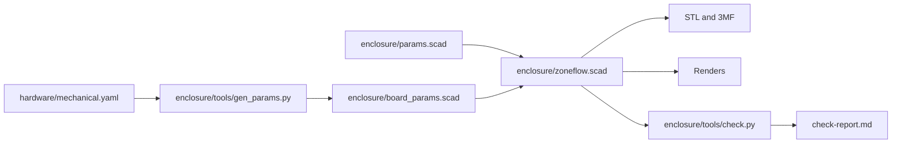

# ZoneFlow mechanical design, revision A

Status: **paper design, 2026-11-10**. No board exists and no part has been
printed. Dimensions come from datasheets and drawings that I opened, and the
text says which. Section 9 lists what I could not confirm.

This document is for the PCB layout engineer. It explains the mechanical
contract in `hardware/mechanical.yaml`, which is the file to work from. If a
number here disagrees with that file, the file is right.

The board has not been laid out. That was deliberate. The product's shape
comes from how people use it, the enclosure follows from that, and the board
outline follows from the enclosure.

## 1. The product in brief

A wall-mounted unit 120.2 mm wide, 162.0 mm tall and 33.7 mm deep. The wiring
cover stands 2.5 mm further forward, and the knob 14 mm.

| Part of the product | What it is |
|---|---|
| Base | A tray with the back wall, the side walls, the wall fixings, the cable entries and the bosses that carry the board |
| Fascia | The front of the electronics compartment: display window, knob, two buttons, ten light pipes, label recess |
| Wiring cover | The front of the wiring compartment, held by two toes and one screw |
| Display carrier | A printed plate on four legs that stands on the board and holds the display panel |
| Knob, two button caps, light-pipe comb | The small parts |

The board is vertical, parallel to the wall, with its component side towards
the room. The terminal blocks are on its bottom edge and point down into the
wiring compartment. The ESP32 module is in the top right corner with its
antenna above the board.

## 2. Coordinates

All positions use one frame.

- **Origin**: the bottom-left corner of the board, seen from the component side with the terminal blocks at the bottom.
- **x**: to the right, along the terminal blocks.
- **y**: up, towards the antenna.
- **z**: out of the component side, towards the user. z = 0 is the top surface. The bottom surface is at z = -1.6.
- **Rotation**: degrees counter-clockwise seen from the top side. Each part in the YAML file states what its 0 degree orientation is.

## 3. Board outline: 114 x 100 mm

A plain rectangle, 1.6 mm thick, corners rounded up to 1.5 mm if you like.

### 3.1 Why 114 mm wide

The bottom edge sets the width. Everything an installer or a service person
plugs in is on that edge, in this order from the left:

| Item | Width on the edge, mm | Note |
|---|---|---|
| Margin and USB-C | 15.5 | Centre at x = 8.0. The opening for the plug is 13 mm wide. |
| J1, 2-way | 8.42 | P x 3.81 + 0.8, from the Kefa drawing |
| Gap | 4.0 | Holds a fascia hook |
| J2, 7-way | 27.47 | |
| Gap | 0.6 | Zones 4 and 5 are neighbours |
| J3, 4-way | 16.04 | |
| Gap | 4.0 | Holds a fascia hook |
| J4, 7-way | 27.47 | Ends at x = 103.5 |
| Qwiic and margin | 10.5 | Centre at x = 109.25 |
| **Total** | **114.0** | |

The order of the blocks is the installer's order from section 16.1 of the
hardware design. I did not change it.

A board 100 mm wide would cost less at JLCPCB. It does not fit. The four
terminal blocks alone take 79.4 mm, and USB and Qwiic must be on the same edge
to be reachable behind the wiring cover.

### 3.2 Why 100 mm tall

The height comes from the area the circuit needs. My estimate, from the
packages in the bill of materials:

| Block | Area, mm² | Basis |
|---|---|---|
| Nine output channels | 3600 | 400 each: DPAK with a copper island on both sides, 2920 PTC, SMB TVS, SMD-6 opto, eight chip parts |
| Edge connectors | 1000 | 114 x 9 strip |
| Module with its antenna rule | 700 | 18 x 19.5 on the board plus a strip beside it |
| Power entry and buck | 1200 | Fuse holder, SMC TVS, 17 x 17 capacitor base on the bottom, buck, inductor |
| Fail-safe, over-current, current sense, expander | 1200 | Two SOIC-14, SOIC-8, TSSOP-24, about 80 chip parts |
| Sensors and sensor supply | 600 | |
| USB, LDO, RTC, coin cell | 900 | The holder is 31.3 x 16 |
| Encoder, buttons, display connector, backlight | 700 | |
| Mounting holes, feet, test pads | 500 | |
| **Sum** | **10,400** | |

114 x 100 mm is 11,400 mm². That leaves about 10 % for routing on top of
the space inside each block. It is tight for two layers and comfortable for
four. If the layout cannot be closed, make the board taller. Each millimetre
of height costs one millimetre of enclosure height and nothing else, because
the parts near the top edge are positioned from the top edge in the enclosure
source. Tell me before you do, so that the YAML file moves first.

### 3.3 Where the blocks go

This is advice. Only the positions in section 4 are fixed.

- **y from 0 to 8**: the edge connectors.
- **y from 8 to 39**: the field circuits. Outputs behind J2 and J3 and spreading sideways, power entry on the left behind J1, sensors on the right behind J4. This is where the AC, the surge currents and the heat are, and it is the far end of the board from the antenna.
- **y = 42**: the row of ten LEDs. Each output LED belongs at the logic end of its channel, so a channel runs upward from its terminal to its LED. The channel pitch that this gives is 9.5 mm. A MOC3023 is 8.9 mm long, so the opto goes with its long side across the column.
- **y from 45 to 100**: logic, the module, the display connector and the controls.
- **Bottom side**: C1 and K1, and whatever else you choose. See section 5.

## 4. Fixed positions

Every part below is positioned by the enclosure. The table gives the
reference point in millimetres. `hardware/mechanical.yaml` has the same
numbers with their sources, plus the body sizes.

| Ref | Part | x | y | Side | Orientation and notes |
|---|---|---|---|---|---|
| J5 | USB-C | 8.0 | edge | top | Mouth towards -y, about 1.0 mm beyond the edge |
| J1 | 24 VAC header, 2-way | pin 1 at 17.805 | pin row 5.9 | top | Mating face at y = -2.0. Pin 1 is the leftmost pin on all four headers. |
| J2 | Header, 7-way | pin 1 at 30.225 | 5.9 | top | COM, COM, MV, 1 to 4 |
| J3 | Header, 4-way | pin 1 at 58.295 | 5.9 | top | 5 to 8 |
| J4 | Header, 7-way | pin 1 at 78.335 | 5.9 | top | 5V, FLOW, GND, RAIN, GND, AUX, GND |
| J6 | Qwiic, JST SH side entry | 109.25 | edge | top | Mouth towards -y, about 0.5 mm beyond the edge |
| D6 | Status LED | 12.0 | 42.0 | top | |
| D902 | Master valve LED | 26.0 | 42.0 | top | |
| D102 to D802 | Zone LEDs 1 to 8 | 35.5 to 102.0, pitch 9.5 | 42.0 | top | |
| SW4 | Back button | 22.0 | 51.5 | top | Keep the 10 mm actuator, height code M |
| SW5 | Home / Manual button | 48.0 | 51.5 | top | |
| SW3 | Encoder | 85.0 | 78.0 | top | Shaft axis. Any multiple of 90 degrees. |
| J7 | Display FPC connector | 60.5 | 78.43 | top | FPC enters from +x. Mouth at x = 63.0. Pin 1 at y = 75.68. |
| U4 | ESP32-S3-WROOM-1 | 103.0 | 93.25 | top | Antenna towards +y and wholly beyond the top edge |
| BT1 | CR2032 holder | 93.0 | 54.0 | top | Reserved position. May move, see below. |
| C1 | Bulk capacitor | 16 | 32 | **bottom** | Suggested. Free within the bottom zones. |
| K1 | Relay | 42 | 22 | **bottom** | Suggested. Free within the bottom zones. |

Notes on some of these.

- **Terminal headers overhang the edge by 2.0 mm.** The partition between the two compartments is 1.6 mm thick and stands 0.4 mm off the board edge. The header faces are flush with its wiring side. The pin row is 7.9 mm behind the face, from the Kefa drawing, so it is 5.9 mm inside the board.
- **The fault LED D8 has no light pipe.** It shows only with the fascia off. Firmware reports the same fault on the display. If the owner wants it on the front, an eleventh pipe at x = 12, y = 47 would do it.
- **The coin cell** lifts out of its holder upward. It must not be under the display carrier, a button cap or the light-pipe strip. With the fascia off it is in the open. Replacing it means two screws and no board removal.
- **SW1 and SW2**, reset and boot, are reachable with the fascia off. Put them anywhere.
- **Test pads** can go on either side. The bottom is covered by the base once the board is in.

### 4.1 Mounting holes and supports

| Id | x | y | What | Keep-out |
|---|---|---|---|---|
| A | 5.5 | 95.0 | 3.4 mm hole. Carrier leg and M3x16 countersunk screw. | 9 mm on top, 10 mm below |
| B | 70.0 | 95.0 | Same | 9 mm on top, 10 mm below |
| C | 4.5 | 12.0 | 3.4 mm hole. M3x6 pan head. | 7 mm on top, 10 mm below |
| D | 109.5 | 12.0 | Same | 7 mm on top, 10 mm below |
| E | 5.0 | 61.0 | No hole. Carrier foot rests here. | 6 mm on top |
| F | 70.0 | 61.0 | No hole. Carrier foot rests here. | 6 mm on top |
| G | 86.0 | 64.0 | No hole. A post under the board takes the encoder push. | 7 mm below |

There is no screw in the top right corner. A steel screw there would be
inside the antenna's 15 mm clearance. That corner is 44 mm from screw B, and
only the module sits on it.

**A board that is 0.2 mm off.** The holes are 3.4 mm for a 3.0 mm screw, which
is 0.2 mm of play in every direction. Nothing else locates the board. Its
edges are 1.1 mm from the side walls and 0.4 mm from the partition. The
connector openings have 0.4 mm per side. The button caps sit loosely on the
switch actuators, and the encoder passes through a 14 mm hole.

## 5. Height limits

Heights are above the surface the part is mounted on. A later row overrides
an earlier one where they overlap.

| Zone | Side | x0, y0 to x1, y1 | Maximum, mm | Reason |
|---|---|---|---|---|
| T_GENERAL | top | 0, 0 to 114, 100 | 9.0 | Fascia inside surface is at 10.5 |
| T_CARRIER | top | 0, 57.5 to 74.5, 100 | 6.5 | Under the display carrier, underside at 7.65 |
| T_FPC | top | 58, 66.5 to 72, 89.5 | 0 | The display FPC folds here. J7 only. |
| T_BTN_BACK | top | 11.5, 45 to 32.5, 58 | 7.0 | Under the button cap flange |
| T_BTN_HOME | top | 37.5, 45 to 58.5, 58 | 7.0 | Under the button cap flange |
| T_LIGHTPIPE | top | 9.3, 39.3 to 104.7, 44.7 | 1.0 | Light pipes end 1.5 above the board |
| T_ANTENNA | top | 79, 85 to 114, 100 | 3.5 | Near the antenna. No metal bodies except U4. |
| T_EDGE_LEFT, T_EDGE_RIGHT | top | 1 mm strips | 0 | The fascia lip hangs over the board edge |
| B_GENERAL | bottom | 0, 0 to 114, 100 | 17.0 | 18.0 to the back wall |
| B_KEYHOLE_L | bottom | 10.5, 70 to 28.5, 94 | 10.0 | Pocket for a wall screw head |
| B_KEYHOLE_R | bottom | 85.5, 70 to 103.5, 94 | 10.0 | Pocket for a wall screw head |
| B_ANTENNA | bottom | 79, 85 to 114, 100 | 3.5 | Near the antenna |

The interference check builds these zones as solids and intersects them with
every printed part. The result is empty. So the heights in this table are
free space in the model, with the margins that the table already includes.

### 5.1 The tall parts

| Part | Height, mm | Source | Where it can go |
|---|---|---|---|
| C1, Lelon VZH 16 x 16.5 | 17.0 maximum | Lelon table, L = 16.5 ± 0.5 | Bottom only |
| K1, Omron G5NB | 15.3 maximum | Omron outline, 20.5 x 7.2 x 15.3 | Bottom only |
| Terminal headers | 7.0 | Kefa KF2EDGR drawing | Their fixed positions |
| CR2032 holder BS-6 | 5.5 | Q&J drawing | Top, T_GENERAL |
| L1, SRN6045TA | 4.5 | Bourns, 4.2 ± 0.3 | Top, anywhere |
| USB-C | 3.26 | HRO drawing | Fixed |
| Module | 3.25 | Espressif, 3.1 ± 0.15 | Fixed |
| DPAK triacs | 2.4 | ST package data | Top or bottom |

**C1 and K1 must be on the bottom side.** This is the one place where the
enclosure dictates something that costs money, so here is the reasoning.

The top-side limit is set by the display. Its FPC tail is 20.7 mm long. To
reach a connector on the board, the panel's back can be at most about 9 mm
above the board. The panel is 2.05 mm thick and sits 1.5 mm behind the front
surface. So the front surface is 12.5 mm above the board, and the space under
it is 10.5 mm. A 17 mm capacitor and a 15.3 mm relay do not fit there.

I looked at three other ways and rejected them.

- **A deeper front everywhere.** The FPC no longer reaches.
- **A front that steps forward over the lower half of the board.** It works, but the product gets a second step in its face and the LED row lands on the slope. The uniform slab is easier to print and looks better.
- **A second board for the display and controls.** Covered in section 8.

What bottom-side mounting costs:

- **K1** is through-hole. Fitting it from the bottom changes nothing in assembly.
- **C1** as the Lelon SMD part needs a second SMT side at the assembly house. JLCPCB charges a second setup for that. I did not get a quote.
- **C1 as the through-hole alternative** already named in the BOM, Rubycon 63PX470MEFC12.5X20, avoids the second SMT side. It is 20 mm long and does not fit standing up. It fits lying down, where it is 12.5 mm high and needs a footprint of about 13 x 25 mm.

The bottom side has 18 mm of free depth across the whole board, so you may
also use it for anything else that helps the layout, such as the second half
of each triac's copper island.

## 6. The display

The panel is the HS20HS072RX. The hardware design asked for its dimensions to
be confirmed. I rendered the outline drawing from its datasheet at 360 dpi and
read it. A physical sample is still needed before the board is ordered.

| Item | Value | How I know |
|---|---|---|
| Outline | 51.8 x 36.2 mm, tolerance 0.2 | Dimensioned |
| Active area | 40.8 x 30.6 mm | Dimensioned |
| Active area to the edge opposite the FPC | 2.64 mm | Dimensioned |
| Active area to each long edge | 2.8 mm | Dimensioned |
| Recommended window | 43.94 x 33.6 mm | Note 8 of the drawing says the "V.A" figures are the suggested housing window. Scaling the drawing puts 43.94 and 33.6 on the lines just outside the active area. |
| 46.6 mm | The glass length | Scaled. Not labelled. |
| Thickness | 2.05 ± 0.05 mm | Dimensioned. The 1.1 mm figure is the glass alone. |
| FPC tail | 6.5 mm wide, 20.7 ± 0.5 mm beyond the outline | Dimensioned |
| Tail position | Its near edge is 15.28 ± 0.5 mm from one long edge | Scaled. That settles the "centre or edge" question in the hardware design: it is the edge. |
| Contact side | Display side | The front view draws the twelve fingers. The rear view draws a hatched 5 x 6.5 mm stiffener. Not stated in words. |
| Viewing direction | Free | "IPS ALL" on the drawing |

### 6.1 How the panel is held

The section above cuts through the display, the FPC fold and the encoder.

- **The carrier supports it.** The panel lies on the carrier's deck, 8.85 mm above the board, on a strip of thin double-sided tape.
- **The fascia locates it.** Five ribs inside the fascia surround the panel with 0.4 mm per side. They centre the window on the active area whatever the board does.
- **Nothing clamps it.** There is 0.5 mm of air between the glass and the 1.0 mm bezel lip. A board that sits 0.2 mm high or a fascia that prints 0.2 mm thick closes that to 0.1 mm and still does not touch.
- **The window is an open aperture** 42.0 x 31.8 mm, the active area plus 0.6 mm per side, with a 45 degree chamfer. See the enclosure page for why there is no clear window.

The panel is used in landscape, 320 x 240, rotated 90 degrees from its
datasheet view, with the FPC edge on the right. The 8.4 mm of inactive glass
on that edge is hidden between the window and the knob.

### 6.2 The FPC and J7

The tail folds back under the panel in a C and enters J7 from the right. J7
is under the edge of the panel, and the carrier has an opening over it. The
assembler plugs the tail in with the panel standing on edge, closes the lock,
then folds the panel down onto the deck.

The length works out as follows. The tail leaves the panel 1.3 mm below the
glass, at z = 9.7. I assume J7's slot is 1.0 mm above the board. The drop is
8.7 mm, so the fold has a radius of 4.35 mm and uses 13.7 mm of tail. With
3.3 mm in the connector, 3.7 mm is left for the two straight parts. That puts
J7's mouth at x = 63.0, which is 0.76 mm inside the panel's edge. The ± 0.5 mm
on the tail length changes the fold radius by 0.16 mm.

Folded this way, the display-side face of the tail faces the board. That is
what the bottom-contact J7 in the BOM needs, if my reading of the contact side
is right. If a sample shows the contacts on the other face, fit the
top-contact connector on the same footprint. Nothing mechanical changes.

J7's mouth is 37 to 42 mm in x from module pins 18 to 22, which are on the
module's bottom edge. The hardware design asks for "about 40 mm", so that
holds.

## 7. The antenna

Espressif's hardware design guidelines for the ESP32-S3, section 1.4.7, say
three things that apply here.

- **Position**: put the module's antenna outside the base board, with the feed point at the board's edge. For a module with the feed point on the right, which the WROOM-1 is, figure 24 marks the top right corner as recommended.
- **If the antenna cannot overhang**: cut the board away under it and for at least 15 mm beside it. Figure 26 gives that dimension and the 6 mm depth of the antenna area.
- **In the product**: "A clearance of at least 15 mm is recommended in all directions" inside the housing.

The contract does the first. The module's 18 x 6 mm antenna area is wholly
above the top board edge, so no board material is beside or under it and the
second rule does not arise.

For the third, here is what the enclosure gives.

| Thing near the antenna | Distance, mm |
|---|---|
| Encoder frame, the nearest metal | 15.3 |
| Board screw B | 24 |
| Fascia screws in the top wall | 24 and more |
| Display frame | 30 |
| Wall screws in the keyholes | 22 behind the board plane |
| The wall itself | 22 behind |
| Top wall of the enclosure, plastic | 4 |
| Fascia, plastic | 9.5 in front |

Metal is outside 15 mm. Plastic is not, and it cannot be in a product this
size. PETG near a 2.4 GHz antenna shifts its tuning a little. How much is a
bench question, already item 14 in the hardware design's risk register.

Keep C1, K1, the fuse holder and L1 out of the two antenna zones in the
table. They are far away if they stay near the terminals.

## 8. One board or two

One board. I considered a main board with a separate display and control
board behind the fascia.

Two boards would remove the bottom-side constraint on C1 and K1, and would
let the main board be 100 x 100 mm. Against that:

- **A second PCB order and a second assembly job**, each with its own setup charge.
- **A board-to-board cable** of about 14 conductors: SPI, backlight, encoder, buttons, ten LEDs unless they move to an expander.
- **Hand work** to plug that cable in every unit.
- **A second set of mounts** and a second tolerance chain between the two boards.

The single board costs one of two things: a second SMT side for one
capacitor, or a through-hole capacitor laid on its side. That is cheaper than
a second board. If the layout cannot be closed on 114 x 100 mm even with four
layers, the two-board split is the fallback, and the fascia would need
redesigning around it.

## 9. What is not confirmed

Each item is also in the `unconfirmed` list of the YAML file, with what to
change if it turns out wrong.

- **FPC contact side.** Read from how the two views are drawn. Check a sample.
- **FPC reach.** A calculation from a scaled dimension and an assumed slot height. Check a sample against a printed carrier before ordering boards.
- **J7 body and slot height.** The XUNPU PDF refers to a drawing that is not in it. I assumed a 5.0 x 9.6 mm body and a slot 1.0 mm above the board. The "2.0 mm high" comes from the part name.
- **The eight 0.6 mm tabs on the panel frame.** I assumed they stay within 0.4 mm of the outline.
- **Plug height.** The Kefa drawing gives the plug as 11.1 mm thick but not where that sits against the header. I took the top as 11.6 mm above the board. The cover clears 13.0.
- **USB-C overhang.** Read as about 1.0 mm from a footprint drawing that does not dimension it.
- **USB-C plug overmold.** 12.35 x 6.5 mm maximum, from memory of the Type-C specification. Not re-read.
- **JST SH header width.** 6.0 mm assumed. I read only its height and depth.
- **Heights of the MOC3023 and the fuse holder.** Not read. Both are far under 9 mm for any plausible value.
- **Heat-set insert hole.** 4.0 mm for a 5.7 mm long M3 insert. That figure came from a search summary of a supplier page that I could not open. It is a parameter.
- **Length tolerance of the Rubycon capacitor.** I did not find the figure in the extracted text.

## 10. Problems found with chosen parts

I did not edit the circuit design documents. These are for their author.

1. **C1 and K1 cannot be on the top side.** Section 5.1. This needs a decision between a second SMT side and the through-hole capacitor lying down.
2. **The encoder is taller than the hardware design assumed.** Its shaft top is 24.5 mm above the board, not about 15. The drawing gives 4.5 mm of body and 20 mm of shaft and bushing. The knob absorbs it: it stands 14 mm off the fascia. A shorter-shaft EC11 would make a lower knob, but I did not look for one with stock.
3. **The 10 mm button height is right.** The hardware design called it a placeholder. Keep code M.
4. **The enclosure probably runs warmer than 10 K above ambient at full load.** My estimate on the enclosure page is about 6 K at 1 W, 11 K at 2 W and 16 K at 3 W, with the vents. The hardware design assumes 10 K at about 3.5 W. The triac junction estimate rises from 89 °C to about 97 °C, still under its 125 °C limit. The module would see about 68 °C at 50 °C ambient, above its 65 °C rating without PSRAM ECC. The firmware rule to enable ECC stops being a recommendation. This is an estimate from textbook coefficients. The thermal run in the bring-up plan decides it.
5. **Display stock.** 460 pieces and no second source, as the hardware design says. The fascia is drawn around this panel's outline. A different 2.0 inch panel would need new numbers in the YAML file and a rebuild, which is what the parameters are for, but it is still a risk.
6. **USB with 24 VAC connected.** The USB socket is behind the wiring cover, beside J1. The hardware design's advice is to unplug J1 before connecting a computer, and this puts the two side by side.

## 11. How the files fit together

- **`hardware/mechanical.yaml`** is the contract. Edit it by pull request.
- **`gen_params.py`** refuses to run if the contract contradicts itself. It checks that each header's length matches its pole count, that pin 1 and the pin row follow from the mating face, that J7 is centred on the FPC tail, that no screw is within 15 mm of the antenna, and that every zone and part is on the board.
- **`board_params.scad`** is generated and committed. Do not edit it.
- **`check.py`** intersects 45 pairs of solids and fails the build if any pair overlaps by more than 0.5 mm³. The pairs are the placeholder board, the display, the mated plugs and the height zones, each against every printed part, and the printed parts against each other.

Run `make` in `enclosure/` after any change to the YAML file.

## 12. Sources

| What | Document | Link |
|---|---|---|
| Display | HS20HS072RX datasheet v1.0, outline drawing | <https://www.lcsc.com/datasheet/C5329582.pdf> |
| Encoder | ALPS EC11J1525402 product sheet | <https://www.lcsc.com/datasheet/C209762.pdf> |
| Buttons | XKB TS-1102S-C-M-B drawing rev A1 | <https://www.lcsc.com/datasheet/C381050.pdf> |
| Terminal headers | Kefa KF2EDGR-3.81 drawing rev A | <https://www.lcsc.com/datasheet/C441187.pdf> |
| Terminal plugs | Kefa KF2EDGK-3.81 drawing rev A | <https://www.lcsc.com/datasheet/C440863.pdf> |
| USB-C | HRO TYPE-C-31-M-12 drawing | <https://www.lcsc.com/datasheet/C165948.pdf> |
| Coin cell holder | Q&J BS-6 drawing | <https://www.lcsc.com/datasheet/C70377.pdf> |
| Bulk capacitor | Lelon VZH series | <https://www.lcsc.com/datasheet/C249935.pdf> |
| Relay | Omron G5NB, Chinese edition | <https://www.lcsc.com/datasheet/C48746.pdf> |
| Inductor | Bourns SRN6045TA | <https://www.lcsc.com/datasheet/C5151734.pdf> |
| Module | ESP32-S3-WROOM-1 datasheet v1.8, figure 10-1 | <https://www.espressif.com/sites/default/files/documentation/esp32-s3-wroom-1_wroom-1u_datasheet_en.pdf> |
| Antenna rules | ESP32-S3 Hardware Design Guidelines, release master of 2026-11-10, section 1.4.7 | <https://docs.espressif.com/projects/esp-hardware-design-guidelines/en/latest/esp32s3/esp-hardware-design-guidelines-en-master-esp32s3.pdf> |

The LCSC links open a page that wraps the maker's PDF for that part number.
