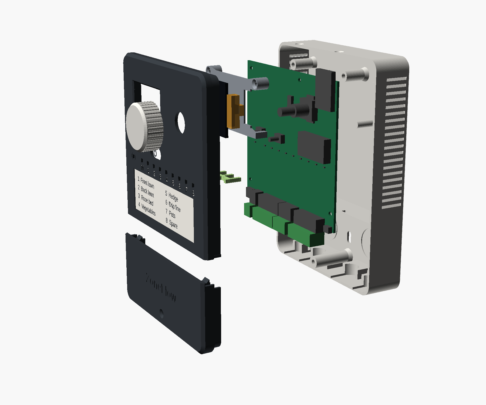
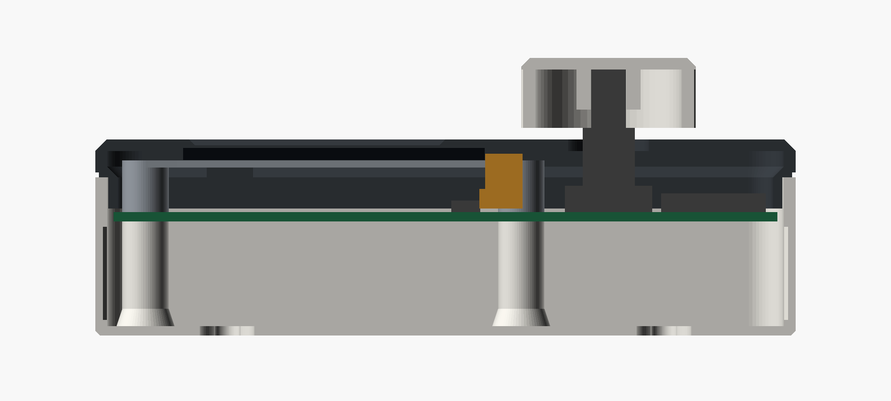
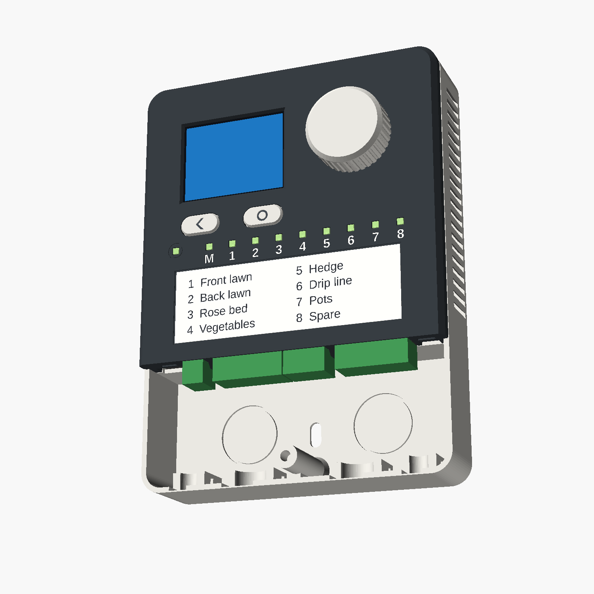

# Assembly

!!! warning "Written from the model"
    No unit has been assembled. These steps are how the parts were designed
    to go together. Expect to correct them after the first build.

From back to front: base, board with its four terminal plugs, display carrier,
display panel, light-pipe comb and button caps, fascia and wiring cover, knob.

## What you need

- **Printed parts**: the eight in the [printing guide](printing.md).
- **Assembled board** with the display panel and its CR2032 cell loose.
- **Screws**: 2 x M3x6 pan head, 2 x M3x16 countersunk, 3 x M3x8 countersunk.
- **Inserts**: 7 x M3 heat-set, unless you printed the self-tapping version.
- **Tape**: thin double-sided tape, about 0.1 mm, for the display.
- **For the wall**: three screws up to 4.5 mm with heads up to 9 mm, wall plugs to suit, 2.5 mm cable ties, a 28 x 89 mm label.

## 1. Prepare the printed parts

1. **Inserts.** Press four into the board bosses in the base, one into the tall boss in the wiring compartment, and two into the pillars inside the fascia's top edge. The fascia ones go in sideways.
2. **Light pipes.** Push the comb into the channel inside the fascia until the ten pipe ends are flush with the front. It is a press fit. If it is loose, add a drop of glue at each end of the rail, away from the pipes.
3. **Engraving.** Fill it with white paint now if you have not. See the printing guide.

## 2. Board into the base

1. Fit the cell into its holder.
2. Lower the board into the base, terminal headers towards the wiring compartment. The headers overhang the board edge and rest above the partition.
3. Fit the two M3x6 screws in the lower corners. Leave them a turn loose.

## 3. Display

The section shows where this ends up: fascia on top, then the panel, the
carrier deck, the folded cable in orange and the connector on the board.

1. Stand the carrier on the board: two legs over the upper holes, two feet on the bare pads below. Fit the two M3x16 countersunk screws through the legs. Tighten all four board screws.
2. Put two short strips of tape on the carrier deck.
3. Hold the panel upright on its cable edge, at the opening in the carrier, with the screen facing right, away from the carrier. Open the connector's lock, slide the cable in, close the lock.
4. Fold the panel down to the left onto the deck, so that the screen ends up facing you. The cable makes a C under it. Do not crease the cable.
5. Press the panel lightly onto the tape, roughly centred. The fascia will centre it.

!!! note "The cable is short"
    The tail is 20.7 mm long. If it will not reach, or reaches only with the
    cable pulled tight, stop. That is one of the unconfirmed dimensions in
    the [mechanical design](../design/mechanical.md#9-what-is-not-confirmed).

## 4. Fascia

1. Stand a button cap on each switch: the chevron on the left, the ring on the right.
2. Hold the fascia with its top edge lifted about 20 degrees. Lower its bottom edge first, so that the two hooks go down behind the partition, between the terminal blocks.
3. Swing the top down. The encoder shaft passes through the large hole and the buttons come up through theirs. Guide the buttons with a fingertip if they catch.
4. Check that the display sits square in the window. If not, lift the fascia and move the panel.
5. Fit the two M3x8 countersunk screws down through the top wall of the base.
6. Push the knob onto the shaft, flat to flat.

Both buttons should click and the knob should turn and press without
rubbing. If a button does not click, its cap is sitting on the fascia. That
is a clearance to fix in the model, not something to force.

## 5. On the wall

1. Tape the drilling template, `enclosure/output/drill-template.pdf` printed at 100 %, to the wall and level it. Check its 100 mm line with a ruler first.
2. Drill the three marked points. Fit the two upper screws and leave their heads 3 mm proud.
3. Decide where the cables come in. Cut the skin out of each bottom entry you will use, or knock out one of the round panels in the back for a cable that comes out of the wall.
4. Hang the base on the two screws and slide it down. Fit the third screw through the slot in the wiring compartment.

## 6. Wiring

{ width="560" }

Follow [wiring](../getting-started/wiring.md) for what goes where. The
mechanical part:

1. Pull the plugs off the board. Wire them on the bench or in the hand.
2. Lay each cable into its entry from the front. Strip the outer jacket from just above the cradle.
3. Put a cable tie round the jacket and through the tunnel in the cradle. Pull it snug.
4. Push the plugs back on. The 24 VAC plug is the two-way one on the left.
5. Stick the label in its recess and write the zone names on it.

## 7. Wiring cover

1. Hook the cover's two toes into the slots at the bottom edge of the fascia, with the cover's bottom edge lifted.
2. Swing it shut. Its top edge laps over the fascia.
3. Fit the M3x8 countersunk screw.

## Later

- **Changing the cell.** Take off the wiring cover, pull the knob off, remove the two screws in the top wall, swing the fascia up from the top and lift it away. The cell is in the open on the right. The board stays where it is.
- **Connecting USB.** Take off the wiring cover. The socket is at the left end of the terminal row. Read the USB warning in [safety](../safety.md) first, and pull the 24 VAC plug unless you know your transformer's output is not earthed.
