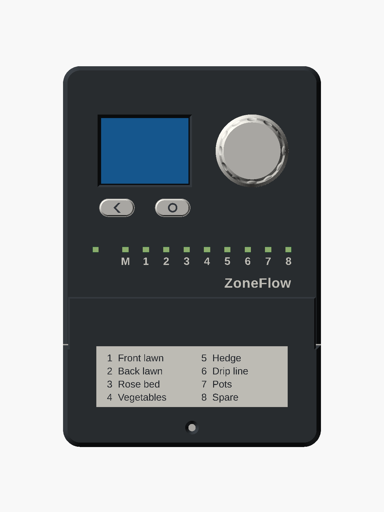
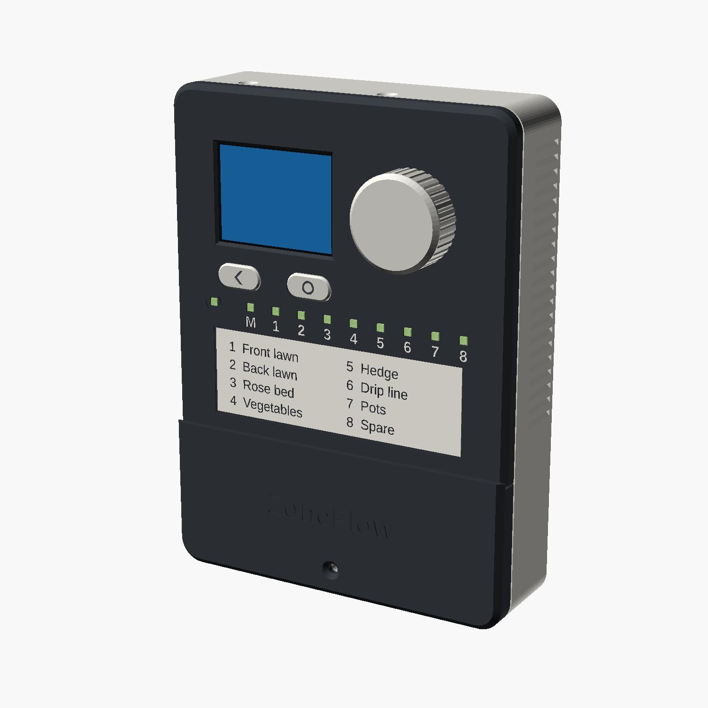
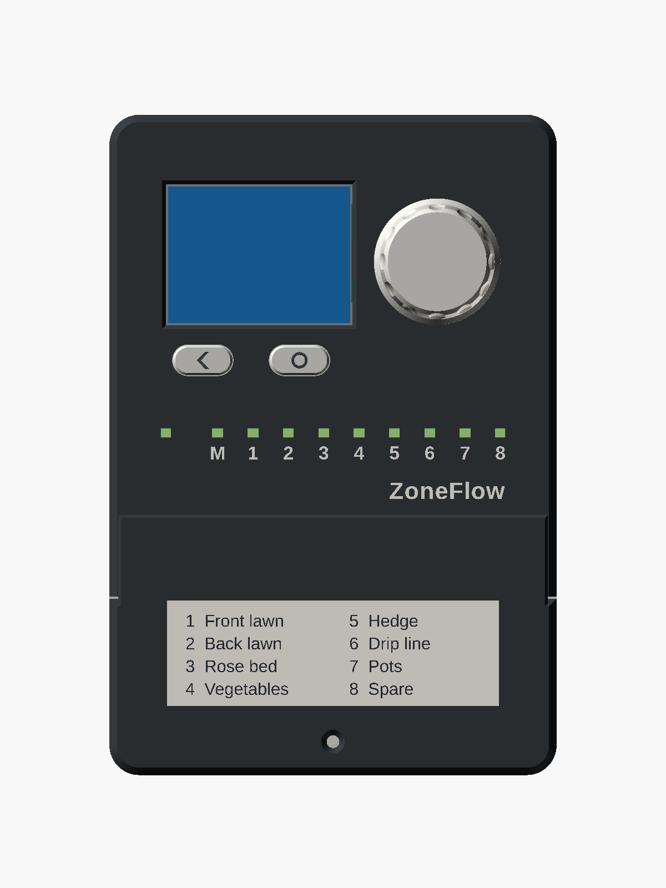
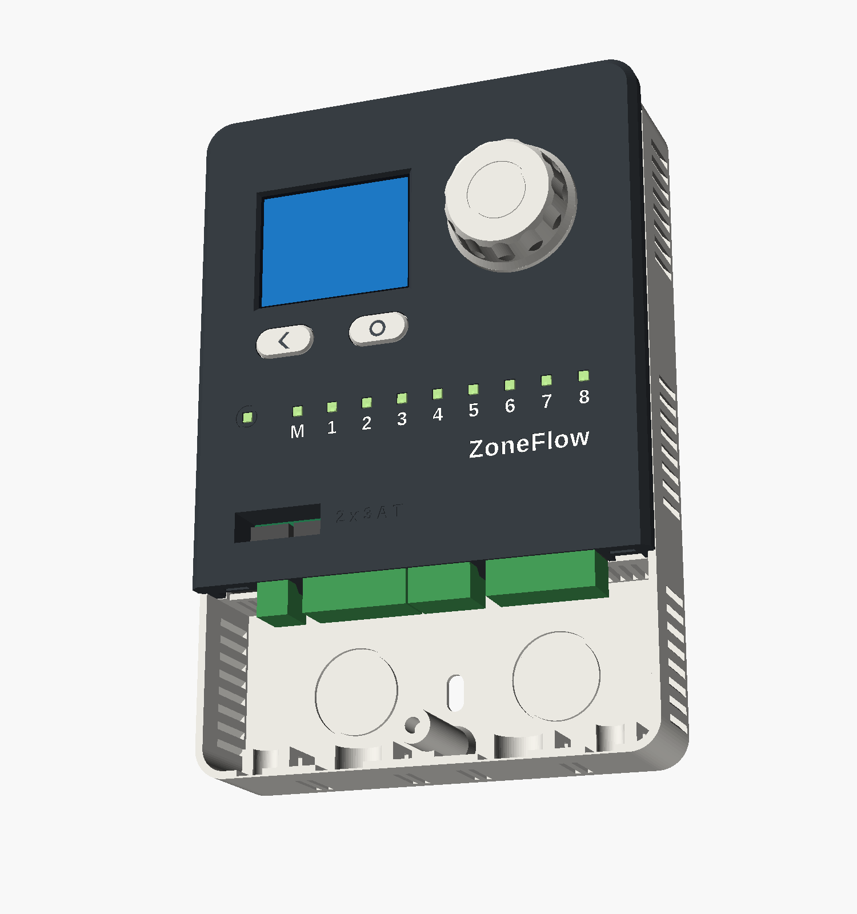
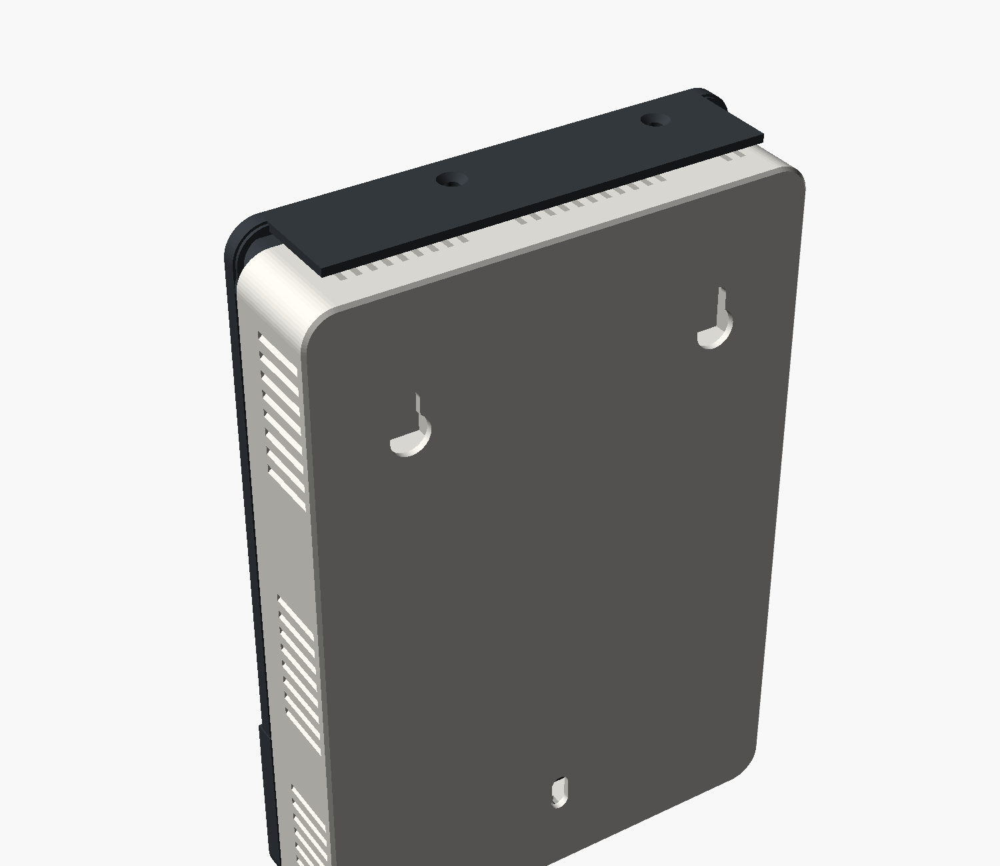

# Enclosure

!!! warning "Designed, not printed"
    The enclosure exists as a parametric model. Nobody has printed it and no
    board exists to put in it. What has been checked is that the modelled
    parts do not overlap each other, the board as it is laid out, or a
    printable stand-in for it. See [what was checked](#what-was-checked) and
    the [test fit](test-fit.md). Tracked in
    [issue #9](https://github.com/syntroniks/zoneflow/issues/9).

{ width="400" }
{ width="430" }

The enclosure is for indoor or garage walls. It is not weatherproof. See
[safety](../safety.md).

- [Printing](printing.md): material, settings, orientation, time and filament for each part
- [Assembly](assembly.md): from printed parts and a board to a unit on the wall
- [Test fit](test-fit.md): a printable stand-in for the board, and what to check with it before a board is ordered
- [Mechanical design](../design/mechanical.md): the contract with the PCB, for the layout engineer

## At a glance

| Item | Value |
|---|---|
| Size on the wall | 120.2 x 177.5 mm |
| Depth | 33.7 mm at the fascia, 35.7 mm at the wiring cover, 47.7 mm at the knob |
| Printed parts | 8: base, fascia, wiring cover, display carrier, knob, two button caps, light-pipe comb |
| Largest part | Base, 120.2 x 172.0 x 32.2 mm in print orientation |
| Supports | None |
| Screws | 7 M3 screws and 7 M3 heat-set inserts, or self-tapping bosses |
| Wall fixing | Two keyholes 75 mm apart and a third screw 123 mm below |

## The front

The local interface is what this product is for, so the fascia carries only
that.

- **Display and knob.** The screen is on the left behind a chamfered window. The knob is on the right at the same height.
- **Two buttons under the screen.** Back is under the screen's left edge and Home / Manual under its right edge, so the bottom row of the screen can name them. The caps carry a chevron and a ring.
- **Ten lights.** Status on the left, then M for the master valve and 1 to 8, on a 9.5 mm pitch, with engraved numbers under them. There is 15 mm of clear face above the row and below it.
- **Name.** "ZoneFlow", engraved, lower right.

The zone label is on the wiring cover, not on the fascia. Revision 1 had it
under the lights, and the lower third of the face was crowded.

The screen is perpendicular to the wall. The panel is IPS with no preferred
viewing direction, so at chest to eye height it reads the same from above and
below.

### Display window: an open aperture, sized by a parameter

The panel sits 1.5 mm behind the front surface, behind a printed bezel that
covers its metal frame and inactive border. There is no clear window in front
of it. A printed part cannot be optically clear, so a window would mean a
piece of acrylic that every builder has to cut. The cost of leaving it out is
that the panel's polariser is exposed to fingers. For an indoor controller
that is touched a few times a year, I accept that.

The 2.0 inch panel is small on this face. `panel = "2.4"` in
`enclosure/params.scad` rebuilds the fascia and the carrier for a 2.4 inch
panel. The board is not laid out for one. The
[mechanical design](../design/mechanical.md#73-a-24-inch-panel-later) says
what would have to change.

{ width="360" }

### Knob

A low drum, 29 to 31 mm across and 12 mm tall, on a 34 mm foot. Twelve
shallow scallops run up its side and through the top chamfer. There is no
pointer, because the encoder turns without end. The foot hides the hole in
the fascia. It prints top down, so the face you touch has the bed's finish,
and nothing overhangs more than 45 degrees.

It is 12 mm tall because the encoder's shaft stands 12 mm out of the fascia.
A shorter-shaft encoder would allow a lower knob.

### Light pipes

The comb is one flat part printed in clear PETG. Ten square pipes, 2.4 mm
across, run from 0.7 mm above each LED to the front surface. Printed on its
side, the layers run along each pipe. The pipes share one rail, so a little
light from a lit LED will reach its neighbours. Whether that is visible, and
whether 1.6 mA per LED is bright enough, are bench questions.

## Two compartments

{ width="560" }

A partition separates the electronics above from the wiring below. The
terminal headers, the USB socket and the Qwiic socket pass through it with
0.4 mm of clearance. With the wiring cover off, an installer sees the four
plugs, the two fuses and nothing else of the board.

- **Wiring cover.** Its lower part closes the wiring compartment. Its upper part is a flap, 1.85 mm thick, that lies on the fascia for 22 mm. Two toes hook into the fascia and one M3 screw holds the bottom.
- **Fuse well.** The two 3 A fuses stand in a walled well in the fascia, behind the 24 VAC plug. The flap covers it. With the cover off you lift a fuse out with tweezers or small pliers. The walls reach down to 0.3 mm above the board, so nothing else is within reach.
- **Zone label.** A recess 90.5 x 29.5 mm on the cover takes a standard address label, 28 x 89 mm or 29 x 90 mm.
- **Cable entries from below.** Four notches in the bottom wall: two 12.5 mm wide for 18 AWG multi-conductor sprinkler cable and two 7 mm wide for the transformer lead and a sensor cable. Each is closed by a 0.5 mm skin until you cut it out. The notches are open to the front, so a cable is laid in, not threaded through.
- **Cable entry from behind.** Two 22 mm knock-outs in the back wall.
- **Strain relief.** Behind each bottom entry is a cradle with a tunnel for a 2.5 mm cable tie.
- **Room for the wires.** 30 mm from the cradles to the plugs and 32 mm of depth.

### The step between fascia and cover

Revision 1 listed the 2.5 mm step as a weakness. I looked at removing it and
kept it, at 2.0 mm, for three reasons.

- **The plugs are taller than the fascia allows.** They need 12.5 mm above the board and the fascia's inside is at 10.5 mm. The fascia cannot move forward, because the display cable would no longer reach its connector.
- **A flush joint needs a recess in the fascia's face** for the cover to sit in. The fascia prints face down, and a recess in the face is an overhang that needs support.
- **The flap now does work.** It closes the fuse well, hides the seam, and holds the fascia's lower edge down. The cover reads as a door that overlaps the panel above it.

### USB is behind the wiring cover

The USB-C socket is at the left end of the terminal row and points down into
the wiring compartment. To use it, take the wiring cover off.

- **It is a service port.** Firmware updates normally arrive over the network.
- **It sits next to the 24 VAC plug.** The hardware design explains why connecting an earthed computer while 24 VAC is connected can short the transformer in some installations. Its advice is to pull the 24 VAC plug first.
- **No hole in the outside.**

## Fixing to the wall

Two keyholes take screws up to 4.5 mm with heads up to 9 mm. The unit hangs on
them and slides down 8 mm. A third screw goes through a slot inside the wiring
compartment and stops it lifting off. The build produces a 1:1 drilling
template, `enclosure/output/drill-template.pdf`.

Each keyhole opens into a closed pocket inside the base. A screw head cannot
reach the board and the keyhole does not open into the electronics.

## Heat and ventilation

About 2 to 3.5 W turns into heat inside. The triacs, the shunt and the
regulator are in the lower half of the board. The module is at the top.

{ width="480" }

Air comes in low and leaves high. Every opening is 1.4 mm wide.

| Opening | Where | Area, mm² | Drips |
|---|---|---|---|
| Inlet | 16 slanted slits low in the side walls of the electronics compartment | 358 | Slits slope down to the outside |
| Inlet | 16 slanted slits in the side walls of the wiring compartment and 8 slits in its bottom wall, then 28 slits in the partition below the board | 376 in series | Bottom wall faces down |
| Outlet | 16 slanted slits high in the side walls | 358 | Slits slope down to the outside |
| Outlet | 22 slits in the top wall, under the roof | 254 with the gap behind the roof in series | See below |

- **The roof.** The fascia's top wall runs back 27.5 mm over the top of the base, 3.5 mm above it. Hot air leaves through slits in the top wall into that gap and out behind and beside the roof. A drip from above lands on the roof. One that falls behind it lands on a strip of top wall that has no slits, because they stop 2.5 mm inside the roof's edge.
- **Path past the triacs.** The partition slits are directly under the terminal headers. Air from them rises behind the board past the bottom copper of the triac row, and through the 1.1 mm gaps at the board's edges to the front. The board is 18 mm off the back wall, so the rear space is one open channel 110 mm tall.
- **Insects.** 1.4 mm stops wasps, flies and most spiders. It does not stop small ants.
- **The two compartments** are now joined by the partition slits, below the board. They are too narrow for a finger or a screwdriver. A loose wire strand could pass one.

### How warm it gets: an estimate

Nothing has been measured. This is a calculation with textbook coefficients,
and a reviewer can redo it.

- **Outside surface** of the electronics compartment that sheds heat: front 149 cm², sides and top 124 cm², half credit for the 149 cm² back because it faces the wall. 0.0348 m².
- **Outside film**: 9 W/m²K for natural convection plus radiation. 3.2 K/W from the wall surface to the room.
- **Inside film**: I assume half the heat leaves the parts by convection into the air and half by radiation straight to the walls. With 4 W/m²K over 0.0422 m², the air sits 5.9 K above the walls per watt of convected heat.
- **Sealed box**: 3.2 x 0.9 + 5.9 x 0.5 gives 5.8 K of air temperature rise per watt.
- **Vents**: inlets total 734 mm² at a mean height of y = 14, outlets 612 mm² at y = 104. In series that is 470 mm² with 91 mm between them. With a discharge coefficient of 0.5 and the air 15 K above ambient, the flow is 69 cm³/s and carries away 1.1 W.

| Heat inside | Rise, revision 1 | Rise now | Sealed, for comparison |
|---|---|---|---|
| 1 W, idle with the backlight dimmed | 6 K | 5 K | 6 K |
| 2 W | 11 K | 9 K | 12 K |
| 3 W, three valves on | 16 K | 12.5 K | 17.5 K |
| 3.5 W, three valves on and backlight full | 18 K | 14 K | 20 K |

The circuit design now assumes 70 °C inside at 50 °C ambient, a rise of
20 K. By this estimate the enclosure has about 6 K in hand at 3.5 W. The
vents carry about 30 % of the heat at full load. Revision 1's carried about
15 %. The larger box accounts for about 1 K of the improvement.

What I am least sure of is the discharge coefficient through slits 2 mm
deep, and whether the air mixes as the calculation assumes. The bench run in
the hardware design's bring-up plan decides it.

## What was checked

Run `make` in `enclosure/`. It rebuilds the parameters from
`hardware/mechanical.yaml`, reads the positions of the parts from the board
file, exports every part, renders the views and runs the check. The report
is `enclosure/output/check-report.md`.

- **Interference.** 91 pairs of solids are intersected in their assembled positions. 45 are the contract's placeholder board, the display with its folded cable, the mated plugs and the promised component height zones, each against every printed part, and the printed parts against each other. 32 are the printable [test-fit kit](test-fit.md) and the soldered lead ends, which come from the board file. 14 repeat the display checks with the 2.4 inch option. Every pair overlaps by less than 0.5 mm³, with two exceptions that are expected. The knob and the placeholder shaft share 35.5 mm³, the flat that the placeholder does not have. The contract's volume for the display cable reaches 1.9 mm³ into the connector it plugs into.
- **The board as KiCad models it.** Every body of KiCad's detailed export against every printed part. None overlaps. That export lacks 22 parts, listed in the report.
- **Board against contract.** The 26 parts the contract places are where the board file puts them, within 0.05 mm.
- **Clearances.** 89 gaps and 20 alignments at the features a person checks by hand, measured on the exported meshes.
- **Print files.** Each STL is one closed solid, sits on the bed and fits 220 x 220 mm in its print orientation.
- **Contract consistency.** The generator rejects a contract whose numbers contradict each other.

Not checked, because it needs a printer and a board:

- **Fit of any printed part** to another or to a real component.
- **Snap and press fits**: the fascia hooks, the cover toes, the knob on the shaft, the light-pipe rail.
- **Whether the display cable reaches** its connector.
- **Print quality** of the 45 degree features, the 1.4 mm slits and the roof, which is a wall 27.5 mm tall and 2 mm thick.
- **Temperature, RF range and LED brightness.**

## What still looks weak

- **The top margin is large.** 24 mm of face above the 2.0 inch screen, against 17.5 mm at the sides. The roof added 5.5 mm of it. The 2.4 inch option fills the space.
- **The engraved markings are dark on dark** unless you fill them with paint, which the printing page asks for. The renders show them filled.
- **The flap is narrower than the cover** by 2.3 mm a side, because the fascia's face ends at its chamfer. It leaves a small notch at each end of the seam.
- **The roof stops short of the corners.** Seen from above and behind, the base's top wall shows at both ends.
- **Two screw heads show on the roof** and one on the wiring cover.
- **Three groups of slits show on each side.**
- **The wiring cover's flap is blank** above the label. It is the fuse door, and it says nothing about that on the outside.
