# Test fit

!!! warning "Nobody has printed these parts"
    The project has printed nothing and no board exists. Every gap on this
    page is a number from the model. Printers differ by a few tenths of a
    millimetre, which is the size of the smallest gaps here. The point of
    the test fit is to find out which ones your printer closes.

You can check the enclosure by hand before any board is ordered. Print the
enclosure, print a stand-in for the board, and put them together dry.

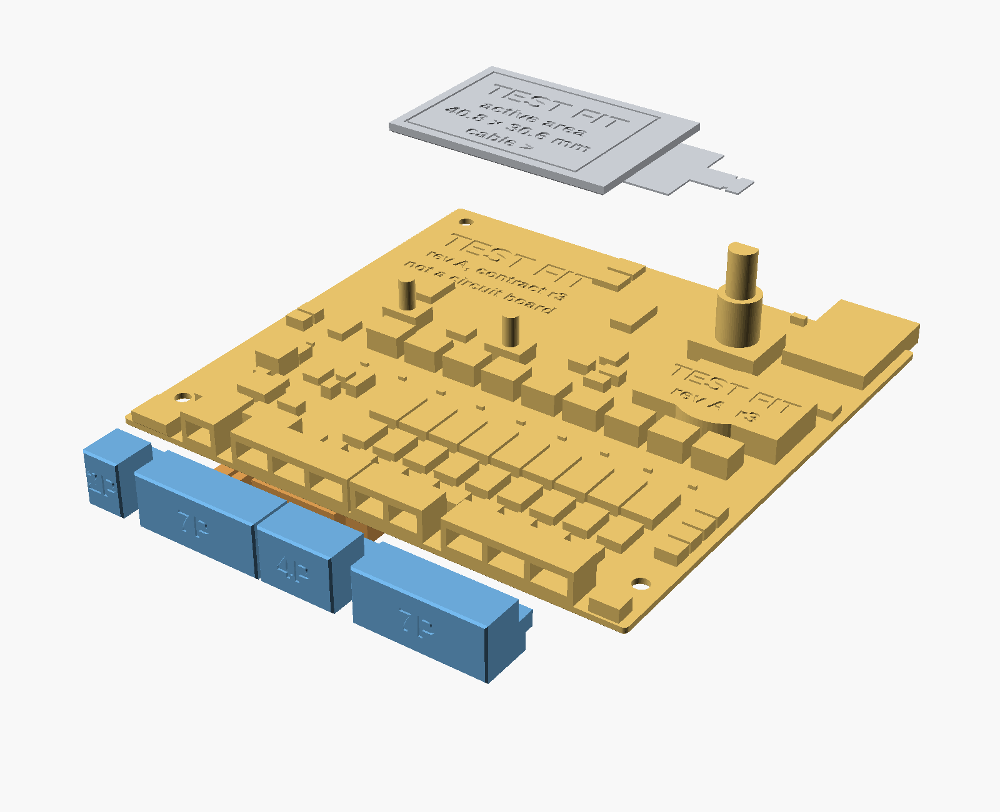{ width="620" }

The kit is seven files and eight prints. There is a board, the two
bottom-side parts C1 and K1, three sizes of plug piece and a display panel. The board is generated from the
laid-out board file, `hardware/zoneflow-a/zoneflow-a.kicad_pcb`, at its true
outline and thickness. Each part on it that comes near the enclosure is a
solid block at the position the board file gives, with the body size from the
[mechanical contract](../design/mechanical.md).

**[Download every print file as one zip](print/zoneflow-test-fit-print-files.zip)**, 6 MB.

Record what you find in
[issue #9](https://github.com/syntroniks/zoneflow/issues/9). The last section
says what to write down.

## What to print

Every file is already in print orientation. Put it on the bed as it is. All
of it fits a 220 x 220 mm bed.

### Plates

One 3MF per print batch, with the parts laid out. They hold positions only,
no slicer settings. I wrote them with a script and read them back with a
second library. No slicer has opened them, so if yours rejects one, use the
single files below and tell us in the issue.

| Plate | What is on it |
|---|---|
| [Plate 1, test-fit kit](print/plates/zoneflow-plate-1-test-fit-kit.3mf) | Board, C1, K1, four plug pieces, display panel |
| [Plate 2, body colour](print/plates/zoneflow-plate-2-body.3mf) | Base, display carrier, knob, two button caps |
| [Plate 3, front colour](print/plates/zoneflow-plate-3-front.3mf) | Fascia, wiring cover |
| [Plate 4, clear](print/plates/zoneflow-plate-4-clear.3mf) | Light-pipe comb |

### The test-fit kit

| Piece | Files | Quantity | Size on the bed, mm | Volume, cm³ | Hours at 5 mm³/s | Hours at 10 mm³/s |
|---|---|---|---|---|---|---|
| Board | [STL](print/test-fit/zoneflow-testfit-board.stl), [3MF](print/test-fit/zoneflow-testfit-board.3mf) | 1 | 114.0 x 117.0 x 26.1 | 35.9 | 2.0 | 1.0 |
| C1, the capacitor | [STL](print/test-fit/zoneflow-testfit-c1.stl), [3MF](print/test-fit/zoneflow-testfit-c1.3mf) | 1 | 14.0 x 13.0 x 27.5 | 4.0 | 0.2 | 0.1 |
| K1, the relay | [STL](print/test-fit/zoneflow-testfit-k1.stl), [3MF](print/test-fit/zoneflow-testfit-k1.3mf) | 1 | 7.2 x 20.5 x 16.3 | 2.3 | 0.1 | 0.1 |
| Plug piece, 2-way | [STL](print/test-fit/zoneflow-testfit-plug-2p.stl), [3MF](print/test-fit/zoneflow-testfit-plug-2p.3mf) | 1 | 8.4 x 11.6 x 15.4 | 1.1 | 0.1 | 0.0 |
| Plug piece, 4-way | [STL](print/test-fit/zoneflow-testfit-plug-4p.stl), [3MF](print/test-fit/zoneflow-testfit-plug-4p.3mf) | 1 | 16.0 x 11.6 x 15.4 | 2.0 | 0.1 | 0.1 |
| Plug piece, 7-way | [STL](print/test-fit/zoneflow-testfit-plug-7p.stl), [3MF](print/test-fit/zoneflow-testfit-plug-7p.3mf) | **2** | 27.5 x 11.6 x 15.4 | 3.5 each | 0.2 each | 0.1 each |
| Display panel | [STL](print/test-fit/zoneflow-testfit-panel.stl), [3MF](print/test-fit/zoneflow-testfit-panel.3mf) | 1 | 72.5 x 36.2 x 2.0 | 3.8 | 0.2 | 0.1 |
| **Whole kit** | | 8 pieces | | **56.2** | **3.1** | **1.6** |

### The enclosure

The same eight parts as in [printing](printing.md), rebuilt against contract
revision 3.

| Part | Files | Size on the bed, mm | Volume, cm³ | Hours at 5 mm³/s | Hours at 10 mm³/s |
|---|---|---|---|---|---|
| Base | [STL](print/zoneflow-base.stl), [3MF](print/zoneflow-base.3mf) | 120.2 x 172.0 x 32.2 | 71.5 | 4.0 | 2.0 |
| Fascia | [STL](print/zoneflow-fascia.stl), [3MF](print/zoneflow-fascia.3mf) | 120.2 x 131.7 x 27.5 | 41.5 | 2.3 | 1.2 |
| Wiring cover | [STL](print/zoneflow-cover.stl), [3MF](print/zoneflow-cover.3mf) | 120.2 x 69.9 x 13.9 | 19.5 | 1.1 | 0.5 |
| Display carrier | [STL](print/zoneflow-bridge.stl), [3MF](print/zoneflow-bridge.3mf) | 77.5 x 42.0 x 8.9 | 3.4 | 0.2 | 0.1 |
| Knob | [STL](print/zoneflow-knob.stl), [3MF](print/zoneflow-knob.3mf) | 34.0 x 34.0 x 12.0 | 5.3 | 0.3 | 0.1 |
| Back button cap | [STL](print/zoneflow-button-back.stl), [3MF](print/zoneflow-button-back.3mf) | 20.0 x 12.0 x 5.1 | 0.7 | 0.0 | 0.0 |
| Home button cap | [STL](print/zoneflow-button-home.stl), [3MF](print/zoneflow-button-home.3mf) | 20.0 x 12.0 x 5.1 | 0.7 | 0.0 | 0.0 |
| Light-pipe comb | [STL](print/zoneflow-lightpipe.stl), [3MF](print/zoneflow-lightpipe.3mf) | 92.4 x 11.0 x 2.4 | 1.0 | 0.1 | 0.0 |
| **All eight** | | | **143.6** | **8.0** | **4.0** |

Times and filament are calculated, not sliced. Hours are the volume divided
by an average flow. Use the 5 mm³/s column for an older bed-slinger and the
10 mm³/s column for a current fast printer. Filament is at most the volume
times the density: 71 g for the kit and 182 g for the enclosure in PETG at
1.27 g/cm³, if every piece were solid. A print with infill uses less.

### Settings

| Setting | Value | Why |
|---|---|---|
| Material | The enclosure as in [printing](printing.md). The kit in PETG or PLA. | PETG if you want to fold the panel's cable strip. PLA cracks there. |
| Colour | Any. A kit in a colour unlike the enclosure is easier to look at. | |
| Nozzle | 0.4 mm | |
| Layer height | 0.2 mm | The board is 1.6 mm, eight layers. The panel is 2.05 mm and prints as 2.0. |
| Perimeters | 3 | |
| Infill | 20 % | |
| Supports | **None** | See below |
| Brim | None | Every edge on the bed has a 0.4 mm chamfer against elephant's foot |

### How the kit differs from the real parts

A real board has parts on both faces and connectors that hang over its edge.
A model of that needs supports. I changed five things so that it does not.

- **Header overhang.** The terminal headers hang 2 mm over the board edge. On the kit, that 2 mm is on the plug piece. The plug piece pushes in from the wiring side as a real plug does, and its prongs go into pockets in the header block.
- **USB-C mouth.** It hangs 1 mm over the edge. Its underside rises at 45 degrees, so the lowest 1 mm of the mouth is missing.
- **Antenna end.** The module's antenna hangs 6 mm over the top edge. The space under it is filled down to the bed. That space is free in the enclosure.
- **C1 and K1.** They are on the bottom side. Each is a separate piece with a rail that fits a blind slot in the underside of the board. Push them in. If they are loose, use a drop of glue or a strip of tape.
- **Panel cable.** It is a flat strip 0.4 mm thick, two layers, at the back face of the panel. The real cable leaves the panel 0.75 mm higher, by a figure scaled from the drawing.

The top face says TEST FIT with the board revision and the contract
revision, in the bare area under the display carrier and on the cell holder.
The underside says it again.

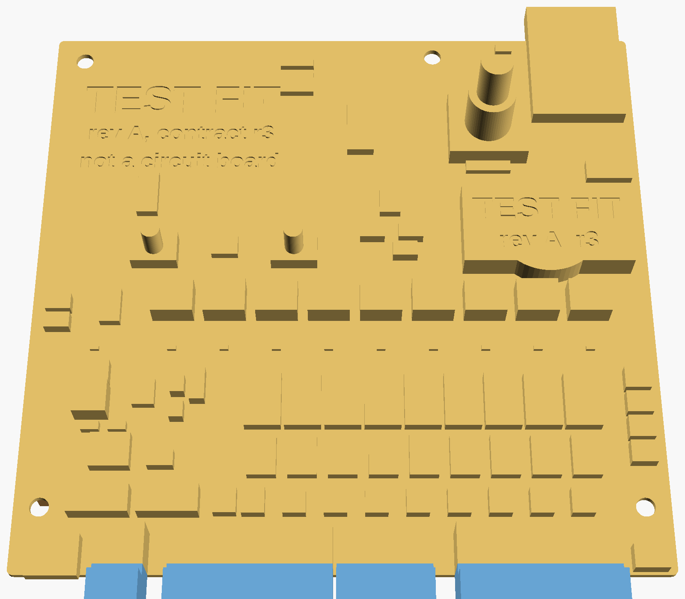{ width="480" }
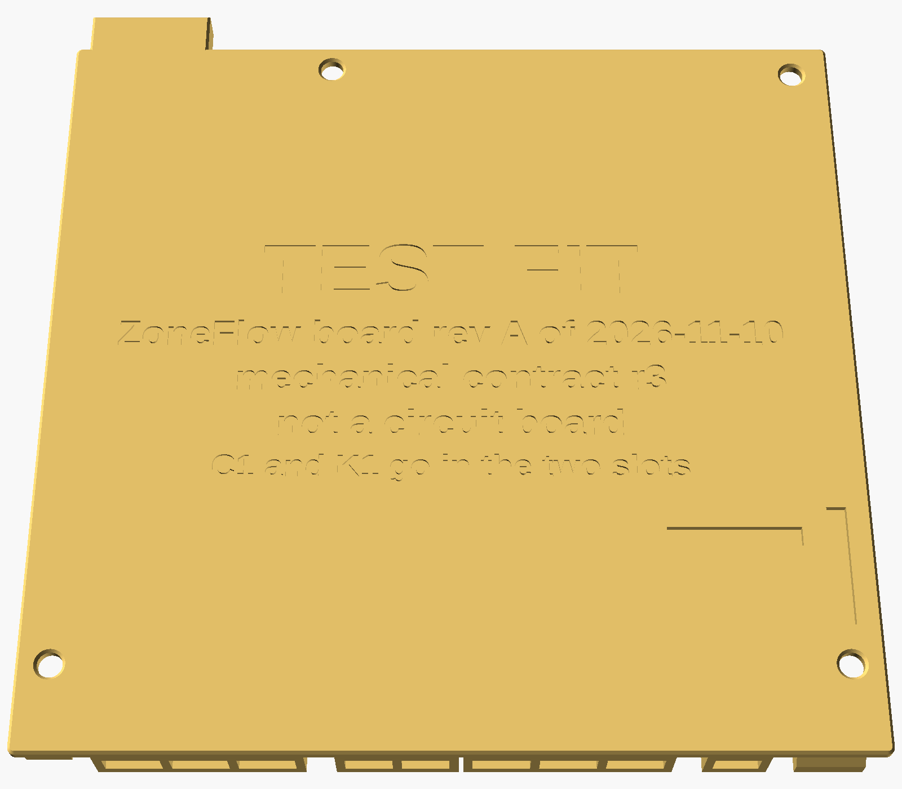{ width="480" }

### What the kit leaves out

- **Low parts.** 228 parts under 1.5 mm tall have no block. They are too small to print. The ten LEDs are the exception: each is a bump 1.6 x 0.8 x 0.8 mm, which a 0.4 mm nozzle prints as two lines.
- **Lead ends.** The soldered ends of through-hole leads are not printed. The check below includes them as 2.5 mm stubs, a length I assumed.
- **Fold stiffness.** A printed strip does not bend like a flat cable.
- **Real mating parts.** Try a real USB-C cable and a real Qwiic plug in their openings. The kit has neither.
- **Clicks.** The printed buttons and encoder do not move.

The list of all 90 stand-ins and the source of each number is
[`enclosure/output/test-fit/stand-ins.md`](https://github.com/syntroniks/zoneflow/blob/main/enclosure/output/test-fit/stand-ins.md).

## The dry fit

You need no screws and no inserts. The board rests on its bosses. If you
have M3 screws, drop them through the board holes as loose pins. With the
default `fastener = "insert"` the holes in the bosses are 4.0 mm, so a screw
does not hold without an insert.

The expected gaps come from the build's check, which measures them on the
exported meshes. The full table is in
[`enclosure/output/check-report.md`](https://github.com/syntroniks/zoneflow/blob/main/enclosure/output/check-report.md).
A feeler gauge or strips of paper measure the small ones. Printer paper is
about 0.1 mm.

### 1. Board into the base

Push C1 and K1 into their slots under the board. Lower the board into the
base with the header blocks towards the wiring compartment.

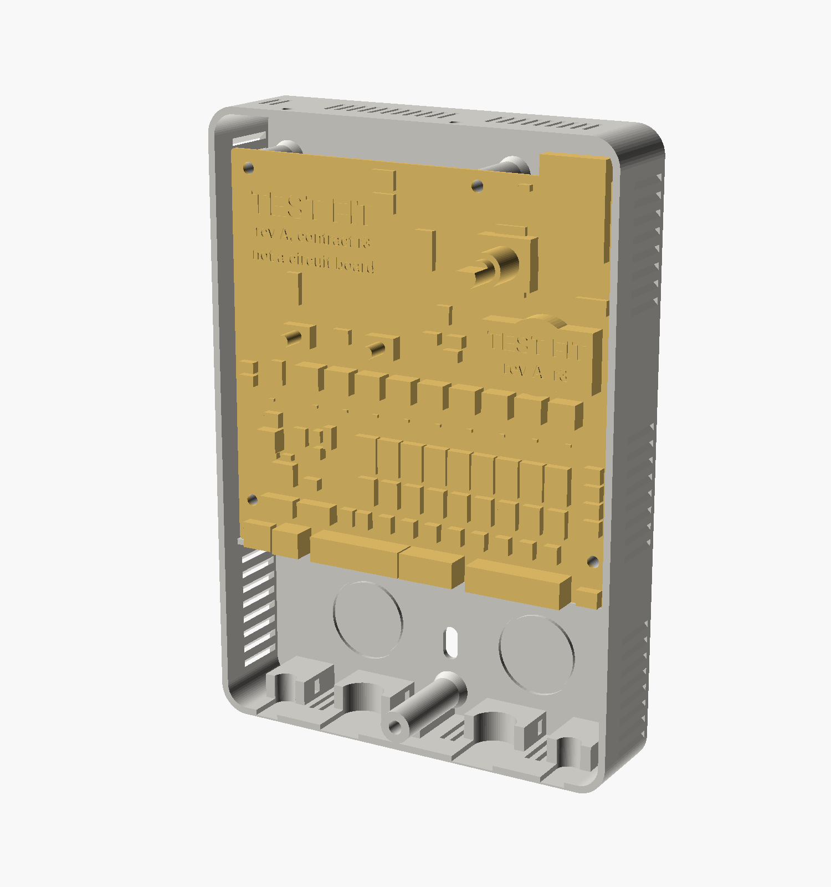{ width="420" }

| Check | Expect |
|---|---|
| The board drops in without force and lies flat on four bosses and the post under the encoder | No rocking |
| Each board hole is over the hole in its boss | In line. The 3.4 mm hole leaves 0.2 mm around an M3 screw. |
| Left and right board edges to the side walls | 1.1 mm each |
| Bottom board edge to the partition | 0.4 mm |
| C1 over the two ribs in the base | 0.3 mm. Lay two strips of paper on the ribs. The board should still lie flat. With four it should rock. |
| K1 above the back wall | 2.7 mm |
| K1 to the left side wall | 2.3 mm |

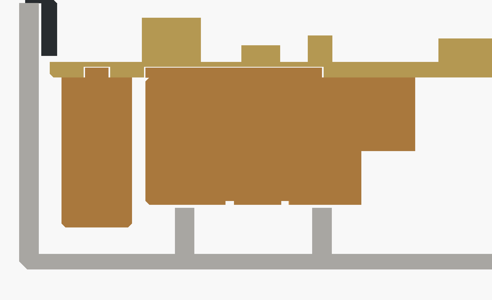{ width="620" }

In this slice K1 is on the left and C1 beside it, each with its rail in a
slot of the board. The two ribs stand under C1.

### 2. Carrier and panel

Stand the display carrier on the board, with its two legs over the upper
holes and its two feet on the bare board below. Lay the panel on the deck with its cable strip
to the right.

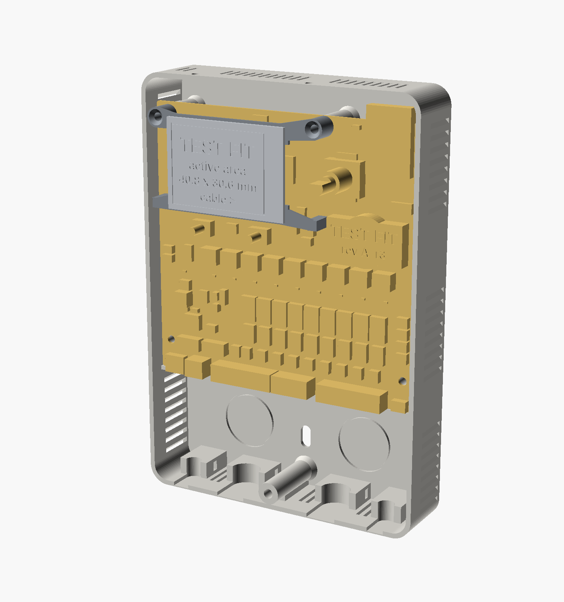{ width="420" }

| Check | Expect |
|---|---|
| Carrier legs over holes A and B | In line |
| Carrier feet | Flat on bare board. No block under either foot. |
| The connector block J7 shows in the opening at the right end of the deck | 5.65 mm below the deck |
| Fold the cable strip down and back under the panel, into the opening | The two notches, 3.3 mm from the tip, reach the right-hand face of J7 with the strip not pulled tight |

The cable check is rough. The strip starts 0.75 mm lower than the real cable,
which is worth about 1.2 mm of length in the fold, so a strip that only just
reaches is a fail. The real answer needs a panel.

### 3. Fascia

Press the light-pipe comb into its channel inside the fascia. Stand a button
cap on each actuator. Lower the fascia bottom edge first, so that its two
hooks go behind the partition, then swing the top down over the shaft. Push
the knob onto the shaft, flat to flat.

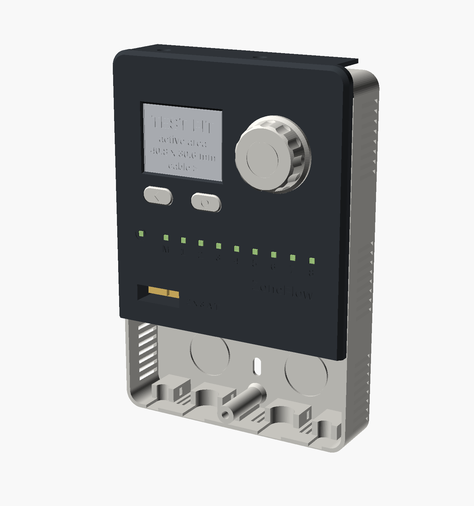{ width="420" }

**The display.**

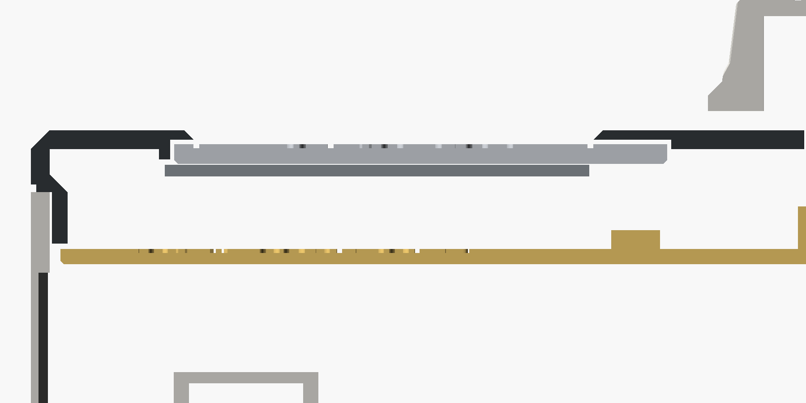{ width="700" }

| Check | Expect |
|---|---|
| The groove around TEST FIT on the panel | All of it in view, the same width on four sides. The groove is 0.6 mm wide and is the strip between the active area and the window. |
| Panel to the locating ribs | 0.4 mm on each of four sides. The panel should shift a little under a fingernail and not rattle. |
| Glass to the bezel lip in front of it | 0.5 mm, and 0.55 mm with a panel printed 2.0 mm thick. Nothing should press on the panel. |
| Panel on the deck | 0.1 mm, the tape. Without tape the panel lies that much low. |

**The knob.**

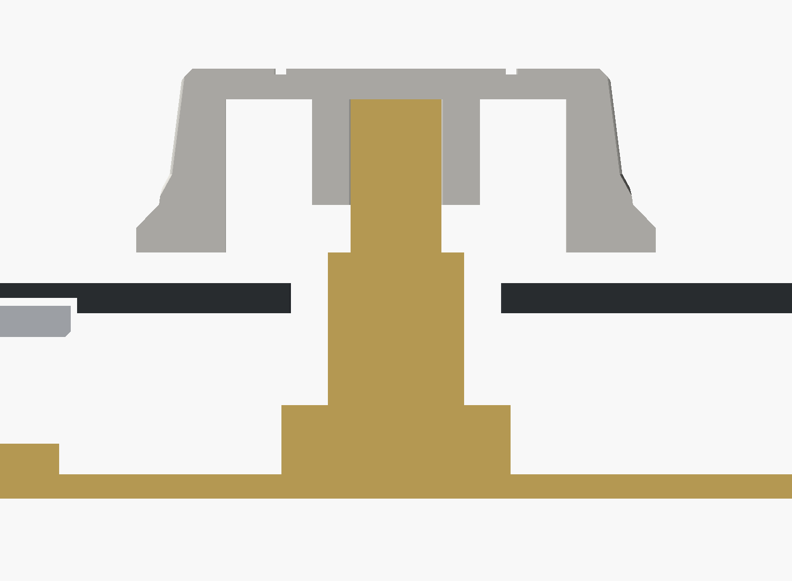{ width="520" }

| Check | Expect |
|---|---|
| Knob on the shaft | A push fit, 0.1 mm all round and at the flat. It seats on the end of the shaft. |
| Knob underside to the fascia | 2.0 mm. A real encoder takes 1.5 mm of that when pressed. |
| Bushing in the hole of the fascia | 2.5 mm all round. The hole is large on purpose. |
| The shaft is in the middle of the hole | In line |

**The buttons.**

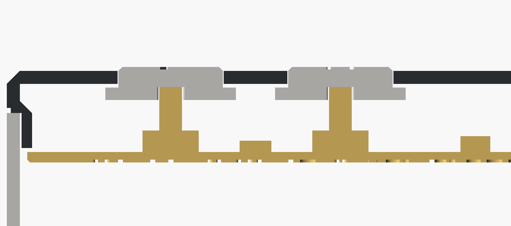{ width="700" }

| Check | Expect |
|---|---|
| Each cap in its hole | 0.25 mm all round. It should drop back under its own weight. |
| Cap on the actuator | Loose, 0.4 mm all round, resting on the actuator's end |
| Cap face above the fascia | 0.6 mm |
| Cap flange to the inside of the fascia | 0.6 mm. Lift the cap: it should rise that far and stop. |

**The lights.**

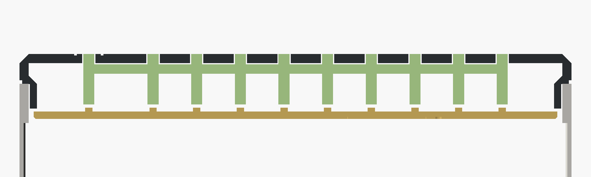{ width="760" }

| Check | Expect |
|---|---|
| Each pipe in its hole | 0.25 mm each side, the end flush with the face |
| Each pipe over its LED bump | In line, 0.7 mm above it. Look in from the side before the fascia closes, or down a clear pipe. |

### 4. Plug pieces

Push the four plug pieces in from the wiring compartment. The 2-way is on the
left, then a 7-way, the 4-way and the other 7-way.

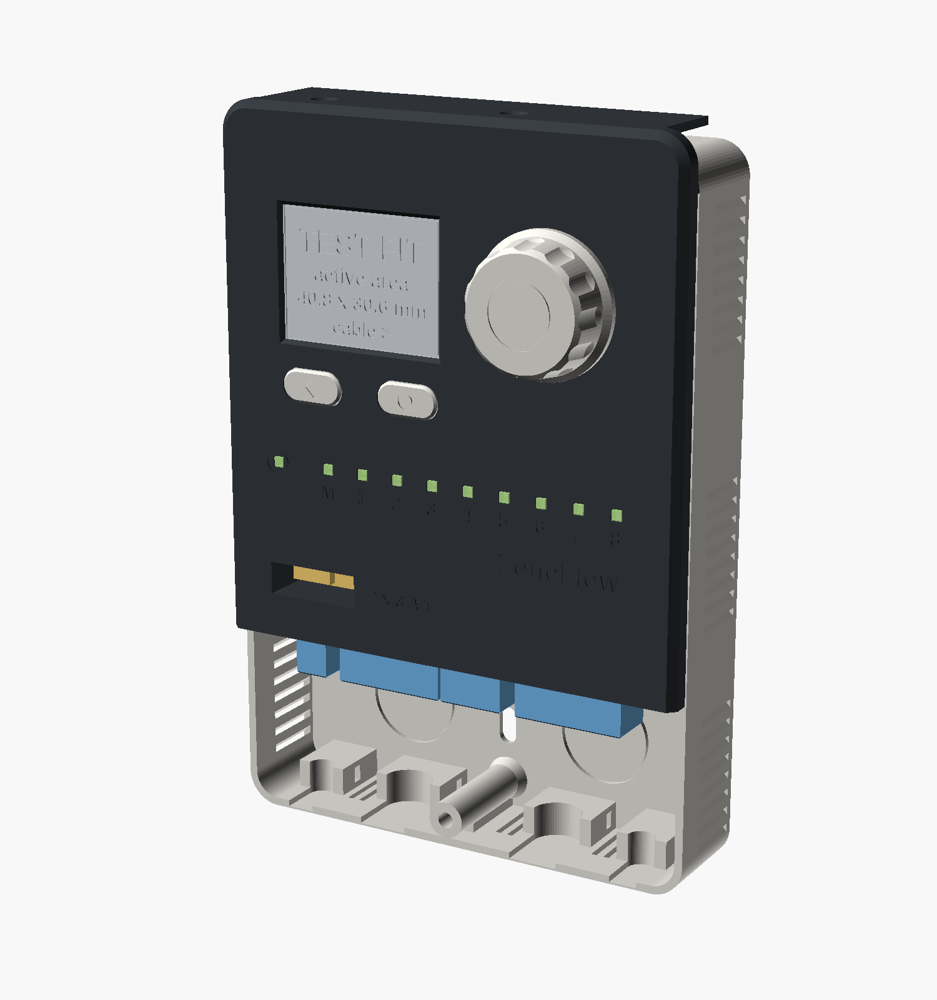{ width="420" }
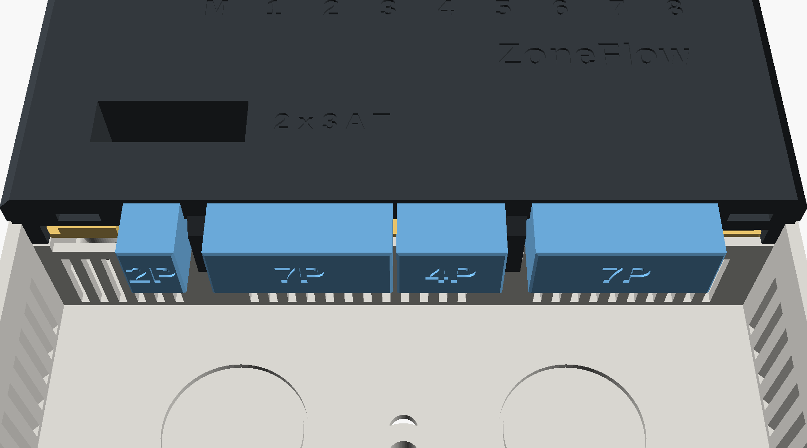{ width="620" }

| Check | Expect |
|---|---|
| Each plug piece goes home and its prongs find the pockets | The shoulder of the plug touches the partition. That contact is by design and has nothing spare. |
| Header to the sides of its opening | 0.4 mm. Between the first 7-way and the 4-way there is no wall. |
| Header to the top of its opening | 0.4 mm |
| Header underside to the top of the partition in the base | 0.3 mm |
| Plug to the fascia hook beside it | 0.5 mm, four places |
| USB-C block to the left edge of its opening | 2.0 mm, and 2.1 mm above it |
| A real USB-C cable | It goes in. By the contract's unconfirmed 12.35 x 6.5 mm overmold it has 0.33 mm on the left and 0.45 mm above and below. |
| Qwiic block in its opening | 0.75 mm each side, 1.45 mm above |

### 5. Wiring cover

Hook the cover's two toes into the slots at the bottom edge of the fascia and
swing it shut.

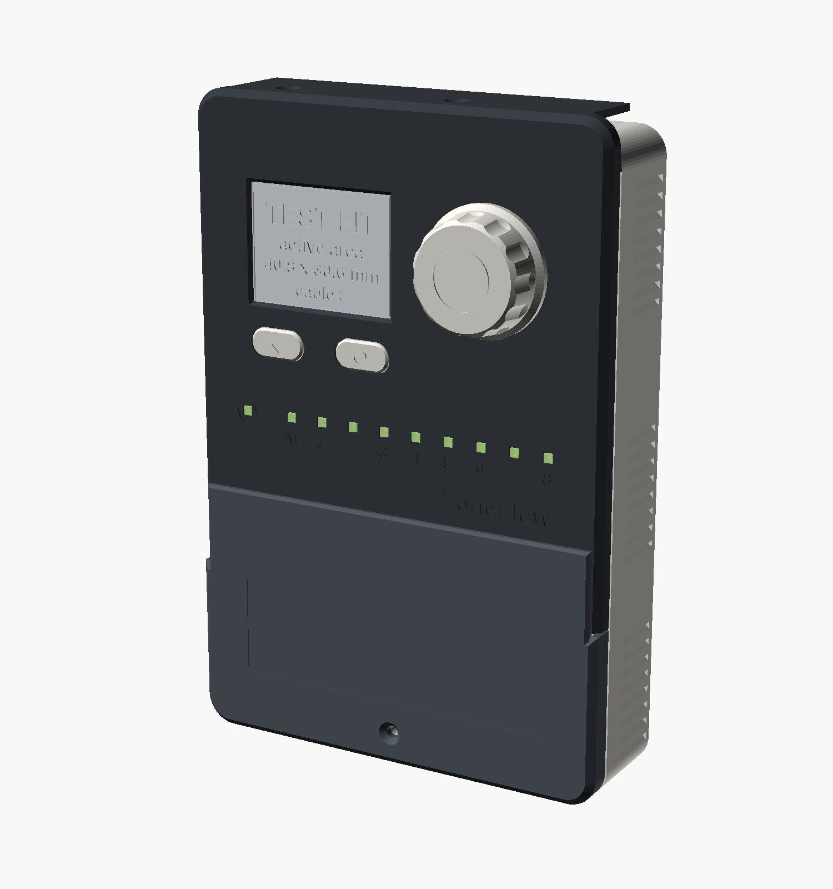{ width="420" }
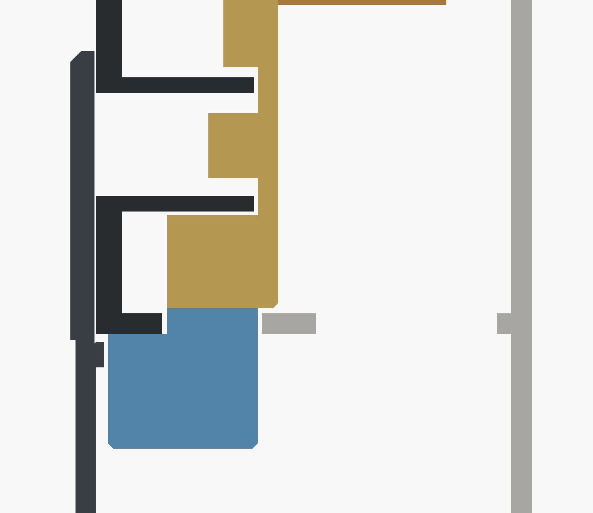{ width="520" }

In this slice the front of the product is on the left. The cover's flap lies
over the fuse well. Below the board edge the plug piece sits in its opening,
over the partition in the base.

| Check | Expect |
|---|---|
| The cover closes over the plug pieces | 0.3 mm between the plug tops and the cover's top wall, 0.9 mm to the inside of the cover |
| The flap lies on the fascia and covers the fuse well | 0.15 mm under the flap, and the flap reaches 2.0 mm past the well |
| With the cover off: the fuse holder blocks in the well | 0.49 mm to the end walls, 1.4 mm and 1.6 mm to the long walls |
| With the fascia off: the walls of the well | They end 0.3 mm above the board |

## The gaps to watch

The check adds up what each gap has to absorb: 0.2 mm for the printed parts,
which I assumed, the board's thickness tolerance of 0.16 mm, and a placement
figure for the part. Seven gaps are 0.3 mm, the smallest that must stay open:

- **C1 to its ribs.** 0.3 mm.
- **Header undersides to the base partition.** 0.3 mm, four headers. A board at the thin end of its tolerance sits lower and takes 0.16 mm of it.
- **Fuse-well walls to the board.** 0.3 mm. A thick board takes 0.16 mm of it.
- **Plug tops to the cover's top wall.** 0.3 mm, and the plug height is unconfirmed in the contract.

With the tolerances stacked one way, the last three close by 0.06 mm. That
does not mean they will. It means these are the first places to look.

## What to measure with callipers

Measure the printed pieces and compare. The difference is what your printer
adds or takes, and it is the most useful thing to report.

| Piece | Dimension | Model, mm |
|---|---|---|
| Test-fit board | Width x height, without the tab under the antenna | 114.0 x 110.0 |
| Test-fit board | Thickness | 1.6 |
| Test-fit board | Mounting hole | 3.4 |
| Test-fit board | Hole C to hole D, the lower pair, centre to centre | 105.0 |
| Test-fit board | Hole A to hole B, the upper pair | 69.51 |
| Test-fit board | Hole C to hole A, the left pair | 93.01 |
| Test-fit board | Header blocks, width: 2-way, 4-way, 7-way | 8.42, 16.04, 27.47 |
| Test-fit board | Header block, top above the underside | 8.6 |
| Test-fit board | Encoder shaft, diameter and across the flat | 5.98 and 4.45 |
| Test-fit board | Encoder shaft, top above the underside | 26.1 |
| Test-fit board | Button actuator, diameter and top above the underside | 3.5 and 11.6 |
| Display panel | Outline and thickness | 51.8 x 36.2 x 2.05 |
| Display panel | Cable strip beyond the panel edge | 20.7 |
| Plug piece | Body height and depth, nose height | 11.6, 8.9, 7.0 |
| Base | Inside width at the board | 116.2 |
| Base | Top of a board boss below the rim of the side wall | 7.6 |
| Fascia | Window at its narrowest, behind the chamfer | 42.02 x 31.82 |
| Fascia | Hole for the encoder | 14.0 |
| Fascia | Hole for a button cap | 16.5 x 8.5 |
| Fascia | Hole for a light pipe, square | 2.9 |
| Fascia | Fuse well, inside | 23.6 x 8.0 |
| Fascia | Opening for the right-hand 7-way header, width | 28.27 |
| Knob | Bore diameter and across the flat | 6.18 and 4.65 |

## Reporting results

Write in [issue #9](https://github.com/syntroniks/zoneflow/issues/9):

- **Printer and settings.** Printer, material, nozzle, layer height, slicer.
- **Calliper values.** The table above, as printed.
- **Each check.** Pass, tight or loose, with the gap you measured.
- **Photos.** Any place that binds.

Most fixes are one parameter in `enclosure/params.scad`. Change it, run
`make` in `enclosure/`, and the check says whether anything now collides.

| What you see | Parameter | Now, mm |
|---|---|---|
| The fascia or the cover will not go into the base, or a button cap binds in its hole | `fit` | 0.25 per side |
| A header, the USB-C or the Qwiic block rubs its opening | `comp_clear` | 0.4 per side |
| The board is tight between the side walls | `pcb_gap` | 1.1 |
| The board touches the partition | `part_gap` | 0.4 |
| The panel is tight or loose between its ribs | `display_fit` | 0.4 per side |
| The knob is loose or will not go on | `knob_bore_fit` | 0.1 per side |
| A cap is tight on its actuator | `btn_socket_d` | 4.3 |
| A cap presses on its switch | `btn_flange_gap` | 0.6 |
| The light-pipe comb is loose in its channel | `lp_fit` | 0.1 per side |
| A light pipe is tight in the fascia | `lp_hole` | 2.9 |
| C1 sits on its ribs | `c1_rib_gap` | 0.3 |
| A screw is tight in a hole | `m3_clear` | 3.4 |
| An insert is loose or will not go in | `insert_d` | 4.0 |
| C1 or K1 will not go into its slot, or a plug piece into its pockets | `tf_rail_fit`, `tf_prong_fit` in `enclosure/testfit.scad` | 0.15 |

Four gaps are not parameters yet. Each is a number inside
`enclosure/zoneflow.scad`. Say so in the issue if one is too small:

- **Glass to the bezel lip.** It follows from `stack.panel_front_z` in `hardware/mechanical.yaml`.
- **Header underside to the partition.** The partition's top, 0.3 mm below the board's top surface, in `base()`.
- **Fuse-well walls to the board.** The 0.3 mm in `fascia()`.
- **Plug top to the cover's top wall.** The 0.3 mm in `cover()`.

## What the build checked

`make` in `enclosure/` regenerates everything on this page from the board
file and the contract, and fails if a check fails.

- **Positions.** The 26 parts the contract places are where the board file puts them, within 0.05 mm.
- **Interference.** 91 pairs of solids, each under 0.5 mm³: the kit as printed, the lead ends and the contract's own models against every printed part.
- **KiCad's model.** All 338 bodies of KiCad's detailed export of the board against every printed part. None overlaps.
- **Gaps.** 89 gaps and 20 alignments measured on the meshes and compared with the numbers on this page.
- **Print files.** Each is one closed solid, sits on the bed and fits 220 x 220 mm.

KiCad's export lacks 22 parts. Their model files are missing from the
library on the build machine, or their footprints name none: the fuse
holders, the PTC fuses, the USB-C receptacle, the encoder, the buttons, the
display connector, the cell holder and C1 among them. For those, the kit's
blocks are the only check. The export is published for viewing as
[STL](print/test-fit/view-only/zoneflow-a-board-detailed-view-only.stl) and
[3MF](print/test-fit/view-only/zoneflow-a-board-detailed-view-only.3mf), and
as [STEP](print/test-fit/view-only/zoneflow-a.step). Do not print it. It is
338 separate bodies, one of them not closed, and most are smaller than a
nozzle can make.

## Building the files yourself

```sh
cd enclosure
make openscad   # once: fetches the OpenSCAD snapshot the files were built with
make test-fit   # the kit, the enclosure, the check and build/zoneflow-test-fit-print-files.zip
```

Two steps read the board with KiCad 10. Their results are committed, so the
rest builds without KiCad:

```sh
make test-fit -o board_layout.json -o output/test-fit/view-only/zoneflow-a-board-detailed-view-only.stl
```
