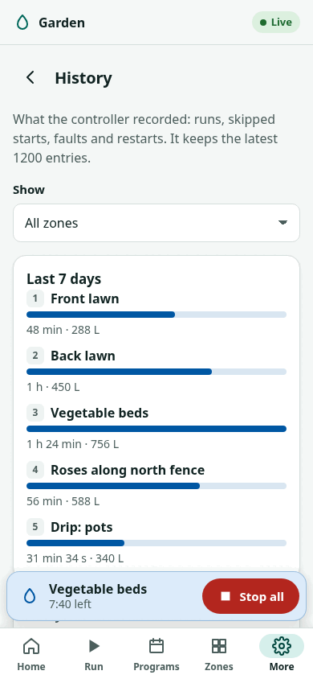
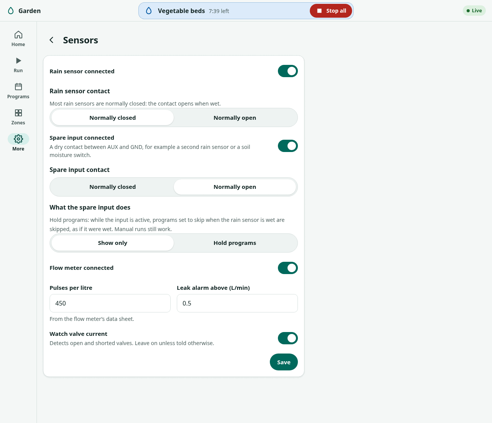
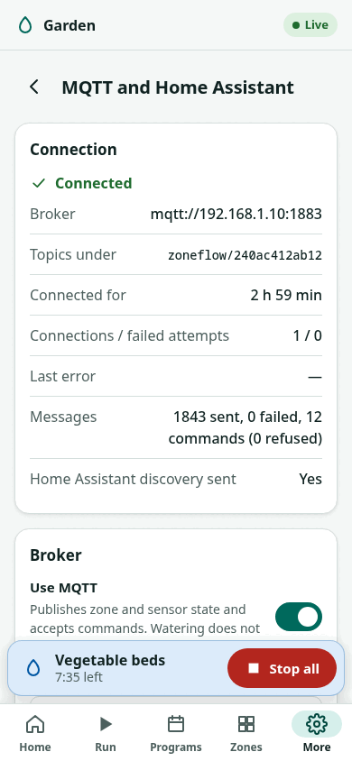

# Standalone firmware

!!! warning "Written from the design; not yet verified on hardware"
    The standalone firmware (`firmware/zoneflow-fw/`) is written and builds
    in CI; its logic is covered by host tests on a PC. Nothing has run on a
    board. The web interface on this page has run only against a mock
    controller (`firmware/zoneflow-fw/web/mock/`) that follows the
    [API](api.md). Expect details to change once it runs on hardware. Work
    is tracked in [issue #6](https://github.com/syntroniks/zoneflow/issues/6);
    the design is in [firmware architecture](../design/firmware-architecture.md)
    and [firmware security](../design/firmware-security.md).

The standalone firmware runs the controller on its own: zone driver with the
safety limits, scheduler, current and flow diagnostics, the
[display interface](../guide/display.md), WiFi setup over Bluetooth LE or a
setup access point, this web interface, a [REST API](api.md) with a live
event stream, [MQTT with Home Assistant discovery](mqtt.md), and updates
over the network with rollback.

## Using the web interface

Open `http://zoneflow-xxxx.local/` or the controller's IP address in a
browser on the same network. The display shows both under
**Menu → Setup → Network**.
The interface is served by the controller itself and works without internet.
It follows the phone's light or dark setting and works from 320 px wide.

<figure markdown>
{ width="300" }
{ width="300" }
<figcaption>Dashboard while a program runs.</figcaption>
</figure>

### First visit

The first visit sets up the controller in three steps:

1. **Admin password.** Type the 10-character setup code, then choose a
   password of 8 to 64 characters. The setup code proves you have the
   controller in hand; the API never returns it. Where to find it:
   [joining your network](../getting-started/provisioning.md#before-you-start).
   If you set the password on the setup access point's page, this step is
   skipped.
2. **Time zone.** The browser's own zone is suggested. Start times follow
   local time, including summer time.
3. **Zones.** How many valves are wired, and a name for each.

{ width="300" }

If you leave after setting the password, the time zone and zone steps come
back on your next visit until you finish them or choose **Skip setup for
now**.

Anyone on your network can look at the status without signing in (turn on
**Settings → Password and security → Require sign-in to view** to change
that). Changing anything asks for the password. Every restart of the
controller, including after an update, signs everyone out.

### Dashboard

The top card says what is watering, how long is left, which program started
it and what comes next. **Stop all** is always one tap away: on other pages
it moves to a bar above the navigation (on a computer, into the top bar).
**Pause** closes the valve and keeps the remaining time; a paused queue stops
by itself after the pause timeout (default 2 hours), so watering never
restarts by surprise. **Skip to next** ends the current zone.

When nothing is watering, the card shows the next scheduled start.

**Needs attention** lists faults in plain words with what to check, for
example a valve that draws no current (check the wire and the solenoid), a
short circuit, missing 24 V AC, a zone resting after its maximum run time or
a wet rain sensor. **Clear faults** releases latched faults and lockouts
after a confirmation; a fault whose cause is still there comes back at once.

The **zone tiles** show each zone's state. Tap one to run it.

If the page loses its connection to the controller it says so at the top
and greys the live values: what you see is the last known state, not the
current one. It reconnects by itself.

{ width="300" }

### Run a zone or a program by hand

**Run** → choose the zone → **Start**. The duration you used last time is
already selected. The **Program** tab runs a whole program now. A manual run
joins the queue behind whatever is watering.

The controller can refuse: a zone locked out by a fault, a zone resting
after its maximum run time ("try again in 12 min"), a locked-out master
valve, or no 24 V AC. The reason is shown in plain words.

{ width="300" }
{ width="300" }

### Programs

A program waters its zones one after another, from up to four start times a
day, on chosen weekdays, every N days, or on odd or even dates. Each zone has
its own run time; 0 leaves it out. **Follow seasonal adjustment** scales the
run times by the percentage in **Settings → Watering**. **Skip when the rain
sensor is wet** applies to scheduled starts only.

The editor shows the **next seven days** of runs, worked out in the browser
with the controller's own rules and time zone, including summer-time
changes, rain delay and the other programs. Programs never overlap: a
program that starts while another runs waits for it.

{ width="300" }

### Zones

Each zone has a name, an on/off switch, a **maximum run time** and current
limits. The controller never keeps a zone open longer than its maximum,
counted across back-to-back runs; after reaching it the zone rests (30
minutes by default). The **default run time** is preselected when you run
the zone by hand, and used when Home Assistant opens it without a duration.
**Test run** opens the valve for 1, 2 or 5 minutes so you can check it in
the garden.

Once a zone has run on its own, the page shows the current its valve drew
(measured since the controller last started). **Set limits around the
measurement** fills in the current limits from it: below the minimum counts
as a broken wire, above the maximum as a shorted valve.

{ width="300" }
{ width="300" }

### Rain delay

**More → Rain delay** skips scheduled programs for 12 hours up to 30 days.
Manual runs still work. Needs the clock to be set.

{ width="300" }

### History

**More → History** shows what the controller recorded, newest first and
grouped by day: every watering run (how long it ran out of how long was
planned, which program started it, the valve current and, with a flow meter,
the water used), skipped and missed starts with the reason, faults, restarts
with their cause, and firmware updates. A summary at the top adds up the
watering time and water per zone over the last seven days. Choose a zone to
see only its entries. New entries appear while the page is open.

The controller keeps the latest 1200 entries in its flash memory and writes
them at least once a minute (faults at once), so a power cut loses at most
the last minute.

{ width="300" }

### Settings

| Section | What it does |
|---|---|
| Device | Controller name, and how this browser shows and enters times (automatic, 24-hour or 12-hour). |
| Time | Controller time and its source, time zone, set the clock from the phone when there is no internet. |
| Watering | Seasonal adjustment, zones in use, catch-up of missed starts, pause timeout, rest time, master valve. |
| Sensors | Rain sensor and its contact type, spare input (contact type, and whether it holds programs like the rain sensor), flow meter, valve-current monitoring. |
| Network | WiFi status and signal; change the WiFi network (restarts into setup: a zone that is watering stops and is not resumed, scheduled starts still run while setup waits). The display can do the same: **Menu → Setup → Network → Set up WiFi**. |
| MQTT and Home Assistant | Broker address and port, TLS with public certificate authorities or your own CA certificate, username and password (write-only: the page only says whether one is stored), base topic, Home Assistant discovery with zones shown as valves or switches, and the live connection state. See [MQTT](mqtt.md). |
| Password and security | Change password, require sign-in to view, HTTPS with the certificate fingerprint, host-name check. |
| Backup and restore | Download settings, zones and programs as a file; restore one. WiFi and the admin password are never in a backup. |
| Firmware update | Install `zoneflow-fw.bin` from a file or URL, or a new web interface (`www.bin`). If watering is running you are warned that the update stops it. If the new firmware does not start properly, the controller goes back to the old one. |
| Restart and reset | Restart, and factory reset (type RESET to confirm). |

{ width="300" }
{ width="600" }
{ width="300" }
{ width="300" }
{ width="300" }

Screenshots of every screen, light and dark, phone and desktop, are in
[`docs/firmware/img/webui/`](https://github.com/syntroniks/zoneflow/tree/main/docs/firmware/img/webui).
The developer guide is in
[`firmware/zoneflow-fw/web/README.md`](https://github.com/syntroniks/zoneflow/blob/main/firmware/zoneflow-fw/web/README.md).
