# Standalone firmware

!!! note "Phase 2, never run on hardware"
    `firmware/zoneflow-fw/` has the zone driver, scheduler, configuration and diagnostics (phase 1), and WiFi with BLE and SoftAP provisioning, the [REST API](api.md) with a live event stream, and OTA with rollback (phase 2). The display interface is written and runs in a desktop simulator; see [display interface](../design/display-ui.md). The browser UI, described below, has only run against a mock controller. MQTT is not written yet. Nothing has run on a board; the logic is unit-tested on a PC. Work is tracked in [issue #6](https://github.com/syntroniks/zoneflow/issues/6); the design is in [firmware architecture](../design/firmware-architecture.md) and [firmware security](../design/firmware-security.md).

Planned scope, from the [specification](../design/system-spec.md):

- Zone driver that follows the safety rules (outputs off by default, hardware output-enable, maximum run time)
- Scheduler with programs, start times, weekday, interval and odd-even rules, per-zone durations, seasonal adjustment, rain delay and sensor inhibit. It runs from the RTC when the network is down
- Persistent configuration with a versioned schema
- WiFi provisioning over Bluetooth LE, with a fallback access point
- Local web UI, a documented REST API and a live status stream
- MQTT with Home Assistant discovery
- OTA update with rollback
- Colour display interface driven by the encoder and buttons: zone status, manual run, schedule viewing and editing, rain delay, faults, network setup
- Flow and current diagnostics: per-zone learned current, fault reporting
- Host-side unit tests for the scheduler and other pure logic

## Using the web interface

!!! warning "Shown against a mock controller"
    No board exists yet. The screenshots and the end-to-end tests use a mock
    controller (`firmware/zoneflow-fw/web/mock/`) that follows the
    [API](api.md). Expect details to change once the firmware runs on
    hardware.

Open `http://zoneflow-xxxx.local/` (the last four characters are on the
display) or the controller's IP address in a browser on the same network.
The interface is served by the controller itself and works without internet.
It follows the phone's light or dark setting and works from 320 px wide.

<figure markdown>
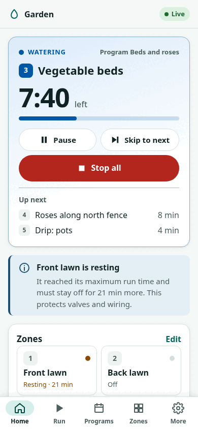{ width="300" }
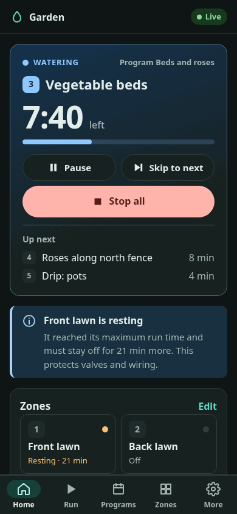{ width="300" }
<figcaption>Dashboard while a program runs.</figcaption>
</figure>

### First visit

The first visit sets up the controller in three steps:

1. **Admin password.** Type the 10-character setup code from the
   controller's display, then choose a password of 8 to 64 characters.
   The setup code proves you are standing at the controller; it never leaves
   it.
2. **Time zone.** The browser's own zone is suggested. Start times follow
   local time, including summer time.
3. **Zones.** How many valves are wired, and a name for each.

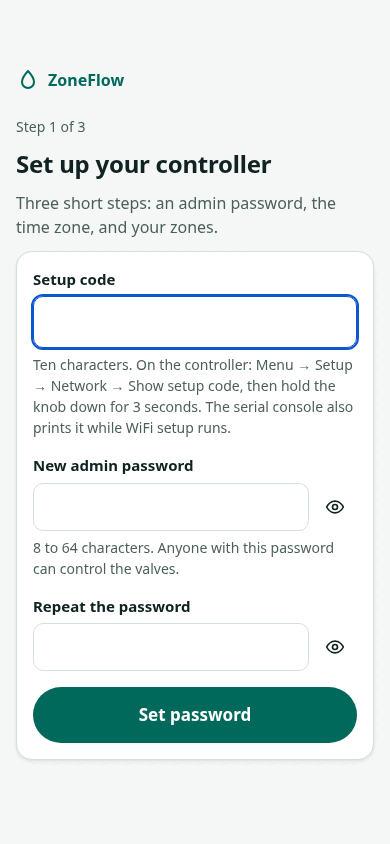{ width="300" }

Anyone on your network can look at the status without signing in (turn on
**Settings → Password and security → Require sign-in to view** to change
that). Changing anything asks for the password. Every restart of the
controller, including after an update, signs everyone out.

### Dashboard

The top card says what is watering, how long is left, which program started
it and what comes next. **Stop all** is always one tap away: on other pages
it moves to a bar above the navigation (on a computer, into the top bar).
**Pause** closes the valve and keeps the remaining time; a paused queue stops
by itself after the pause timeout (default 2 hours), so watering never
restarts by surprise. **Skip to next** ends the current zone.

When nothing is watering, the card shows the next scheduled start.

**Needs attention** lists faults in plain words with what to check, for
example a valve that draws no current (check the wire and the solenoid), a
short circuit, missing 24 V AC, a zone resting after its maximum run time or
a wet rain sensor. **Clear faults** releases latched faults and lockouts
after a confirmation; a fault whose cause is still there comes back at once.

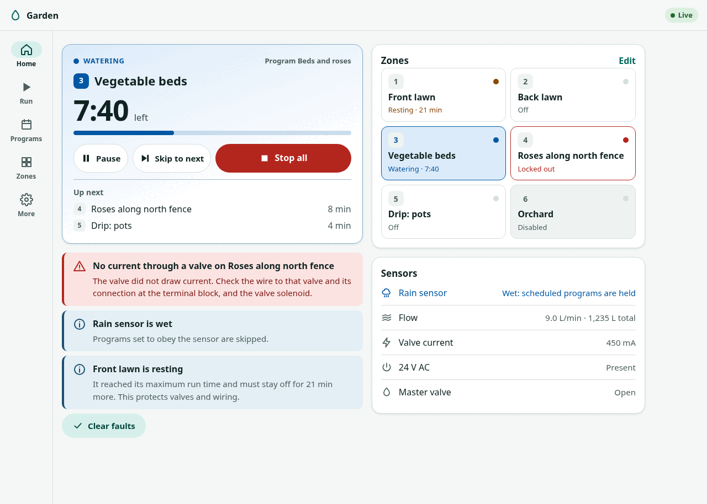

The **zone tiles** show each zone's state. Tap one to run it.

If the page loses its connection to the controller it says so at the top
and greys the live values: what you see is the last known state, not the
current one. It reconnects by itself.

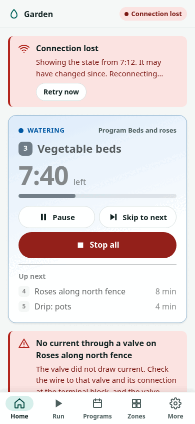{ width="300" }

### Run a zone or a program by hand

**Run** → choose the zone → **Start**. The duration you used last time is
already selected. The **Program** tab runs a whole program now. A manual run
joins the queue behind whatever is watering.

The controller can refuse: a zone locked out by a fault, a zone resting
after its maximum run time ("try again in 12 min"), a locked-out master
valve, or no 24 V AC. The reason is shown in plain words.

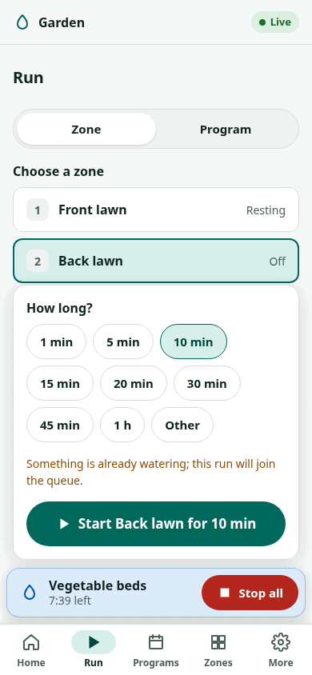{ width="300" }
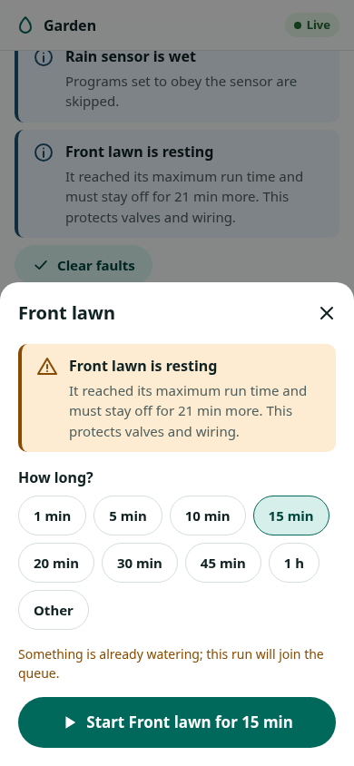{ width="300" }

### Programs

A program waters its zones one after another, from up to four start times a
day, on chosen weekdays, every N days, or on odd or even dates. Each zone has
its own run time; 0 leaves it out. **Follow seasonal adjustment** scales the
run times by the percentage in **Settings → Watering**. **Skip when the rain
sensor is wet** applies to scheduled starts only.

The editor shows the **next seven days** of runs, worked out in the browser
with the controller's own rules and time zone, including summer-time
changes, rain delay and the other programs. Programs never overlap: a
program that starts while another runs waits for it.

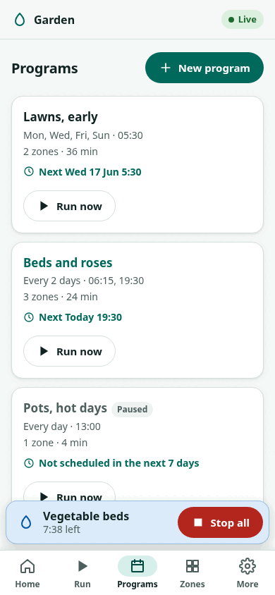{ width="300" }
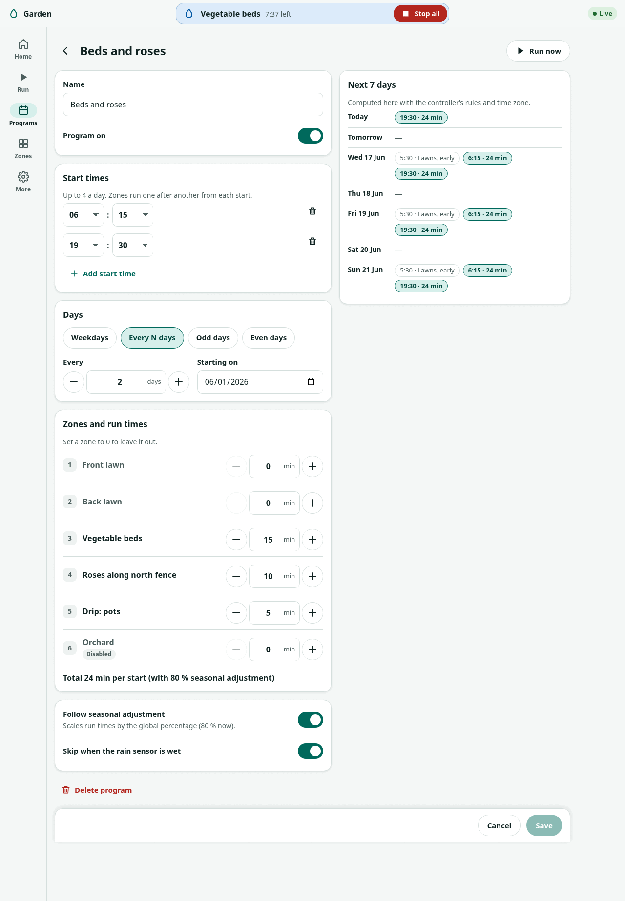

### Zones

Each zone has a name, an on/off switch, a **maximum run time** and current
limits. The controller never keeps a zone open longer than its maximum,
counted across back-to-back runs; after reaching it the zone rests (30
minutes by default). **Test run** opens the valve for 1, 2 or 5 minutes so
you can check it in the garden.

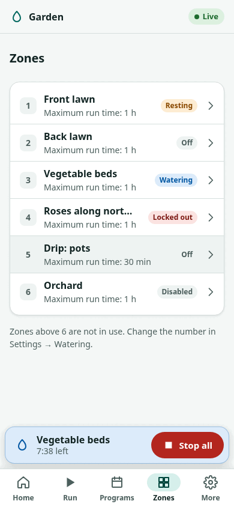{ width="300" }
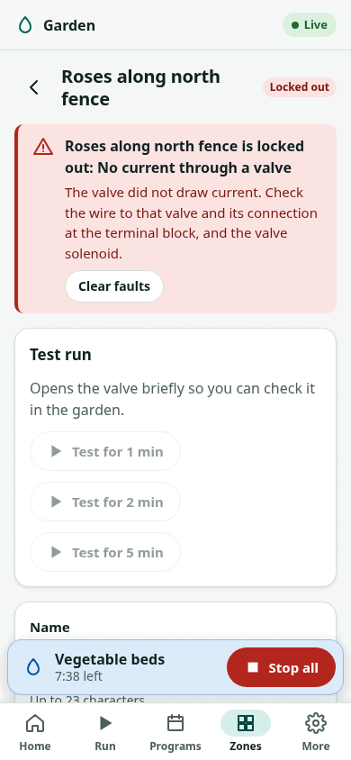{ width="300" }

### Rain delay

**More → Rain delay** skips scheduled programs for 12 hours up to 30 days.
Manual runs still work. Needs the clock to be set.

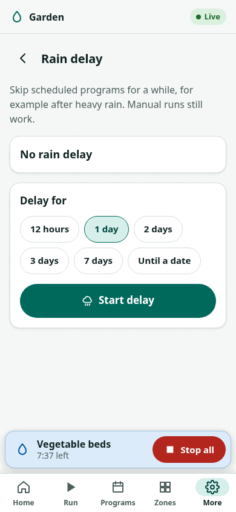{ width="300" }

### Activity

**More → Activity** lists what happened since the page was opened (valves
opening and closing, programs started or skipped, faults). The controller
does not keep a history yet, so a reload starts the list again.

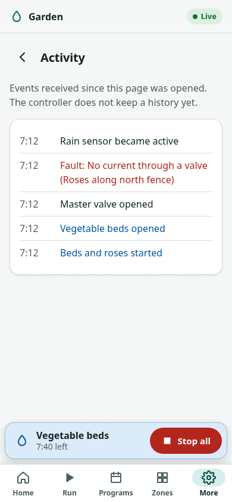{ width="300" }

### Settings

| Section | What it does |
|---|---|
| Device | Controller name. |
| Time | Controller time and its source, time zone, set the clock from the phone when there is no internet. |
| Watering | Seasonal adjustment, zones in use, catch-up of missed starts, pause timeout, rest time, master valve. |
| Sensors | Rain sensor and its contact type, flow meter, valve-current monitoring. |
| Network | WiFi status and signal; change the WiFi network (restarts into setup). MQTT settings are not in this firmware yet. |
| Password and security | Change password, require sign-in to view, HTTPS with the certificate fingerprint, host-name check. |
| Backup and restore | Download settings, zones and programs as a file; restore one. WiFi and the admin password are never in a backup. |
| Firmware update | Install `zoneflow-fw.bin` from a file or URL, or a new web interface (`www.bin`). If watering is running you are warned that the update stops it. If the new firmware does not start properly, the controller goes back to the old one. |
| Restart and reset | Restart, and factory reset (type RESET to confirm). |

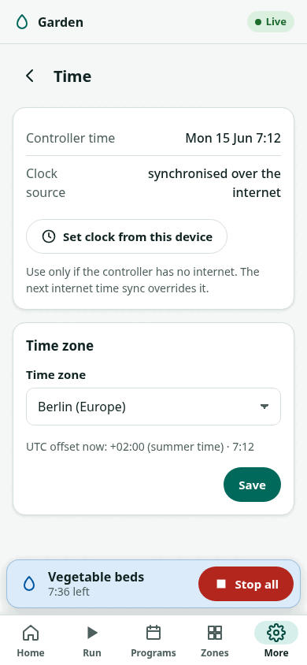{ width="300" }
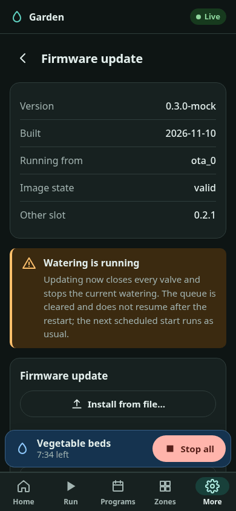{ width="300" }
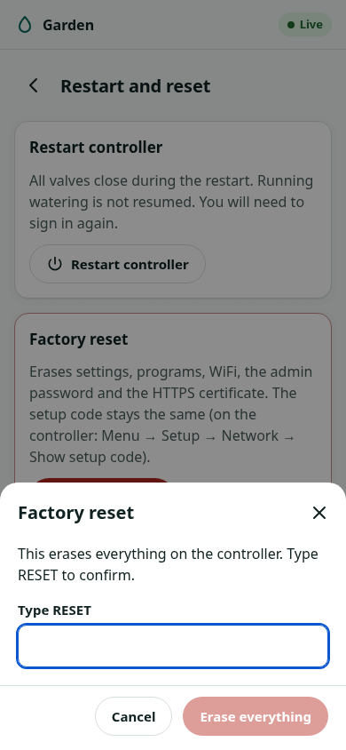{ width="300" }

Screenshots of every screen, light and dark, phone and desktop, are in
[`docs/firmware/img/webui/`](https://github.com/syntroniks/zoneflow/tree/main/docs/firmware/img/webui).
The developer guide is in
[`firmware/zoneflow-fw/web/README.md`](https://github.com/syntroniks/zoneflow/blob/main/firmware/zoneflow-fw/web/README.md).
