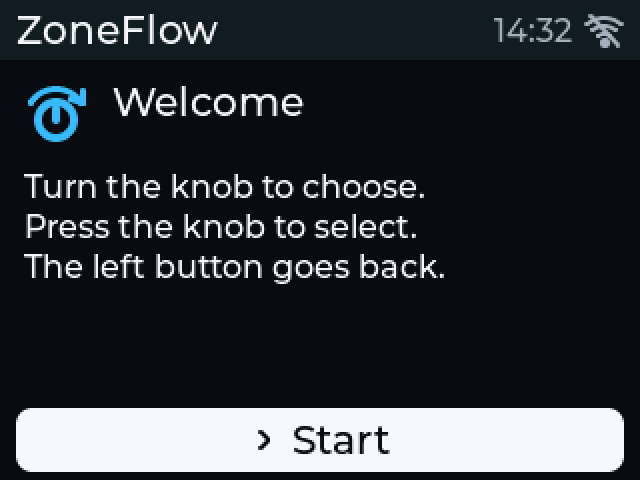
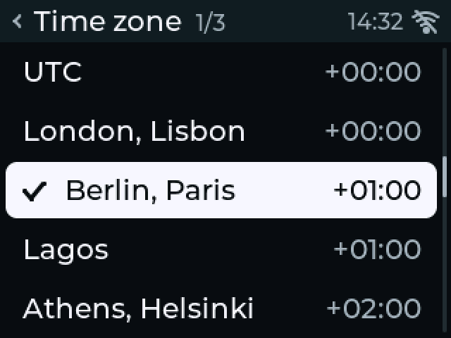
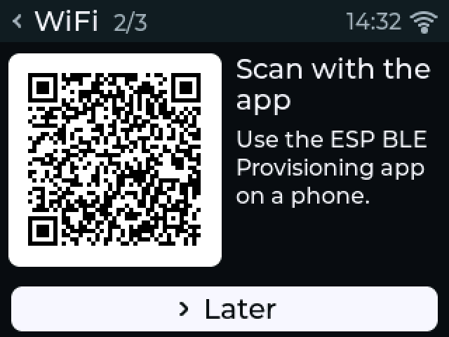
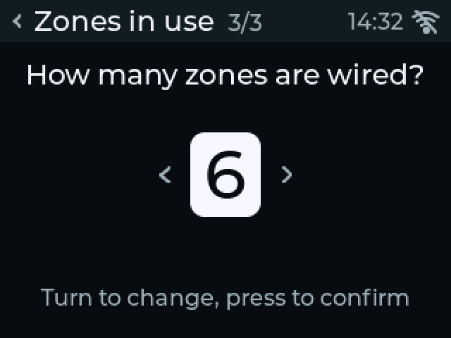
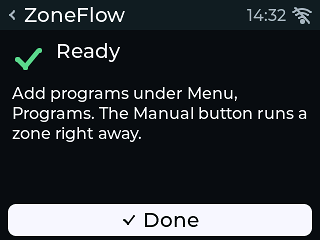
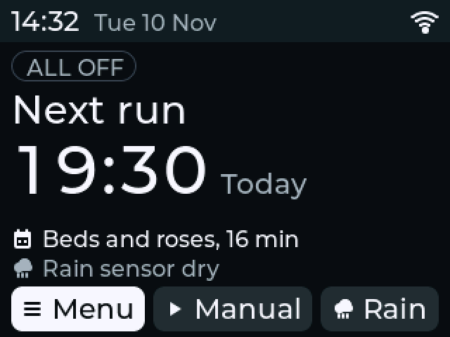
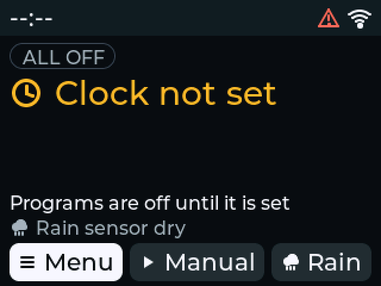
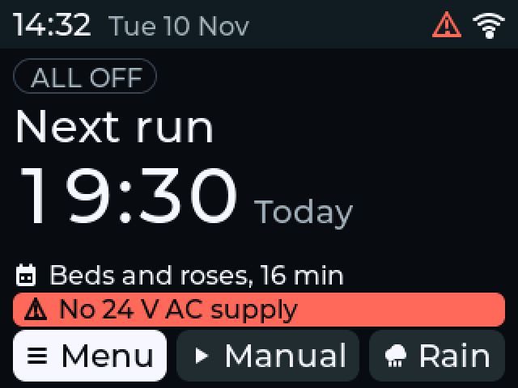

# First power-up

!!! warning "Written from the design; not yet verified on hardware"
    No board has been powered. What the display shows comes from the
    firmware's desktop simulator; what the lights do comes from the
    firmware source. Timings and brightness are unmeasured.

## Before you start

- The board has firmware. If not, [install it](../firmware/web-installer.md) over USB with the 24 VAC plug off.
- The CR2032 cell is in its holder and the display is plugged in ([assembly](../enclosure/assembly.md)).
- The wiring is done and checked ([wiring](wiring.md#check-before-power-up)).
- No USB cable is connected.

## Steps

1. Pull the valve plugs J2 and J3 off the board. The first power-up is with the transformer only.
2. Plug in the transformer.
3. Check that the display lights up and shows the first screen (below).
4. Check that no output light (M, 1 to 8) is on.
5. Check that the status light flashes briefly about every 2 seconds.
6. Go through the setup steps on the display, or press **Later** at the WiFi step and do that part from [joining your network](provisioning.md).
7. Unplug the transformer.
8. Push the valve plugs back on.
9. Plug the transformer in again.
10. Go on to [testing each zone](testing-zones.md) before you set up a schedule.

If something else happens, see [troubleshooting](../troubleshooting.md).

## What the lights mean

The front has ten light pipes: the status light on the left, then M for the
master valve and 1 to 8.

| Light | Standalone firmware | ESPHome |
|---|---|---|
| Status | Short flash every 2 s: running, no fault. On: a valve is open. Fast blink, about five times a second: a fault is latched. | Blinks while a fault is latched |
| M, 1 to 8 | On while that output actually has drive | The same |

The output lights are wired to the real drive in hardware, not to what
firmware asked for: a light is on only when the output's switch is being
fired and the fail-safe allows it. A light does not prove that the valve has
current; the current measurement does that.

On the board, out of sight behind the fascia, a red light (D8) shows that the
hardware over-current cut-off has tripped. Firmware reports the same event
on the display, so you do not need to see it.

## What the display shows: standalone firmware

On first power-up, and after a factory reset, the setup wizard runs. Turn the
knob to choose, press the knob to select, and use the left button (Back) to
go back.

| Welcome | 1. Time zone | 2. WiFi |
|---|---|---|
| { width="260" } | { width="260" } | { width="260" } |

| 3. Zones in use | Done |
|---|---|
| { width="260" } | { width="260" } |

1. **Welcome.** Press the knob on **Start**.
2. **Time zone.** Turn to your city or UTC offset, press. Programs follow local time, summer time included.
3. **WiFi.** The screen shows a QR code for the phone app. Follow [joining your network](provisioning.md), or press **Later**. The controller waters without a network.
4. **Zones in use.** Turn to the number of zone outputs you wired, press.
5. **Done.** Home appears.

Manual/Home does nothing until the wizard is finished. Valves work during
the wizard. Home then looks like this:

{ width="300" }

At start-up, with 24 VAC present, the firmware tests the valve board: both
keep-alive detectors, the output expander and, before each run, the relay
and the outputs. **Menu → Sensors and flow** shows the result on the
**Valve board** row: Testing, then Idle or Ready. A failed test shows as a
fault; see [troubleshooting](../troubleshooting.md#safety-circuit-failed-its-test).

### If the clock is not set

The controller sets its clock from the network, or from the backup clock
once that has been set. On a new board with no network yet, Home says
**Clock not set** and no program starts:

{ width="300" }

Set it by hand under **Menu → Setup → Time → Set the clock**, or connect the
controller to your network. Manual runs work without a clock.

### On USB power alone

USB runs the logic, the display and the radio, but not the valves or the
5 V sensor supply. Home then says **No 24 V AC supply**, valves cannot open,
and the start-up self-test waits until 24 VAC is present.

{ width="300" }

## What the display shows: ESPHome

The ESPHome package has a status screen, not menus: the controller name and
time, the running zone and its time left (or "Idle" and the next scheduled
run), the valve current and flow, and one status line. The status line reads
**Ready** when nothing is wrong, or shows the first fault, no 24 VAC, rain or
a rain delay. The backlight dims after a minute and turns off after five.

!!! note "To be completed"
    A picture of the ESPHome status screen. The package has no simulator;
    the picture will come from the first prototype (follow the
    [progress log, issue #1](https://github.com/syntroniks/zoneflow/issues/1)).

Next: [joining your network](provisioning.md).
