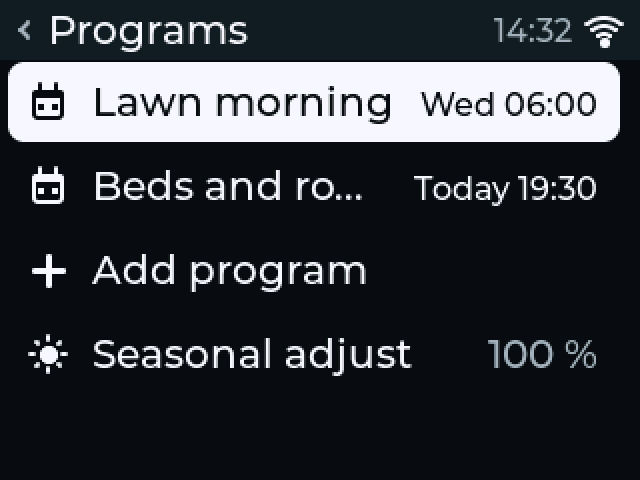
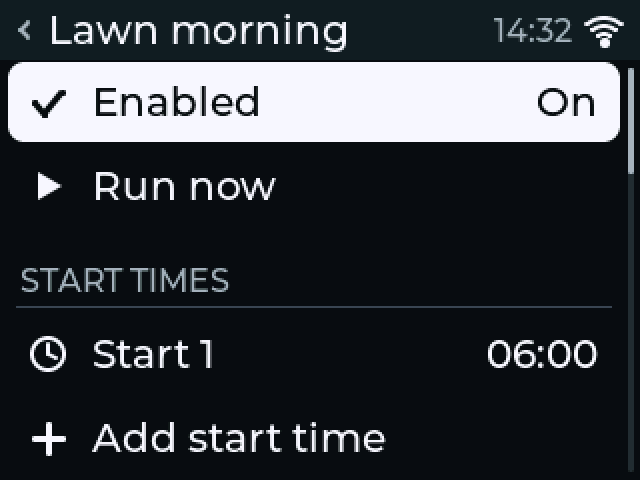
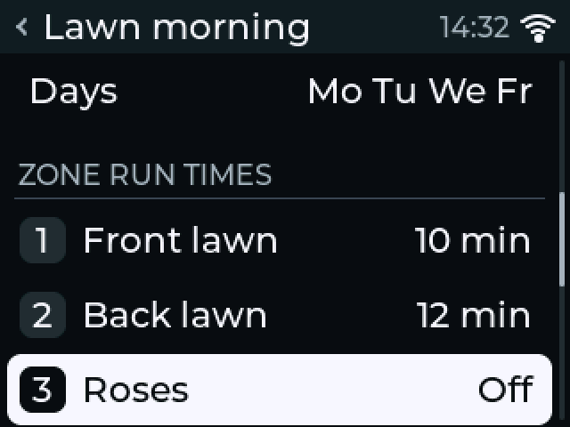
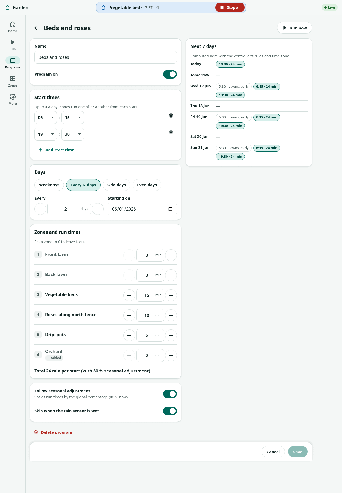

# First schedule

!!! warning "Written from the design; not yet verified on hardware"
    The display steps follow the desktop simulator, the web steps the web
    interface running against a mock controller, and the Home Assistant
    steps the ESPHome package's entity list. None has run on a board.

A **program** waters a list of zones one after another, each for its own run
time, starting at set times on set days. Make one program per watering
pattern, for example "Lawn" every two days at 06:00 and "Beds" on Monday,
Wednesday and Friday at 19:30.

The clock must be set before any program starts. If Home says **Clock not
set**, see [first power-up](first-power-up.md#if-the-clock-is-not-set).

Pick one of the three ways below. The first two are for the standalone
firmware, the third for the ESPHome package.

## From the display (standalone firmware)

Every value on the display is set the same way: press the row, turn the
knob to change the value, press to confirm.

| Programs | A program | Its zones |
|---|---|---|
| { width="260" } | { width="260" } | { width="260" } |

1. On Home, turn to **Menu** and press.
2. Choose **Programs**.
3. Choose **Add program**. The new program opens.
4. Under **START TIMES**, choose **Add start time**.
5. Turn to the hour and press. Turn to the minutes, in steps of five, and press.
6. Under **DAYS**, choose **Runs on** and pick **Weekdays**, **Interval**, **Odd dates** or **Even dates**.
7. For **Weekdays**: choose **Days**, turn to a day, press to switch it on or off, repeat, then press **OK**. For **Interval**: choose **Every** and set the number of days.
8. Under **ZONE RUN TIMES**, choose each zone that should water and set its minutes. Zero ("Off") leaves the zone out.
9. Under **OPTIONS**, set **Rain sensor** to **Obey** if you have one connected, and leave **Seasonal adjust** as it is for now.
10. Press **Back**. The display asks whether to save. **Save** is focused: press the knob.

The program list now shows when it starts next, and Home shows the next run.

Notes:

- An interval of "every 3 days" set today runs today's later start times, then every third day.
- A start time turned below 00 reads "Off" and is removed.
- A program with no start time, no zone or no day can be saved; it says so at the top of its screen and never runs.
- Names are set in the web interface. On the display a new program is "Program 1", "Program 2" and so on.

## From the web interface (standalone firmware)

1. Open the controller's page and sign in.
2. Choose **Programs**.
3. Choose **New program**.
4. Type a **Name**.
5. Under **Start times**, choose **Add start time** and set the time. Add up to four.
6. Under **Days**, choose **Weekdays**, **Every N days**, **Odd days** or **Even days**, and set the days.
7. Under **Zones and run times**, set the minutes for each zone. Leave a zone at 0 to leave it out.
8. Switch on **Skip when the rain sensor is wet** if you have one connected. Leave **Follow seasonal adjustment** as it is for now.
9. Check **Next 7 days**. It lists the runs the controller will make, worked out with its own rules and time zone.
10. Choose **Save**.

A program that starts while another runs waits for it: programs never
overlap. The controller holds at most 16 programs.

## From Home Assistant (ESPHome package)

The package has three programs, A, B and C, each with two start times. They
run on the controller; Home Assistant only sets them.

1. In Home Assistant, open the ZoneFlow device.
2. Set each zone's **Zone N run duration** in minutes. That is the time a zone runs in a program at 100 %.
3. Set **Program A start 1** to the start time.
4. Choose **Program A days**: Every day, Weekdays, Weekends, Odd days, Even days, Every 2 days, Every 3 days, or Custom. For Custom, switch on the days under **Program A Sunday** to **Saturday**.
5. Set **Program A zones** to `all`, or to zone numbers such as `1, 2, 5`.
6. Leave **Program A run time** at 100 %, or change it to scale every zone's duration for this program.
7. Switch on **Program A enabled**. Programs are off by default.
8. To add a second start, set **Program A start 2** and switch on **Program A start 2 enabled**.
9. Check **Next scheduled run**. It shows the next start, for example `Sat 06:00 Program A`.

**Schedule status** says what the scheduler did last, for example
`Program A skipped: rain sensor`. Set the time zone with the `timezone`
substitution in your device file, or programs follow UTC.

With the standalone firmware and MQTT, Home Assistant shows the programs and
can switch them on and off and run them, but programs are edited on the
display or in the web interface. See [MQTT and Home Assistant](../firmware/mqtt.md).

## Seasonal adjustment

Seasonal adjustment scales the run times of every program that follows it,
so you can water less in spring and more in summer without editing each
program.

- Display: **Menu → Programs → Seasonal adjust**, in steps of 5 %.
- Web interface: **Settings → Watering**.
- ESPHome: **Seasonal adjustment**, a multiplier from 0 to 2.5.

The zone's maximum run time still applies to the adjusted time.

## Rain delay

A rain delay skips scheduled starts for a while. Manual runs still work.

- Display: on Home, choose **Rain**, then 6 h, 12 h, or 1 to 14 days.
- Web interface: **More → Rain delay**, from 12 hours to 30 days.
- ESPHome: **Rain delay**, in hours.

Next: [testing each zone](testing-zones.md).
