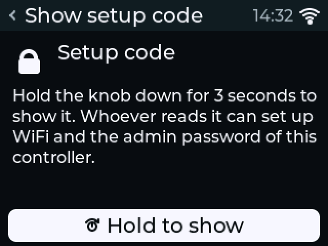
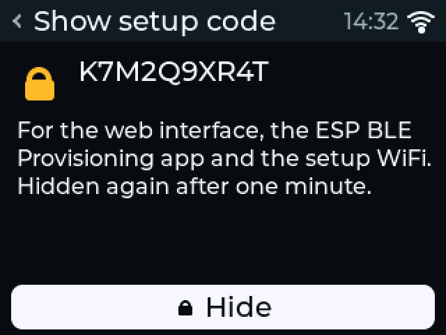
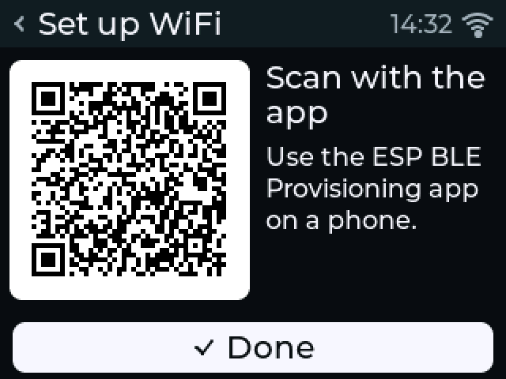
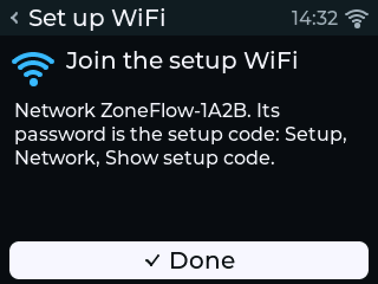
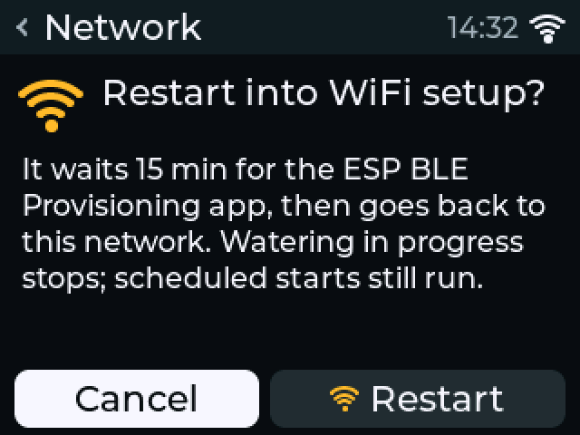

# Joining your network

!!! warning "Written from the design; not yet verified on hardware"
    No board exists, so none of these steps has been tried with a real
    phone, app or router. The steps follow the firmware source and the
    [firmware security](../design/firmware-security.md) design.

The controller waters on schedule without a network, so you can do this at
any time. The two firmwares join a network in different ways:

- [Standalone firmware](#standalone-firmware): Espressif's phone app over Bluetooth LE, or a setup access point.
- [ESPHome](#esphome): Improv over the USB cable or over Bluetooth LE.

## Standalone firmware

### Before you start

- A **2.4 GHz** WiFi network. The ESP32-S3 has no 5 GHz radio. WPA2 or WPA3 personal, or an open network. Mesh networks are fine: the controller does not lock to one access point or channel.
- A phone with the **ESP BLE Provisioning** app (Espressif Systems; Android and iOS), or a phone or laptop that can join a WiFi network.
- The controller's **setup code**: 10 characters, capital letters and digits, never 0, O, 1 or I. The controller makes it at first boot and keeps it for good; a factory reset does not change it.

Where to find the setup code:

- **On the display, as text.** Open **Menu → Setup → Network → Show setup code** and hold the knob down for 3 seconds. A short press is not enough, so a brush against the knob does not show it. The code stays on screen for one minute, until the screen dims, or until you press **Hide** or leave the screen. Holding the knob at the controller is the proof that you may see it; see [security for home users](../guide/security.md).
- **Inside the QR code** on the display, while Bluetooth setup runs. The provisioning app reads it from there. Any QR reader shows it too: the QR code holds a short text with the device name, the user name `wifiprov`, the setup code (`pop`) and the transport.
- **On the USB serial console**, while setup runs. Connect a computer by USB (read the [USB rules](../safety.md#usb-and-earthing) first) and open a serial monitor.

{ width="300" }
{ width="300" }

### Path 1: Bluetooth with the phone app (default)

A controller with no WiFi settings advertises over Bluetooth LE as
`ZoneFlow-XXXX` for **10 minutes** after power-up. `XXXX` is the last four
hex digits of its MAC address. The display shows the QR code during that
time, in the wizard's WiFi step or under **Menu → Setup → Network → Set up WiFi**.

{ width="300" }

1. Open the ESP BLE Provisioning app and choose to provision a new device.
2. Scan the QR code on the display.
3. Choose your network in the app.
4. Type the network's password.
5. Wait until the app reports success. The display then shows the network and the controller's address.

The app sends the password over an encrypted session that only someone with
the setup code can open (ESP-IDF Security 2). If the password was wrong, the
app says so, and you can try again: the controller keeps advertising.

Without the QR code, pick `ZoneFlow-XXXX` in the app's device list and type
the setup code when the app asks for the "proof of possession". Some app
versions list only devices whose name starts with a set prefix (the default
is reported as `PROV_`; not checked): set the prefix to `ZoneFlow` in the
app's settings, or use the QR code.

After success the controller turns Bluetooth off and frees its memory until
the next setup.

From a computer, the ESP-IDF `esp_prov` tool works too:

```sh
python $IDF_PATH/tools/esp_prov/esp_prov.py --transport ble \
    --service_name ZoneFlow-AB12 --sec_ver 2 \
    --sec2_username wifiprov --sec2_pwd K7Q2M9XW4R \
    --ssid "Your network" --passphrase "your wifi password"
```

### Path 2: the setup access point

If no phone has opened a Bluetooth setup session with the setup code within
10 minutes, the controller switches to a WiFi access point and stays there
until it is set up. A Bluetooth session that stays open keeps Bluetooth up
for at most 30 minutes.

The display shows the network's name under **Menu → Setup → Network → Set up WiFi**:

{ width="300" }

1. On a phone or laptop, join the WiFi network `ZoneFlow-XXXX`. Its password is the setup code (**Show setup code** on the display).
2. Wait for the setup page to open by itself ("sign in to network"). If it does not, browse to `http://192.168.4.1/`.
3. Pick your network and type its password.
4. Choose an admin password for the controller, 8 to 64 characters. Set it here: until one is set, anyone on your network who knows the setup code can set it.
5. Press **Connect**.
6. Wait for the page to report that the controller has joined your network and to show its address, `http://zoneflow-xxxx.local/`. The access point then closes.

The **ESP SoftAP Provisioning** app (Espressif) also works on this access
point with the same setup code.

!!! warning "The setup page is plain HTTP inside the access point"
    The WiFi password and the admin password cross the access point's
    WPA2 link, whose key is the setup code. Someone who records a phone
    joining the access point can try to guess the setup code offline. See
    [security for home users](../guide/security.md).

### After joining

1. Open `http://zoneflow-xxxx.local/` in a browser on the same network. If that name does not open, use the IP address your router shows, or the one on the display under **Menu → Setup → Network**.
2. If you did not set an admin password on the setup page, the web interface asks for the setup code and a new password on the first visit. Nothing can be changed over the network until a password is set.
3. Finish the first-visit steps: time zone and zones. See [the web interface](../firmware/standalone.md#first-visit).

### Changing networks later

On the controller, which works when the WiFi is what is broken:
**Menu → Setup → Network → Set up WiFi**. The display asks "Restart into
WiFi setup?" with **Cancel** focused; choose **Restart**.

{ width="300" }

From the web interface: **Settings → Network → Change WiFi network**. The
REST API equivalent is `POST /api/v1/network/reprovision` with
`{"transport": "ble"}` or `{"transport": "softap"}`.

1. Start it from the display (Bluetooth), or choose **Set up over Bluetooth** or **Set up over the controller's own WiFi** in the web interface and confirm. The controller restarts into setup.
2. Follow path 1 or path 2 above. After the restart, **Set up WiFi** shows the QR code.
3. The stored network stays until new settings work. If nobody completes setup within **15 minutes** (30 at most while a phone keeps a setup session open), the controller goes back to the stored network.

What happens to watering:

- **A zone that is watering stops at the restart and is not resumed.** The rest of that program's zones do not run either: its start counts as used, so it is not caught up after the restart.
- **Scheduled starts still run while setup waits**, as long as the clock is set. The controller cannot reach a time server during setup, so after the restart the time comes from the battery-backed clock. If that clock has no valid time (no battery, or it lost the time), no program starts until the clock is set, and the display shows "Clock not set". Manual runs work in either case.

Holding **Manual/Home** still stops every valve, as on every screen.

### If it does not work

| Symptom | Check |
|---|---|
| The app does not find the device | More than 10 minutes since power-up: use the setup access point, or unplug and plug in again. Bluetooth on in the phone; location permission on Android. |
| The app reports a wrong proof of possession | Type the setup code again. It has no 0, O, 1 or I. |
| "AP not found" | The network is 5 GHz only, or the name was mistyped (capitals count). |
| Joined, but `zoneflow-xxxx.local` does not open | Some networks block mDNS. Use the IP address from your router or the display. |

## ESPHome

The ESPHome package has no setup code and no Espressif app. It uses Improv.

### Over the USB cable, while flashing

The [web installer](../firmware/web-installer.md) offers WiFi setup over the
cable (Improv Serial) right after flashing.

1. Flash the ESPHome firmware with the installer, 24 VAC plug off.
2. When the installer offers it, choose **Connect to WiFi**.
3. Pick the network and type its password.

### Over Bluetooth LE

1. Press **Home** (the right button) on the controller. Improv over Bluetooth is allowed for two minutes after the press.
2. Open an Improv client on a phone or computer and connect to the controller.
3. Pick the network and type its password.

### Fallback access point

If neither works, the controller opens a WiFi access point called
**ZoneFlow setup**. Join it and choose your network on the page it opens.

### Adopt it in Home Assistant

Home Assistant finds the controller on the network. Adopt it in the ESPHome
dashboard, which writes a device file that uses the ZoneFlow package from
GitHub. See [ESPHome](../firmware/esphome.md#install).

The fallback access point has no password (the package sets none in
`wifi: ap:`), so anyone in WiFi range can choose a network for the
controller while it is open. It opens only when the controller cannot join
a stored network. If that matters to you, add `password:` under `wifi: ap:`
in your device file.

!!! note "To be completed"
    The Home Assistant screens for adoption will be checked on the first
    prototype (follow the [progress log, issue #1](https://github.com/syntroniks/zoneflow/issues/1)).

Next: [first schedule](first-schedule.md).
