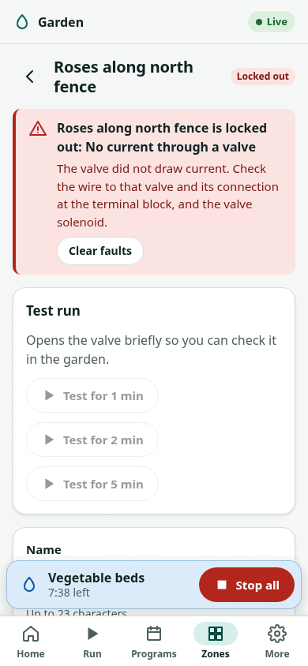

# Testing each zone

!!! warning "Written from the design; not yet verified on hardware"
    The current figures below are the firmware's default limits, not
    measurements of real valves.

Run every valve once, by itself, before you rely on a schedule. This checks
the wiring and gives the controller a current reading for each valve.

## What a test run shows

- The valve opens in the garden.
- The output light for that zone comes on.
- The controller measures the valve current. With nothing else on, that reading belongs to that valve alone.

Both firmwares compare the current with a window, by default **80 to 700 mA
per output**, after 500 ms of inrush. Below the window counts as an open
circuit; above it as over-current. See [troubleshooting](../troubleshooting.md)
if a zone reports either.

!!! note "Master valve"
    With a master valve, its current is in the same measurement: the board
    measures one total current. The reading for a zone then includes the
    master. A master that draws more than 80 mA hides an open zone wire
    from the lower limit, so set each zone's minimum close to its measured
    current once you have it (below).

## From the display (standalone firmware)

1. On Home, turn to **Menu** and press.
2. Choose **Zones**, then the zone.
3. Choose **Test run** and set 1 to 10 minutes.
4. Press. The run starts and Home shows it.
5. Check the valve in the garden.
6. Back on the zone's screen, read **Last current**.
7. Repeat for every zone.

To stop a run at once, hold the right button (Manual/Home) for 0.8 seconds
on any screen, or press **Stop** on Home.

## From the web interface (standalone firmware)

{ width="300" }

1. Choose **Zones**, then the zone.
2. Under **Test run**, choose 1, 2 or 5 minutes.
3. Check the valve in the garden.
4. When the run has ended, the page shows "Measured: ... mA with this zone open alone".
5. Choose **Set limits around the measurement**. This sets the minimum to half and the maximum to 1.6 times the measured current.
6. Choose **Save**.
7. Repeat for every zone.

The measurement is kept until the controller restarts.

## From Home Assistant (ESPHome package)

1. Open the **Zone N** valve entity and open it. The zone runs for its **Zone N run duration**.
2. Check the valve in the garden.
3. Read **Zone N current** after the run. It is the mean current of the last run with no other output changing.
4. Repeat for every zone.
5. To narrow the window for a zone, set `min_current` and `max_current` for it through `zone_overrides` in the `zoneflow:` block of your device file.

You can also start a zone from the controller: turn the knob to the zone and
press. It runs for its run duration. **Back**, with nothing chosen, stops everything.

## Write down the results

Keep a note of each zone's current. A later reading that has dropped
towards zero, or risen well above it, points to a wiring or solenoid fault
before the controller has to report one.

!!! note "To be completed"
    Typical readings for common valves, and how close the limits can be
    set, will be added from the prototype's measurements (follow the
    [progress log, issue #1](https://github.com/syntroniks/zoneflow/issues/1)).
