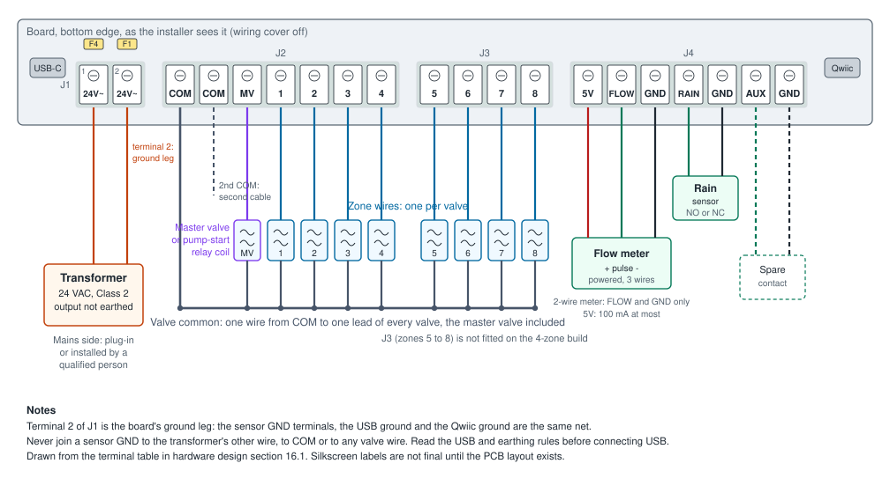

# Wiring

!!! warning "Written from the design; not yet verified on hardware"
    The terminal order and names come from
    [hardware design section 16.1](../design/hardware-design.md#161-terminal-blocks)
    and the schematic. The PCB layout is not finished, so the silkscreen
    labels are not final: compare them with this page when you have a board.

!!! danger "Before you start"
    - The transformer is unplugged.
    - No USB cable is connected.
    - You have read the [USB and earthing rules](../safety.md#usb-and-earthing).

Select the diagram to open it full size.

## The terminals

All field wiring goes to four pluggable screw-terminal blocks along the
bottom edge of the board, left to right as you look at the open wiring
compartment. Pull each plug off the board, wire it in your hand, and push it
back. The USB-C socket is at the left end of the row and the Qwiic socket at
the right end.

| Block | Terminal | Label | Connect | Notes |
|---|---|---|---|---|
| J1 | 1 | 24V~ | Transformer, first wire | Through fuse F4 |
| J1 | 2 | 24V~ | Transformer, second wire | Through fuse F1. This wire becomes the board's ground. |
| J2 | 1 | COM | Valve common wire | |
| J2 | 2 | COM | Second common wire | Only if a second cable needs its own common |
| J2 | 3 | MV | Master valve, or pump-start relay coil | Other lead to the common |
| J2 | 4 to 7 | 1 to 4 | Zone valves 1 to 4 | Other lead to the common |
| J3 | 1 to 4 | 5 to 8 | Zone valves 5 to 8 | Not fitted on the 4-zone build |
| J4 | 1 | 5V | Flow meter supply | Current-limited, 100 mA usable, off on USB power |
| J4 | 2 | FLOW | Flow meter pulse output | |
| J4 | 3 | GND | Flow meter ground | |
| J4 | 4 | RAIN | Rain sensor, one wire | |
| J4 | 5 | GND | Rain sensor, other wire | |
| J4 | 6 | AUX | Spare input, one wire | |
| J4 | 7 | GND | Spare input, other wire | |

!!! warning "The two 24V~ terminals are not interchangeable in every installation"
    Terminal 2 is the board's ground. The sensor GND terminals, the USB
    ground and the Qwiic ground are all connected to it. In most homes,
    with a transformer whose output is not earthed, either way round works.
    In the cases listed in [safety](../safety.md#usb-and-earthing) it
    matters. The design asks for terminal 2 to be marked on the silkscreen,
    for example with a ground symbol.

!!! note "To be completed"
    The silkscreen mark on terminal 2 and the final terminal labels come
    with the PCB layout, [issue #5](https://github.com/syntroniks/zoneflow/issues/5).
    This page will then show a photo of the terminal row.

## Wire size and stripping

- The plugs take 0.33 to 1.3 mm² (22 to 16 AWG) wire. Irrigation cable is usually 0.82 mm² (18 AWG).
- Strip enough to fill the terminal clamp and no more. No bare copper should show outside the plug.
- Tighten each screw, then pull the wire gently to check it holds.

!!! note "To be completed"
    The strip length and tightening torque come from the terminal plug's
    drawing, which has not been read in detail. They will be added with the
    first prototype.

## Steps

### 1. Transformer

1. Run the transformer's two wires in through a narrow bottom entry.
2. Connect them to the 2-way plug (J1), one wire to each terminal.
3. If your transformer's output is earthed on one side, or the controller shares the transformer with another device: work out which wire goes to terminal 2 before you go on. [Safety](../safety.md#usb-and-earthing) explains why.
4. Do not plug the transformer in yet.

### 2. Valves

Every valve has two leads. One goes to its zone terminal. The other goes to
the common wire, which goes to COM.

1. Run the valve cable in through a wide bottom entry.
2. At the valve box outdoors, join one lead of every valve to the cable's common wire with waterproof connectors.
3. Join the other lead of each valve to its own wire in the cable.
4. At the controller, connect the common wire to COM on the 7-way plug (J2).
5. Connect each zone wire to its zone terminal: 1 to 4 on J2, 5 to 8 on the 4-way plug (J3).
6. If a second cable has its own common wire, connect it to the second COM terminal.
7. Write down which zone is which. The wiring cover has a recess for a label.

!!! tip "Measure each valve before you connect it"
    With the plug off the board, measure the resistance between COM and
    each zone terminal on the plug. Compare it with the valve maker's data
    for the solenoid. A reading near zero is a short in the wiring or the
    solenoid; a reading of no continuity is a broken wire or a burnt
    solenoid. The repository does not give a resistance range for
    solenoids, so use the maker's figure.

### 3. Master valve or pump-start relay

1. Connect one lead of the master valve, or one terminal of the pump-start relay's 24 VAC coil, to MV.
2. Connect the other lead to the common wire, the same as a zone valve.
3. Tell the firmware a master is connected:
    - Standalone firmware: turn the master valve on under **Settings → Watering** in the web interface. It is off by default.
    - ESPHome: add `master_valve: "true"` under `substitutions:` in your device file. It is off by default.

Both firmwares open the master 1 second before the first zone and close it 2
seconds after the last.

!!! danger "Pump-start relay"
    The MV terminal drives only the relay's 24 VAC coil. The relay's
    contacts switch the pump's own supply, which is often mains. That
    wiring is outside this project and must be done by someone qualified,
    in a separate enclosure if your local rules ask for one. Never bring
    mains into the ZoneFlow enclosure.

### 4. Rain sensor

A rain sensor is a switch. Connect its two wires to RAIN and the GND next to
it, on the 7-way plug (J4). Polarity does not matter.

1. Connect one wire to RAIN and the other to the GND next to it.
2. Find out whether the sensor's contact is **normally closed** (opens when wet, the usual type) or **normally open** (closes when wet). The sensor's data sheet says so.
3. After power-up, set the contact type and turn the sensor on:
    - Standalone firmware: **Settings → Sensors → Rain sensor connected**, then **Rain sensor contact**. The default is normally closed.
    - ESPHome: the `Rain sensor type` select and the `Rain sensor enabled` switch. The sensor is off by default, because a normally-closed setting with nothing connected reads "wet".

Programs skip their scheduled starts while the sensor reads wet, if the
program is set to obey it. Manual runs still work. The input waits for the
reading to stay the same for 2 seconds before it changes state.

### 5. Flow meter

The FLOW input counts pulses up to 200 Hz. A closed contact reads low. Wire
it for the kind of meter you have:

| Meter output | Wires | Connect |
|---|---|---|
| Dry contact (reed switch), 2 wires | Either way round | FLOW and GND |
| Open collector, with its own supply | Signal, ground | Signal to FLOW, ground to GND |
| Powered sensor, 3 wires (for example Hall effect) | Supply, signal, ground | Supply to 5V, signal to FLOW, ground to GND |

1. Wire the meter as in the table. The three flow terminals 5V, FLOW and GND are next to each other for a 3-wire meter.
2. For a powered meter, check that it runs from 4.5 V and draws no more than 100 mA. The 5V terminal is off when the board runs from USB alone.
3. After power-up, enter the meter's pulses per litre (K-factor, from its data sheet):
    - Standalone firmware: **Settings → Sensors → Flow meter connected** and **Pulses per litre**.
    - ESPHome: the `flow_pulses_per_litre` substitution. The default in both is 450.

The firmware raises "Water flows with all valves off" when the meter counts
more than 0.5 L/min for 60 seconds with every valve closed. Both values are
defaults you can change.

### 6. Spare input

AUX and the GND next to it take a dry contact: the spare input.

- Standalone firmware: **Settings → Sensors → Spare input connected**, then
  its contact type and **What the spare input does**: **Show only**, or
  **Hold programs**. With **Hold programs**, programs set to skip when the
  rain sensor is wet also skip while the spare input is active. The
  display shows the state and the choice under **Sensors and flow**. The same
  settings are `sensors.spare` in the [REST API](../firmware/api.md).
- ESPHome: the `Spare input` binary sensor shows its state. The package does
  not hold programs on it; use it in your own automations.

### 7. Expansion (Qwiic)

The Qwiic socket at the right end of the terminal row is a 4-pin JST SH
connector with I2C and 3.3 V. It supplies at most **80 mA**. Its ground is
the board ground, terminal 2 of J1. No firmware uses it yet.

## Check before power-up

1. Every plug is fully home on its header.
2. No strand of wire bridges two terminals.
3. No strand or wire joins the two 24V~ terminals.
4. Nothing from the transformer, COM or a valve wire touches a GND terminal on the sensor plug. COM is the other transformer wire: a connection to GND shorts the transformer and opens F1.
5. Both fuses are seated in the fuse well above the 24 VAC plug.

Then fit the wiring cover and go on to [first power-up](first-power-up.md).
If the board has no firmware yet, [install it](../firmware/web-installer.md)
first, with the 24 VAC plug off.
