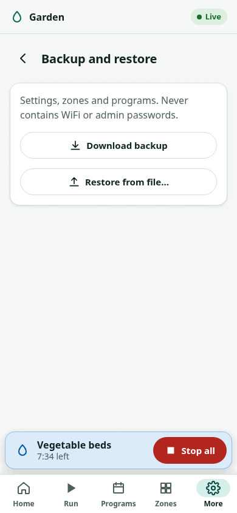

# Backup and restore

!!! warning "Written from the design; not yet verified on hardware"
    Backup and restore are covered by host tests of the firmware's API and
    by the web interface's tests against a mock controller. Neither has run
    on a board.

A backup is a file with the controller's configuration: zones, programs and
settings. Make one before every firmware update and after any large change.

## What a backup holds and what it does not

| In the backup | Never in the backup |
|---|---|
| Zones: names, enabled, maximum run times, current limits, default run times | WiFi network and password |
| Programs | Admin password |
| Watering settings: seasonal adjustment, master valve, rest time, pause timeout | MQTT password and custom CA certificate |
| Sensor settings | Setup code |
| MQTT settings other than the password and certificate | HTTPS key and certificate |
| Time zone, device name | Run history |

After a restore to a new or reset controller you must join it to WiFi and set
its admin password and MQTT password again. This is on purpose: a backup
file never carries a secret. See
[firmware security, section 4.5](../design/firmware-security.md#45-secrets-in-logs-answers-backups-and-dumps).

## Standalone firmware

### From the web interface

{ width="300" }

To back up:

1. Sign in.
2. Open **Settings → Backup and restore**.
3. Choose **Download backup**. The browser saves a JSON file.

To restore:

1. Sign in.
2. Open **Settings → Backup and restore**.
3. Choose **Restore from file…** and pick the backup file.
4. Confirm. Every setting, zone and program is replaced by the backup's. WiFi and the admin password stay as they are.

A backup made by newer firmware is refused by older firmware
(`unsupported_schema`). Update the firmware first, then restore.

### From a computer

`zfflash` does the same over the network:

```sh
cd tools/zfflash
uv run zfflash backup  --host zoneflow-ab12.local --out zoneflow-backup.json
uv run zfflash restore --host zoneflow-ab12.local --file zoneflow-backup.json
```

The admin password is read from the `ZF_PASSWORD` environment variable, or
asked for. The REST API routes are `GET /api/v1/config/backup` and
`POST /api/v1/config/restore`; see the [API reference](../firmware/api.md).

A backup can be read by anyone on your network unless **Require sign-in to
view** is on. It holds no passwords, but it does show your zones and
schedule. See [security for home users](security.md).

## ESPHome

The ESPHome package keeps its configuration in your device file and in Home
Assistant. Back up the device file with your other ESPHome files. Program
settings you set from Home Assistant (start times, days, zones) are entities
on the controller, not lines in the device file.

The controller keeps these entity values in its own flash, so they survive
a restart and an update, but not a replacement board: a new controller
starts with the package defaults (`firmware/esphome/zoneflow/program.yaml`:
every program off, start 1 at 06:00, start 2 at 18:00 and off, every day,
all zones, 100 %). The package has no export for them, by
decision: Home Assistant already holds every value. To move them, note the
`Program …` entities of the old controller (start times, days, zones, run
time, enabled), adopt the new controller with the same device file, and set
the same values on its entities. Zone names, the maximum run time, the
master valve and the flow meter are substitutions in the device file and
move with it.
