# The display

!!! warning "Written from the design; not yet verified on hardware"
    Every picture on this page comes from the firmware's desktop simulator,
    which runs the display code against the real controller core with fake
    hardware. No panel has shown it yet. Colours, brightness and the feel of
    the knob need a board. The design reasons are in
    [display interface](../design/display-ui.md).

This page is for the **standalone firmware**. The ESPHome package has a
simpler status screen; see [ESPHome, display and controls](../firmware/esphome.md#display-and-controls).

## Controls

There is no touch screen. Three controls do everything.

| Control | Action | Does |
|---|---|---|
| Knob | Turn | Moves the white bar to another row or button. In a value picker, changes the value. |
| Knob | Press | Selects. In a picker, confirms. |
| Back (left button) | Press | One level up. In a picker, cancels. |
| Back | Hold | Climbs out of the menus, one level every 0.4 s. |
| Manual/Home (right button) | Press | On Home: opens Manual run. Anywhere else: goes Home. |
| Manual/Home | Hold 0.8 s | **Stops all valves**, from any screen. |

Rules that hold on every screen:

- The item the knob acts on is drawn dark on a white bar.
- Lists stop at their ends. Spin to the top or bottom without looking.
- With the screen dimmed or dark, the first turn or press only wakes it.
- Questions that erase something open with **Cancel** selected.
- After 90 seconds without input the display goes back Home, unless a program has unsaved changes or the setup wizard is running.
- In value pickers, turning fast takes bigger steps: a run time of 45 minutes is a flick of the knob.

## Home

Home answers: is water running, where and for how long, what comes next, is
anything holding the schedule back, and is anything wrong.

| Idle | Watering, program | Watering, one zone |
|---|---|---|
| 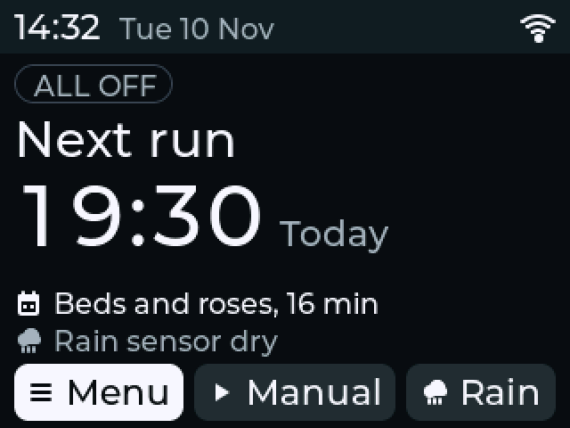{ width="260" } | 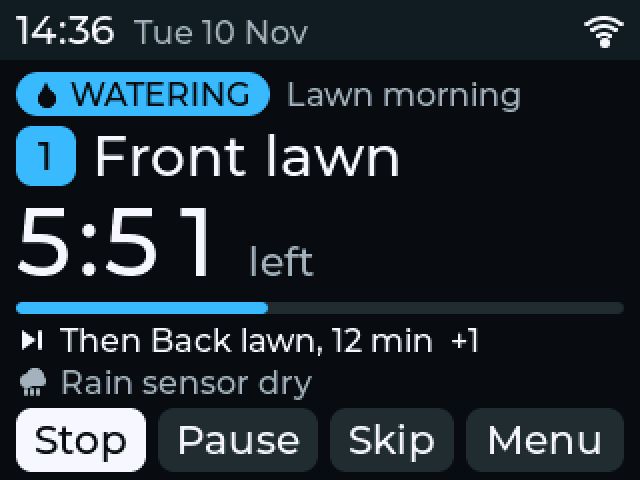{ width="260" } | 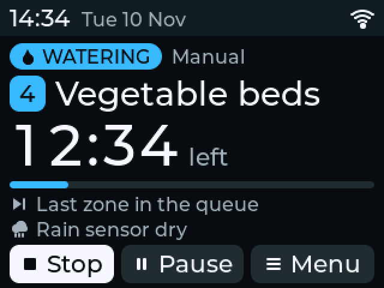{ width="260" } |

- **Top bar:** clock, date, WiFi, rain hold and a fault mark.
- **State chip:** `ALL OFF` in grey, `WATERING` in blue with the program name or "Manual", `PAUSED` in amber. A filled chip means "look".
- **Large numbers:** the next start when idle, the time left when watering.
- **Lines below:** what runs next, rain delay, rain sensor, missing supply, faults.
- **Buttons:** Menu, Manual, Rain when idle. Stop, Pause, Skip (if something is queued) and Menu while watering. Stop is first and selected.

The display shows only what the controller core reports. It never shows
"off" while a valve is open. On every other screen a blue chip in the top bar
shows the running zone and its time left.

Other states:

| Paused | Rain delay | Rain sensor wet |
|---|---|---|
| 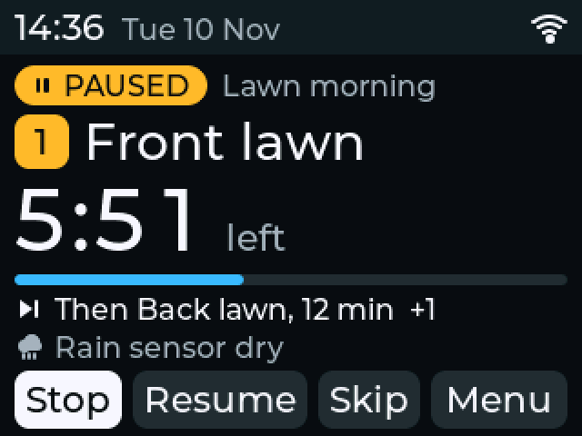{ width="260" } | 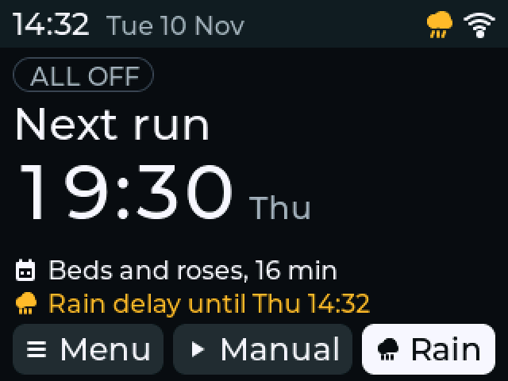{ width="260" } | 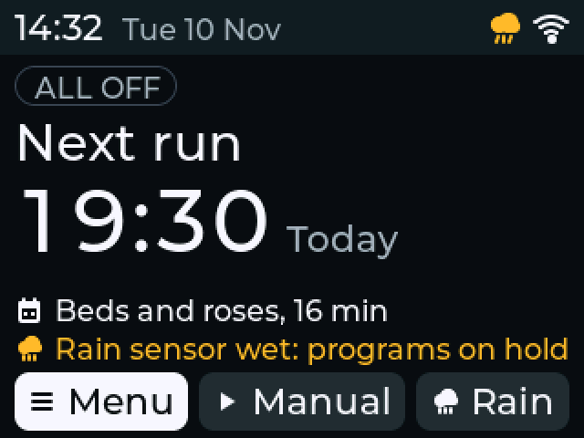{ width="260" } |

| A fault | No 24 V AC | Clock not set |
|---|---|---|
| 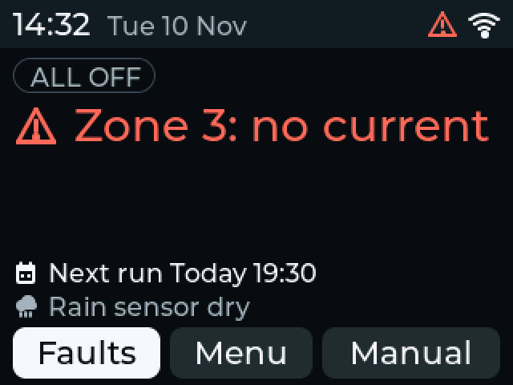{ width="260" } | 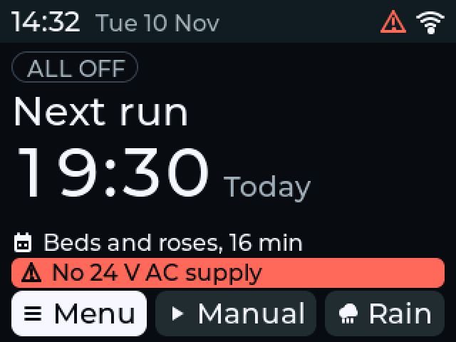{ width="260" } | 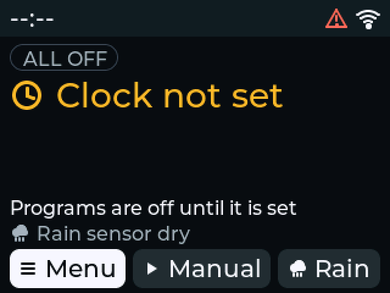{ width="260" } |

## Stop watering

- **On Home:** press the knob. Stop is the first button and is selected whenever a valve is open or a run is queued.
- **Anywhere:** hold Manual/Home for 0.8 seconds.
- **With the screen dark:** the first input only wakes it, so Stop is the second input.

Stop needs no confirmation.

## Run a zone by hand

Three inputs from Home:

| 1. Manual/Home | 2. Press on a zone | 3. Press on the minutes |
|---|---|---|
| 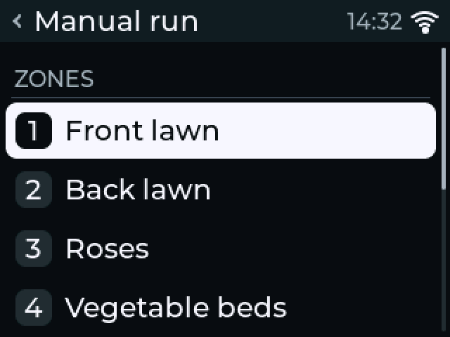{ width="260" } | 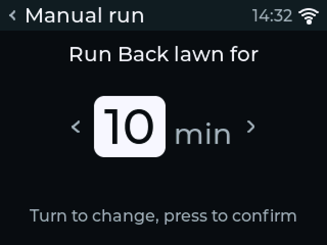{ width="260" } | { width="260" } |

1. Press Manual/Home. The list opens on the zone you ran last.
2. Turn to the zone and press. The picker opens on the minutes you used last.
3. Turn to the minutes and press. The run starts and Home appears.

Programs are in the same list, under the zones. A program asks "Run now?"
once.

A row that cannot be chosen says why: no 24 V AC, master valve locked, an
update running, or a zone **Resting** after reaching its maximum run time,
with the time left. A manual run waits behind whatever is already watering.

## Menu

| Item | What it holds |
|---|---|
| Manual run | The same list as the Manual/Home button |
| Zones | Each zone's state; a test run of 1 to 10 minutes; enable or disable; last current; longest allowed run; Clear faults |
| Programs | The programs, when each starts next, Add program, and the seasonal adjustment |
| Rain delay | Off, 6 h, 12 h, 1, 2, 3, 5, 7, 10 or 14 days |
| Sensors and flow | Rain sensor, 24 V AC supply, valve current, flow rate, water counted since power-on, valve board state, master valve, spare input. Read only. |
| Faults | What is wrong, one row each; a row opens what to check |
| Setup | Network, Time, Display, Zones in use, About, Run setup again, Factory reset |

### Zones

| Zones | A zone | A zone with a fault |
|---|---|---|
| 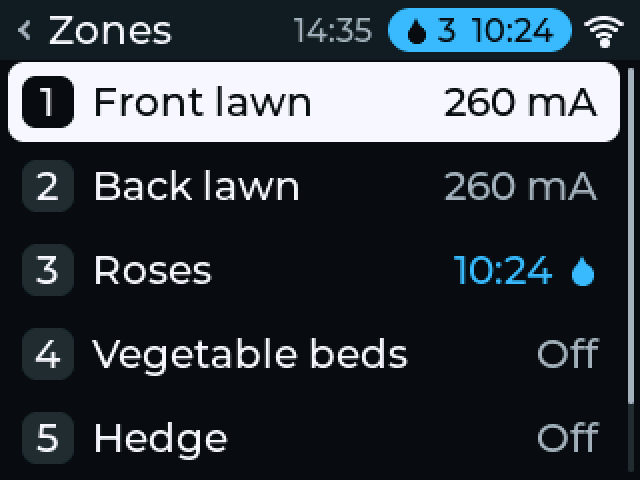{ width="260" } | 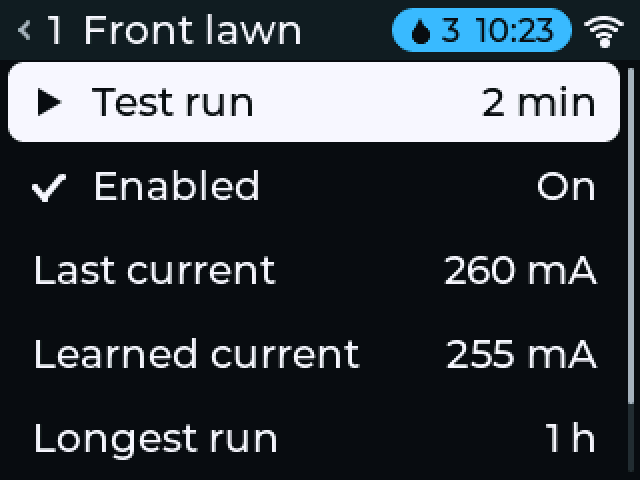{ width="260" } | 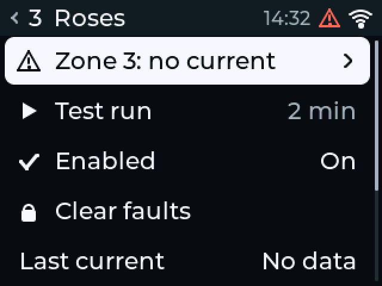{ width="260" } |

- **Last current** is the total valve current while that zone ran alone. With a master valve it includes the master's share. It is lost at a restart.
- **Learned current** reads "No data" in this firmware version.
- **Clear faults** clears every latched fault, not only this zone's.
- Zone names are set in the web interface.

### Programs

A program's screen holds everything about it in one list: enabled, run now,
up to four start times, the day rule, a run time for every zone, seasonal
adjustment, the rain sensor, delete. Edit each value the same way: press the
row, turn, press. [First schedule](../getting-started/first-schedule.md#from-the-display-standalone-firmware)
walks through a new program.

| Start time | Day rule | Run time |
|---|---|---|
| 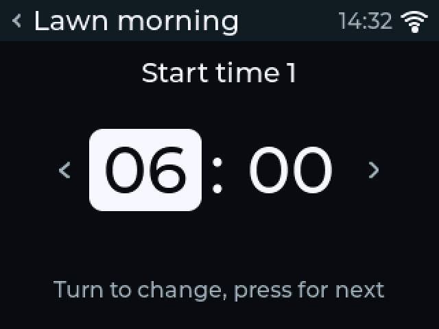{ width="260" } | 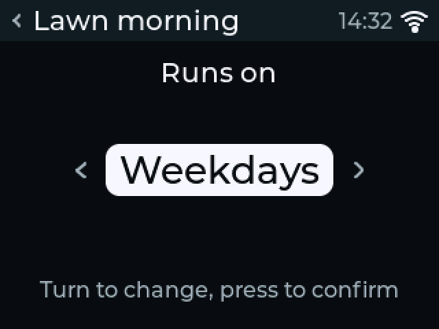{ width="260" } | 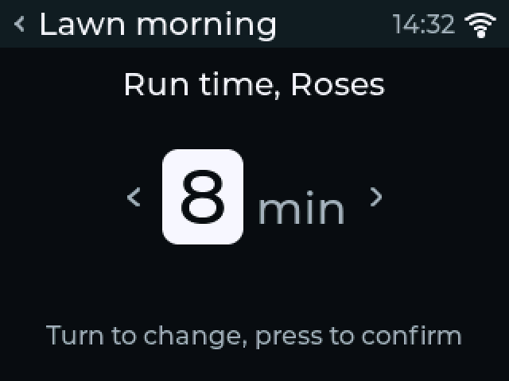{ width="260" } |

Nothing is saved while you edit. Leaving a changed program asks once: **Save**
or **Discard**. **Delete program** asks with Cancel selected.

### Rain delay

Two inputs from Home: **Rain**, then a press on the length. Home then shows
until when, and the next run moves past the delay. The clock must be set.

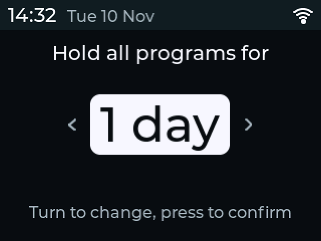{ width="300" }

### Faults

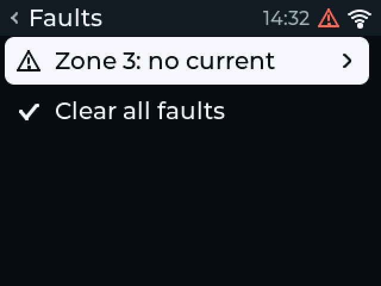{ width="300" }
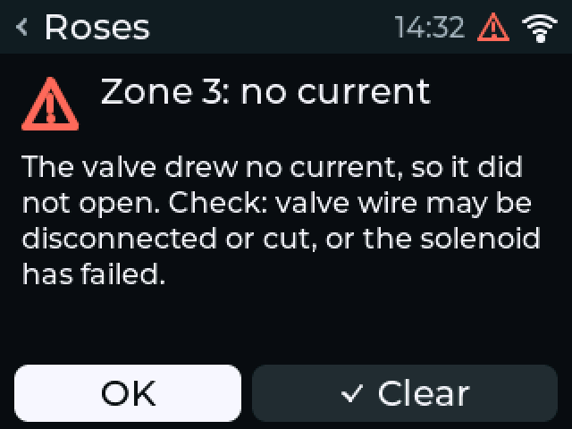{ width="300" }

Each fault says what happened, then what to check. A new fault lights the
screen. [Troubleshooting](../troubleshooting.md#fault-messages) lists every
message.

### Setup

| Setup | Time | Display |
|---|---|---|
| 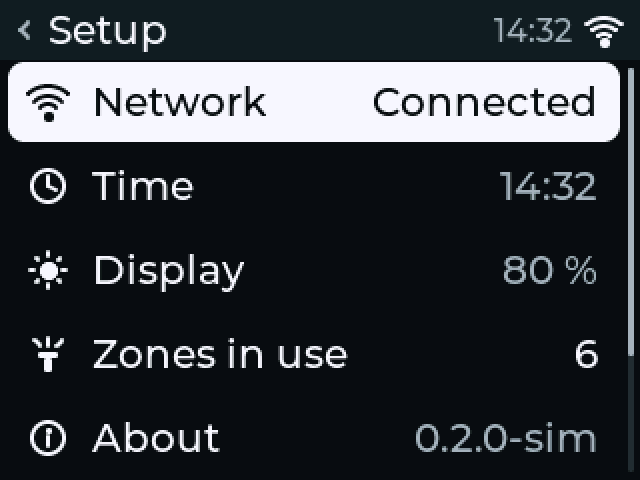{ width="260" } | 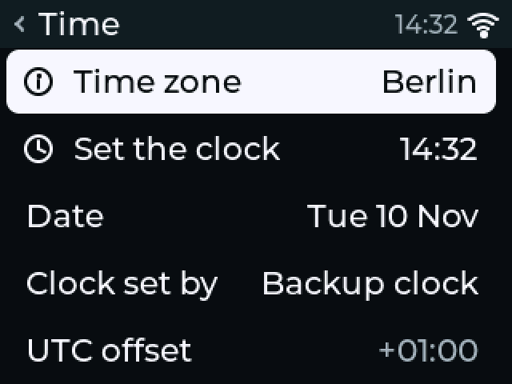{ width="260" } | 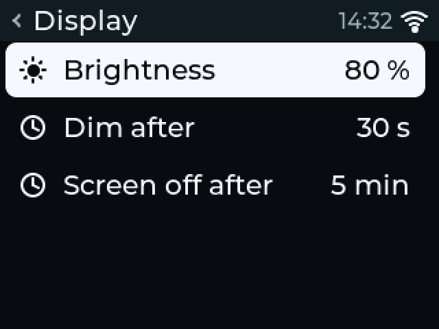{ width="260" } |

- **Network:** link state, network name, address, signal. **Set up WiFi** shows the QR code while WiFi setup runs. On a controller that already has a network it says setup is not running; use the web interface to change networks.
- **Time:** the time zone (34 cities and UTC offsets), the clock set by hand, and where the time came from (network, backup clock, not set).
- **Display:** brightness, time until the screen dims, time until it goes dark.
- **Zones in use:** how many of the outputs are wired.
- **About:** firmware version, board, device name, ESP-IDF and LVGL versions, licence.
- **Run setup again:** the first-boot wizard.
- **Factory reset:** see [factory reset](factory-reset.md).

## Limits of this version

- English only, 24-hour clock, metric units.
- Long program names are cut short in the program list.
- The time zone list has no shortcut; it is 34 rows.
