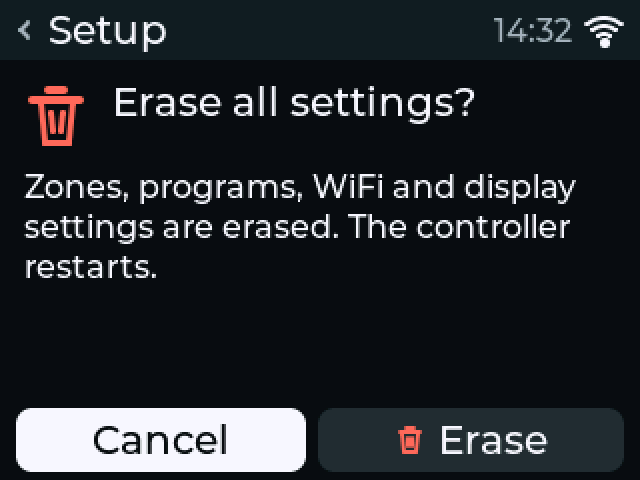
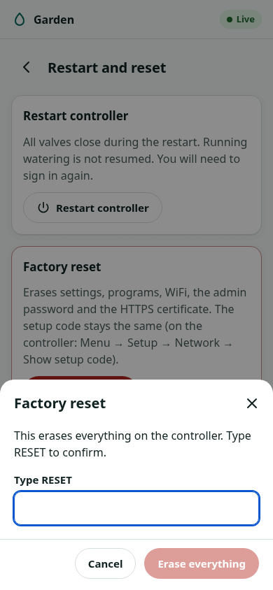

# Factory reset

!!! warning "Written from the design; not yet verified on hardware"
    The reset paths below are in the firmware and covered by host tests and
    the display simulator. None has run on a board.

A factory reset returns the controller to its first-boot state. Make a
[backup](backup-restore.md) first if you want your zones and programs back.

## What it erases and what it keeps (standalone firmware)

| Erased | Kept |
|---|---|
| Zones, programs and all settings | The setup code |
| WiFi network and password | The firmware, and the previous firmware in the other update slot |
| Admin password and web settings | The web interface |
| | The safety circuit's learned release times (they belong to the board; a confirmed repair of a safety fault makes it learn them again) |
| HTTPS key and certificate | |
| MQTT password and CA certificate | |
| Run history | |
| The stored crash dump | |
| Display settings | |

The controller stops watering first, then erases, then restarts into the
setup wizard and WiFi setup.

The setup code is kept so that a label or note of it stays valid. It also
means that anyone who knew the code before the reset can still use it
during the next setup.

## On the display

1. Open **Menu → Setup → Factory reset**.
2. The question "Erase all settings?" opens with **Cancel** selected. Turn to **Erase**.
3. Press the knob. The display shows "Erasing, then restarting".

{ width="300" }

## In the web interface

{ width="300" }

1. Sign in.
2. Open **Settings → Restart and reset**.
3. Choose factory reset.
4. Type `RESET` to confirm.

## From the REST API

```sh
curl -X POST http://zoneflow-ab12.local/api/v1/system/factory-reset \
     -H "Authorization: Bearer $TOKEN" -H 'Content-Type: application/json' \
     -d '{"confirm": "factory-reset"}'
```

An admin session is needed.

## Over USB, when nothing else works

`zfflash` erases the settings partition from outside, without the firmware's
help. Read the [USB rules](../safety.md#usb-and-earthing) and pull the
24 VAC plug first.

```sh
cd tools/zfflash
uv run zfflash erase-nvs     # settings only; keeps the firmware
uv run zfflash flash factory # everything, firmware included
```

Both of these also replace the setup code: the firmware makes a new one at
the next start. See [updating firmware](../firmware/releases.md#update-over-usb-with-zfflash).

## ESPHome

The ESPHome package has no factory reset of its own in this version. To
start over, flash the factory image again with the
[web installer](../firmware/web-installer.md), then set WiFi and adopt the
controller again.
