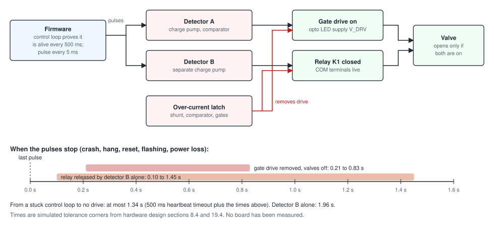

# How the fail-safe works

!!! warning "Designed and simulated; not yet verified on hardware"
    The circuit is analysed in
    [hardware design sections 7 and 8](../design/hardware-design.md#8-fail-safe-gate)
    and simulated with ngspice. The times on this page are simulation
    results. Nobody has measured them on a board.

## The problem

A sprinkler controller that crashes with a valve open floods something. On
many controllers a valve stays open if the processor stops while it is on,
because the pin that drives the valve stays where it was. The
[prior-art survey](../design/prior-art.md#3-known-field-failures-and-complaints)
records exactly that: a board that crashed mid-cycle and left its master
valve on.

ZoneFlow's rule is that **the firmware must keep proving it is alive, or the
valves turn off**. Nothing in software can override this, because it is done
by parts on the board.

## How it works

1. **The firmware sends a heartbeat.** While a valve should be on, the firmware toggles one pin every 5 ms. It only does so while its main control loop has shown, within the last half second, that it is still running. A hung loop, a stopped timer and a halted processor all end the pulses.
2. **Detector A turns pulses into permission to drive.** Each pulse tops up a small capacitor; a resistor drains it all the time. While pulses arrive, the capacitor stays charged and a comparator says "drive allowed". It needs a pulse at least every 20 ms. A pin stuck high or stuck low is not a pulse, so it does not count.
3. **Drive allowed does three things.** It powers the light-emitting side of every output's opto-triac, it lets the chip that holds the valve on/off bits out of reset, and it lets the relay in the valve common close. When it goes away, all three stop. The chip forgets every on/off bit, so nothing comes back on by itself.
4. **Detector B holds the relay.** It is a second charge pump on the same pulses, made of different parts. The relay's coil current passes through a transistor that only detector B controls. If some fault held detector A on, the relay still opens when the pulses stop.
5. **The relay feeds every valve.** All valve commons pass through it. With the relay open, no valve has power, even if an output's switch has failed short.
6. **A short trips a latch.** If the valve current passes 4.0 to 5.4 A peak, a comparator sets a latch that removes drive in about 70 microseconds and opens the relay. Only stopping the pulses for longer than detector A's hold-up clears it.

## How fast

From the last pulse, by simulation:

- Drive is gone after **0.21 to 0.83 seconds**, and the valves are off with it.
- Detector B lets the relay go between **0.10 and 1.45 seconds**. That matters only if detector A has failed.
- Counting from a stuck control loop, which first has to miss its half-second deadline: at most **1.34 seconds** to no drive.

The specification asked for "about one second" from the last pulse. The
figures are the tolerance corners of
[hardware review A2](../design/hardware-review-a2.md), which are wider than
the first analysis. The long end of detector B's range belongs to one corner
of its transistor's tolerance and has to be measured.

## What happens when

| Event | What turns the valves off |
|---|---|
| Firmware crashes or hangs | Pulses stop; both detectors let go |
| Processor reset, or a firmware update being written over USB | Pulses stop; the expander is held in reset |
| Power cut | Nothing has power |
| An output's triac fails short after a surge | The firmware sees current with no valve on, opens the relay and stops; if the firmware is also dead, the relay opens when the pulses stop |
| A shorted valve wire | The over-current latch, within microseconds; the resettable fuse on that output if the latch does not act |
| The 5 V converter fails with its switch shorted | A clamp holds the 5 V rail under 10 V and a soldered fuse in the converter's input opens. The board goes dark and the relay has no supply |
| The 3.3 V regulator fails short | A voltage detector sees the logic rail above 4 V and holds the drive enable off, whatever the processor does. The red fault LED lights. The processor itself is not protected and may be damaged |
| A single failed part in either detector | The other detector, by design. The [single-fault analysis](../design/hardware-design.md#85-single-fault-analysis) goes through each part |

## How the controller checks it

A safety circuit that is never tested can fail silently. The firmware tests
both detectors:

- At start-up.
- Before every run and after every run.
- Every 10 minutes between runs, so a controller that does not water for a month still checks itself.

It checks that each detector is off when the pulses are stopped, comes on
within 150 ms when they start, and lets go within its window when they stop.
Before each run it also checks that no current flows with the relay open
(a welded relay contact) and with the relay closed and every output off (a
shorted output). If a detector fails, the controller refuses to water and
shows [Safety circuit failed its test](../troubleshooting.md#safety-circuit-failed-its-test).
That fault needs a person to confirm a repair before any valve opens again.

Hardware review A2 added two checks, and the firmware runs both before
every run. One lets the heartbeat pin float for half a second, with the
display, its backlight and the memory busy, and watches that nothing else
moves it ([Safety signal disturbed](../troubleshooting.md#safety-signal-disturbed)).
The other checks that the relay's first transistor lets go when the chip
driving it lets go of it ([Valve relay driver faulty](../troubleshooting.md#valve-relay-driver-faulty)).
The review also widened the time windows of the stop test. With 24 V AC on
and the board near room temperature, it learns how long its own detectors
take, and from then on each stop test must come within 0.4 and 1.7 times
those times, which is how an open bleed resistor shows
([Safety timing not learned](../troubleshooting.md#safety-timing-not-learned)).
The hardware answers to the firmware's questions set those numbers from
simulation, made the pin-high test hold for 2 seconds, and made the board
check its own supply first: a supply that is too low or too high, a failed
power input and a 3.3 V rail that is too high each have a message of their
own ([24 V AC supply too low](../troubleshooting.md#24-v-ac-supply-too-low)).

## What it does not cover

- **A valve that sticks open mechanically.** The controller can only remove power. A valve with dirt in it may stay open without power.
- **The processor behind a failed 3.3 V regulator.** If the regulator fails short, the processor gets about 5 V, which is outside its ratings, and nothing can be said about what it then does. The valves no longer depend on that: a detector removes drive by hardware ([hardware design, section 9.5](../design/hardware-design.md#95-over-voltage-on-3v3-detector-u13)). The processor and the display may not survive, and the detector cannot be tested once the board is in use.
- **A solder bridge onto the heartbeat net.** A bridge of a few kilohms or less from that net to a signal that toggles by itself defeats both detectors while the processor is in reset. The pin was chosen so that no such signal is beside it, and the float check looks for it.
- **Firmware that keeps pulsing while doing the wrong thing.** The hardware checks that the firmware's control loop is running, not that its decisions are right. The maximum run time in the firmware, which no schedule or request can exceed, covers that case as far as software can.

All of the above is on paper. The bench tests that will check it are risks
10, 22 and 23 in the [risk register](../design/hardware-design.md#20-design-risk-register).
