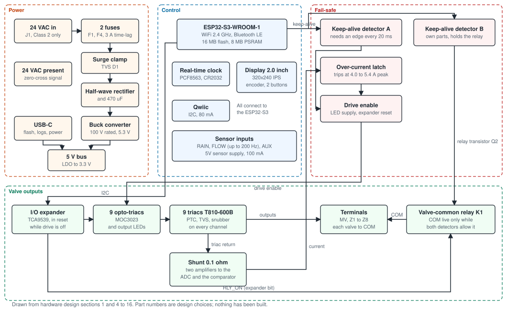

# Hardware reference

!!! warning "Design values; not yet verified on hardware"
    The revision A board exists as a reviewed circuit design, a captured
    schematic and a PCB layout that passes its checks. Nothing has been built
    or measured. Every figure in this section is a design value, a calculation
    or a simulation result, from the
    [hardware design](../design/hardware-design.md).

## Block diagram

Select the diagram to open it full size.

In words:

- **Power.** The 24 VAC input passes a fuse in each wire and a surge clamp. A diode and a 470 uF capacitor rectify it. A buck regulator rated for 100 V makes 5.3 V, and a linear regulator makes 3.3 V. USB-C feeds the same 5 V bus through a diode, so USB alone runs the logic, the display and the radio, but not the valves.
- **Control.** An ESP32-S3-WROOM-1 module with WiFi and Bluetooth LE runs the firmware. A real-time clock with a CR2032 cell keeps time through power cuts. The display, knob and two buttons, the sensor inputs and a Qwiic connector connect to it.
- **Outputs.** Nine identical channels, eight zones and the master. Each has a triac that switches the valve, fired through an opto-triac, with a resettable fuse, a surge clamp and a snubber. The processor reaches them only through an I2C expander, which is held in reset whenever drive is off.
- **Valve common.** A relay feeds the COM terminals. It closes only while firmware asks for it and two independent conditions allow it.
- **Fail-safe.** Two keep-alive detectors and an over-current latch can each remove drive without firmware. See [how the fail-safe works](fail-safe.md).
- **Measurement.** All triacs return through one 0.1 ohm shunt. Two amplifiers feed the processor's ADC, and firmware computes the true RMS current. A comparator on the same signal trips the over-current latch. A square wave at mains frequency tells firmware that 24 VAC is present.

## Pages

- [Specifications](specifications.md): ratings, interfaces and sizes, as designed.
- [How the fail-safe works](fail-safe.md): why a crashed controller cannot hold a valve open.
- [Schematic](schematic.md): the 20-page KiCad schematic, sheet by sheet.
- [PCB layout](layout.md): renders, every layer, an interactive BOM, and what was checked.
- [Bill of materials](bom.md): every part, with LCSC numbers and data sheets.
- [The 4-zone build](four-zone.md): what is left off.
- [Ordering boards](ordering.md): the fabrication files, and what is missing before anyone should order.
- [Design notes](design-notes.md): where the calculations are.

## Safety rules built into the design

From the [specification](../design/system-spec.md), section 2:

1. Outputs are off by default. With the processor in reset, unpowered, crashed or being flashed, every valve output is off. This is enforced in hardware.
2. No valve output shares an ESP32 strapping pin or a pin that glitches at boot. In this design no valve is on a processor pin at all.
3. A hardware output-enable gates all output drivers. Firmware must keep toggling a keep-alive signal. A second detector on the same signal, sharing no part with the first, releases the valve-common relay.
4. Firmware enforces a maximum run time per zone, counted across back-to-back runs.
5. Only Class 2 circuits are on the board. No mains.
6. A relay in the valve common removes power from every valve when an output device has failed short.

## Pin map and netlist

- `hardware/pinmap.yaml`: every processor pin, I2C address and expander bit. Both firmwares generate their pin definitions from it.
- `hardware/netlist.yaml`: every component, its value, package, LCSC number and the net on every pin. The schematic is generated from it and checked against it.
