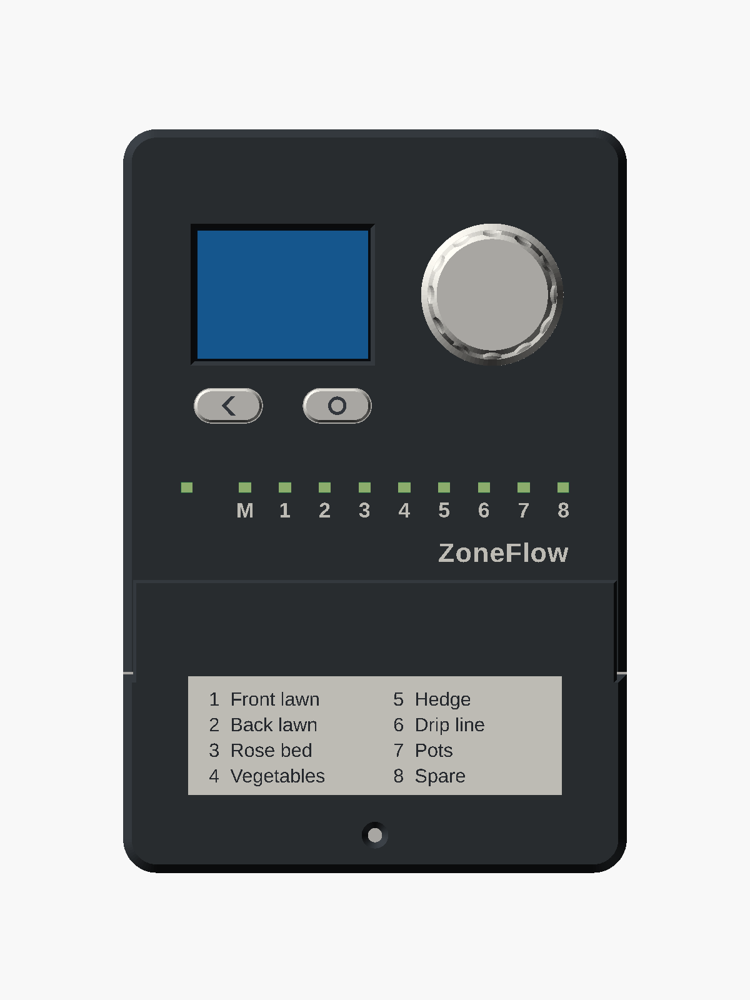
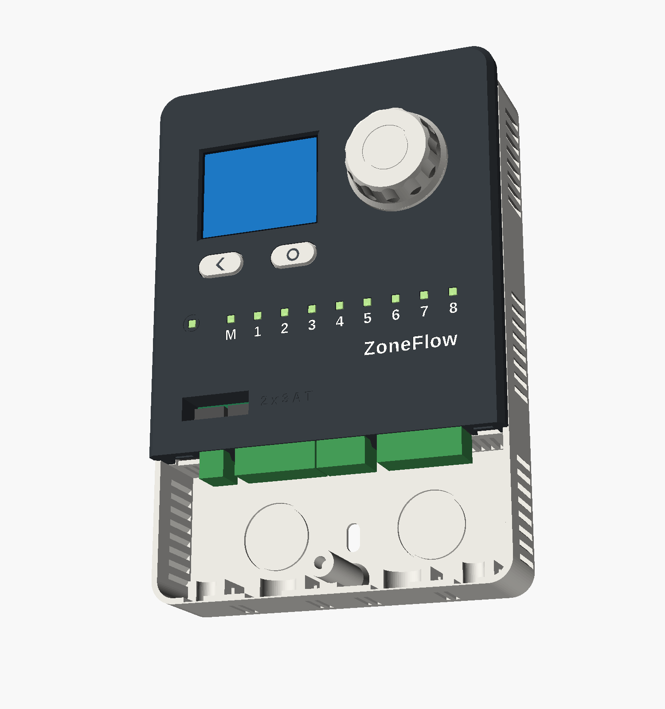
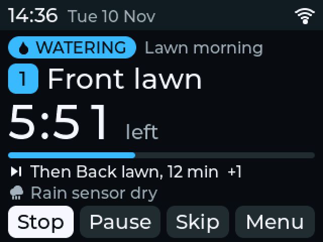
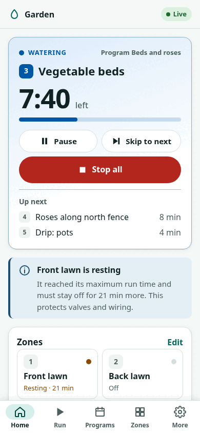

# ZoneFlow

An open-source controller for 24 VAC sprinkler valves: 8 zones plus a master valve or pump-start relay, a colour display with a knob, WiFi and Bluetooth LE, and no cloud service.

[Try it in your browser](try-it.md){ .md-button .md-button--primary }

!!! danger zf-status "Status: designed on paper. Not built. Not tested."
    - No ZoneFlow board has been made. No firmware has run on one.
    - Every figure on this site is a design value, a calculation or a simulation result. None is a measurement.
    - **Do not order boards yet.** The PCB layout has had an independent review, but nobody has gone through its pre-order checklist, and no prototype has been bench-tested. See [ordering boards](hardware/ordering.md). The [review walkthrough](hardware/review/index.md) leads the owner through that checklist with pictures.
    - ZoneFlow has no safety, EMC or radio certification.

    Read the [safety notes](safety.md) before you build anything from this
    project. The [status page](status.md) lists what is done and what is next.

{ width="360" }
{ width="420" }

## What it is

ZoneFlow is a wall-mounted controller for the 24 VAC solenoid valves used in
garden and lawn irrigation. It replaces a conventional sprinkler timer. It is
for people who want a controller they can inspect, repair and run without a
vendor's cloud: home owners who are comfortable wiring a sprinkler timer, and
people who build their own electronics.

- One board drives 8 zones and a master valve or pump-start relay. A 4-zone build of the same board leaves out zones 5 to 8.
- It runs its schedule from a battery-backed clock. Watering continues when the network or Home Assistant is down.
- A 2.0 inch colour display, a knob and two buttons give a full local interface: run a zone, edit programs, set a rain delay, read faults.
- It measures valve current, so it can say "Zone 3: no current" instead of watering nothing.
- The valve outputs are switched off by hardware when the firmware stops, crashes or is being flashed. See [how the fail-safe works](hardware/fail-safe.md).

## What exists today

| Part | State | Where |
|---|---|---|
| Circuit design | Written with calculations and simulations, reviewed once (review A1), findings resolved | [Hardware design](design/hardware-design.md), [review A1](design/hardware-review-a1.md) |
| Schematic | Captured in KiCad 10 from the design netlist; ERC clean; 20 pages | [Schematic](hardware/schematic.md) |
| Bill of materials | Every line with an LCSC number, stock and price checked on 2026-11-10 | [BOM](hardware/bom.md) |
| PCB layout | Placed and routed, four layers; DRC, mechanical contract and fail-safe layout rules checked on the files; not reviewed, not built | [PCB layout](hardware/layout.md), [layout document](design/hardware-layout.md) |
| Enclosure | Parametric model, interference-checked, STL and 3MF files; not printed | [Enclosure](enclosure/index.md) |
| Standalone firmware | Written; builds in CI; logic covered by host tests; display runs in a desktop simulator | [Web interface](firmware/standalone.md), [display](guide/display.md) |
| ESPHome package | Written; compiles for the board; logic covered by host tests | [ESPHome](firmware/esphome.md) |
| Browser demo | The firmware's logic, display and REST API compiled to WebAssembly, on simulated hardware; smoke-tested in CI | [Try it](try-it.md) |
| Release tooling | Web installer, release workflow, `zfflash` command-line tool; no release published yet | [Installing firmware](firmware/web-installer.md) |

The pictures on this site are renders of the enclosure model, screenshots
from the display simulator and screenshots of the web interface running
against a mock controller. None is a photo of real hardware.

**The display**, as the firmware draws it in the simulator

{ width="300" }

**The web interface**, against the mock controller

{ width="240" }

**The schematic**, power sheet

[{ width="320" }](hardware/schematic.md)

## Two firmware options

Both run on the same board and share the same C++ code for the parts that
matter for safety: the output stage, the self-tests, the zone driver with its
maximum run time, and the current checks.

| | Standalone firmware | ESPHome package |
|---|---|---|
| For | A controller that works on its own | Houses that already run Home Assistant |
| Needs a hub | No | Home Assistant, for setup and control |
| Schedules without the network | Yes | Yes |
| Setup | Phone app over Bluetooth LE, or a setup access point | Improv over USB or Bluetooth LE |
| Local display | Full menus: programs, settings, faults, network | Status screen and manual runs |
| Programs | 16, up to 4 start times each | 3, two start times each |
| Control from elsewhere | Own web interface, REST API, MQTT with Home Assistant discovery | Home Assistant entities and automations |
| Updates | Over the network, with automatic rollback | ESPHome OTA with safe mode |

[Choosing a firmware](firmware/index.md) has the longer comparison.

## Features, as designed

These are what the design and firmware are written to do. None has been
checked on a board.

- 8 zone outputs and 1 master-valve or pump-start output, 24 VAC, 0.5 A each continuous, 1.5 A inrush for 100 ms; up to two zones and the master on at once.
- Powered from one Class 2 sprinkler transformer, 24 VAC, 50 or 60 Hz. The input is designed to survive 32 VAC continuous.
- A fuse in each transformer wire, a surge clamp on the input and on the valve common, and a resettable fuse, a surge clamp and a snubber on every output.
- A relay in the valve common, held by its own keep-alive detector: a failed output switch cannot keep a valve on.
- Valve current measured as a true RMS value: open valve, shorted valve, current with every valve off, and loss of 24 VAC are reported in plain words.
- A hardware over-current cut-off that acts within about 70 microseconds of a short.
- Rain sensor input (normally open or normally closed), flow meter input up to 200 Hz with a leak alarm, one spare input, and a current-limited 5 V supply for powered flow meters.
- Maximum run time per zone that no schedule, app or automation can exceed, counted across back-to-back runs, with a rest time after it.
- Real-time clock with a CR2032 cell.
- USB-C for flashing and logs; USB alone runs the logic for work on a desk.
- One Qwiic (I2C) connector for expansion.
- Printable wall-mount enclosure for indoor or garage use, with a separate wiring compartment.

## How it compares

From the [prior-art survey](design/prior-art.md), which read the published
schematics and firmware of other open controllers in November 2026:

- OpenSprinkler, the reference open design, uses the same output topology: a triac per zone, one transformer leg as ground, one shunt for total current. ZoneFlow adopts it.
- Most open ESP32 irrigation boards use relays with no surge protection and no current sensing.
- Of the boards surveyed, only hwstar's 9-valve board, now retired, had a hardware watchdog that disconnects the valves.
- Reported field failures in other projects are triacs blown by shorted or lightning-hit wiring, regulators stressed by unloaded transformers at 28 to 30 VAC or more, valves pulsed at boot, a crash that left a master valve on, and WiFi that locked to one access point. The design addresses each; the [hardware design](design/hardware-design.md) says how, and the [status page](status.md) says what still needs a bench to confirm.

## Where to start

- [Safety](safety.md): read first.
- [Status and roadmap](status.md): what is done, what needs a prototype.
- [Getting started](getting-started/index.md): the installation manual, written from the design.
- [Hardware reference](hardware/index.md): block diagram, specifications, schematic, BOM.
- [FAQ](faq.md) and [glossary](glossary.md).
- [Design documents](design/index.md): the engineering record.

## Follow and contribute

- Progress is logged in [issue #1](https://github.com/syntroniks/zoneflow/issues/1). Open work is in the [issue list](https://github.com/syntroniks/zoneflow/issues).
- The most useful contribution now is a review: of the [circuit](design/hardware-design.md), the [schematic](hardware/schematic.md) or the [firmware](design/firmware-architecture.md). See [contributing](contributing.md).

## Licences

| Part | Licence |
|---|---|
| Hardware and enclosure | CERN-OHL-P-2.0 |
| Firmware and tools | Apache-2.0 |
| Documentation | CC-BY-4.0 |
