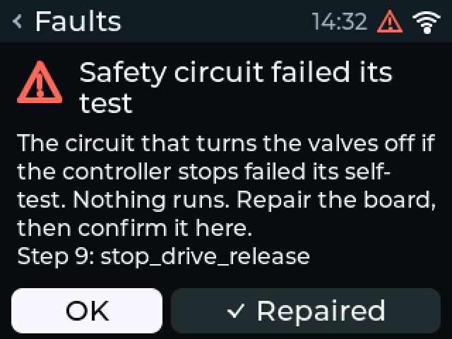
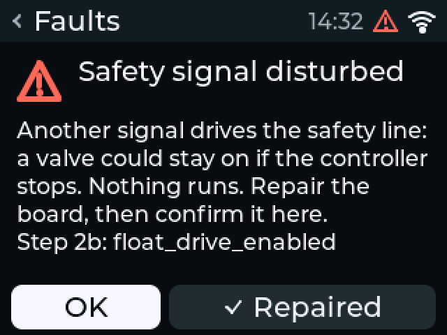
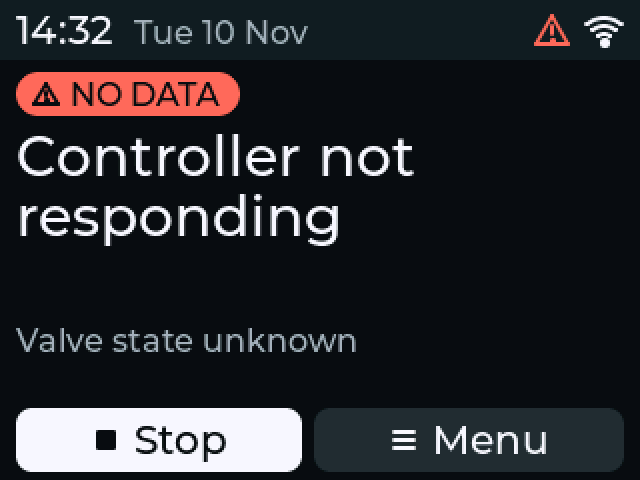

# Troubleshooting

!!! warning "Written from the design; not yet verified on hardware"
    The messages on this page are the ones in the firmware: the display's
    string table (`zf_ui/strings.hpp`), the web interface's
    (`web/src/i18n/en.ts`) and the fault codes in `zf_core`. What causes
    each one comes from the [hardware design](design/hardware-design.md)
    and the firmware source. No fault has been produced on a real board.

!!! danger "If water will not stop"
    Unplug the transformer. With no 24 VAC no valve can open. Then close
    the water supply if it keeps flowing, and read
    [a valve does not close](#a-valve-does-not-close).

## How to read a fault

Each fault is shown with a title that says what happened and a line that
says what to check.

- **Display (standalone):** Home shows the fault in red, and **Faults** opens it. **Menu → Faults** lists them all, one row each. A fault on the valve board adds a line "Step N: check name" for whoever repairs it.
- **Web interface:** **Needs attention** on the dashboard. The history page records every fault with its time.
- **ESPHome:** the `Faults` text entity, `Fault` and `Zone N fault` binary sensors, and the display's status line.
- **MQTT and REST:** the fault codes in the right-hand column of the [fault table](#fault-messages), for example `zone_open_circuit`.

### How to clear a fault

| Kind | Display | Web interface | ESPHome | API, MQTT |
|---|---|---|---|---|
| Most faults | **Faults →** the fault **→ Clear**, or **Clear all faults** | **Clear faults** and confirm | `Clear faults` button, or hold **Home** for 3 s | `POST /api/v1/faults/clear`, `<root>/cmd/clear_faults` |
| Safety circuit failed its test, Safety signal disturbed, Valve relay driver faulty, Power input circuit failed, Logic supply too high, Protection held on | **Repaired**, then **Yes, repaired** | Confirm on the controller, or `POST /api/v1/faults/acknowledge-repair` | `Acknowledge repair (press twice)` within 10 s | `POST /api/v1/faults/acknowledge-repair` |
| No 24 V AC supply, 24 V AC supply too low or too high, Clock not set, Valve current not measured, Sensor supply overloaded, Mains signal wrong, Safety timing not learned | Clear by themselves when the cause goes | The same | The same | The same |
| Zone N: no current | Clears itself when the zone next runs and draws current; or clear it | The same | The same | The same |

Clearing releases every latched fault and lockout at once. A fault whose
cause is still there comes back at once. Fix the cause first.

## Fault messages

The display, the web interface and the ESPHome `Faults` sensor use the same
title for each fault, from one table in the firmware
(`zf_core/include/zf/fault_text.hpp`); the API and MQTT send the code in the
middle column. "Zone N" is the zone's number, or its name in the web
interface and ESPHome; a zone-type fault on the master output reads
"Master valve: ...". Where no zone is named, the web interface uses the
plain form, for example "Valve drew no current".

| Title | Code | Clears itself |
|---|---|---|
| [Zone N: no current](#zone-n-no-current) | `zone_open_circuit` | When the zone next runs with its current |
| [Zone N: current too high](#zone-n-current-too-high) | `zone_over_current` | No |
| [Zone N: short circuit](#zone-n-short-circuit) | `short_circuit` | No |
| [Protection tripped](#protection-tripped), or Zone N: protection tripped | `over_current_trip` | No |
| [Master valve locked](#master-valve-locked) | `master_locked_out` | No |
| [Current with all valves off](#current-with-all-valves-off) | `current_while_idle` | No |
| [No 24 V AC supply](#no-24-v-ac-supply) | `ac_lost` | Yes |
| [Water flows with all valves off](#water-flows-with-all-valves-off) | `flow_without_zones` | No |
| [Clock not set](#clock-not-set) | `time_invalid` | Yes |
| [Settings could not be read](#settings-could-not-be-read) | `config_invalid` | No |
| [Settings could not be saved](#settings-could-not-be-saved) | `storage_error` | No |
| [Valve current not measured](#valve-current-not-measured) | `current_sense_unavailable` | Yes |
| [Sensor supply overloaded](#sensor-supply-overloaded) | `sensor_supply` | Yes |
| [Zone N: valve current lopsided](#zone-n-valve-current-lopsided) | `zone_dc_current` | No |
| [Mains signal wrong](#mains-signal-wrong) | `mains_signal` | Yes |
| [Safety circuit failed its test](#safety-circuit-failed-its-test) | `keepalive_detector` | No, needs a confirmed repair |
| [Safety signal disturbed](#safety-signal-disturbed) | `keepalive_bridged` | No, needs a confirmed repair |
| [Valve relay driver faulty](#valve-relay-driver-faulty) | `relay_gate_bleed` | No, needs a confirmed repair |
| [Safety timing not learned](#safety-timing-not-learned) | `not_commissioned` | Yes |
| [Valve driver not responding](#valve-driver-not-responding) | `output_expander` | No |
| [Valve relay stuck closed](#valve-relay-stuck-closed) | `relay_welded` | No |
| [Valve output stuck on](#valve-output-stuck-on) | `output_shorted` | No |
| [Protection did not reset](#protection-did-not-reset) | `trip_latch_stuck` | No |
| [24 V AC supply too low](#24-v-ac-supply-too-low) | `supply_low` | Yes |
| [24 V AC supply too high](#24-v-ac-supply-too-high) | `supply_high` | Yes |
| [Power input circuit failed](#power-input-circuit-failed) | `rectifier_fault` | No, needs a confirmed repair |
| [Logic supply too high](#logic-supply-too-high) | `supply_over_voltage` | No, needs a confirmed repair |
| [Protection held on](#protection-held-on) | `latch_input_held` | No, needs a confirmed repair |

### Valve and wiring faults

#### Zone N: no current

> The valve drew no current, so it did not open. Check: valve wire may be
> disconnected or cut, or the solenoid has failed.

- **Detected:** the zone was on, but after the 500 ms inrush allowance the current stayed below the zone's minimum (80 mA by default). The zone stops. It is not locked out: an open wire is a fault in the garden, not in the controller, so the zone's next start tries again, and a run that draws current inside the zone's window clears the fault. Both firmwares do the same (firmware architecture, section 7).
- **Likely causes:** a wire loose at the terminal or at the valve; a cut cable; a corroded splice; a burnt-out solenoid; the zone has no valve; the minimum is set above what this valve draws.
- **Check:**
    1. Unplug the transformer.
    2. Pull the valve plug (J2 or J3) off the board.
    3. Measure the resistance between COM and the zone's terminal on the plug.
    4. No continuity: the wire or the solenoid is open. Measure again at the valve box, across the solenoid's two leads, to find which.
    5. A reading: compare it with the valve maker's data for that solenoid. The repository gives no resistance range.
    6. If the reading is right, check the zone's current limits (web interface, **Zones**). A valve with a small solenoid can draw less than 80 mA.
- **Clear:** fix the cause. The fault clears itself at the zone's next run, or clear it by hand.

#### Zone N: current too high

> The zone was switched off and locked. Check: damaged solenoid, or two
> valves on one terminal.

- **Detected:** the current stayed above the zone's maximum (700 mA by default) after the inrush allowance, but below the short-circuit limit (3000 mA). Or the current rose by more than a fifth (at least 40 mA) while no output switched, and stayed up with every valve off for less than one current window, so the extra current went through this zone (see [valve output stuck on](#valve-output-stuck-on) for the other case).
- **Likely causes:** a damaged solenoid with shorted turns; two valves on one zone terminal; water in a splice; the maximum is set too low for this valve.
- **Check:**
    1. Unplug the transformer and pull the valve plug.
    2. Measure the resistance between COM and the zone's terminal. Compare with the valve maker's data. A value well below it points to the solenoid or the wiring.
    3. Check that only one valve is on this zone wire.
    4. Open the splices at the valve box and look for water.
- **Clear:** fix the cause, then clear the fault. If the valve is right and draws more than the default, raise the zone's maximum in the web interface.

#### Zone N: short circuit

> All valves were switched off and this zone is locked. Check: the zone
> wire may touch the common wire.

- **Detected:** the firmware measured more than the short-circuit limit, 3000 mA RMS, with this zone on. Everything stops and the zone is locked out.
- **Likely causes:** the zone wire touches the common wire, in the cable or at a splice; a cable cut by a spade; a solenoid shorted internally.
- **Check:**
    1. Unplug the transformer and pull the valve plug.
    2. Measure the resistance between COM and the zone's terminal. Near zero confirms a short.
    3. Disconnect the valve at the valve box and measure again. Still near zero: the cable is shorted. Now open: the solenoid is shorted.
- **Clear:** fix the cause, then clear the fault.

#### Protection tripped

> A short made the board switch all valves off for a moment. The other zones
> carry on. A zone with three trips in a day stays off. Check: valve wires
> touching each other or the common wire. Then clear the fault.

- **Detected:** the hardware over-current cut-off tripped. It removes drive from every output about 70 microseconds after the current passes 4.0 to 5.4 A peak, and the relay in the valve common opens. Firmware blames the output switched on in the last 500 ms; otherwise it marks every output that was on as suspect. It then carries on with the others.
- **Likely causes:** as for a short circuit, but the short draws so much current that the hardware acts first: a dead short on a short cable from a large transformer.
- **Check:** as for [short circuit](#zone-n-short-circuit).
- **Clear:** fix the cause, then clear the fault. After three trips in one day an output stays off until cleared.

#### Master valve locked

> The master valve failed several times in a row, so no zone can run.
> Check: master valve wiring and solenoid. Then clear the fault.

- **Detected:** three short-circuit or over-current faults in a row on the master output (the default). Because every zone needs the master, no zone runs.
- **Likely causes:** as for the zone faults above, on the MV wire or the master valve or pump-start relay coil.
- **Check:** measure between COM and MV on the unplugged J2 plug, as above.
- **Clear:** fix the cause, then clear the fault.

#### Zone N: valve current lopsided

> The valve current flowed in one direction only, so the output that drives
> it is failing. The zone was switched off and locked. The board needs
> service.

- **Detected:** the zone's current had a DC part: the output switch conducts on one half of the AC cycle only.
- **Likely causes:** the zone's triac or its opto-triac is failing.
- **Check:** nothing to check in the wiring. The board needs repair of that output.
- **Clear:** latched, and the zone is locked out in both firmwares: a half-dead output is a fault on the board and does not mend itself. After the repair, clear the fault.

### Supply and board faults

#### No 24 V AC supply

> Valves cannot open. Watering resumes when power returns. Check:
> transformer plugged in, fuse, supply wires.

- **Detected:** the 24 VAC signal has had no edge for 25 ms. The signal is taken after fuse F4, so a blown F4 reads the same as no transformer.
- **Likely causes:** the transformer is unplugged or its socket is off; the board runs from USB alone; a loose wire in the J1 plug; a blown fuse; a failed transformer.
- **Check:**
    1. Check the transformer is plugged in and the socket is on.
    2. Measure AC volts across the two wires at the J1 plug, plug pulled. The supply is 24 VAC nominal; an unloaded transformer can read higher, up to the 32 VAC the board is designed for.
    3. Unplug the transformer. Take both fuses out of the fuse well and check each for continuity. Either can open on a fault, so check both.
    4. If a fuse has opened, find out why before you replace it: a short on a valve wire, or a wire from the transformer or COM touching a sensor GND terminal.
- **Clear:** clears itself when 24 VAC returns. Scheduled starts missed meanwhile are skipped.

#### Current with all valves off

> A valve output may be stuck on. If water is flowing, unplug the 24 V
> supply. The board needs service.

- **Detected:** current above the idle threshold while no output is on.
- **Likely causes:** an output's triac, surge clamp or snubber capacitor has failed short. That is the usual way a triac dies after a surge or an overload.
- **Check:** if water flows, unplug the transformer. Then see [valve output stuck on](#valve-output-stuck-on).
- **Clear:** the board needs repair.

#### Valve output stuck on

> Current flowed with every valve off: a valve output on the board is
> shorted. The relay was opened and nothing runs. The board needs service.

- **Detected:** at the start of a run, with the relay closed and every output off, current flowed (self-test step 6). Or during a run: the current rose with no output switched, the firmware switched every output off at once, and current kept flowing with the relay closed (rule 6). An output that fails short during another zone's run is found this way within about a second; before the hardware answers it watered until that run ended. A device that fails within half a second of a zone switching on is found when that zone's run ends.
- **Likely causes:** a shorted triac, surge clamp, opto-triac or snubber capacitor on one output.
- **What protects you:** the relay in the valve common is open, so no valve has power, whatever the shorted part does.
- **Clear:** the board needs repair. Nothing runs until then.

#### Valve relay stuck closed

> Current flowed although the valve relay should have been open: a welded
> relay contact or a bridged jumper. Nothing runs. The board needs service.

- **Detected:** before a run, with the relay told to stay open, the firmware switched the first output on for 100 ms and measured current (self-test step 5).
- **Likely causes:** the relay contact welded, for example after breaking a short-circuit current; the relay's bypass jumper bridged; the relay's driver transistor shorted.
- **Clear:** the board needs repair.

#### Protection did not reset

> The short-circuit protection stayed tripped after the valves were switched
> off. Nothing runs. Clear the fault to try again. If it comes back, the
> board needs service.

- **Detected:** the over-current latch was still set 3 seconds after the keep-alive stopped. The latch clears only when the keep-alive stops.
- **Likely causes:** a short still present that trips the latch again, or a fault in the latch or its detector.
- **Clear:** clear the fault to try again. If it comes back, the board needs repair.

#### Valve driver not responding

> The chip that drives the valves did not answer or did not read back what
> was written. All valves were switched off. Clear the fault to try again.
> If it comes back, the board needs service.

- **Detected:** the output expander did not acknowledge, or its registers did not read back as written, or the I2C bus was stuck.
- **Likely causes:** a fault on the board, or a device on the Qwiic connector holding the bus.
- **Check:** unplug anything on the Qwiic connector, then clear the fault.
- **Clear:** clear the fault to try again.

#### Safety circuit failed its test

> The circuit that turns the valves off if the controller stops failed its
> self-test. Nothing runs. Repair the board, then confirm it here.

- **Detected:** one of the two keep-alive detectors did not behave as designed in a self-test: it was on when it should be off, did not come on within 150 ms, or did not let go within its time window when the pulses stopped. The window is 0.15 to 1.0 s for the gate drive and 0.05 to 1.6 s for the relay, and, once the board has learned its own times, 0.40 to 1.70 times those.
- **Why it matters:** those detectors are what turn the valves off when the firmware crashes. With one of them unreliable, a crash could leave a valve on.
- **Clear:** this fault does not clear with one press. After the board has been repaired and checked, confirm the repair: on the display, **Repaired**, then **Yes, repaired** (Cancel is focused first). In ESPHome, press `Acknowledge repair (press twice)` twice within 10 seconds. The full self-test runs before any valve opens.

{ width="300" }

The "Step N" line names the failed check. For whoever repairs the board:

| Line | Meaning | Section of the hardware design |
|---|---|---|
| Step 1: `idle_drive_enabled` | The gate-drive read-back (GPIO42, `V_DRV`) was high and the expander answered with the keep-alive stopped: detector A or the over-current latch is stuck on | 19.7 step 1 |
| Step 1: `idle_drive_supply_on` | `V_DRV` was high with the expander in reset: Q3 conducts when it should not, or GPIO42 is driven | 19.7 step 1, 8.6 |
| Step 1: `idle_relay_on` | The relay read-back (GPIO7) was low with the keep-alive stopped: the relay transistor Q2 is on, or, on USB power with 24 V AC present, `V_BUCK` is missing (U1, F5 or D25; rule 15). To tell them apart, unplug USB: with a failed regulator the controller is dark on 24 V AC alone; with Q2 or its detector at fault it keeps running | 19.7 steps 0 and 1, 19.1 rule 15, 4.8 |
| Step 1: `supply_over_voltage` | Both current channels rested above 0.90 V: the 3.3 V rail is above about 3.6 V. Raises [Logic supply too high](#logic-supply-too-high) | 19.1 rule 18, 19.10 |
| Step 0: `rectifier_fault` | `VIN_MON` under 0.10 V for 2 s with mains on `AC_ZC`. Raises [Power input circuit failed](#power-input-circuit-failed) | 19.10 |
| Step 3: `latch_input_held` | The over-current latch set twice with no valve bit low. Raises [Protection held on](#protection-held-on) | 19.8, 9.5 |
| Step 1: `idle_relay_gate_drain` | GPIO7 read between 0.3 and 1.5 V at rest: Q2 shorted gate to drain | 7.4; review A2 4.6 question 7 |
| Step 1: `idle_expander_answers` | The expander answered with the gate-drive read-back low: `DRV_EN` stuck high | 19.7 step 1 |
| Step 2: `pin_high_drive_enabled`, `pin_high_relay_on` | A detector came on, or stayed on, with the keep-alive pin held high for 2.0 s: a shorted pump capacitor (C22, C51) or a leak onto a reservoir | 19.7 step 2 |
| Step 2b: `float_pin_high`, `float_drive_enabled`, `float_relay_on` | With the keep-alive pin an input, something lifted the keep-alive net or a detector came on: see [Safety signal disturbed](#safety-signal-disturbed) | 19.7 step 2b |
| Step 3: `start_drive_timeout`, `start_relay_timeout`, `start_no_acknowledge` | A detector or the expander did not come on within 150 ms of the first pulse | 19.7 step 3 |
| Step 4a, 4b, 4c: `expander_inputs`, `expander_outputs`, `expander_config` | The expander's pins or registers did not read as expected | 19.7 steps 4a to 4c |
| Step 5: `relay_welded` | Current with the relay open | 19.7 step 5 |
| Step 5: `weld_no_readback` | A valve pin did not read low while its bit was driven low | 19.7 steps 5 and 7 |
| Step 5b: `gate_bleed` | Current with the relay's control released without being driven low: see [Valve relay driver faulty](#valve-relay-driver-faulty) | 19.7 step 5b |
| Step 6: `relay_no_readback`, `output_shorted` | The relay bit did not read back, or current with no output on | 19.7 step 6 |
| Step 7: `run_readback`, `run_drive_lost`, `run_relay_lost` | During a run, a register or a detector changed by itself | 19.7 step 7 |
| Step 8: `end_no_acknowledge` | The expander did not accept the end-of-run writes | 19.7 step 8 |
| Step 9: `stop_drive_release`, `stop_relay_release` | A detector let go outside its absolute window (0.15 to 1.0 s, 0.05 to 1.6 s), or not within 3 s | 19.7 step 9 |
| Step 9: `stop_drive_band`, `stop_relay_band` | A detector let go outside 0.40 to 1.70 times this board's learned time: typically an open bleed resistor (R30 or R91 for the gate drive, R14 or R90 for the relay). Found with the board between about 10 and 40 °C; outside that range it can hide until the board is back there | 19.7 step 9 |
| Step 9: `stop_expander_answers` | The expander still answered after the stop | 19.7 step 9 |
| (no step): `keepalive_pin_routed` | A peripheral of the processor is routed to the keep-alive pin: a firmware fault | 19.1 rule 16 |

Steps 1, 2, 2b, 5b and 9 mean one of the two layers can no longer be
relied on, and they need the confirmed repair, as do `rectifier_fault`,
`supply_over_voltage` and `latch_input_held`. Step 2b raises "Safety
signal disturbed", step 5b "Valve relay driver faulty", steps 1, 2 and 9
"Safety circuit failed its test". Other steps raise the matching fault
above. Confirming a repair also makes the board learn its detector times
again (see [Safety timing not learned](#safety-timing-not-learned)).

#### Safety signal disturbed

> Another signal drives the safety line: a valve could stay on if the
> controller stops. Nothing runs. Repair the board, then confirm it here.

- **Detected:** the float test (self-test step 2b). At start-up and before every run, also when the 2-second pin-high test runs only once a day, the controller lets go of the keep-alive line for half a second, with the display redrawn, its backlight at half power (4.7 kHz), the memory busy and the byte 0x55 sent on the serial port without pause (a terminal on J8 shows a line of the letter U at every test). Nothing may drive the line meanwhile. Something did: the line read high, or one of the safety detectors came on.
- **Why it matters:** a leak of a kilohm or so from a signal that switches by itself, such as the backlight, onto the keep-alive line does nothing while the controller drives the line, and keeps both safety detectors on if the controller crashes. It is the one board fault that defeats both layers. Hardware review A2, section 3.3.
- **Likely causes:** flux residue, a solder bridge or a dendrite near the keep-alive line; a damaged component on it; or, as a firmware fault (`keepalive_pin_routed`), a serial port opened on the keep-alive pin.
- **Clear:** the board needs repair. Clean and inspect around GPIO17, module pin 10, and the keep-alive net. Then confirm the repair as above.

{ width="300" }

#### Valve relay driver faulty

> The valve relay stayed on when its control was let go. Nothing runs.
> Repair the board, then confirm it here.

- **Detected:** the gate bleed check (self-test step 5b). Before every run the controller switches the relay on for 20 ms and then lets go of its control line without switching it off first. The relay must open by itself; with the first output on for one 100 ms window no current may flow.
- **Why it matters:** if the relay driver keeps its charge when its control is let go, the relay stays on through a reset of the valve driver chip, and one of the two layers is lost.
- **Likely causes:** R12, the resistor that discharges the relay driver's gate, open or missing.
- **Clear:** the board needs repair. Then confirm the repair as above.

#### Safety timing not learned

> The board has not learned how fast its safety circuit switches off. It
> learns this by itself with 24 V AC on, at room temperature. If this
> stays, the board needs service.

- **Detected:** the board has no stored release times for its two keep-alive detectors. Until it has, the stop test after every run applies only its wide absolute limits, which cannot find an open bleed resistor.
- **What happens:** with 24 V AC connected and no zone running, the controller runs its start-up test and up to ten short test cycles, about 5 seconds each, and stores the middle value of five that agree. It takes a sample only while the processor's own temperature sensor reads 25 to 50 °C, which puts the board at about 10 to 40 °C; outside that, and after ten cycles that did not agree, it tries again every 10 minutes. Do the first start at room temperature. The warning clears itself when the times are stored. Watering works meanwhile.
- **If it stays:** the room is too cold or too hot for the processor to read 25 to 50 °C, or the times did not agree, or they were outside what a healthy board gives (gate drive 0.33 to 0.85 s, relay 0.12 to 1.25 s). The board may have a fault: every board with an open bleed resistor on the gate-drive detector is refused, and about a quarter of those with one on the relay detector; the rest need an ohmmeter (bring-up step 1). If it stays at room temperature, the board needs checking.
- **Learning again:** confirming a repair of a safety fault clears the stored times, and the board learns them again. A factory reset keeps them: they belong to the board, not to its settings.

#### Mains signal wrong

> The 24 V AC timing signal is not at mains frequency. Zero-cross switching
> and current readings may be off. The board needs service.

- **Detected:** the 24 VAC timing signal is present but not at 50 or 60 Hz. A reading of 100 Hz, or edges that follow the keep-alive, means the timing signal is bridged to the keep-alive signal on the board.
- **Clear:** clears itself if the signal returns to normal. If it stays, the board needs repair.

#### 24 V AC supply too low

> The supply is below what the board needs, so no valve opens. Watering
> resumes when it is back. Check: transformer rating, supply wires and
> connections.

- **Detected:** the rectified supply, read on `VIN_MON` as the mean of a 100 ms window, is 0.10 to 0.60 V: under about 18.6 V DC, below the specified 21.6 VAC. The self-test waits in step 0 and no valve opens. Hardware design 19.10.
- **Why it waits:** in a brown-out the board's 5 V converter switches off while the timing signal still shows mains. With USB attached the processor keeps running, and the relay read-back reads low, which the self-test would otherwise take for a relay fault that needs a repair.
- **Likely causes:** a transformer that is too small for the valves (the reading falls by a tenth or more when a valve starts), low mains, long thin supply wires, a loose terminal.
- **Clear:** clears itself when the supply is back.

#### 24 V AC supply too high

> The supply is above what the board allows, so no valve opens. Check: the
> transformer must be a 24 V AC one.

- **Detected:** `VIN_MON` above 1.50 V: the rectified supply is above about 46.5 V, more than the 32 VAC with no load that the board is designed for. Hardware design 19.10.
- **Clear:** clears itself when the supply is back in range. Check the transformer's rating plate.

#### Power input circuit failed

> 24 V AC is connected, but the board's power input gives nothing, so
> nothing runs. Repair the board, then confirm it here.

- **Detected:** `VIN_MON` under 0.10 V for 2 s or more while the timing signal shows mains: the rectifier diode D2, the resistor R1 or the capacitor C1 has failed (hardware design 19.10 and 4.8). The controller runs from USB meanwhile.
- **Clear:** the board needs repair. Then confirm the repair as for [Safety circuit failed its test](#safety-circuit-failed-its-test).

#### Logic supply too high

> The board's 3.3 V supply is too high. The valves were switched off and
> nothing runs. Repair the board, then confirm it here.

- **Detected:** both current channels rest above 0.90 V with nothing running. They rest at 0.2385 times the 3.3 V rail, so the rail is above about 3.6 V (hardware design 19.1 rule 18, 19.10). The likely cause is the regulator U3 failed short. Above 4.0 V the detector U13 removes valve drive by hardware whatever the processor does (section 9.5).
- **Why it matters:** the processor and the display are outside their ratings; nothing can be said about what they do. The valves do not depend on them.
- **Clear:** the board needs repair. Then confirm the repair.

#### Protection held on

> The short-circuit protection is held on with no valve running, and the red
> light on the board stays lit. Nothing runs. Repair the board, then confirm
> it here.

- **Detected:** the over-current latch set as the safety pulses started, twice in a row, with no valve switched on (hardware design 19.8). No load current caused it, so it is not counted against any zone.
- **Likely causes:** the 3.3 V rail above 4 V with U13 acting, U13 or its divider R13 and R100, the comparators U6B or U6C, or the threshold chain R48 to R51. The red LED D8 lit while nothing runs points to this fault and to no other.
- **Clear:** the board needs repair. Then confirm the repair.

#### Valve current not measured

> The board gets no usable current reading. Zones still run, but a broken or
> shorted valve, a stuck relay or a shorted output is not noticed. If it
> stays, the board needs service.

- **Detected:** the firmware gets no valid readings from the current measurement; or a self-test step waited half a second for a current window and none came; or one of the two current channels rests outside its limits with nothing running (0.70 to 0.88 V and 0.68 to 0.90 V). Hardware design 19.1 rule 19.
- **What is skipped:** the weld check, the relay driver check and the stuck-output check before a run (self-test steps 5, 5b and 6) and the stuck-output check while the relay is closed. The fault stays for as long as that lasts, so the skipped checks are never silent.
- **What still works:** zones run, and the hardware over-current cut-off still acts on a short. Open circuits and over-current below the hardware limit are not detected.
- **Clear:** clears itself. If it stays, the board needs repair.

### Sensor and flow faults

#### Water flows with all valves off

> The flow meter counts water although nothing is running. Check: a leak,
> or a valve that does not close.

- **Detected:** the flow meter measured more than 0.5 L/min for 60 seconds with every valve closed (defaults).
- **Likely causes:** a leak downstream of the meter; a valve that does not close fully; someone using a tap on the same line.
- **Check:** look at each zone in the garden; close the supply and see whether the flow stops.
- **Clear:** fix the cause, then clear the fault.

#### Sensor supply overloaded

> The 5 V terminal for sensors is overloaded or too hot. Check: sensor wiring
> and how much current the sensors draw (100 mA at most).

- **Detected:** the current-limited switch on the 5V terminal reports over-current or over-temperature. It limits at 116 to 158 mA, and a resettable fuse behind it can trip earlier when the enclosure is hot.
- **Likely causes:** a shorted sensor cable; a sensor that draws more than 100 mA; the 5V wire on a GND terminal.
- **Check:** unplug the sensor plug (J4), measure the resistance between the 5V and GND wires of the flow meter cable. Near zero is a short.
- **Clear:** clears itself when the overload goes.

### Settings and clock faults

#### Clock not set

> Programs do not start until the time is known. Connect WiFi, or set the
> time under Setup, Time.

- **Detected:** the controller has no valid time: no network time yet, and the backup clock is not set or lost its time.
- **Likely causes:** a new board; the CR2032 cell is missing, flat or loose.
- **Check:** connect the controller to your network, or set the time by hand (**Menu → Setup → Time → Set the clock**; web interface **Settings → Time**). If the clock is lost after every power cut, replace the cell ([assembly, Later](enclosure/assembly.md#later)).
- **Clear:** clears itself once the time is set. Manual runs work meanwhile.

#### Settings could not be read

> The stored settings were rejected and defaults are in use. Set up zones and
> programs again, or restore a backup.

- **Detected:** the stored configuration failed validation at start-up. The controller runs with defaults.
- **Fix:** restore a backup ([backup and restore](guide/backup-restore.md)), or set the zones and programs again. A backup made by newer firmware is refused by older firmware.

#### Settings could not be saved

> Writing to memory failed. Try again. If it keeps failing, the board needs
> service.

- **Fix:** try again. If it keeps failing, the board's flash memory needs checking.

## Other symptoms

### The display is dark

- The screen dims and then turns off after a while without input (set under **Menu → Setup → Display**). Turn or press the knob: the first input only wakes the screen.
- Nothing on the screen and the status light dark: no power. Check the transformer and both fuses, as for [no 24 V AC supply](#no-24-v-ac-supply). On USB alone the display still works.
- The status light flashes but the screen stays dark: the display cable may be out of its connector. Open the fascia and check the cable lock ([assembly](enclosure/assembly.md#3-display)).

### Home says "Controller not responding"

{ width="300" }

The display has had no status from the controller core for 5 seconds. It
does not know the valve state and offers **Stop**. Press Stop. If it stays,
unplug the transformer and plug it in again; the hardware turns every valve
off when the firmware stops.

### A zone will not start

The display, web interface and API say why. The reasons are:

| Message | Meaning |
|---|---|
| zone locked by a fault / is locked out by a fault | A fault on this zone is latched. Fix it and clear faults. |
| zone is resting / resting after its maximum run time | The zone reached its maximum run time, counted across runs, and must stay closed for the rest time (30 minutes by default). |
| zone disabled | Enable it in Zones. |
| No 24 V AC supply / no power | See [no 24 V AC supply](#no-24-v-ac-supply). |
| Update running / maintenance | A firmware update is in progress. Watering is off until it ends. |
| Master valve locked | See [master valve locked](#master-valve-locked). |
| The valve board failed a self-test | See the fault, then acknowledge it. |

### A program did not run

The history page (web interface) and **Schedule status** (ESPHome) give the
reason a start was skipped:

| Reason | What to do |
|---|---|
| rain delay | A rain delay is set. End it, or wait. |
| rain sensor (wet) | The rain sensor reads wet. If it is dry outside, check the sensor's contact type setting and its wiring. |
| no 24 V AC | The transformer was off at the start time. |
| update running | A firmware update was in progress. |
| already running | The program was still running from its previous start. |
| queue full | Too many runs were queued. |
| nothing to run | The program has no zone with a run time, or every zone in it is disabled. |
| master valve locked | See [master valve locked](#master-valve-locked). |
| board fault | The valve board has a latched fault. |

Also check that the clock is set, the time zone is right, and the program is
enabled. After a power cut the controller runs a missed start late only if
it is at most 60 minutes old; older starts are skipped and recorded as
missed.

### The rain sensor always reads wet, or never

1. Check the contact type setting: most sensors are normally closed.
2. With a normally closed setting and nothing connected, the input reads wet. Turn the sensor off in the settings if none is connected.
3. Pull the sensor plug (J4) and measure the sensor between its RAIN and GND wires: dry and wet should give opposite readings (continuity, then none, or the reverse).
4. The input waits 2 seconds before it changes state.

### The flow meter reads nothing

1. Check that the flow meter is switched on in the settings and the pulses per litre are set.
2. A powered meter needs the 5V terminal, which is off on USB power alone.
3. Check the meter's wiring against [wiring, flow meter](getting-started/wiring.md#5-flow-meter).

### A valve does not close

1. Unplug the transformer. If the valve still runs, the valve itself is stuck open. That is a valve problem: see the valve maker's instructions.
2. If the valve closes with the transformer unplugged and opens again when you plug it in with no zone running: the board should report [current with all valves off](#current-with-all-valves-off) or [valve output stuck on](#valve-output-stuck-on) and open its relay. Leave the transformer unplugged and have the board repaired.

### A fuse keeps opening

A fuse that opens again after replacement points to a short:

- Between a valve wire and COM, in the cable, a splice or a solenoid.
- A wire from the transformer or COM touching a sensor GND terminal. COM is the other transformer wire.
- With a computer on USB: an earth fault path. Read the [USB rules](safety.md#usb-and-earthing) and pull the USB cable.

Check each with the transformer unplugged and the plugs off the board.

### The web interface does not open

- Use the IP address from your router, or from **Menu → Setup → Network** on the display. Some networks block the `.local` name.
- The controller must be on the same network as your phone or computer.
- If the page says it lost its connection, it shows the last known state in grey and reconnects by itself.
- After a restart or an update everyone is signed out: sign in again.

### Joining the network fails

See [joining your network, if it does not work](getting-started/provisioning.md#if-it-does-not-work).

### The WiFi changed and the controller is offline

A new router, a new WiFi name or a new WiFi password leaves the controller
off the network, and with it the web interface. Use the display:
**Menu → Setup → Network → Set up WiFi**, then **Restart**. The controller
restarts into Bluetooth setup for 15 minutes and keeps watering on
schedule meanwhile; a zone that was watering stops. See
[changing networks](getting-started/provisioning.md#changing-networks-later).

### Installing firmware fails

See [installing firmware](firmware/web-installer.md#if-the-browser-cannot-connect)
and [recover a board that does not start](firmware/releases.md#recover-a-board-that-does-not-start).

## Still stuck

Open an issue at
[github.com/syntroniks/zoneflow/issues](https://github.com/syntroniks/zoneflow/issues)
with the fault title, the "Step" line if there is one, the firmware version
(**Menu → Setup → About**), and what you measured.
